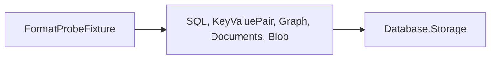

# Format-probe crash fixture design

The executable creates a real database with the selected engine, closes its initial setup, then
leaves committed catalog/root changes and stolen uncommitted physical pages in the journal.
Environment.Exit skips unwinding the live brackets. Engine tests invoke this process, preserve
all refused files byte for byte, or tear journal-covered pages and verify exact recovery.

The fixture depends on the model assemblies, which use Storage:

The fixture adds no shipped API or on-disk format. Each model test imports the common
FormatProbeTests.targets to build/copy the executable and link its test-only process helper.
