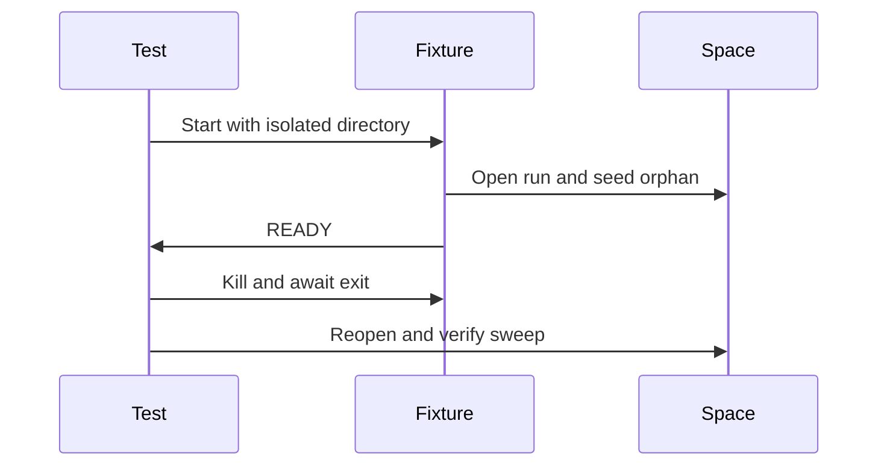

# Storage temporary-file crash fixture design

The owning Storage test starts the fixture with an isolated directory, waits for READY, kills
the process tree and waits for exit before reopening the space. A 60-second cancellation guard
bounds a broken fixture; completion depends on process output and exit, never elapsed duration.
Both the actual open run and a seeded closed orphan follow the substrate's owned filename rule.

The parent owns the child lifetime:

