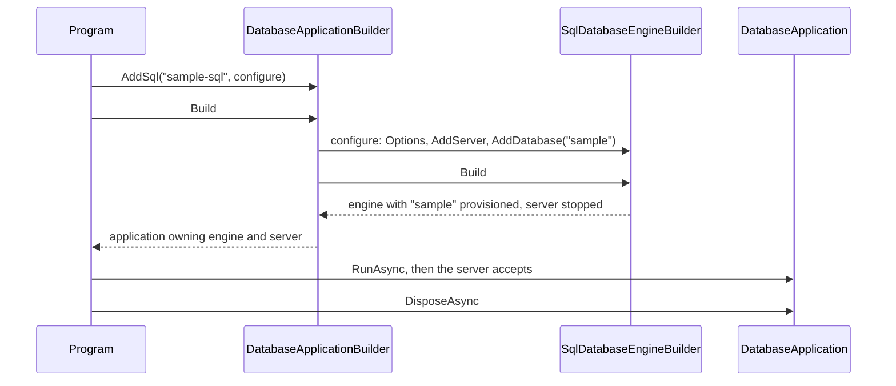

# Database sample host fixture

This non-packable acceptance fixture composes the SQL engine, its server and its one database in
its ordinary `Program.cs`, through the three composition levels of the engine extensibility design
(B1, owner decisions 49 to 59 of 2026-10-09): the application builder registers the engine
`sample-sql` with `AddSql`, the engine builder sets its options, adds its TCP server with
`AddServer(server => server.Listen(...))` and declares the database `sample`, and the database
builder declares its schema inline with `database.Schema(...)`.

That inline declaration is the one schema source. At build time the `Sdk.Database` compiler reads
it as an anchor and writes `obj/<configuration>/<framework>/cohesion/database/sample.schema.json`
and `sample.schema.sha256`. At run time the engine's build, inside application `Build()`, compiles
the same declaration, then creates or opens `sample` and provisions it before the server is
attached to a running host, so the server never accepts a connection ahead of the schema.

The fixture is owned by `Database.Testing`. The retired resource integration was removed on
2026-10-31 with the application-model restart (assimalign/cohesion#1759), and the area's resource
integration is `Assimalign.Cohesion.Database.Hosting.ApplicationModel`.

The opt-in Sample:TestHandshake=true mode reserves a loopback port in 20000-31999 through Build,
retrying occupied/reserved candidates below the platform ephemeral ranges. It releases the port
immediately before StartAsync, writes READY with its port and provisioning code/detail,
and waits for STOP on stdin before graceful shutdown. Database.Testing uses that process
handshake to verify that an older executable opens a newer schema with CS03405, preserves
newer values and serves writes using stored defaults (#1779). The ordinary mode retains RunAsync. AppendRuntimeIdentifierToOutputPath=false puts the
self-contained apphost in bin/<configuration>/net10.0 so the acceptance copy places it directly
in SampleHost/, matching the executable path the test launches. Clean output is required when
verifying the copy, so an older flat apphost cannot mask a RID-directory regression.

The sequence below shows the ordinary build and run of the fixture.

