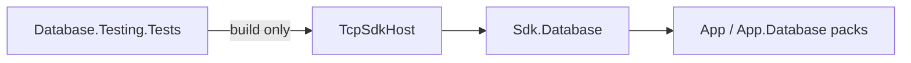

# TCP SDK acceptance fixture design

This fixture closes #1391's framework-consumer acceptance case. Its ordinary Program declares
`AddKeyValue`, `AddGraph` and `AddBlob`; each engine declares `app` and calls
`AddServer(server => server.Listen(uri))`. It imports `Assimalign.Cohesion.Database` for the
single generic TCP helper. No direct project or package reference can expose the transport
implementation to this consumer. `Sdk.Database` supplies App and App.Database and the local
feed selected by the area's generated global.json supplies their exact versions.

The test and fixture boundaries are:

The parent test build uses ReferenceOutputAssembly=false and copies the fixture's complete
self-contained output. The fixture records actual ReferencePath assembly identities after
ResolveAssemblyReferences using the existing client-canary pattern. The acceptance test requires
Database.Tcp from the App.Database reference pack, excludes Connections.Tcp from those compiler
inputs, and requires its runtime assembly next to the executable. These assertions inspect
build results rather than source text. The parent test's own TCP/project references do not flow
into the fixture's compiler inputs.

The program reserves three positive IPv4 loopback ports with BCL sockets through engine and
`app` provisioning, then releases them immediately before application startup binds the actual
listeners. This follows the existing Database.Tcp smoke's positive-resource-URI policy. The
application owns the three engines, their declared databases and nested servers. Startup through
IDatabaseApplication completes before READY is written; the test never polls ports or sleeps.

Each external DatabaseClient binds one of the exported model protocol-family singletons. Renting
a connection completes Startup, authentication and Ready. A private test-only
DatabaseProtocolExchange sends Ping and requires Pong without adding any public API. No typed
model connection exposes a Ping method, so the existing generic exchange seam owns that check.
The test then sends STOP and requires STOPPED and exit code zero. Application stop precedes
engine disposal, and every server/listener is released by its existing owner.

The process lifetime and parent operation budgets are 90-second hang guards. Cleanup gets an
independent 30-second hang guard, so cancellation does not skip graceful stop. On failure, the
parent closes stdin first and kills only the process it started if that process refuses to exit.
A separate 30-second hang guard then confirms the killed process has exited. The parent never
scans or kills other dotnet processes. No allocation, timing ratio or duration maximum
is an acceptance assertion. No product behavior, error code, storage format or wire byte changes.

Run `pwsh scripts/Install-Local.ps1 -Configuration Release -SkipLibraries` before the parent suite.
The fixture intentionally disables ApplicationModel generation and schema tooling; the original
SampleHost continues to own SQL manifests, LocalGateway, durable restart and admin-plane coverage.

All three fixture engines retain their default in-memory storage: no RootPath or storage
strategy is configured, so the process creates no persistent data directory to clean up.
