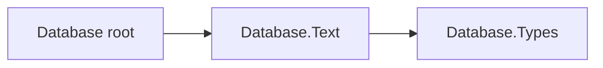

# Database.Text design (#1626)

## Ownership and scope

Text is a concrete-first child root with sealed public leaves and a single shipped
dependency, Types. The area root references Text; no inverse edge exists. Text owns
its vocabulary and exception. Storage, model, hosting, language and plugin
registration dependencies are absent.

The dependency graph preserves independent consumption:

The fixed pipeline tokenizes, optionally removes canonical accents, folds case,
and for English removes stop words and applies Porter2. `simple` is the default;
both analyzers preserve accents by default and assign weight D. Custom analyzers,
other languages, queries, ranking, canonical rendering, postings, evaluation and
bulk builds are non-goals.

## Determinism and analyzer identity

Words start with Unicode 17.0 `Lu`, `Ll`, `Lt`, `Lm`, `Lo`, `Nl` or `Nd`. Scalars
in `Mn`, `Mc`, `Me` or `Cf` continue an open word but never start one. Other
scalars separate words, including apostrophes. Adjacent letters and digits form
one token. There is no normalization before tokenization; marks remain in raw
tokens. Rune decoding refuses unpaired surrogates with `InvalidUnicode`.

Production tables come from checksum-pinned Unicode 17.0 `UnicodeData.txt`, the
same source and SHA-256 used by Types. Regenerate them with
`scripts/resources/Database/Generate-TextTokenizerData.ps1`. The generated header
cites Unicode License v3 in `docs/UNICODE_LICENSE.txt`; following Types' precedent,
that notice is currently not packed. Classification uses no runtime category tables.

Folding delegates to `Collation.CaseInsensitive.Normalize` or
`Collation.CaseAccentInsensitive.Normalize` (Types `src/Collation.cs:113-149`).
There is no culture-sensitive casing, runtime normalization, ICU or OS call.
Already-folded ASCII is an identity fast path; other casing uses Types. Exhaustive
ASCII tests run under en-US, tr-TR and el-GR. Lexemes sort by scalar order,
equivalent to UTF-8 byte order, including supplementary scalars.

Descriptors are plain values: exact case-sensitive name, any `int` version and
`FoldAccents` (default false). `Create(name, foldAccents)` selects the current
version (**1**); `Create(name, version, foldAccents)` represents every persisted
version, including zero and negatives. Resolution through `TextAnalyzer.Create`
refuses unknown names with `UnknownAnalyzer` and any unavailable version with
`AnalyzerVersionMismatch`, both as `TextException`. The caller owns persistence,
refusal and rebuilding; resolution never silently upgrades an identity.

Version 1 fingerprints are fixed rows in the tests. Future released-version rows
must remain unchanged; changed output requires a new version. Hashed inputs include
both oracle corpora, all 127 stop words, digit-bearing tokens, a 1,001-byte word and
mark-bearing words. Exact-set tests compare REL_17_11's `english.stop`. Exhaustive
hashes cover the classification bitmap (0 separator, 1 word start, 2 continuation)
and both Types normalization operations for every scalar in either token class.
Normalization hashes append the little-endian scalar, normalized UTF-8 and a zero
delimiter. These detect changes beyond the finite analysis corpus.

| Name | Version | Accent folding | SHA-256 |
|---|---|---|---|
| simple | 1 | false | `8E0247D1FB80D6A41C16D101E9635B28F271A8D86AC04C16E7960F2A8F0B55EE` |
| simple | 1 | true | `6675A595CA9070755EFA038E377AA403CFDE3D86C68AAADF4C10D8D7DCA89032` |
| english | 1 | false | `54F24E9CDC99B0EA4C9CD90D6AB739C8B50F18A52406B5DC23A229712C7CDE56` |
| english | 1 | true | `784A63ADA9E4E920DF74F682B62C75410FCF2F98279693D8344D33CAE5A44D7E` |
| Token classes | 1 | — | `CB1B5F63C7050E70BDC89FFE829288DC26E04E072C544B4FE46F4797633A0752` |
| CaseInsensitive normalization | 1 | false | `91C1D1E7FBCFB85B4A0359784B5FCDB5DF8ACB69C6D081206AF730F3E26A0095` |
| CaseAccentInsensitive normalization | 1 | true | `D9902F64D2C576C055F9408BD7152F7C9CBDE07B291910DF4E267EAD3DE60252` |

Pull requests run these expectations on Linux; Windows and macOS run on main or
manual all-OS workflows. Runtime hash codes serve only in-process value equality.

## Porter2 and the PostgreSQL oracle

The in-house C# stemmer follows PostgreSQL **REL_17_11**'s Snowball 2.2.0 generated
`src/backend/snowball/libstemmer/stem_UTF_8_english.c`: exception/suffix tables at
38–330, prelude/regions at 359–455, steps 1a–1c at 483–642, later steps at 644–867,
and orchestration at 976–1070. No stemming package or third-party vocabulary is used.

`Porter2Stemmer` uses a token-sized mutable span (stack workspace below 256 UTF-16
units, otherwise a bounded array) and immutable suffix tables. Regions are fixed
before mutation; matching chooses the longest suffix before checking its region
or preceding letter. ASCII y marking is restored afterward; non-ASCII traversal
counts scalars. Per-call flags count successful step hits without shared state.

English checks stop words before stemming without rechecking the stem. Tokens
containing any ASCII `0`–`9`, or exceeding **1,000 raw UTF-8 bytes** before folding,
bypass both operations and retain their folded form. Non-ASCII `Nd` digits do
not trigger that bypass. These follow PostgreSQL's `numword`/`int`/`uint` routing
to `simple` and `dict_snowball.c:288-292`. An empty stem keeps the input, following
`dict_snowball.c:323`. The possessive step is independently tested because the
public tokenizer separates apostrophes.

`EnglishPostgres17.tsv` contains 60,379 distinct observed dictionary pairs from
PostgreSQL **17.11**, using `postgres:17.11`. Inputs combine pinned repository
English documentation, suffix variants spread across the sorted vocabulary,
exceptions, apostrophes, all stop words and supplementary/non-ASCII cases. `{}`
marks empty dictionary results. Every implemented step has successful hit counts.
`scripts/resources/Database/Generate-TextStemmerOracle.ps1` fixes console encoding,
checks the server version, and regenerates this fixture plus the PostgreSQL
columns in `ParserPostgres17.tsv` and terminal-weight observations in
`VectorPostgres17.tsv`. Tests assert PostgreSQL agreement rows directly and
separately assert documented departure outputs. Ordinary tests need no server.
The generator's pinned vocabulary revision makes capture reproducible.

The 127 stop words equal REL_17_11
`src/backend/snowball/stopwords/english.stop:1-127`. Source headers cite and retain
Snowball v2.2.0's BSD-3 notice, stored verbatim in `docs/SNOWBALL_LICENSE.txt`.
It ships at `licenses/Database.Text/SNOWBALL_LICENSE.txt` in Text's package and
both App.Database framework packs. See [Snowball v2.2.0 COPYING](https://raw.githubusercontent.com/snowballstem/snowball/v2.2.0/COPYING).

## Tokenizer comparison with PostgreSQL 17.11

PostgreSQL has specialized URL, mail, file, host, number, markup and hyphen token
classes. Text uses letter/digit runs with mark continuations. The fixture pins
both analyzers; this table shows simple output and relevant English exceptions.

| Input | PostgreSQL simple | Text simple |
|---|---|---|
| `The QUICK brown foxes jumped 42 times` | `'42':6 'brown':3 'foxes':4 'jumped':5 'quick':2 'the':1 'times':7` | Same |
| `https://example.com/a?q=1` | `'/a?q=1':3 'example.com':2 'example.com/a?q=1':1` | `'1':6 'a':4 'com':3 'example':2 'https':1 'q':5` |
| `User.Name@example.com` | `'user.name@example.com':1` | `'com':4 'example':3 'name':2 'user':1` |
| `www.example.com` | `'www.example.com':1` | `'com':3 'example':2 'www':1` |
| `/usr/local/bin` | `'/usr/local/bin':1` | `'bin':3 'local':2 'usr':1` |
| `state-of-the-art` | `'art':5 'of':3 'state':2 'state-of-the-art':1 'the':4` | `'art':4 'of':2 'state':1 'the':3` |
| `-12 +3 4.50 1e3` | `'+3':2 '-12':1 '1e3':4 '4.50':3` | `'12':1 '1e3':5 '3':2 '4':3 '50':4` |
| `can't dog's O'Reilly` | `'can':1 'dog':3 'o':5 'reilly':6 's':4 't':2` | Same |
| `<title>Blue</title> &amp; red` | `'blue':1 'red':2` | `'amp':4 'blue':2 'red':5 'title':1,3` |
| `中文 日本語 한국어 Привет κόσμος مرحبا` | `'κόσμος':5 'привет':4 'مرحبا':6 '中文':1 '日本語':2 '한국어':3` | Same except final sigma folds to `'κόσμοσ':5` |
| `café naïve İSTANBUL Σ ς ẞ 𐐀` | `'café':1 'istanbul':3 'naïve':2 'ß':6 'ς':5 'σ':4 '𐐨':7` | `'café':1 'naïve':2 'ß':6 'İstanbul':3 'σ':4,5 '𐐨':7` |
| `abc123 ١٢٣ １２３` | `'abc123':1 '١٢٣':2 '１２３':3` | Same |
| `hello_world foo/bar foo.bar` | `'foo.bar':4 'foo/bar':3 'hello':1 'world':2` | `'bar':4,6 'foo':3,5 'hello':1 'world':2` |

Types uses Unicode default simple case folding. Its departures from simple
lowercasing include every CaseFolding C or S mapping whose target differs from
UnicodeData's simple lowercase mapping: U+00B5, U+017F, U+0345, U+03C2,
U+03D0–03D1, U+03D5–03D6, U+03F0–03F1, U+03F5, U+13F8–13FD,
U+1C80–1C88, U+1E9B, U+1FBE, U+1FD3, U+1FE3, U+AB70–ABBF and U+FB05.
Cherokee folds to uppercase, so uppercase U+13A0–13F5 also differs from
lowercasing. Dotted capital I (U+0130) has no C/S mapping and remains dotted
unless accents are removed. Capital sharp S lowers to ß in both engines and
is not a departure. No OS-specific PostgreSQL locale rules enter Text's contract.

Additional observed pins apply to both analyzers unless noted:

| Input | PostgreSQL 17.11 | Text |
|---|---|---|
| `covid19s 4wheeling mp3players` | `'4wheeling':2 'covid19s':1 'mp3players':3` | Same |
| `abc١٢٣s`, English | `'abc١٢٣':1` | Same |
| 999 `a` then `s`, English | 999 `a` at position 1 | Same |
| 1,000 `a` then `s`, English | All 1,001 bytes at position 1 | Same |
| `ȾȾ` + 2,041 `a` + `s z`, English | `'z':2` after notice | Same, silently |
| Thai `สวัสดี` | `'สวัสดี':1` | Same |
| Hindi `हिन्दी` | `'हिन्दी':1` | Same |
| Arabic `كَتَبَ` | `'كَتَبَ':1` | Same |
| Hebrew `שָׁלוֹם` | `'שָׁלוֹם':1` | Same |
| NFD `naïve`, simple / English | `'naïve':1` / `'naïv':1`, still NFD | Same |
| `二〇二四年` | `'二〇二四年':1` | Same |
| `123̈ z` | `'123̈':1 'z':2` | Same |
| `123̈abc` | `'123̈abc':1` | Same |
| Leading mark + `a`, simple / English | `'a':1` / `{}` | Same |
| `a` + U+200D + `b`, or `a` + U+20DD + `z` | One marked lexeme at position 1 | Same |
| `ſo`, English | `'ſo':1` | `{}`: folding produces stop word `so` |
| `ſo`, simple | `'ſo':1` | `'so':1` |
| `5µm` | `'5µm':1` | `'5μm':1` |
| Cherokee `ᎠᎡᎢ` | `'ꭰꭱꭲ':1` | `'ᎠᎡᎢ':1` |
| Unicode 17 U+323B0 | `{}` | `'𲎰':1`, using pinned Unicode 17 classification |

With `FoldAccents`, NFC and NFD spellings give identical lexemes and positions.
It also decomposes Hangul syllables into conjoining jamo: `한국어` becomes
`한국어` (24 bytes rather than 9). Korean lexemes roughly triple in size;
the **2,047-byte** value limit applies to the folded form.

## Value model and limits

Values snapshot their input, expose read-only collections, and implement
structural equality. Explicit lexemes are nonempty valid Unicode without nulls;
they may contain separators because explicit construction does not tokenize.
Repeated lexemes merge. Positions sort ascending and deduplicate, retaining the
highest weight; excess positions keep the earliest values. A default position is
invalid. D/C/B/A map to 0/1/2/3; all input positions must be positive.

The value limit is **2,047 UTF-8 bytes**, matching PostgreSQL's 11-bit lexeme
length field. PostgreSQL 17.11 has distinct input-path limits: its document parser
accepts raw words up to **2,046 bytes**, skipping at 2,047 without consuming a
position, and its tsvector text reader also rejects a 2,047-byte literal lexeme.
However, case folding can expand an accepted 2,046-byte raw word into a valid
**2,047-byte value**. Text preserves this distinction: the value factory admits
2,047 bytes and the analyzer applies the earlier raw-word cutoff. A normalized
word exceeding 2,047 bytes is skipped after consuming its input position.
PostgreSQL emits notices for skipped words; Text has no model diagnostics channel
and skips silently. Explicit invalid lexemes instead raise `InvalidLexeme`.

| Edge statement run against PostgreSQL 17.11 | Observed result and pinned Text behavior |
|---|---|
| `length((tsvector_to_array(to_tsvector('simple', repeat('x',2046))))[1])` | 2046; accepted |
| `to_tsvector('simple', repeat('x',2047) \|\| ' z')` | Notice; `'z':1`; skipped without a position |
| `(quote_literal(repeat('x',2047)))::tsvector` | Text reader errors at 2047, max 2046; Text models values, not this reader |
| `to_tsvector('simple', 'Ⱦ' \|\| repeat('x',2044))` (also English) | Raw 2046 bytes becomes a valid 2047-byte lexeme after folding; retained |
| `to_tsvector('simple', 'ȾȾ' \|\| repeat('x',2042) \|\| ' z')` (also English) | Raw 2046 bytes becomes 2048 after folding; skipped with notice, leaving `'z':2` |
| `'a:1A,2B,3C,4D,16382,16383,16384A,20000B'::tsvector` | `'a':1A,2B,3C,4,16382,16383`; positions clamp at 16383 |
| `'a:0'::tsvector` | Wrong position info; zero and default positions refused |
| Explicit `a:1,...,257` | 256 entries, last 256; explicit values cap at 256 |
| `to_tsvector('simple', repeat('a ',257))` | 255 entries, last 255; analyzer caps at 255 |
| `to_tsvector('english', repeat('the ',16383) \|\| ' fox fox')` | `'fox':16383`; stop-word gaps and clamping |
| 512 distinct stripped 2046-byte lexemes plus one 1023-byte lexeme | Payload 1048575; accepted; `pg_column_size` is 1050635 including directory/header |
| Same with a final 1024-byte lexeme | Error at payload 1048576; `VectorTooLarge` |

The 1 MiB limit applies to PostgreSQL's string/position area, **1,048,575 bytes**,
not the full datum including its directory. Each positioned lexeme aligns the
running payload to two bytes, then adds a two-byte count and two bytes per
position. An early lower-bound check refuses excessive input while accumulating;
the final sorted layout checks alignment exactly. No input can accumulate an
unbounded list per term: builders retain at most 256 positions (255 for analysis).

Every duplicate position retains the highest weight, including the 256th kept
position and position 16,383. This order-independent rule deliberately differs
from PostgreSQL's deterministic but unstable sort followed by early cutoff:

| Explicit input | PostgreSQL 17.11 | Text |
|---|---|---|
| `x:1,…,255 x:256B,256A` | `x:1,…,255,256B` | `x:1,…,255,256A` |
| `x:16383A,16383B,1,2,3,4,5` | `x:1,2,3,4,5,16383B` | `x:1,2,3,4,5,16383A` |

Both cases are pinned from the server. PostgreSQL's sort is deterministic across
OSes; the difference comes from unstable ordering and stopping before all terminal
duplicates have been examined.

Relevant PostgreSQL REL_17_11 sources: `src/include/tsearch/ts_type.h:43-93`
(fields/limits), `src/backend/utils/adt/tsvector.c:34-82` (position merging),
`:174-303` (reader/size checks), `src/backend/tsearch/to_tsany.c:80-150`
(analysis position cap), and `:165-227` (payload alignment/limit).

## Error model, bounds and AOT

`TextException.Code` is `UnknownAnalyzer`, `AnalyzerVersionMismatch`,
`InvalidUnicode`, `InvalidLexeme`, or `VectorTooLarge` from `TextErrorCode`.
Models translate these codes into their own diagnostics. Messages come from
`Properties/ErrorMessages.resx`. Standard argument guards handle nulls,
nonpositive positions and invalid weight values; persisted versions are values
until resolution. No internal service or reflection seam is exported.

Token workspace is bounded by the raw-word cutoff, and builders retain at most
256 positions per term (255 during analysis); a lower-bound payload check refuses
excessive retained data before final alignment checks. Allocation caps use the
minimum of five rounds and configuration-specific per-case bounds at approximately
2.5 times measured allocations, with no elapsed-time assertions.

The NativeAOT guard exercises analysis, folding (including dotted I and Deseret),
descriptor refusal and immutable values. It uses SDK-default compiler/runtime
packs and promotes IL diagnostics to errors; all five checks must pass without
IL2xxx/IL3xxx warnings. Text is synchronous, owns no background process and raises
no lifecycle events, so it has no EventSource.
