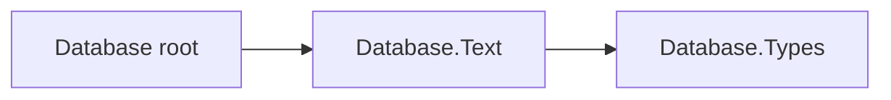

# Database.Text design (#1626, IX-T1)

## Ownership and scope

Text is a concrete-first child root (T3-20). Its public leaves are sealed and its
only shipped dependency is Types. The area root references Text; no inverse edge
exists. Text owns its exception and vocabulary. It has no storage, model, hosting,
language, plugin registration or public interface dependency.

The dependency graph preserves independent consumption:

The fixed, composable pipeline is letter/digit tokenization, optional canonical
accent removal and simple case folding, followed for English by stop-word removal
and Porter2 stemming. There are two built-in analyzers and one persisted folding
option. Custom analyzers, other languages, queries, ranking, canonical rendering,
postings, evaluation and bulk builds are outside IX-T1.

## Determinism and analyzer identity

The tokenizer recognizes `Lu`, `Ll`, `Lt`, `Lm`, `Lo` and `Nd`, frozen as 728
inclusive scalar ranges captured from .NET 10's managed Unicode classification.
It does not consult the consuming runtime's category tables or OS globalization.
The test-only `GenerateTokenizerData.ps1` reproduces the ranges using a .NET 10
PowerShell host. Rune decoding rejects unpaired surrogates with `InvalidUnicode`.
Every other scalar separates runs, including combining marks and apostrophes.
Adjacent letters and digits form one token. There is no normalization before
tokenization: `cafe` followed by a combining acute produces the lexeme `cafe`.

Folding delegates to `Collation.CaseInsensitive.Normalize` or
`Collation.CaseAccentInsensitive.Normalize` (Types `src/Collation.cs:113-149`),
reusing Types' Unicode 17 source tables. There is no current-culture casing,
runtime normalization, `CompareInfo`, ICU or OS call. Already-folded ASCII is an
identity fast path; uppercase ASCII still uses Types, and ASCII cannot have
canonical accents. An exhaustive ASCII test compares both choices with Types.
Lexemes sort by Unicode scalar order, which equals UTF-8 byte order and differs
from UTF-16 ordinal order for supplementary characters.

Descriptors persist the exact case-sensitive names `simple` and `english`, a
positive version (currently **1** for each), and `FoldAccents` (default **false**).
Unknown persisted names remain representable, including the empty name, so
resolution can return `UnknownAnalyzer`; no arbitrary identifier grammar or name
normalization is imposed. `Create` refuses a different version with
`AnalyzerVersionMismatch`. The caller owns persistence and refusal/rebuild.
No on-disk format or model version changes in this run.

Any output change to tokenization, Unicode data, folding, stop words or stemming
requires a version bump. Tests pin analyzer output over the 15-case parser corpus
and all 60,209 observed dictionary inputs, with a newline after each test-only
vector representation. SHA-256 hashes and version are adjacent in the test:

| Name | Version | Accent folding | SHA-256 |
|---|---|---|---|
| simple | 1 | false | `7F1176222B2431EDBCB234D9BAD62BF8CF16A448AAC18E7DE9B7C02DF382CBF9` |
| simple | 1 | true | `B8D667ECEA89C90C5081A585FEC37EA5A6C91FCC031DAD9DA3BF71C039573542` |
| english | 1 | false | `C85950AD855469EEE4B01E8E5A51619BF8C6473BEE8E2EC40B8F78ACE20771BE` |
| english | 1 | true | `301ED0FB1A3716424B3A9C8DBAD3287486CD71EA81F2AE1B65611A936AD206B5` |

The one-byte inclusion bitmap for every scalar from 0 through 0x10FFFF also has a
version-1 hash: `A97D3C808483919939AD80C7D898ACEC6727AB8ACA8F8CA0247F426524304E36`.
Windows, Linux and macOS CI use these same expectations; local gates additionally
exercise ARM64 and x64. Runtime hash codes are for in-process value equality and
are never a persisted analyzer fingerprint.

## Porter2 and the PostgreSQL oracle

The stemmer is in-house C#, with no stemming package or third-party vocabulary
file. It follows PostgreSQL **REL_17_11**'s Snowball 2.2.0 English generated C,
`src/backend/snowball/libstemmer/stem_UTF_8_english.c`: exception and suffix tables
at lines 38-330, prelude/regions at 359-455, steps 1a-1c at 483-642, later steps
at 644-867, and orchestration at 976-1070. The local reference clone's working
tree has Snowball 3.0.0 and is deliberately not the compatibility target.

`Porter2Stemmer` uses a token-sized mutable span (stack workspace below 256 UTF-16
units; otherwise a bounded array) and immutable suffix tables. Regions are fixed
before suffix mutation; matching chooses the longest suffix before its region or
preceding-letter condition is tested. ASCII `y` marking is restored afterward;
non-ASCII scalar traversal still agrees with the UTF-8 algorithm. Internal,
per-invocation flags count actual step hits without shared instrumentation state.
The public analyzer removes stop words before stemming and does not recheck the
stem against the list. The stemmer's possessive step is independently tested even
though the public tokenizer separates apostrophes.

`EnglishPostgres17.tsv` contains 60,209 distinct word/result pairs observed with
`ts_lexize('english_stem', word)` on PostgreSQL 17.11 (container `postgres:17`,
aarch64 Debian). Inputs combine repository English documentation and generated
suffix variants, exceptions, apostrophes and supplementary/non-ASCII cases.
Empty results represent stop words. `GenerateOracle.ps1` captures the pairs;
ordinary tests consume them without a server. The generator reads documentation at
base `c9ac0df64`, reproducing the captured file byte-for-byte. Every implemented algorithm step
has nonzero successful hit counts in the differential test.

The English list is the 127 Snowball entries from PostgreSQL
`src/backend/snowball/stopwords/english.stop:1-127`. Both the stemmer source and
stop-list source retain the Snowball BSD-3 notice. The complete notice ships as
`SNOWBALL-LICENSE.txt` in the Text NuGet package and in the Database Ref/Runtime
framework packages. See the
[Snowball license](https://snowballstem.org/license.html). No generated C file or
third-party vocabulary file is vendored.

## Tokenizer comparison with PostgreSQL 17.11

PostgreSQL's parser has specialized URL, mail, file, host, number, markup and
hyphen token classes. IX-T1 intentionally uses letter/digit runs. All cases below
are pinned for both analyzers in `ParserPostgres17.tsv` and were observed using
`to_tsvector` and `ts_debug('english', input)`. The table shows `simple` output;
the fixture also pins English stop-word gaps and stems.

| Case and input | PostgreSQL `simple` | Text `simple` |
|---|---|---|
| Plain: `The QUICK brown foxes jumped 42 times` | `'42':6 'brown':3 'foxes':4 'jumped':5 'quick':2 'the':1 'times':7` | Same |
| URL: `https://example.com/a?q=1` | `'/a?q=1':3 'example.com':2 'example.com/a?q=1':1` | `'1':6 'a':4 'com':3 'example':2 'https':1 'q':5` |
| Email: `User.Name@example.com` | `'user.name@example.com':1` | `'com':4 'example':3 'name':2 'user':1` |
| Host: `www.example.com` | `'www.example.com':1` | `'com':3 'example':2 'www':1` |
| Path: `/usr/local/bin` | `'/usr/local/bin':1` | `'bin':3 'local':2 'usr':1` |
| Hyphen: `state-of-the-art` | `'art':5 'of':3 'state':2 'state-of-the-art':1 'the':4` | `'art':4 'of':2 'state':1 'the':3` |
| Signed, decimal, exponent: `-12 +3 4.50 1e3` | `'+3':2 '-12':1 '1e3':4 '4.50':3` | `'12':1 '1e3':5 '3':2 '4':3 '50':4` |
| Apostrophes: `can't dog's O'Reilly` | `'can':1 'dog':3 'o':5 'reilly':6 's':4 't':2` | Same |
| XML/entity: `<title>Blue</title> &amp; red` | `'blue':1 'red':2` | `'amp':4 'blue':2 'red':5 'title':1,3` |
| Non-Latin: `中文 日本語 한국어 Привет κόσμος مرحبا` | `'κόσμος':5 'привет':4 'مرحبا':6 '中文':1 '日本語':2 '한국어':3` | Same except final sigma folds: `'κόσμοσ':5` |
| Marks/casing: `café naïve İSTANBUL Σ ς ẞ 𐐀` | `'café':1 'istanbul':3 'naïve':2 'ß':6 'ς':5 'σ':4 '𐐨':7` | `'cafe':1 'naïve':2 'ß':6 'İstanbul':3 'σ':4,5 '𐐨':7` |
| Letter/digits: `abc123 ١٢٣ １２３` | `'abc123':1 '١٢٣':2 '１２３':3` | Same |
| Separators: `hello_world foo/bar foo.bar` | `'foo.bar':4 'foo/bar':3 'hello':1 'world':2` | `'bar':4,6 'foo':3,5 'hello':1 'world':2` |

Types uses Unicode default simple folding: final sigma joins sigma, dotted capital
I stays dotted unless accents are removed, sharp S folds to sharp s without an
`ss` expansion. These recorded departures from PostgreSQL's lowercase operation
are necessary to reuse Types' pinned contract. No operating-system-dependent
PostgreSQL locale semantics are imported.

## Value model and limits

Values snapshot their input, expose read-only collections, and implement
structural equality. Explicit lexemes are nonempty valid Unicode without nulls;
they may contain separators because explicit construction does not tokenize.
Repeated lexemes merge. Positions sort ascending and deduplicate, retaining the
highest weight; excess positions keep the earliest values. A default position is
invalid. D/C/B/A map to 0/1/2/3; all input positions must be positive.

The value limit is **2,047 UTF-8 bytes**, matching PostgreSQL's 11-bit lexeme
length field. PostgreSQL 17.11 has distinct input-path limits: its document parser
accepts raw words up to **2,046 bytes**, skipping at 2,047 without consuming a
position, and its tsvector text reader also rejects a 2,047-byte literal lexeme.
However, case folding can expand an accepted 2,046-byte raw word into a valid
**2,047-byte value**. Text preserves this distinction: the value factory admits
2,047 bytes and the analyzer applies the earlier raw-word cutoff. A normalized
word exceeding 2,047 bytes is skipped after consuming its input position.
PostgreSQL emits notices for skipped words; Text has no model diagnostics channel
and skips silently. Explicit invalid lexemes instead raise `InvalidLexeme`.

| Edge statement run against PostgreSQL 17.11 | Observed result and pinned Text behavior |
|---|---|
| `length((tsvector_to_array(to_tsvector('simple', repeat('x',2046))))[1])` | 2046; accepted |
| `to_tsvector('simple', repeat('x',2047) \|\| ' z')` | Notice; `'z':1`; skipped without a position |
| `(quote_literal(repeat('x',2047)))::tsvector` | Text reader errors at 2047, max 2046; Text models values, not this reader |
| `to_tsvector('simple', 'Ⱦ' \|\| repeat('x',2044))` (also English) | Raw 2046 bytes becomes a valid 2047-byte lexeme after folding; retained |
| `to_tsvector('simple', 'ȾȾ' \|\| repeat('x',2042) \|\| ' z')` (also English) | Raw 2046 bytes becomes 2048 after folding; skipped with notice, leaving `'z':2` |
| `'a:1A,2B,3C,4D,16382,16383,16384A,20000B'::tsvector` | `'a':1A,2B,3C,4,16382,16383`; positions clamp at 16383 |
| `'a:0'::tsvector` | Wrong position info; zero and default positions refused |
| Explicit `a:1,...,257` | 256 entries, last 256; explicit values cap at 256 |
| `to_tsvector('simple', repeat('a ',257))` | 255 entries, last 255; analyzer caps at 255 |
| `to_tsvector('english', repeat('the ',16383) \|\| ' fox fox')` | `'fox':16383`; stop-word gaps and clamping |
| 512 distinct stripped 2046-byte lexemes plus one 1023-byte lexeme | Payload 1048575; accepted; `pg_column_size` is 1050635 including directory/header |
| Same with a final 1024-byte lexeme | Error at payload 1048576; `VectorTooLarge` |

The 1 MiB limit applies to PostgreSQL's string/position area, **1,048,575 bytes**,
not the full datum including its directory. Each positioned lexeme aligns the
running payload to two bytes, then adds a two-byte count and two bytes per
position. An early lower-bound check refuses excessive input while accumulating;
the final sorted layout checks alignment exactly. No input can accumulate an
unbounded list per term: builders retain at most 256 positions (255 for analysis).

Duplicate weights follow PostgreSQL's terminal cutoff too: after reaching a new
maximum position or the count limit, the first weight there is retained. A sole
position still merges all duplicate weights. Text retains stable input order
within duplicate groups, avoiding an OS-dependent sorting tie-breaker.

Relevant PostgreSQL REL_17_11 sources: `src/include/tsearch/ts_type.h:43-93`
(fields/limits), `src/backend/utils/adt/tsvector.c:34-82` (position merging),
`:174-303` (reader/size checks),
`src/backend/tsearch/to_tsany.c:80-150` (analysis position cap), and `:165-227`
(payload alignment/limit).

## Error model, work and AOT

`TextException.Reason` is one of `UnknownAnalyzer`, `AnalyzerVersionMismatch`,
`InvalidUnicode`, `InvalidLexeme`, or `VectorTooLarge`. There is no Database
diagnostic-code prefix. Model runs translate reasons to their own diagnostics.
Messages come from generated `Properties/ErrorMessages.resx`. Standard argument
guards handle nulls, nonpositive versions/positions and invalid weight values.
No internal service or reflection seam is exported.

Scanning is linear in input scalars with a fixed-size range-table binary search;
normalization/stemming operate only on bounded tokens. Each stemmer step searches
a constant suffix set. Position insertion is bounded by 256 entries; dictionary
terms sort once at the end. An overlong token needs constant workspace even for
a million characters. The early vector bound limits retained distinct-term data.

Allocation tests use the minimum of **five** rounds, never elapsed time. On
ARM64 Debug the mixed 4096-token corpus improved from 942/958 bytes per token
(simple/English without accents) and 2094/2110 (with accents) to 246/262 and
498/514 respectively, with a 1600-byte test ceiling for this fixed corpus across
architectures. Distinct-term corpora retain under 394 bytes per token at 1024 and
2048 terms, with a 1024-byte ceiling. Stemming allocates 36 bytes per token on its suffix corpus; the
test ceiling is 256. Skipping a million-character word allocates 112 bytes total,
with a 1024-byte ceiling. Release on both ARM64 and x64 measures 102 bytes per token
for simple and 118 for English, with either accent option; the same five-round
bounds pass in Debug and Release on both architectures. NativeAOT's invariant-globalization guard exercises the
same managed code and requires all five checks to pass with no IL2xxx/IL3xxx
warnings. Text is a pure synchronous value library and raises no lifecycle events;
it owns no EventSource or background process.

The new guard pins compiler/runtime packs 10.0.14 because SDK 10.0.401's default
10.0.12 compiler produces NU1903 (CVE-2026-111497). This is local to the new sample;
updating the shared SDK/other samples is outside IX-T1's edit scope.
