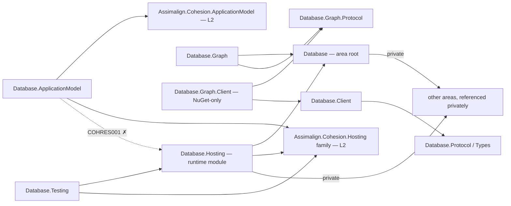

# Cohesion Data Platform (`resources/Database/`)

The multi-model OLTP database engine family for Cohesion: five independent database engines — **SQL**, **Documents**, **Graph**, **Blob**, and **KeyValuePair** — sharing one durable kernel (storage, write-ahead logging, transactions, indexing). A hosted database is an ordinary customer-owned `Sdk.Database` executable whose `Program.cs` composes its engines, code-first schema, servers, and provisioning. See [DESIGN.md](../../docs/resources/Database/DESIGN.md) for the architecture, requirements, and decision log; sequencing lives in [docs/programs/DATABASE_PROGRAM_PLAN.md](../../docs/programs/DATABASE_PROGRAM_PLAN.md).

## Storage corruption diagnostics (#1160)

`DatabaseCorruptionException` with `CK06003` is the area-wide signal for damaged storage,
including corruption wrapped in coded engine exceptions or an `AggregateException`. It names
the database and affected page and retains the storage cause. When open is refused, an engine
also includes its previous model diagnostic as an additional entry: Graph `CG06018`,
Documents `CD06103`, and Blob `COHDBB004` retain their unrecoverable-files diagnosis. Existing
coded diagnostics are preserved too. Wire consumers can recognize either the common corruption
signal or the model code; a damaged read never becomes a successful result with data omitted.

## Area root, child roots, and model families

`Assimalign.Cohesion.Database` is the **area root**. It holds only what is true of
every model: engine, database, session, and transaction contracts; the provisioning
seam and compiled-schema identity; object ownership; value objects; and exceptions.
It composes the **child roots** `Types`, `Language`, `Storage`, `Transactions`,
`Indexing`, `Execution`, `Protocol`, and `Security`. The dependency
arrow always points **root → child**; a child root never references the area root.

**A project whose name contains a model segment — `*.Sql.*`, `*.Documents.*`,
`*.Graph.*`, `*.Blob.*`, or `*.KeyValuePair.*` — is a model family member. It owns
its model's vocabulary; engines inherit the area root, while Protocol and language packages remain independent.** Relational tables, document
collections, graph edges, and blob containers live in their model family, never in
the area root.

The placement test is: *if a different model would need a different shape of it,
it is not root material.* The object-ownership contract (`DatabaseObjectOwner`,
`DatabaseObjectLockedException`) is root material, because four model catalogs persist it; a
compiled schema is not, because its shape is the model's (the root's former `CompiledSchema`
left in B1, owner decision 50 of 2026-10-09). The root previously carried the relational schema
model; feature A3 in [DATABASE_MVP_FEATURES.md](../../docs/programs/DATABASE_MVP_FEATURES.md)
moved it into `Database.Sql.Schema`. That package supplies SQL declarations,
compilation, canonical serialization, and migration planning, independently of the
SQL engine. The SDK build task consumes this thin package without referencing the
SQL engine or transports.

`DatabaseObjectOwner` distinguishes code-first `Schema` objects from `Adhoc`
objects. SQL persists ownership and refuses session DDL that alters or drops a
schema-owned object; only compiled-schema provisioning may change it. Ad-hoc
objects remain fully mutable through ad-hoc statements.

## Project map

An arrow means "references": `Database.Hosting --> Database` reads
`Database.Hosting` references `Assimalign.Cohesion.Database`.

Solid edges are the references this area permits. The dotted edge is the one `COHRES001`
rejects: **no library in the area may reference its own `Database.Hosting` runtime
module**, and the declarative `.ApplicationModel` package in particular never does — generated
code in an opted-in consumer executable joins the two sides at run time through
`Assimalign.Cohesion.Hosting.Resources.ResourceRuntime` instead. The area root and its feature
libraries likewise reference no `Assimalign.Cohesion.Hosting*` library at all (`COHRES004`).

`Database.Testing → Database.Hosting` is the one solid edge that crosses that line, and it is the
area's **single sanctioned exemption**: the test factory drives the concrete runtime, which cannot
be done through abstractions alone, so the project declares
`CohesionHostingIsolationExemptions` in its own csproj. Nothing else in the area may, and a second
holder needs the deviation protocol in `.claude/rules/deviations.md`.

The diagram is the area's **spine** — the root, the runtime module, the hosting-family
integrations, the declarative plane, and the client and test packages. The area has more
projects than one readable diagram holds; the table below and `docs/DEPENDENCIES.md` carry
them all.

The full reference graph for every Cohesion assembly, including the exact external dependencies
collapsed above, is in [docs/DEPENDENCIES.md](../../docs/DEPENDENCIES.md).

## Layering

In the repo's L1/L2/L3 model (see `docs/programs/DELIVERY_ROADMAP.md`), this area is **L3.2 — Data Platform**: a service platform built on the L1 foundation libraries (`Core`, `Connections`, `Hosting`, `Security`) and the L2 application runtime (`ApplicationModel`). It ships to consumers through the `Assimalign.Cohesion.Sdk.Database` MSBuild SDK and the `Assimalign.Cohesion.App.Database` shared framework.

## Project catalog

### Kernel (shared by every model)

| Project | Role |
|---|---|
| `Assimalign.Cohesion.Database` | Area root: engine/database/session/transaction contracts and, since phase 3 of the concrete-types plan, the abstract bases that replace them (`DatabaseEngine`, `DatabaseInstance`, `DatabaseSession`, `DatabaseExecutionSession<TRequest>`, `DatabaseLanguageSession<TRequest>`, `DatabaseTransaction`, `DatabaseServer`, `DatabaseServerSession`), exceptions, application composition, and object ownership (no schema type since B1) — **rolls up the child roots** (`Types`/`Language`/`Storage`/`Transactions`/`Execution`/`Indexing`/`Protocol`/`Security`; child roots never reference the root) |
| `Assimalign.Cohesion.Database.Storage` | Child root — pages, buffer pool, free-space map, journal (WAL), recovery, backup |
| `Assimalign.Cohesion.Database.Transactions` | Child root — MVCC snapshots, isolation levels, lock manager, transaction log seam, `TransactionId`/`TransactionState` |
| `Assimalign.Cohesion.Database.Indexing` | Order-preserving key encoding, B+Tree/hash index contracts, cursors (child root; rolled up by the root) |
| `Assimalign.Cohesion.Database.Types` | Child root — shared scalar type system: identity, comparison/collation, binary encoding |
| `Assimalign.Cohesion.Database.Execution` | Child root — model-neutral request/result families (Types-only dependency) (`DatabaseRequest`, `DatabaseResult`, `DatabaseResultSet`, `DatabaseRow`) |
| `Assimalign.Cohesion.Database.Language` | Child root — shared lexer/parser and diagnostic-production infrastructure; diagnostic value types live in Types |
| `Assimalign.Cohesion.Database.Memory` | In-memory storage strategy (tests, embedded scenarios) |

### Model engines

The root session has lifecycle, state and transactions. Sql, Documents and Graph use
`DatabaseLanguageSession<TRequest>`; KeyValuePair uses `DatabaseExecutionSession<KeyValueRequest>`
with an internal wire parser, and Blob has no execute member.

Each model owns its engine, catalog, storage and future model-specific security in one project. Public Catalog and Storage types keep their namespaces in `src/Catalog/` and `src/Storage/`; internals live in `src/Internal/Catalog/` and `src/Internal/Storage/`. The code dependency direction remains engine → Catalog → Storage → shared kernel, enforced by a Roslyn architecture test in each model suite. `.Language` (where implemented), `.Protocol`, `.Client`, SQL `.Schema` and optional `.Tcp` remain separate projects. (The empty `.Replication` satellites and the shared `Database.Replication` and `Database.Governance` placeholders were deleted with #1257; replication returns as its own design when it is built.)

`src/Internal/Engine/Storage/` holds engine persistence composition: storage strategies,
catalog-aware glue, and engine row/entry codecs. These types may use Catalog and engine types.
Transaction record-space adapters and their physical location-packing helpers belong to the
Storage layer (`src/Internal/Storage/`, or nested inside a public Storage type), since they bind
physical records to the shared transaction kernel without engine dependencies. The architecture
test enforces both adapter and strategy placement across all five implemented models. This
refines the original fold's folder map without changing namespaces or public members.

The guard also checks each referenced type's containing assembly. Storage permits only the
shared `Database.Storage`, `Database.Transactions`, `Database.Indexing` assemblies
plus the BCL from the actual `Microsoft.NETCore.App` reference pack. Graph Storage also permits
`Database.Types` for index keys, historically reached through Indexing. Catalog permits those plus
the area root and `Database.Types`. Protocol, Language, Schema and Connections remain disallowed. The allowlists were seeded from
the retired Storage/Catalog project references at `a64426436` and checked against current symbol
usages. Engine code has no external-assembly restriction. Cache has no component source, so its
architecture test is deferred until implementation.

| Model | Root project | Notes |
|---|---|---|
| SQL | `Assimalign.Cohesion.Database.Sql` | Ships the SQL engine, compiled-schema migration renderer/provisioner, the model's wire-protocol server (`SqlDatabaseServer`), its model builder verbs and a reference to Sql.Protocol for the protocol family; declared dialect in `Sql.Language`; includes its Catalog and Storage components |
| TCP composition | `Assimalign.Cohesion.Database.Tcp` | Generic `Listen(Uri)` for all five model options; references Database and Connections.Tcp while engines stay transport-independent |
| SQL schema | `Assimalign.Cohesion.Database.Sql.Schema` | Thin SQL schema declarations, compiled relational object shapes, canonical serialization, validation, and migration planning; shared by SQL and SDK Tasks, with direct references only to the area root and `Database.Types` |
| Documents | `Assimalign.Cohesion.Database.Documents` | Session-bound JSON document engine, OQL query/index-DDL planning and execution, collection ownership, transactional index management and a database-bound wire server; includes its Catalog and Storage components |
| Documents client | `Assimalign.Cohesion.Database.Documents.Client` | NuGet-only pooled OQL rows/documents, versioned CRUD, collection commands and coded diagnostics |
| Documents language | `Assimalign.Cohesion.Database.Documents.Language` | Declared OQL query/index-DDL subset, AST, diagnostics, and conformance corpus |
| Graph | `Assimalign.Cohesion.Database.Graph` | Durable graph engine, bounded traversal and path execution, database-bound sessions, transport-neutral `GraphDatabaseServer`, and root-builder composition; includes its Catalog and Storage components |
| Graph client | `Assimalign.Cohesion.Database.Graph.Client` | [NuGet-only typed client](Assimalign.Cohesion.Database.Graph.Client/docs/OVERVIEW.md) referencing only Database.Client, Graph.Protocol, Database.Types, Database.Protocol and Connections; scalar GQL results, graph mutations, `SHOW`, and streams of complete graph paths |
| Graph language | `Assimalign.Cohesion.Database.Graph.Language` | Executable ISO/IEC 39075 GQL subset, pattern AST, diagnostics, and conformance corpus |
| Blob | `Assimalign.Cohesion.Database.Blob` | Streaming blob and container API, database-bound sessions, transport-neutral `BlobDatabaseServer`, engine lifecycle, and ownership enforcement over the shared kernel; no `.Language` project; includes its Catalog and Storage components |
| Blob client | `Assimalign.Cohesion.Database.Blob.Client` | [Typed streaming client](Assimalign.Cohesion.Database.Blob.Client/docs/OVERVIEW.md) over shared connection pooling and handshake; bounded upload/download, delete, properties, and prefix listing |
| Blob streaming fixture | `Assimalign.Cohesion.Database.Blob.StreamingFixture` | Non-packable process fixture under `Blob/fixtures/`, exercised by Blob tests to verify bounded-memory streams and crash recovery |
| Blob wire streaming fixture | `Assimalign.Cohesion.Database.Blob.Client.StreamingFixture` | Non-packable process fixture under `Blob.Client/fixtures/`; transfers 256 MiB through the real client/server over InMemory with a 64 MiB managed heap |
| KeyValuePair | `Assimalign.Cohesion.Database.KeyValuePair` | **Delivered** — ordered key space on the shared kernel (index-primary composition, etag CAS) and the model's wire-protocol server (`KeyValueDatabaseServer`); command grammar in `docs/COMMANDS.md`; no `.Language` project; includes its Catalog and Storage components |
| Cache | `Assimalign.Cohesion.Database.Cache` | Post-MVP; deferred behind KeyValuePair |

### Model wire contracts

| Project | Role |
|---|---|
| `Assimalign.Cohesion.Database.Sql.Protocol` | Single owner of Sql wire messages, codecs, model family and transfer DTOs; independently consumed by engine and client |
| `Assimalign.Cohesion.Database.Graph.Protocol` | Single owner of Graph wire messages, codecs, model family and transfer DTOs; independently consumed by engine and client |
| `Assimalign.Cohesion.Database.Documents.Protocol` | Single owner of Documents wire messages, codecs, model family and transfer DTOs; independently consumed by engine and client |
| `Assimalign.Cohesion.Database.KeyValuePair.Protocol` | Single owner of KeyValuePair wire messages, codecs, model family and transfer DTOs; independently consumed by engine and client |
| `Assimalign.Cohesion.Database.Blob.Protocol` | Single owner of Blob wire messages, codecs, model family and transfer DTOs; independently consumed by engine and client |

Each implemented remote client references its model Protocol and shared Client/Protocol/Types/Connections; Documents.Client also references Execution. No remote client references an engine or the area root. The six client exceptions derive directly from System.Exception and retain local read-only Diagnostics snapshots. COHDBCLIENT001 protects this boundary in both project and resolved-reference layers. Cache.Client remains empty.

### Service surface, hosting, orchestration

| Project | Role |
|---|---|
| `Assimalign.Cohesion.Database.Protocol` | Child root — framing, handshake, lifecycle, errors, version negotiation, and immutable model-family binding |
| `Assimalign.Cohesion.Database.Client` | Shared client core: connection settings, pooling, handshake, framing, and model-exchange lifetime; model clients materialize results |
| `Assimalign.Cohesion.Database.Security` | Child root — the authentication contract (`DatabaseAuthenticator`, an abstract base the application implements, and its `AllowAll`) |
| `Assimalign.Cohesion.Database.Hosting` | Host composition (`Host<TContext>`), the area's only DI seam; implements `DatabaseApplication.CreateBuilder(args)`, which honors an enabled executable's ambient `Hosting.Resources` `ResourceContext` and generated default-control-plane registration and stays plain otherwise. Every model engine opens or creates the databases its builder declares (a SQL engine also provisions their schemas) inside application Build, so they exist before any server accepts. The internal admin service privately hosts `Web.Hosting` + `Web.Health` for health, readiness, liveness, endpoint observation, commands, and graceful stop. |
| `Assimalign.Cohesion.Database.ApplicationModel` | Manifest-backed `DatabaseResource : PlannedResource`, `AddDatabase(manifest, options)`, the platform-neutral Database planner (stable identity, sized per-replica volume claims, one headless governing service), and the Database default-control-plane factory registered by generated executable code through `Hosting.Resources` |
| `Assimalign.Cohesion.Database.Testing` | The area's sole hosting-isolation exemption holder; `DatabaseApplicationTestFactory.FromProgram<Program>()` runs the resource's real entry point inside `Hosting.Resources` `ResourceRuntime.CreateScope(...)`, waits on the `admin` control plane, and stops it through the graceful control-plane path |
| `resources/Database/Assimalign.Cohesion.Database.Testing/fixtures/Assimalign.Cohesion.Database.SampleHost` | Non-packable `Sdk.Database` executable with `CohesionApplicationModel=enabled` and build-time schema compilation; composes a SQL table/index schema and the TCP server in `Program.cs`, provisions that compiled schema before accept, and supplies the real-process E2E apphost (`ReferenceOutputAssembly=false`) |
| `Assimalign.Cohesion.Database.Embedded` | In-process consumption facade — how other platform resources embed their data layer |

## Dependencies on other areas

- `libraries/Core` — foundational primitives (everywhere)
- `libraries/Hosting/Assimalign.Cohesion.Hosting` — host lifecycle and the per-service execution
  menu exposed by the concrete `DatabaseApplicationBuilder.AddService` verb in
  `Database.Hosting`. The Database root and feature libraries reference no hosting library (O34).
- `libraries/Hosting/Assimalign.Cohesion.Hosting.Resources` — the opt-in resource runtime,
  context, control-plane, and protected-mount contracts used by enabled executables and
  `Database.ApplicationModel`
- `libraries/Hosting/Assimalign.Cohesion.Hosting.Health` — transport-neutral health contribution
  contracts used by `Database.Hosting` and its default control plane
- `libraries/Connections` — transport drivers for the per-model servers (`Database.Sql`'s `SqlDatabaseServer`, and every future model's server)
- `libraries/ApplicationModel` — orchestration contracts (`Database.ApplicationModel` only)
- `resources/Web` — private implementation details: the root's existing Web dependency plus
  `Web.Hosting`/`Web.Health` in `Database.Hosting` for the `admin` control plane. The coordinated
  `CohesionPrivateProjectReference`/`CohesionFrameworkPrivateAssembly` path keeps that closure in
  the `App.Database` runtime pack and out of its reference surface.

## Building

The area solution is `Assimalign.Cohesion.Database.slnx`. Individual projects build with `dotnet build <project>` (build `build/Tasks` first in a fresh clone/worktree so the custom MSBuild tasks exist).
