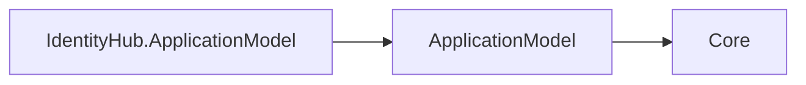

# Assimalign.Cohesion.IdentityHub.ApplicationModel — Design

## Intent

IdentityHub owns its platform-neutral orchestration decisions without owning platform
objects. An enabled `Sdk.IdentityHub` executable produces the generic resource manifest;
this package validates its area shape and turns it into `cohesion/plan/v1` at application
build time.

## Planner contract

`IdentityHubResource` is a `PlannedResource` whose diagnostic name is `IdentityHub
planner`. The planner requires kind `IdentityHub`, a `StatefulSet`, an HTTPS-over-TCP
endpoint named `https`, and exactly one persistent `data` Volume. Generic planning must
then produce one stable replica, a sized per-replica claim, one HTTPS service, and one
portless headless governing service. Additional endpoints and non-persistent Configuration
or Secret mounts remain legal generic traits. Scaling is rejected until IdentityHub
defines a replication protocol.

`IdentityHubResourceOptions.Storage.Size` may replace the manifest claim size. Endpoint
ports, paths, exposure, mounts, and lifecycle defaults remain manifest facts.

## Runtime manifest boundary

The producer supplies runtime metadata; this package preserves it without referencing runtime types. The SDK registers the generic control plane in the executable. Producer manifests contain no command catalog or state declarations; configured runtime handlers provide the live state contracts.

This package describes resource manifests, dependencies and deployment plans. Its only direct Cohesion dependency is ApplicationModel, whose contracts depend only on Core. Sdk.ApplicationModel generates control-plane registration in the enabled resource executable; Hosting.Resources and the resource host own the runtime surface and apply the deployment record. The gateway observes infrastructure and delivers the record.

## Non-goals

- Hosting IdentityHub endpoints or implementing identity protocols.
- Defining token, claim, session, credential, or JWK models.
- Adding gateway implementation dependencies to the guarded declaration package.
- Carrying Kubernetes, Docker, or other platform objects.

## Declarative commands (item 31c)

| Wire kind | Descriptor verb | Ownership key |
|---|---|---|
| `identityhub.add-audience` | `AddAudience` | audience name |
| `identityhub.add-client` | `AddClient` | client id |

Kinds use verb-noun kebab under the area prefix. The examples `rezolvr.record` and
`identityhub.audience` in developer-experience design section 7 are illustrative; item 27's design
rewrite should reflect the landed convention. Producer manifests no longer carry command catalogs; the existing command delivery surface is separate from runtime state management.
Typed verbs validate argument shape and use source-generated JSON metadata. Build validates the
advertised kind, canonical payload, deterministic id, and uniqueness of the target ownership key.
The default control plane handles id replay and owner isolation; each area handler also accepts
an identical reapplication with a different id. Conflicts return named Rejected details.

The typed IIdentityHubResourceDescriptor retains its command surface through DependsOn chaining.
Audience and client commands are registered on the default control plane and served by the existing
authenticated API endpoint, with POST/DELETE and JSON refusal observations. Owner must equal the
authenticated application issuer; transport and bootstrap-token verification are unchanged.

The command registry is written atomically to `registry.json` beside IdentitySigningKey under the
resource data path. Startup restores the registry and control-plane ownership before serving.
Token issuance reads the live combined registry of builder-declared and command-declared clients;
discovery and JWKS remain the same issuer surface. Audience removal is rejected while a client uses it.

Client credentialSource names a resource Secret mount, optionally prefixed with `mount:`. The
declaration stores the mount name, never credential bytes. Hosting reads and hashes the mounted
credential when initializing or updating the registry, so restart requires the mount again.
Clients must reference existing audiences; add the audience before the client. Conflicting resource
seeds or changed client declarations are rejected until the owning declaration is deleted.

## Runtime-independent dependency direction

