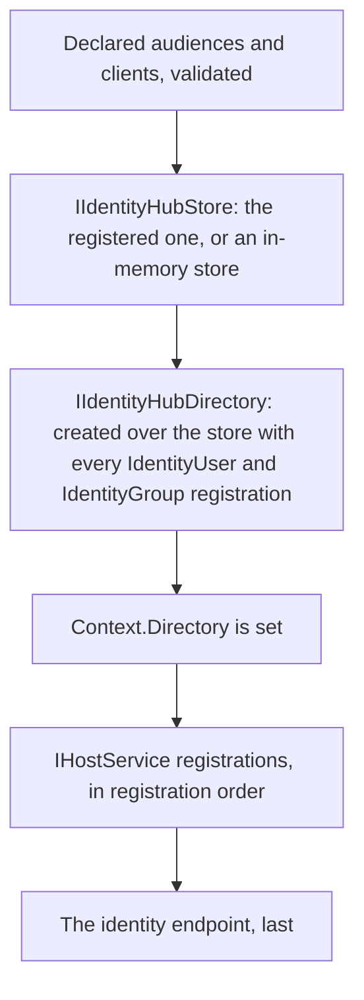

# Assimalign.Cohesion.IdentityHub.Hosting Design

## Issuer runtime

`Local` is the developer-machine environment. `Development` is a deployable environment and follows the same transport and device-approval restrictions as `Production`; an unset environment still resolves to `Production`.

Every built host registers one internal HTTP issuer after user services. The endpoint is resolved from `--endpoint`, then `https://127.0.0.1:8443`. State is resolved from `--data`, then the content root. Plain HTTP is permitted only on loopback in Local.

The issuer exposes public OpenID Provider metadata, JWKS, and token endpoints. It accepts exactly the implemented `openid` scope or an empty scope and returns `invalid_scope` for every other client-controlled value. Client authentication accepts exactly one of HTTP Basic or form credentials, constrains the requested `audience`/`resource` to the registration, and issues ES256 bearer JWTs. Confidential clients authenticate at device authorization and polling as well as for client credentials.

Device authorization and the built-in verification page are available only when the issuer itself binds to loopback in Local. High-entropy device codes, human-readable user codes, a ten-minute lifetime, pending polling, one-shot consumption, and an ID token when `openid` was requested remain supported there. The page has no client-selected subject: every local approval signs in the fixed `development-user` identity, checks a supplied browser origin when present, and sets restrictive cache headers; its framing, referrer, and content-security headers are the ones every IdentityHub response carries (see below). Discovery omits the device endpoint and grant outside that Local mode. Production account login, consent, recovery, federation, and subject selection require a separately authenticated user-flow implementation.

## Keys and tokens

The data directory contains one persisted P-256 PKCS#8 signing key. Creation uses an atomic same-directory move and owner-only permissions on Unix. JWKS publishes only public `EC`/`P-256`/`ES256` coordinates; `kid` is the RFC 7638 SHA-256 thumbprint of canonical public members. Token creation uses IdentityModel's `JsonWebTokenWriter`. Signing is serialized because the ECDSA instance is shared.

An ephemeral self-signed certificate is allowed only on loopback in Local; every other HTTPS binding fails closed with an explicit configuration error. TLS material is always distinct from the issuer signing key.

Issued access tokens contain `iss`, `sub`, `aud`, `iat`, `nbf`, `exp`, `jti`, `client_id`, and token-use metadata. The configured lifetime is capped at 24 hours.

## Resource integration

This module references no application-model library. The old application model's integration, `Assimalign.Cohesion.IdentityHub.Hosting.ApplicationModel` (`builder.Services.AddResource(...)`), was removed with the old model, and its replacement is the resource-provider design in `fabric/`.

## AOT and dependency boundary

Hosting privately composes Cohesion Web/HTTP/connection libraries and the shared IdentityModel JWT implementation. Routes use direct dispatch and `Utf8JsonWriter`; there is no reflection-based routing, serializer metadata discovery, or dynamic activation.

Security headers come from `Web.SecurityHeaders`, registered first in the private pipeline: every response, JSON and the Local device-approval page alike, carries `Content-Security-Policy: default-src 'none'; form-action 'self'; base-uri 'none'; frame-ancestors 'none'`, `Referrer-Policy: no-referrer`, `X-Frame-Options: DENY` and `X-Content-Type-Options: nosniff`. These are the values the approval page used to set by hand; the page now sets only its `Cache-Control: no-store` and `Pragma: no-cache`. `Web.SecurityHeaders` and the `Web.Routing` and `Http.Streaming` assemblies it closes over are private members of `App.IdentityHub`.

## Concrete composition (T10 / O34)

`IdentityHubApplication.CreateBuilder(args)` returns the public concrete `IdentityHubApplicationBuilder`; its `Build()` returns the public `IdentityHubApplication : Host<IdentityHubApplicationContext>`. The public `IdentityHubApplicationContext` implements `IIdentityHubApplicationContext`, reading `ContentRootPath` from the host environment. The application explicitly forwards the root lifecycle contract to `IHost`, and consumers use the concrete application for `RunAsync` and `await using`. Runtime options and supporting services remain internal.

Background-work registration belongs to the concrete `IdentityHubApplicationBuilder`: `AddService(IHostService)` and `AddService(Func<IdentityHubApplicationContext, IHostService>)`. The factory receives the same concrete context as Web's and Database's AddService, so hosting consumers can use environment, state, and hosted-service members beyond the small root contract. Database's root-level AddServer keeps the interface context. Factories run once per build against the same context retained by the application; the hosted-service snapshot is installed after factory evaluation. Services start in registration order and stop in reverse. No area-owned service abstraction is introduced.

The base host owns the already-cancelled run semantic: one complete start and graceful stop
with fresh lifecycle tokens, normal run-observer notifications, and a final Stopped state.
The concrete application and IHost route share it. Startup failures still roll back and propagate.

## Dependency injection composition

`IdentityHubApplicationBuilder.Services` is the application's one composition registry, created with `EnableDynamicCode = false`, `ValidateOnBuild = true`, and `ValidateScopes = true`. The module registers only factories and instances, so the provider stays reflection-free. Every lifecycle service is an `IHostService` registration: `AddService(IHostService)` registers the caller's instance, `AddService(Func<IdentityHubApplicationContext, IHostService>)` registers a factory closed over the context, and a direct `Services.AddSingleton<IHostService>(...)` joins the lifecycle the same way. Order is registration order: `IdentityEndpointService` registers in `Build`, so it starts last and stops first.

`Build` closes registration (the container becomes read-only, and a second `Build` throws), creates the provider once, and resolves `IEnumerable<IHostService>` once into the snapshot the host reuses for every start, stop, and rollback pass. The application owns the provider: disposal stops the host, then disposes the provider, which disposes every factory-created service in reverse creation order while instance registrations stay with their callers. A failed `Build` disposes the provider before rethrowing. The concrete context exposes the provider as `ServiceProvider` to hosting-layer factories; the area root and its features never see it.

Each `AddAudience` and `AddClient` declaration is a registration. `IdentityHubRegistrations` resolves and validates them once, before any lifecycle service is created, so an undeclared client audience fails `Build` without running a service factory. Both verbs are explicit `IIdentityHubApplicationBuilder` shims over public concrete counterparts that return the builder for chaining. `IdentityEndpointService` is disposable; the application now disposes it through the provider.

## The store and the directory

The store and the objects defined in code are registrations too, and the directory is composed from them. The diagram shows the order `Build` resolves them in; an arrow means "is resolved before".

- **`AddStore(IIdentityHubStore)`** registers the caller's instance, which stays with the caller. **`AddStore(Func<IdentityHubApplicationContext, IIdentityHubStore>)`** registers a factory closed over the context; the application owns the store it returns and disposes a disposable one. The root contract's factory overload takes the interface context and forwards to the concrete one. An application has one store: a second `AddStore`, or an `AddStore` after an `IIdentityHubStore` was registered on `Services`, is refused where it is called.
- **With no store, `Build` registers an `InMemoryIdentityHubStore` factory**, so the application owns it. Objects created at run time are then gone when the application stops, and two nodes do not share them. The default is the safe choice for a developer machine and the wrong one for a deployment, and nothing warns about it yet (see the root design's open decisions).
- **`AddUser(IdentityUser)` and `AddGroup(IdentityGroup)`** register the object as a singleton instance. Each checks the registrations already made and refuses an identifier or a name that is taken, with an `InvalidOperationException` from the line that repeats it. The root's name and identifier forms (`AddUser("ada@contoso.example", user => ...)`) are extension members that end in these two.
- **`Build` registers the directory as a factory**: it resolves every `IdentityUser` and `IdentityGroup` registration and the store, and calls `IdentityHubDirectory.Create`. That call checks the objects against each other again, which is what catches a duplicate registered on `Services` directly, past the verbs' own check. The failure is an `ArgumentException` that fails `Build`.
- **The directory is resolved before any lifecycle service is created** and installed as `IdentityHubApplicationContext.Directory`, so a host service factory reads it from the context. A store factory runs earlier and cannot: reading `Directory` there throws, because the directory is created over the store.

Nothing in the issuer reads the directory yet. The token endpoint serves applications only, and moves onto the store and the registry in the next increment (root design, "The order they are built in").

## Build-generated resources (#1467)

The builder's and the context's exception messages live in `src/Properties/ErrorMessages.resx`, read through the build-generated internal `ErrorMessages` class. The messages that existed before the move keep their text. `IdentityEndpointService`, `IdentityHubRegistrations`, and `IdentitySigningKey` still carry literal messages: they are rewritten when the issuer moves onto the store, and move to the resource file in that change rather than twice.

## Factory implementation migration (#1465)

Composition uses the public sealed IdentityModel implementation sanctioned by owner
decision 59 (`JsonWebTokenWriter.CreateEs256`). Existing validation guards remain in place. This package's
public API and behavior are unchanged from 10.0.0-preview.1. Its updated dependency creation
signatures require rebuilding; the source and binary breaks are recorded in the JWT package
design on decision 15's terms. Advisory: not applicable: API shape.