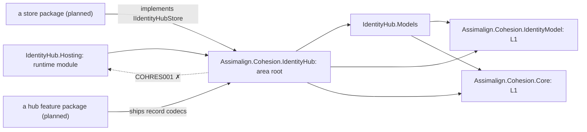
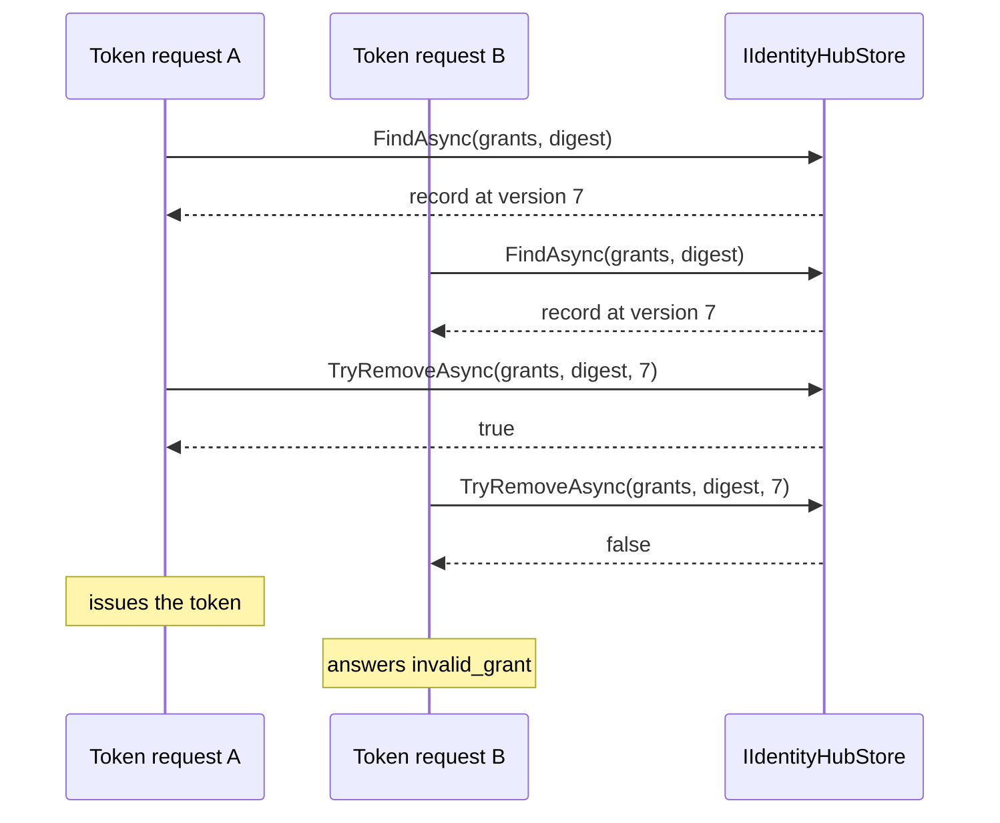
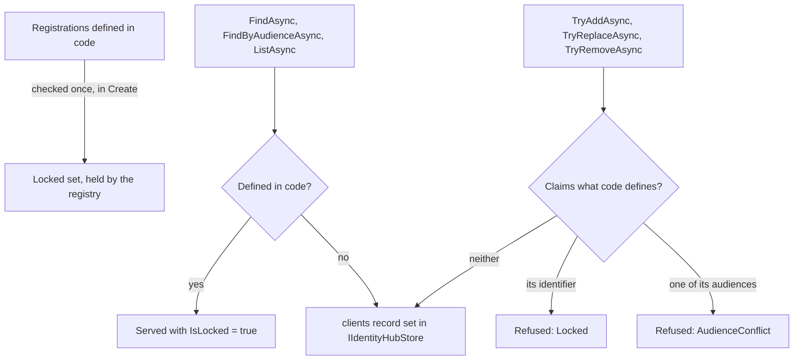

# Assimalign.Cohesion.IdentityHub Design

## Design intent

IdentityHub is a code-first identity server: its identity objects are defined in code, and the
same objects can be created and changed at run time through an API. The area root holds the two
seams every other IdentityHub package builds against, and the first of those identity objects:

- **The application seam.** `IIdentityHubApplicationBuilder`, `IIdentityHubApplication`, and
  `IIdentityHubApplicationContext` are what an application composes. `IdentityHub.Hosting`
  implements them.
- **The store seam.** `IIdentityHubStore` is the one contract between the hub and the data layer
  that keeps its state. The hub reads and writes every durable fact through it and depends on no
  concrete store, so the same hub runs on memory, on an embedded database, or on a managed service.
- **App registrations.** `IIdentityClient` is an application the hub knows, as a client, as an
  API, or as both, and `IIdentityClientRegistry` serves them: the ones defined in code, which are
  locked, over the ones kept in the store. Every later identity object follows the same rule
  (*Code-first objects are locked*).

The registration model sits in the root, and not in a feature package, because every other part
of the hub reads it: the token endpoint, the authorization endpoint, the management API, and each
flow all start from "which application is this". It references nothing the root did not already
reference.

The root references Core, IdentityModel, and IdentityHub.Models. It references no
`Assimalign.Cohesion.Hosting*` library (COHRES004) and never its own runtime module (COHRES001).

## Family map

The diagram shows who references the root. An arrow means "references".



`IdentityHub.Hosting` references the root. The root references `IdentityHub.Models`, IdentityModel,
and Core, and Models references the same two libraries. Two kinds of package are planned and do
not exist yet: a store package, which implements `IIdentityHubStore`, and a hub feature package,
which ships the codecs of its own record sets. Both reference the root and neither references the
other, so a feature never knows which store it runs on. The dotted edge is the one `COHRES001`
rejects: the root may not reference its area's runtime module.

| Package | Role | References in the area |
| --- | --- | --- |
| `Assimalign.Cohesion.IdentityHub` | Area root: application seam, store seam, record vocabulary, error model, in-memory store, app registrations and their registry | `IdentityHub.Models` |
| `Assimalign.Cohesion.IdentityHub.Models` | Tenant-directory data contracts | none |
| `Assimalign.Cohesion.IdentityHub.Hosting` | Runtime module: issuer endpoints and host lifecycle | the root |
| Planned: a store package per medium | Implements `IIdentityHubStore` and passes the store contract tests | the root |
| Planned: hub feature packages | Own their values and the codecs that store them | the root |

## The store seam

### Shape

A store holds **named record sets**. A record has a key that is unique in its set, an opaque
payload, an optional expiry, and index entries it is also found by. The hub owns what a record
means and how its payload is laid out. A store reads only the key, the expiry, and the index
entries, and returns exactly the bytes it was given.

```csharp
public interface IIdentityHubStore
{
    ValueTask<IdentityHubStoredRecord?> FindAsync(IdentityHubRecordSetName set, IdentityHubRecordKey key, CancellationToken cancellationToken = default);
    ValueTask<IdentityHubRecordPage> QueryAsync(IdentityHubRecordSetName set, IdentityHubRecordQuery query, CancellationToken cancellationToken = default);
    ValueTask<IdentityHubWriteResult> TryAddAsync(IdentityHubRecordSetName set, IdentityHubRecord record, CancellationToken cancellationToken = default);
    ValueTask<IdentityHubWriteResult> TryReplaceAsync(IdentityHubRecordSetName set, IdentityHubRecord record, IdentityHubRecordVersion expectedVersion, CancellationToken cancellationToken = default);
    ValueTask<bool> TryRemoveAsync(IdentityHubRecordSetName set, IdentityHubRecordKey key, IdentityHubRecordVersion expectedVersion, CancellationToken cancellationToken = default);
}
```

| Operation | Acts when | Refused as |
| --- | --- | --- |
| `TryAddAsync` | no live record holds the key, and no other live record lists one of the record's unique index entries | `KeyConflict`, `IndexConflict` |
| `TryReplaceAsync` | a live record holds the key at the expected version, and no other live record lists one of the replacement's unique index entries | `VersionConflict`, `IndexConflict` |
| `TryRemoveAsync` | a live record holds the key at the expected version | `false` |
| `FindAsync` | always | returns `null` when no live record holds the key |
| `QueryAsync` | always | returns a last page with no record when nothing matches |

### Why one record store, not typed stores

Three shapes were considered.

1. **One typed interface** with a member per entity (`FindClientAsync`, `AddUserAsync`,
   `RedeemDeviceCodeAsync`). Rejected: the root would absorb every feature's model, which the area
   rules forbid ("the root does not absorb feature abstractions"), and every new entity would
   change a contract that every store package implements.
2. **An aggregate of typed stores** (`IKeyStore`, `IDirectoryStore`, `ISessionStore`, `IAuditStore`,
   the earlier plan in `docs/SERVICE_LAYER_DESIGN.md`). Rejected for the same reason at a smaller
   scale, and for one more: each store would decide expiry, uniqueness, and one-shot redemption on
   its own, so the hub's security rules would be written once per medium.
3. **A generic record store with feature-owned codecs.** Chosen. A new kind of record is a new
   record set name and a codec in the package that owns the value. No contract and no store
   changes. The rules that matter for security (conditional writes, expiry, uniqueness) are stated
   once, in this contract, and one contract test suite checks every store against them.

This is also how the repository's other stores are shaped: `IHttpSessionStore`, the data
protection `IKeyRepository`, and `IOutputCacheStore` all keep opaque values under keys and leave
meaning to their callers.

The trade-offs accepted:

- **A store cannot answer a rich question.** It finds by key and by index equality. Filtering,
  sorting, and prefix or range matching are not in the contract (see *Non-goals and open decisions*).
- **There is no operation over more than one record.** The hub designs each rule to need one
  conditional write.
- **A relational store holds payloads, not columns.** An operator cannot query a user's attributes
  with SQL. What a record must be found by is declared as an index entry.

### Semantics a store must keep

- **Every write is conditional, and a refused write is a result.** A refusal is how a caller learns
  it lost a race. It is never an exception.
- **Each operation is atomic and immediately visible.** A write changes the record, its expiry, and
  all of its index entries together or not at all, and the checks that refuse it are part of the
  same step. Once a write returns, every later read through the store sees it. A store on an
  eventually consistent medium reads with the consistency that keeps this true.
- **Expiry.** From its `ExpiresAt` instant, by the store's clock, a record is absent: it is not
  found, not listed, does not hold its key, and does not hold its unique index entries. When the
  store reclaims the space is its own business. The hub still applies its own protocol expiry to
  what it reads, because its clock and the store's may differ.
- **Uniqueness.** Among the live records of one set, at most one lists a given index name and value
  as unique. A record's own earlier entries never conflict with its replacement. An entry that is
  not unique is shared freely.
- **Versions.** A version is the store's opaque token for one stored state: a row version, an ETag,
  a revision. A record's version changes on every write, and a key never sees the same version
  twice, including after a remove and a new add. That is what stops a stale conditional write from
  matching a successor record.
- **Paging.** The order of records is the store's own and is stable across the pages of one
  enumeration. Only a `null` continuation ends an enumeration: a page may be short or empty and
  still carry one. A record that is live from the first page to the last is returned exactly once.
- **Arguments.** A `default` record set name, key, or version is refused with `ArgumentException`,
  and a canceled token is observed before anything is read or written.

### One conditional write decides

The hub never locks and never reads then writes unconditionally. A rule is one conditional write
whose outcome is the decision. The diagram shows the device grant: two token requests present one
approved device code.



Both requests read the record at version 7. Both ask the store to remove it at version 7. The
store answers `true` to exactly one, and only that request issues a token. The other answers
`invalid_grant`. The same pattern covers the rest of the hub's rules:

| Rule | Write |
| --- | --- |
| Create once (a client id, a signing key id) | `TryAddAsync`; `KeyConflict` means it exists |
| Claim a unique name (a user name, a user code) | a unique index entry; `IndexConflict` names the index |
| Redeem once (a device code, an authorization code, a refresh token) | `TryRemoveAsync` at the version that was read |
| Move a state forward (pending to approved, rotate a secret) | `TryReplaceAsync` at the version that was read; on `VersionConflict` read again and decide again |

### Record vocabulary and limits

| Type | What it is | Rule |
| --- | --- | --- |
| `IdentityHubRecordSetName`, `IdentityHubRecordIndexName` | Names | 1 to 64 characters: lowercase ASCII letters and digits in segments separated by one `.` or `-`, starting with a letter |
| `IdentityHubRecordKey` | A key, and the value of an index entry | 1 to 512 characters, no control character, no unpaired surrogate; ordinal, never normalized |
| `IdentityHubRecordVersion` | The store's token for one stored state | 1 to 128 visible ASCII characters; opaque to the hub |
| `IdentityHubRecord` | Key, payload, expiry, index entries | payload up to 1 MiB; up to 16 index entries |
| `IdentityHubRecordIndex` | One index entry | one index is unique or not within a record, never both |
| `IdentityHubRecordQuery` | Every record, or index equality | page size 1 to 1000, default 100 |

The four names and tokens are generated `CohesionValueType` value objects, so each rule lives once,
in the type's `IsValid`, and an invalid string is refused when it is converted. `default` never ran
`IsValid`, so every boundary refuses it.

**The limits are provisional.** They are set so that a key fits a relational index, a name is a
legal identifier on any medium once escaped, and a payload fits a single row or item on the stores
considered so far. They have not been measured against a real store. Raising one later is
compatible; lowering one is not.

### Codecs and the typed record set

The package that owns a value owns its codec. The codec names the record set, picks the key, the
expiry, and the index entries, and lays out the payload:

```csharp
internal sealed class DeviceGrantCodec : IIdentityHubRecordCodec<DeviceGrant>
{
    public static readonly IdentityHubRecordIndexName UserCode = "user-code";

    public IdentityHubRecordSetName Set => "device-grants";

    public IdentityHubRecord Encode(DeviceGrant value) => new(
        value.DeviceCodeDigest,
        JsonSerializer.SerializeToUtf8Bytes(value, DeviceGrantJsonContext.Default.DeviceGrant),
        value.ExpiresAt,
        [new IdentityHubRecordIndex(UserCode, value.UserCode, isUnique: true)]);

    public DeviceGrant Decode(IdentityHubRecord record) =>
        JsonSerializer.Deserialize(record.Payload.Span, DeviceGrantJsonContext.Default.DeviceGrant)!;
}
```

Hub code then holds an `IdentityHubRecordSet<TRecord>`, which runs the codec in both directions
over the store's operations and adds no behavior of its own:

```csharp
IdentityHubRecordSet<DeviceGrant> grants = IdentityHubRecordSet<DeviceGrant>.Create(store, new DeviceGrantCodec());

IdentityHubEntry<DeviceGrant>? grant = await grants.FindAsync(deviceCodeDigest, cancellationToken);
if (grant is null || !await grants.TryRemoveAsync(grant.Key, grant.Version, cancellationToken))
{
    return InvalidGrant();
}
```

`FindByIndexAsync` is the lookup for a unique index. It follows continuations to the last page, so
it is correct on a store that returns short pages, and it throws `InvalidOperationException` when
more than one record lists the value, because picking one would hide a broken invariant.

A codec reads every layout it ever wrote: a store keeps records across versions of the hub. The
root's public API carries no serializer type. A payload is bytes, so a codec is free to use
System.Text.Json source generation or any other reflection-free format.

### Security rules

- **A key or index value is never a secret.** Stores keep both in the clear, in indexes and in
  diagnostics. A bearer value such as a device code, an authorization code, or a refresh token is
  hashed before it becomes a key.
- **A payload holds no secret in the clear.** It carries a verifier digest, a reference to a secret
  kept elsewhere, or protected bytes. Never a client secret, a bearer token, or private key
  material as they are.
- **Messages name the record set and key at most.** No exception message, `ToString`, or debugger
  display carries a payload, and a refused key is not echoed, because it may hold the control
  character that made it invalid.
- **A store is trusted with integrity, not with secrecy.** The contract does not ask a store to
  encrypt. Protecting a payload is the codec's job, so the protection is the same on every medium.

### Lifecycle and ownership

The contract has no lifecycle member. A store that holds a connection or a file implements
`IDisposable` or `IAsyncDisposable` itself, and whoever created it disposes it: the application for
a store it passes in, the hosting container for one it creates from a factory. An
`IdentityHubRecordSet<TRecord>` holds no state, owns neither its store nor its codec, and never
disposes them. Stores, codecs, and record sets are safe for concurrent use.

### Error model

`IdentityHubException` is the area's abstract exception root and carries an `IdentityHubErrorCode`.
`IdentityHubStoreException` is the one concrete type so far; it also names the record set and key
when they are known.

| Outcome | Reported as |
| --- | --- |
| A conditional write was refused | `IdentityHubWriteResult` or `false`. Never an exception |
| A caller passed `default`, `null`, or a value outside a limit | `ArgumentException` and its subclasses |
| The store's medium failed, timed out, or is unreachable | `IdentityHubStoreException`, `StoreUnavailable`, with the medium's exception inside. The effect is unknown and the operation may be tried again |
| A stored record does not decode | `IdentityHubStoreException`, `StoreRecordCorrupt`, raised by `IdentityHubRecordSet<TRecord>` around the codec |
| A continuation was not issued by the store for the query | `IdentityHubStoreException`, `StoreContinuationInvalid` |
| A unique index lists two records | `InvalidOperationException` from `FindByIndexAsync` |

A store translates its medium's exceptions so that the hub handles one type whatever it runs on.
Error code values are stable and only ever added to.

### The in-memory store

`InMemoryIdentityHubStore` is the reference implementation, the store for tests, and the store for
a hub that runs on one node and may forget everything on restart. It is in the root because the
contract needs an implementation to be checked against, and because it takes no dependency the
root does not already have.

- Each record set has one lock, which is what makes a conditional write and its checks one step.
- There is no timer. An expired record is dropped when an operation next meets it, and every
  write to a record set first drops all of that set's expired records, found through an index
  ordered by expiry. Only a write makes a set grow, so a record that expires and is never read
  again (a device code nobody redeems) is held until the set's next write at most. Without this,
  an unauthenticated endpoint that creates expiring records could fill the process's memory.
- Records list in the ordinal order of their keys, and a continuation encodes the last key
  returned, so an enumeration survives the removal of the record it stopped on.
- One version counter serves the whole store, so no record ever receives a version another held.
- `Create(TimeProvider)` takes the clock that decides expiry; the parameterless constructor reads
  the system clock.

### Writing a store

1. Derive from `IdentityHubStore`. It applies the argument rules and observes cancellation, so the
   five `Core` members always receive valid arguments.
2. Keep each write atomic with its checks: a transaction, a conditional put, or a compare-and-swap,
   whatever the medium offers. Do not read and then write.
3. Enforce uniqueness in the medium (a unique index or a claim row written in the same step), not
   by reading first.
4. Treat a record as absent from its `ExpiresAt` on every path, including the uniqueness check.
5. Issue a version that a key never sees twice.
6. Translate the medium's failures into `IdentityHubStoreException`.
7. Run `IdentityHubStoreContractTests` against the store. A store's test class derives from it and
   supplies the store and its clock. The suite lives in this project's tests today; shipping it for
   store packages is a planned follow-up.

### Adding a record set

1. Define the value in the feature package that owns it.
2. Choose the key. It is what the hub looks the value up by on its hot path, and it is not a secret.
3. Choose the index entries: unique for a name that must belong to one record, not unique for a
   listing such as "the sessions of a subject". Normalize case before forming a key or an index
   value when two spellings must be one.
4. Choose the expiry when the value has a lifetime, so that the store reclaims it.
5. Write the codec with a reflection-free serializer and a layout that can be read back after the
   next change.

## App registrations

### What a registration is

An app registration is the hub's first identity object: one application the hub knows, and
everything the hub needs to issue a token to it or for it. `IIdentityClient` is the contract,
`IdentityClient` the implementation, and `IIdentityClientRegistry` what serves and changes them.

The shape follows the app registration of Microsoft Entra: one object is a client, an API, or
both. It is that one feature and not a copy of Entra (see *What it leaves out*).

| A registration holds | Meaning | Limit |
| --- | --- | --- |
| `Id` | The OAuth `client_id` | 128 characters |
| `DisplayName`, `Description` | What a person is shown. The display name defaults to the identifier | 128 and 256 characters |
| `Grants` | The grants the application may use: authorization code, client credentials, device code, refresh token | Flags |
| `AccessTokenLifetime` | How long an access token issued to it is valid. One hour unless set | 24 hours |
| `Redirects` | Where a user may be sent back to, each with its platform: web, single-page, or native | 64 |
| `Credentials` | What the application proves its identity with: a secret, a certificate, or a federated token. A registration with none is a public client (`IsConfidential` is false) | 16 |
| `Audiences` | The `aud` values of the API the registration exposes. No other registration exposes any of them | 8 |
| `Scopes` | The delegated permissions its API exposes, issued in the `scp` claim | 64 |
| `Roles` | The roles its API exposes to users, to applications, or to both, issued in the `roles` claim | 64 |
| `Permissions` | The scopes and roles, of another registration or its own, that it may be issued | 128 |
| `IsLocked`, `Version` | Set by the registry that served it: whether it is defined in code, and the stored state it was read from | |

A registration is defined with one object initializer and is immutable from then on:

```csharp
IdentityClient api = IdentityClient.Create(new()
{
    Id = "orders-api",
    DisplayName = "Orders API",
    Audiences = { "api://orders" },
    Scopes = { IdentityClientScope.Create("orders.read", "Read orders") },
    Roles = { IdentityClientRole.Create("orders.process", IdentityClientRoleMembers.Applications) },
});

IdentityClient web = IdentityClient.Create(new()
{
    Id = "orders-web",
    Grants = IdentityClientGrants.AuthorizationCode | IdentityClientGrants.RefreshToken,
    Redirects = { IdentityClientRedirect.Web("https://orders.example/signin") },
    Permissions = { IdentityClientPermission.Delegated("orders-api", "orders.read") },
});

IdentityClient daemon = IdentityClient.Create(new()
{
    Id = "orders-daemon",
    Grants = IdentityClientGrants.ClientCredentials,
    Credentials = { IdentityClientCertificateCredential.Create("deploy-2026", certificate) },
    Permissions = { IdentityClientPermission.Application("orders-api", "orders.process") },
});

IdentityClientRegistry registry = IdentityClientRegistry.Create(store, [api, web, daemon]);
```

`IdentityClientDescriptor` is the only mutable type in the model. `IdentityClient.Create` copies it,
checks every rule in the next section, and refuses the whole descriptor with an `ArgumentException`
that names the registration and the rule. Nothing constructs a registration any other way: a
registration read back from a store goes through the same `Create`, so a stored record that breaks
a rule is reported as corrupt and is never served.

### Code-first objects are locked

The hub is a code-first identity server: its identity objects are defined in code, and the same
objects can also be created at run time through an API. The rule that keeps the two apart is the
same for every identity object the hub will hold, and app registrations are the first to follow it:

> **An object defined in code is locked.** It is read like any other object. It changes only where
> it is defined, in the code, and never through an API.

For registrations the registry enforces it. The diagram shows how a call is answered; an arrow
means "leads to".



- **A locked registration never reaches the store.** The registry holds the set it was created
  with. Every node that runs the same code serves the same set, and a registration is gone when
  the code that defines it is.
- **Every write that names a locked identifier is answered `Locked`**: add, replace, and remove
  alike. That includes its credentials (owner decision, 2026-11-19). A locked registration's
  secret or certificate rotates by changing the code or the configuration the code reads, and
  deploying.
- **Code wins.** A stored registration with the identifier of a locked one is not served by any
  read, and a write may not claim an audience a locked registration exposes.
- **Locked is where the object is defined, not a flag on it.** `IsLocked` is set by the registry
  that serves a registration, never by the descriptor, and the stored layout has no such field.

Why not write code-first registrations to the store with a locked flag, which is what a seeding
step would do: the flag would then be a stored byte that anyone who can write the store can clear,
a restart would have to reconcile what the code says with what the store holds, and a registration
removed from the code would live on as a stored record that nothing defines. Holding the locked
set outside the store makes all three impossible. The cost is accepted: the locked set is in
memory on every node, and it must be small enough to define in code.

Why a locked registration's credentials are locked with it (owner decision, 2026-11-19): two
alternatives were weighed and refused. One let the credentials rotate through the API while the
rest of the definition stayed locked; the other let each registration choose. Both need a stored
credential record beside the code-first definition, so what authenticates the application would be
whatever the store holds and not what the code says, and "locked" would no longer mean one thing.
The cost is accepted here too: rotating a locked registration's secret or certificate is a
deployment, not an API call. A registration that must rotate without one is created at run time,
or uses a federated credential, which holds no secret.

A stored registration that code shadows is left in the store. It is served again if the code that
shadows it is removed, which keeps a deployment reversible, and until then its audiences stay
taken among stored registrations. Nothing reports or removes such a record today (#1925).

### The rules a registration keeps

`IdentityClient.Create` refuses a descriptor that breaks any of these, so no other code has to
ask whether a registration it was handed makes sense.

| Rule | Why |
| --- | --- |
| The authorization code grant needs at least one redirect, and a redirect needs that grant | A grant with nowhere to return to cannot complete, and a redirect no grant uses is a mistake waiting to be enabled |
| The client credentials grant needs at least one credential | The grant is the application authenticating as itself |
| The refresh token grant needs the authorization code or the device code grant | Nothing else issues a refresh token |
| Scopes or roles need at least one audience | A permission is issued in a token, and the token needs an `aud` |
| A permission on the registration's own identifier names a scope it exposes, or a role it opens to applications | The one case that can be checked without another registration |
| No identifier, redirect URI, audience, scope name, role name, or permission appears twice | Each is a name something is looked up by. A scope and a role may share a name: they are issued in different claims |
| The lifetime is positive and at most 24 hours | An access token cannot be revoked, so its lifetime is the exposure |

A permission on another registration is not checked against that registration when it is
created, because the other one may be stored and may change. Among the registrations defined in
code it is checked once, in `IdentityClientRegistry.Create`, so a typo in code stops the hub from
starting. Everywhere else a permission is a ceiling: the hub issues at most what a registration
holds, and only what the resource exposes at the moment of issue.

### Identifiers, audiences, and redirects

Each single-valued input is a value object with one rule (`general-rules.md`).

| Type | Rule | Why |
| --- | --- | --- |
| `IdentityClientId`, `IdentityClientCredentialId` | The unreserved characters of RFC 3986 section 2.3, starting and ending with a letter or digit. Ordinal | It needs no escaping in a URL path, a form body, or HTTP Basic authentication, and it is the record key |
| `IdentityClientPermissionName` | A scope token of RFC 6749 section 3.3. Ordinal | It is one entry of a space-delimited `scope` parameter |
| `IdentityClientAudience` | The StringOrURI of RFC 7519 section 2, in visible ASCII, with no fragment. Ordinal | It is compared with the `aud` claim as a string |
| `IdentityClientRedirect` | A URI in RFC 3986 characters and a platform. `https`, or `http` to a host written as `localhost` or a loopback address; a native application may use a private scheme that holds a `.` (RFC 8252 section 7.1). No wildcard, fragment, or user information | It is where an authorization code is sent |

A redirect URI is kept exactly as it was written and is matched character for character, as
OAuth 2.1 requires. Three refusals exist because a parser and a browser can read one string two
ways: a backslash, which a browser reads as a slash and other parsers do not; an authority not
introduced by `//`; and the host name `loopback`, which .NET's `Uri` reports as `localhost`. The
host is therefore read from the string as written, not from the parser.

### Credentials

`IdentityClientCredential` is an abstract base with three sealed leaves, and no interface beside
it: the set of credential kinds is closed, because the hub must know how to verify each one.

| Credential | Holds | Verified by |
| --- | --- | --- |
| `IdentityClientSecretCredential` | A salt, a PBKDF2-HMAC-SHA256 verifier, and the iteration count. Never the secret | `Verify(secret, at)`, in fixed time |
| `IdentityClientCertificateCredential` | A public X.509 certificate and its SHA-256 thumbprint | A client assertion signed with the private key (the hub service, #1917) |
| `IdentityClientFederatedCredential` | An issuer, a subject, and the audiences a foreign token must carry | A token another issuer signed (the hub service, #1917) |

Every credential has an identifier, unique in its registration, and an optional validity window.

- **A secret is derived, never stored.** `Create` takes a secret an operator chose and derives it
  with 600,000 iterations, the OWASP figure for PBKDF2-HMAC-SHA256. `Generate` makes a 256-bit
  secret, hands it back once, and derives it with one iteration, because a secret with that much
  entropy gains nothing from more. PBKDF2 was chosen over Argon2 and scrypt because it is in the
  base class library and neither of the others is; the iteration count is stored with each
  credential, so the figure can rise without invalidating what exists.
- **A secret defined in code is read from configuration.** It costs one derivation when the
  process starts, and the secret is in the process. A certificate or a federated credential puts
  no secret there, and is the better choice for a locked registration.
- **Verification is not rate limited here.** A chosen secret costs 600,000 iterations to verify,
  which is the point of it and also a cost a caller can impose. The endpoint that verifies
  secrets limits attempts (#1913).

### The registry

`IIdentityClientRegistry` is what the rest of the hub reads registrations through.
`IdentityClientRegistry.Create(store, clients)` makes one over a store and the registrations
defined in code. Its own `Locked` property lists the locked set without a call to the store.

| Call | Answers |
| --- | --- |
| `FindAsync(id)` | The registration, locked or stored, or nothing |
| `FindByAudienceAsync(audience)` | The one registration that exposes the audience |
| `ListAsync(limit, continuation)` | A page: the locked registrations first, in the order of their identifiers, then the stored ones in the store's order |
| `TryAddAsync(client)` | `Written`, `Locked`, `IdConflict`, or `AudienceConflict` |
| `TryReplaceAsync(client, expectedVersion)` | `Written`, `Locked`, `VersionConflict`, or `AudienceConflict` |
| `TryRemoveAsync(id, expectedVersion)` | `Removed`, `Locked`, or `VersionConflict` |

A refused write is an `IdentityClientWriteResult`, never an exception, on the same terms as the
store seam: `Locked` and the conflicts are outcomes a caller acts on. `AudienceConflict` names the
audience when the registry can tell which one was taken. A store failure is an
`IdentityHubStoreException`. To change a stored registration, a caller reads it, copies it with
`IdentityClientDescriptor.From`, edits the copy, creates the replacement, and replaces at the
version it read, so two concurrent edits cannot both win.

A page may hold fewer registrations than the limit, or none, while a continuation remains: the
registry drops a stored registration that code shadows after the store has counted it. A listing
ends when the continuation is null. The registry's continuation wraps the store's, and a token it
did not issue is answered with `StoreContinuationInvalid`.

A registry does not trust an `IIdentityClient` it did not create. An implementation other than
`IdentityClient` is copied through `IdentityClient.Create` before it is kept or stored, so a
foreign implementation cannot carry a rule violation, or an `IsLocked` it set itself, into the hub.

### The stored layout

Stored registrations are the first record set built on the store seam.

| Part | Value |
| --- | --- |
| Record set | `clients` |
| Key | The registration's identifier |
| Index entries | One unique `audience` entry per audience, which is what keeps an audience with one registration |
| Payload | UTF-8 JSON with a layout version, `"v": 1` |
| Expiry | None |

The payload is written and read through a source-generated context, with no reflection. An
unknown member is fatal, and so is a layout version other than 1: a registration a newer hub
wrote is refused by an older one, not half read. Empty lists are left out. A maximal registration
is under half of the store's 1 MiB payload limit, and a test holds it there. A payload never holds
a secret: a secret credential is stored as its salt, verifier, and iteration count.

### What it leaves out

Non-goals, each a decision and not an omission:

- **No consent and no pre-authorized applications.** A permission a registration holds is granted.
  Entra's admin and user consent is a product of its own.
- **No owners, branding, optional claims, or sign-out URLs.** They describe an Entra portal, not
  what a token needs.
- **No tenancy.** A registration belongs to the hub. Tenancy is an open decision of the store
  seam (#1914) and of the tenancy contracts (#826).
- **No wildcard redirect, no implicit grant, no resource owner password grant.** OAuth 2.1 removes
  all three.
- **No enabled flag.** A registration that should not be used is removed, or loses its grants.
- **No separate client and API types.** One object can be both, as in Entra. The alternative, one
  type per role as in Duende IdentityServer's `Client`, `ApiResource`, and `ApiScope`, makes a
  web application that also exposes an API two objects that must be kept in agreement.

### What does not use it yet

The model, the registry, and the stored layout are in the root, and nothing calls them yet:

- `IdentityHub.Hosting` still issues tokens from `IIdentityHubApplicationBuilder.AddClient` and
  `IdentityHubClientOptions`. A registration defined with `IdentityClient.Create` is not a client
  the token endpoint knows until Hosting adopts the registry (#1913).
- No web API manages stored registrations (#1924).
- `IdentityHub.Models` holds older application DTOs with a different shape. They are untouched
  and are reconciled with this model when the web API is designed (#1924).
- `IIdentityClient` shares the word "client" with the `IdentityHub.Client` package, which is the
  library an application uses to call a hub. The interface kept the name it had as a placeholder.

## The application seam

The area root owns the public contracts composed by an IdentityHub resource. `IIdentityHubApplicationBuilder` declares token audiences with `AddAudience`, registers OAuth clients with `AddClient`, and builds `IIdentityHubApplication`. The public concrete application, builder, and context live in `Assimalign.Cohesion.IdentityHub.Hosting`.

`AddClient` and `IdentityHubClientOptions` predate the app registration model and still drive Hosting: a non-empty `ClientSecret` enables `client_credentials`, `AllowDeviceAuthorization` enables the device grant, clients list the audiences they may request, and build fails if a client names an undeclared audience or enables no grant. They are transitional. When Hosting adopts the registry (#1913), the builder takes registrations defined with `IdentityClient.Create`, and `AddAudience`, `AddClient`, and `IdentityHubClientOptions` are reshaped onto that model or retired.

The builder has no verb for a store yet. `IdentityHub.Hosting` still keeps its device
authorizations, signing key, and clients in its own internal types, and moving them onto
`IIdentityHubStore` is the next increment (see *Non-goals and open decisions*).

## Security boundary

A registration never holds a client secret: `IdentityClientSecretCredential` keeps a salted PBKDF2 verifier and compares in fixed time, and no exception message, `ToString`, debugger view, or stored payload carries the secret. The transitional `IdentityHubClientOptions` carry a client secret only during composition; Hosting snapshots them and retains only a SHA-256 digest, compared in fixed time, until it adopts the registry (#1913). Access-token lifetimes are positive and capped at 24 hours. IdentityHub builds protocol tokens on the shared IdentityModel and JWT contracts instead of defining competing token, claim, subject, credential, or session primitives.

## Hosting isolation and AOT

The root references Core and IdentityModel contracts, with no Hosting library reference. HTTP serving and cryptography belong to the Hosting module, and persistence belongs to a store behind `IIdentityHubStore`. The surface requires no runtime scanning, dynamic code generation, or container activation and remains trimming- and NativeAOT-safe: the store seam moves bytes, the value objects are build-generated, and a codec serializes through a source-generated context or another reflection-free format.

## Hosting-free application contract (O34)

The root contracts are hosting-free (O34): `IIdentityHubApplication` exposes `Context`, `StartAsync`, and `StopAsync`; `IIdentityHubApplicationContext` exposes `ContentRootPath`. `IIdentityHubApplicationBuilder` owns area declarations and `Build()`. The root and feature packages reference no `Assimalign.Cohesion.Hosting*` library; COHRES004 enforces the boundary.

`IdentityHubApplication.CreateBuilder(args)` returns the public concrete `IdentityHubApplicationBuilder`; its `Build()` returns the public `IdentityHubApplication : Host<IdentityHubApplicationContext>`. The public `IdentityHubApplicationContext` implements `IIdentityHubApplicationContext`, reading `ContentRootPath` from the host environment. The application explicitly forwards the root lifecycle contract to `IHost`, and consumers use the concrete application for `RunAsync` and `await using`. Runtime options and supporting services remain internal.

Background-work registration (`AddService`) is available only on the concrete Hosting builder.

## Build-generated resources (#1467)

Exception messages live in `src/Properties/ErrorMessages.resx` and non-exception strings in
`src/Properties/Resources.resx` (the roles XML payload). Their internal `ErrorMessages` and
`Resources` accessors are generated in the project root namespace by MSBuild's GenerateResource
task through `build/Targets/Build.ErrorMessages.targets`. The generated source stays under
`obj/`; no checked-in designer or Visual Studio custom tool is required. Ordinary
`dotnet build`, CI and NativeAOT publication use the same embedded resources.

## Placeholder contracts

Six interfaces in `Abstractions/` are empty or nearly so and predate both seams: `IIdentityHub`,
`IIdentityClientAdapter`, `IIdentityClientContext`, `IIdentityContext`, `IIdentityProvider`, and
`IIdentityResult`. Nothing implements or consumes them. A seventh, `IIdentityClient`, was an
empty placeholder for an app registration and is now defined (*App registrations*).
`docs/SERVICE_LAYER_DESIGN.md` names the six as the future hub service contracts, so they are left
untouched here. One of them is already wrong for that role: `IIdentityProvider.Authenticate`
returns a `ClaimsPrincipal`, while the area builds on IdentityModel's subject and claim contracts.
Defining or retiring them is its own increment, the one in which the issuer logic leaves
`IdentityHub.Hosting`'s `IdentityEndpointService` for a hub service that runs on the store.

## Removed types

Three public types were removed when the store seam was added. None had a caller in the repository.

- `AuthorizationType`: an empty enum declared in a namespace that did not match the project.
- `DateTimeUtil` and `EpochTime`: date helpers unrelated to an identity hub, whose documentation
  matched `Microsoft.IdentityModel`'s helpers of the same names word for word. `TimeProvider` and
  `DateTimeOffset.ToUnixTimeSeconds` cover what they did.

## Non-goals and open decisions

Non-goals of the store seam:

- **No cross-record transaction, no lock, no unconditional write.** A rule that seems to need one is
  redesigned around one conditional write.
- **No filtering, sorting, prefix, or range query.** If SCIM filtering or directory search needs
  more than index equality, that is a new query model or a separate search seam, decided when the
  directory is built, not a quiet extension of this one.
- **No change notification.** A hub on several nodes that caches what it reads sets its own
  staleness bound.
- **No schema or migration in the store.** The payload layout is the codec's.

Decisions that are still open, and what each one waits for. The store work is tracked under #1911
and the app registration work under #69 (delivered here as #1923):

| Decision | Today | Waits for |
| --- | --- | --- |
| Tenancy in the record address | A record is addressed by set and key. A tenant is carried inside composed keys and index values | #1914, which waits for the tenancy contracts (#826). A first-class partition would change every signature here, so it must be settled before the first durable store ships |
| Limits (key 512, name 64, payload 1 MiB, 16 index entries) | Provisional | The first durable store (#1916) |
| Builder verb for a store, and Hosting on the store | None; Hosting keeps internal state | The next increment (#1913) |
| Code-first clients versus stored clients | Decided 2026-11-19: both. A registration defined in code is locked and never stored; one created at run time is stored (*App registrations*) | Hosting adopting the registry (#1913) |
| Where the registration model lives | In the root, because every part of the hub reads it | The owner's confirmation. `resource-areas.md` keeps feature abstractions out of an area root; the alternative is an `IdentityHub.Clients` feature package that the root's builder contract could then not name |
| What "locked" covers | Decided 2026-11-19: the whole registration, credentials included. Rotating a locked registration's credentials through the API was refused (*Code-first objects are locked*) | Nothing |
| The cost of a chosen secret | PBKDF2-HMAC-SHA256, 600,000 iterations; 1 for a generated secret | The owner's confirmation, and the rate limit on the endpoint that verifies secrets (#1913) |
| A stored registration that code shadows | Left in the store, not served, not reported | #1925 |
| The management web API and the `IdentityHub.Models` application DTOs | Neither exists on this model | #1924 |
| Which medium the first durable store uses | No durable store exists | #1916 |
| Shipping the contract tests | In this project's tests | #1915, likely as an `IdentityHub.Testing` package |
| The placeholder contracts | Left as they are | The hub service increment (#1917) |
