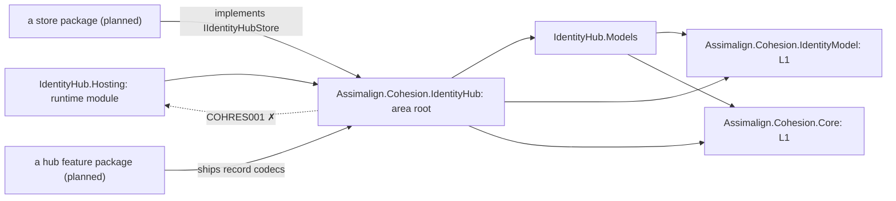
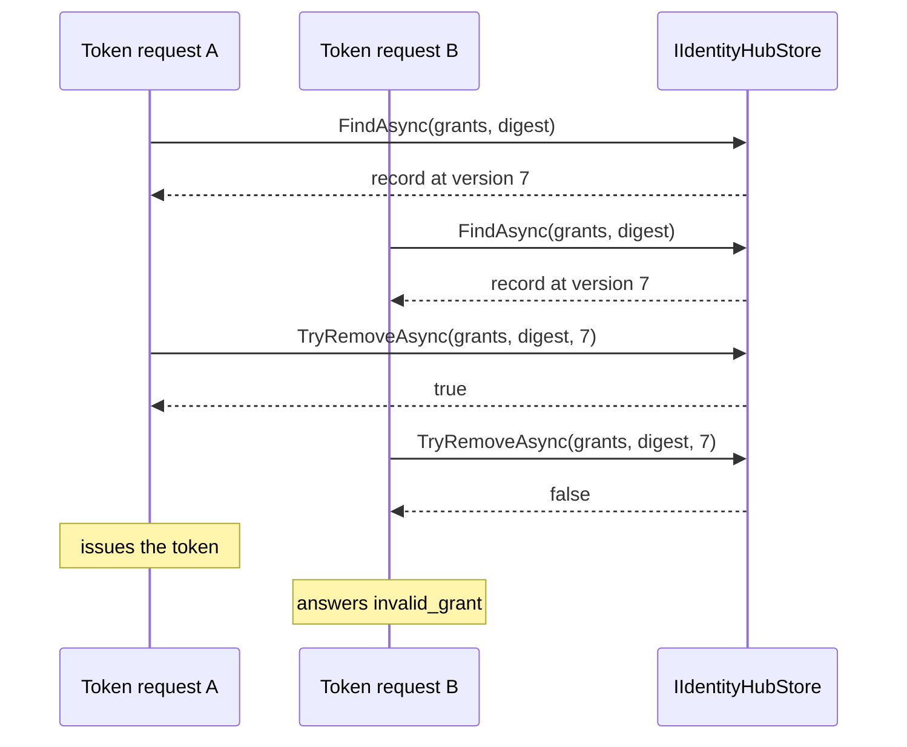

# Assimalign.Cohesion.IdentityHub Design

## Design intent

The area root holds the two seams every other IdentityHub package builds against, and nothing
that belongs to one feature:

- **The application seam.** `IIdentityHubApplicationBuilder`, `IIdentityHubApplication`, and
  `IIdentityHubApplicationContext` are what an application composes. `IdentityHub.Hosting`
  implements them.
- **The store seam.** `IIdentityHubStore` is the one contract between the hub and the data layer
  that keeps its state. The hub reads and writes every durable fact through it and depends on no
  concrete store, so the same hub runs on memory, on an embedded database, or on a managed service.

The root references Core, IdentityModel, and IdentityHub.Models. It references no
`Assimalign.Cohesion.Hosting*` library (COHRES004) and never its own runtime module (COHRES001).

## Family map

The diagram shows who references the root. An arrow means "references".



`IdentityHub.Hosting` references the root. The root references `IdentityHub.Models`, IdentityModel,
and Core, and Models references the same two libraries. Two kinds of package are planned and do
not exist yet: a store package, which implements `IIdentityHubStore`, and a hub feature package,
which ships the codecs of its own record sets. Both reference the root and neither references the
other, so a feature never knows which store it runs on. The dotted edge is the one `COHRES001`
rejects: the root may not reference its area's runtime module.

| Package | Role | References in the area |
| --- | --- | --- |
| `Assimalign.Cohesion.IdentityHub` | Area root: application seam, store seam, record vocabulary, error model, in-memory store | `IdentityHub.Models` |
| `Assimalign.Cohesion.IdentityHub.Models` | Tenant-directory data contracts | none |
| `Assimalign.Cohesion.IdentityHub.Hosting` | Runtime module: issuer endpoints and host lifecycle | the root |
| Planned: a store package per medium | Implements `IIdentityHubStore` and passes the store contract tests | the root |
| Planned: hub feature packages | Own their values and the codecs that store them | the root |

## The store seam

### Shape

A store holds **named record sets**. A record has a key that is unique in its set, an opaque
payload, an optional expiry, and index entries it is also found by. The hub owns what a record
means and how its payload is laid out. A store reads only the key, the expiry, and the index
entries, and returns exactly the bytes it was given.

```csharp
public interface IIdentityHubStore
{
    ValueTask<IdentityHubStoredRecord?> FindAsync(IdentityHubRecordSetName set, IdentityHubRecordKey key, CancellationToken cancellationToken = default);
    ValueTask<IdentityHubRecordPage> QueryAsync(IdentityHubRecordSetName set, IdentityHubRecordQuery query, CancellationToken cancellationToken = default);
    ValueTask<IdentityHubWriteResult> TryAddAsync(IdentityHubRecordSetName set, IdentityHubRecord record, CancellationToken cancellationToken = default);
    ValueTask<IdentityHubWriteResult> TryReplaceAsync(IdentityHubRecordSetName set, IdentityHubRecord record, IdentityHubRecordVersion expectedVersion, CancellationToken cancellationToken = default);
    ValueTask<bool> TryRemoveAsync(IdentityHubRecordSetName set, IdentityHubRecordKey key, IdentityHubRecordVersion expectedVersion, CancellationToken cancellationToken = default);
}
```

| Operation | Acts when | Refused as |
| --- | --- | --- |
| `TryAddAsync` | no live record holds the key, and no other live record lists one of the record's unique index entries | `KeyConflict`, `IndexConflict` |
| `TryReplaceAsync` | a live record holds the key at the expected version, and no other live record lists one of the replacement's unique index entries | `VersionConflict`, `IndexConflict` |
| `TryRemoveAsync` | a live record holds the key at the expected version | `false` |
| `FindAsync` | always | returns `null` when no live record holds the key |
| `QueryAsync` | always | returns a last page with no record when nothing matches |

### Why one record store, not typed stores

Three shapes were considered.

1. **One typed interface** with a member per entity (`FindClientAsync`, `AddUserAsync`,
   `RedeemDeviceCodeAsync`). Rejected: the root would absorb every feature's model, which the area
   rules forbid ("the root does not absorb feature abstractions"), and every new entity would
   change a contract that every store package implements.
2. **An aggregate of typed stores** (`IKeyStore`, `IDirectoryStore`, `ISessionStore`, `IAuditStore`,
   the earlier plan in `docs/SERVICE_LAYER_DESIGN.md`). Rejected for the same reason at a smaller
   scale, and for one more: each store would decide expiry, uniqueness, and one-shot redemption on
   its own, so the hub's security rules would be written once per medium.
3. **A generic record store with feature-owned codecs.** Chosen. A new kind of record is a new
   record set name and a codec in the package that owns the value. No contract and no store
   changes. The rules that matter for security (conditional writes, expiry, uniqueness) are stated
   once, in this contract, and one contract test suite checks every store against them.

This is also how the repository's other stores are shaped: `IHttpSessionStore`, the data
protection `IKeyRepository`, and `IOutputCacheStore` all keep opaque values under keys and leave
meaning to their callers.

The trade-offs accepted:

- **A store cannot answer a rich question.** It finds by key and by index equality. Filtering,
  sorting, and prefix or range matching are not in the contract (see *Non-goals and open decisions*).
- **There is no operation over more than one record.** The hub designs each rule to need one
  conditional write.
- **A relational store holds payloads, not columns.** An operator cannot query a user's attributes
  with SQL. What a record must be found by is declared as an index entry.

### Semantics a store must keep

- **Every write is conditional, and a refused write is a result.** A refusal is how a caller learns
  it lost a race. It is never an exception.
- **Each operation is atomic and immediately visible.** A write changes the record, its expiry, and
  all of its index entries together or not at all, and the checks that refuse it are part of the
  same step. Once a write returns, every later read through the store sees it. A store on an
  eventually consistent medium reads with the consistency that keeps this true.
- **Expiry.** From its `ExpiresAt` instant, by the store's clock, a record is absent: it is not
  found, not listed, does not hold its key, and does not hold its unique index entries. When the
  store reclaims the space is its own business. The hub still applies its own protocol expiry to
  what it reads, because its clock and the store's may differ.
- **Uniqueness.** Among the live records of one set, at most one lists a given index name and value
  as unique. A record's own earlier entries never conflict with its replacement. An entry that is
  not unique is shared freely.
- **Versions.** A version is the store's opaque token for one stored state: a row version, an ETag,
  a revision. A record's version changes on every write, and a key never sees the same version
  twice, including after a remove and a new add. That is what stops a stale conditional write from
  matching a successor record.
- **Paging.** The order of records is the store's own and is stable across the pages of one
  enumeration. Only a `null` continuation ends an enumeration: a page may be short or empty and
  still carry one. A record that is live from the first page to the last is returned exactly once.
- **Arguments.** A `default` record set name, key, or version is refused with `ArgumentException`,
  and a canceled token is observed before anything is read or written.

### One conditional write decides

The hub never locks and never reads then writes unconditionally. A rule is one conditional write
whose outcome is the decision. The diagram shows the device grant: two token requests present one
approved device code.



Both requests read the record at version 7. Both ask the store to remove it at version 7. The
store answers `true` to exactly one, and only that request issues a token. The other answers
`invalid_grant`. The same pattern covers the rest of the hub's rules:

| Rule | Write |
| --- | --- |
| Create once (a client id, a signing key id) | `TryAddAsync`; `KeyConflict` means it exists |
| Claim a unique name (a user name, a user code) | a unique index entry; `IndexConflict` names the index |
| Redeem once (a device code, an authorization code, a refresh token) | `TryRemoveAsync` at the version that was read |
| Move a state forward (pending to approved, rotate a secret) | `TryReplaceAsync` at the version that was read; on `VersionConflict` read again and decide again |

### Record vocabulary and limits

| Type | What it is | Rule |
| --- | --- | --- |
| `IdentityHubRecordSetName`, `IdentityHubRecordIndexName` | Names | 1 to 64 characters: lowercase ASCII letters and digits in segments separated by one `.` or `-`, starting with a letter |
| `IdentityHubRecordKey` | A key, and the value of an index entry | 1 to 512 characters, no control character, no unpaired surrogate; ordinal, never normalized |
| `IdentityHubRecordVersion` | The store's token for one stored state | 1 to 128 visible ASCII characters; opaque to the hub |
| `IdentityHubRecord` | Key, payload, expiry, index entries | payload up to 1 MiB; up to 16 index entries |
| `IdentityHubRecordIndex` | One index entry | one index is unique or not within a record, never both |
| `IdentityHubRecordQuery` | Every record, or index equality | page size 1 to 1000, default 100 |

The four names and tokens are generated `CohesionValueType` value objects, so each rule lives once,
in the type's `IsValid`, and an invalid string is refused when it is converted. `default` never ran
`IsValid`, so every boundary refuses it.

**The limits are provisional.** They are set so that a key fits a relational index, a name is a
legal identifier on any medium once escaped, and a payload fits a single row or item on the stores
considered so far. They have not been measured against a real store. Raising one later is
compatible; lowering one is not.

### Codecs and the typed record set

The package that owns a value owns its codec. The codec names the record set, picks the key, the
expiry, and the index entries, and lays out the payload:

```csharp
internal sealed class DeviceGrantCodec : IIdentityHubRecordCodec<DeviceGrant>
{
    public static readonly IdentityHubRecordIndexName UserCode = "user-code";

    public IdentityHubRecordSetName Set => "device-grants";

    public IdentityHubRecord Encode(DeviceGrant value) => new(
        value.DeviceCodeDigest,
        JsonSerializer.SerializeToUtf8Bytes(value, DeviceGrantJsonContext.Default.DeviceGrant),
        value.ExpiresAt,
        [new IdentityHubRecordIndex(UserCode, value.UserCode, isUnique: true)]);

    public DeviceGrant Decode(IdentityHubRecord record) =>
        JsonSerializer.Deserialize(record.Payload.Span, DeviceGrantJsonContext.Default.DeviceGrant)!;
}
```

Hub code then holds an `IdentityHubRecordSet<TRecord>`, which runs the codec in both directions
over the store's operations and adds no behavior of its own:

```csharp
IdentityHubRecordSet<DeviceGrant> grants = IdentityHubRecordSet<DeviceGrant>.Create(store, new DeviceGrantCodec());

IdentityHubEntry<DeviceGrant>? grant = await grants.FindAsync(deviceCodeDigest, cancellationToken);
if (grant is null || !await grants.TryRemoveAsync(grant.Key, grant.Version, cancellationToken))
{
    return InvalidGrant();
}
```

`FindByIndexAsync` is the lookup for a unique index. It follows continuations to the last page, so
it is correct on a store that returns short pages, and it throws `InvalidOperationException` when
more than one record lists the value, because picking one would hide a broken invariant.

A codec reads every layout it ever wrote: a store keeps records across versions of the hub. The
root's public API carries no serializer type. A payload is bytes, so a codec is free to use
System.Text.Json source generation or any other reflection-free format.

### Security rules

- **A key or index value is never a secret.** Stores keep both in the clear, in indexes and in
  diagnostics. A bearer value such as a device code, an authorization code, or a refresh token is
  hashed before it becomes a key.
- **A payload holds no secret in the clear.** It carries a verifier digest, a reference to a secret
  kept elsewhere, or protected bytes. Never a client secret, a bearer token, or private key
  material as they are.
- **Messages name the record set and key at most.** No exception message, `ToString`, or debugger
  display carries a payload, and a refused key is not echoed, because it may hold the control
  character that made it invalid.
- **A store is trusted with integrity, not with secrecy.** The contract does not ask a store to
  encrypt. Protecting a payload is the codec's job, so the protection is the same on every medium.

### Lifecycle and ownership

The contract has no lifecycle member. A store that holds a connection or a file implements
`IDisposable` or `IAsyncDisposable` itself, and whoever created it disposes it: the application for
a store it passes in, the hosting container for one it creates from a factory. An
`IdentityHubRecordSet<TRecord>` holds no state, owns neither its store nor its codec, and never
disposes them. Stores, codecs, and record sets are safe for concurrent use.

### Error model

`IdentityHubException` is the area's abstract exception root and carries an `IdentityHubErrorCode`.
`IdentityHubStoreException` is the one concrete type so far; it also names the record set and key
when they are known.

| Outcome | Reported as |
| --- | --- |
| A conditional write was refused | `IdentityHubWriteResult` or `false`. Never an exception |
| A caller passed `default`, `null`, or a value outside a limit | `ArgumentException` and its subclasses |
| The store's medium failed, timed out, or is unreachable | `IdentityHubStoreException`, `StoreUnavailable`, with the medium's exception inside. The effect is unknown and the operation may be tried again |
| A stored record does not decode | `IdentityHubStoreException`, `StoreRecordCorrupt`, raised by `IdentityHubRecordSet<TRecord>` around the codec |
| A continuation was not issued by the store for the query | `IdentityHubStoreException`, `StoreContinuationInvalid` |
| A unique index lists two records | `InvalidOperationException` from `FindByIndexAsync` |

A store translates its medium's exceptions so that the hub handles one type whatever it runs on.
Error code values are stable and only ever added to.

### The in-memory store

`InMemoryIdentityHubStore` is the reference implementation, the store for tests, and the store for
a hub that runs on one node and may forget everything on restart. It is in the root because the
contract needs an implementation to be checked against, and because it takes no dependency the
root does not already have.

- Each record set has one lock, which is what makes a conditional write and its checks one step.
- There is no timer. An expired record is dropped when an operation next meets it, and every
  write to a record set first drops all of that set's expired records, found through an index
  ordered by expiry. Only a write makes a set grow, so a record that expires and is never read
  again (a device code nobody redeems) is held until the set's next write at most. Without this,
  an unauthenticated endpoint that creates expiring records could fill the process's memory.
- Records list in the ordinal order of their keys, and a continuation encodes the last key
  returned, so an enumeration survives the removal of the record it stopped on.
- One version counter serves the whole store, so no record ever receives a version another held.
- `Create(TimeProvider)` takes the clock that decides expiry; the parameterless constructor reads
  the system clock.

### Writing a store

1. Derive from `IdentityHubStore`. It applies the argument rules and observes cancellation, so the
   five `Core` members always receive valid arguments.
2. Keep each write atomic with its checks: a transaction, a conditional put, or a compare-and-swap,
   whatever the medium offers. Do not read and then write.
3. Enforce uniqueness in the medium (a unique index or a claim row written in the same step), not
   by reading first.
4. Treat a record as absent from its `ExpiresAt` on every path, including the uniqueness check.
5. Issue a version that a key never sees twice.
6. Translate the medium's failures into `IdentityHubStoreException`.
7. Run `IdentityHubStoreContractTests` against the store. A store's test class derives from it and
   supplies the store and its clock. The suite lives in this project's tests today; shipping it for
   store packages is a planned follow-up.

### Adding a record set

1. Define the value in the feature package that owns it.
2. Choose the key. It is what the hub looks the value up by on its hot path, and it is not a secret.
3. Choose the index entries: unique for a name that must belong to one record, not unique for a
   listing such as "the sessions of a subject". Normalize case before forming a key or an index
   value when two spellings must be one.
4. Choose the expiry when the value has a lifetime, so that the store reclaims it.
5. Write the codec with a reflection-free serializer and a layout that can be read back after the
   next change.

## The application seam

The area root owns the public contracts composed by an IdentityHub resource. `IIdentityHubApplicationBuilder` declares token audiences with `AddAudience`, registers OAuth clients with `AddClient`, and builds `IIdentityHubApplication`. The public concrete application, builder, and context live in `Assimalign.Cohesion.IdentityHub.Hosting`.

Client registration is intentionally code-first. A non-empty `ClientSecret` enables `client_credentials`; `AllowDeviceAuthorization` enables the device grant. Clients explicitly list the audiences they may request, and build fails if a client names an undeclared audience or enables no grant.

The builder has no verb for a store yet. `IdentityHub.Hosting` still keeps its device
authorizations, signing key, and clients in its own internal types, and moving them onto
`IIdentityHubStore` is the next increment (see *Non-goals and open decisions*).

## Security boundary

The public options carry a client secret only during composition. Hosting snapshots options and retains only a SHA-256 digest, compared in fixed time. Access-token lifetimes are positive and capped at 24 hours. IdentityHub builds protocol tokens on the shared IdentityModel and JWT contracts instead of defining competing token, claim, subject, credential, or session primitives.

## Hosting isolation and AOT

The root references Core and IdentityModel contracts, with no Hosting library reference. HTTP serving and cryptography belong to the Hosting module, and persistence belongs to a store behind `IIdentityHubStore`. The surface requires no runtime scanning, dynamic code generation, or container activation and remains trimming- and NativeAOT-safe: the store seam moves bytes, the value objects are build-generated, and a codec serializes through a source-generated context or another reflection-free format.

## Hosting-free application contract (O34)

The root contracts are hosting-free (O34): `IIdentityHubApplication` exposes `Context`, `StartAsync`, and `StopAsync`; `IIdentityHubApplicationContext` exposes `ContentRootPath`. `IIdentityHubApplicationBuilder` owns area declarations and `Build()`. The root and feature packages reference no `Assimalign.Cohesion.Hosting*` library; COHRES004 enforces the boundary.

`IdentityHubApplication.CreateBuilder(args)` returns the public concrete `IdentityHubApplicationBuilder`; its `Build()` returns the public `IdentityHubApplication : Host<IdentityHubApplicationContext>`. The public `IdentityHubApplicationContext` implements `IIdentityHubApplicationContext`, reading `ContentRootPath` from the host environment. The application explicitly forwards the root lifecycle contract to `IHost`, and consumers use the concrete application for `RunAsync` and `await using`. Runtime options and supporting services remain internal.

Background-work registration (`AddService`) is available only on the concrete Hosting builder.

## Build-generated resources (#1467)

Exception messages live in `src/Properties/ErrorMessages.resx` and non-exception strings in
`src/Properties/Resources.resx` (the roles XML payload). Their internal `ErrorMessages` and
`Resources` accessors are generated in the project root namespace by MSBuild's GenerateResource
task through `build/Targets/Build.ErrorMessages.targets`. The generated source stays under
`obj/`; no checked-in designer or Visual Studio custom tool is required. Ordinary
`dotnet build`, CI and NativeAOT publication use the same embedded resources.

## Placeholder contracts

Seven interfaces in `Abstractions/` are empty or nearly so and predate both seams: `IIdentityHub`,
`IIdentityClient`, `IIdentityClientAdapter`, `IIdentityClientContext`, `IIdentityContext`,
`IIdentityProvider`, and `IIdentityResult`. Nothing implements or consumes them.
`docs/SERVICE_LAYER_DESIGN.md` names them as the future hub service contracts, so they are left
untouched here. One of them is already wrong for that role: `IIdentityProvider.Authenticate`
returns a `ClaimsPrincipal`, while the area builds on IdentityModel's subject and claim contracts.
Defining or retiring them is its own increment, the one in which the issuer logic leaves
`IdentityHub.Hosting`'s `IdentityEndpointService` for a hub service that runs on the store.

## Removed types

Three public types were removed when the store seam was added. None had a caller in the repository.

- `AuthorizationType`: an empty enum declared in a namespace that did not match the project.
- `DateTimeUtil` and `EpochTime`: date helpers unrelated to an identity hub, whose documentation
  matched `Microsoft.IdentityModel`'s helpers of the same names word for word. `TimeProvider` and
  `DateTimeOffset.ToUnixTimeSeconds` cover what they did.

## Non-goals and open decisions

Non-goals of the store seam:

- **No cross-record transaction, no lock, no unconditional write.** A rule that seems to need one is
  redesigned around one conditional write.
- **No filtering, sorting, prefix, or range query.** If SCIM filtering or directory search needs
  more than index equality, that is a new query model or a separate search seam, decided when the
  directory is built, not a quiet extension of this one.
- **No change notification.** A hub on several nodes that caches what it reads sets its own
  staleness bound.
- **No schema or migration in the store.** The payload layout is the codec's.

Decisions that are still open, and what each one waits for. The work is tracked under #1911:

| Decision | Today | Waits for |
| --- | --- | --- |
| Tenancy in the record address | A record is addressed by set and key. A tenant is carried inside composed keys and index values | #1914, which waits for the tenancy contracts (#826). A first-class partition would change every signature here, so it must be settled before the first durable store ships |
| Limits (key 512, name 64, payload 1 MiB, 16 index entries) | Provisional | The first durable store (#1916) |
| Builder verb for a store, and Hosting on the store | None; Hosting keeps internal state | The next increment (#1913) |
| Code-first clients versus stored clients | Clients are code-first only | #1913: whether registered clients are written to the store or stay composition-time values |
| Which medium the first durable store uses | No durable store exists | #1916 |
| Shipping the contract tests | In this project's tests | #1915, likely as an `IdentityHub.Testing` package |
| The placeholder contracts | Left as they are | The hub service increment (#1917) |
