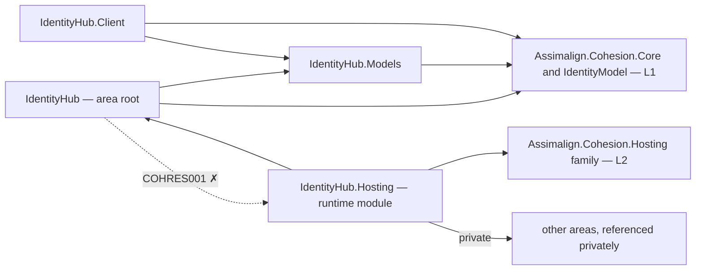

# IdentityHub

IdentityHub is the L3 identity service platform intended to manage tenants, directories, applications, principals, credentials, sessions, token services, federation, and provisioning.

The application builder configures a minimal code-first OpenID Connect issuer with persisted ES256 keys, client credentials, and a loopback Local device-authorization flow. The self-signed fallback is Local-only.

The hub keeps its state behind one contract, `IIdentityHubStore`, which the area root defines. The hub depends on no concrete store: a store package implements the contract for one medium, and the root ships an in-memory store for tests and single-node use. The issuer in `IdentityHub.Hosting` does not run on the store yet; that is the next increment.

IdentityHub is code-first: its identity objects are defined in code, and the same objects can be created at run time through an API. An object defined in code is locked, which means it is read like any other and changes only in the code. App registrations are the first such object. The root defines `IdentityClient`, one application as a client, an API, or both, in the shape of a Microsoft Entra app registration, and `IIdentityClientRegistry`, which serves the registrations defined in code over the ones kept in the store. A registration's identifier is a GUID that `IdentityClientId.FromName` derives from a name, so one created at run time under a name is locked by the deployment whose code defines that name. The issuer does not read the registry yet either.

The old application model's integration, `IdentityHub.Hosting.ApplicationModel` (`builder.Services.AddResource(...)`), was removed with the old model. Its replacement is the resource-provider design in `fabric/`.

## Project map

An arrow means "references": `IdentityHub.Hosting --> IdentityHub` reads
`IdentityHub.Hosting` references `Assimalign.Cohesion.IdentityHub`.



`IdentityHub.Hosting` references the area root and the shared Hosting family, and references
Web, HTTP, Connections, and IdentityModel privately. The root references `IdentityHub.Models`,
and the root, Models, and Client each reference Core and IdentityModel. Solid edges are the
references this area permits. The dotted edge is the one `COHRES001` rejects: **no library in the
area may reference its own `IdentityHub.Hosting` runtime module**. The area root and its feature
libraries likewise reference no `Assimalign.Cohesion.Hosting*` library at all (`COHRES004`).

The full reference graph for every Cohesion assembly, including the exact external dependencies
collapsed above, is in [docs/DEPENDENCIES.md](../../docs/DEPENDENCIES.md).

## Projects

- `Assimalign.Cohesion.IdentityHub` is the area root. It defines the application and builder contracts, the store seam (`IIdentityHubStore`, the record vocabulary, the typed record set, the in-memory store), app registrations and their registry (`IdentityClient`, `IIdentityClientRegistry`), and the area's exception root, alongside the earlier identity domain contracts.
- `Assimalign.Cohesion.IdentityHub.Hosting` provides the concrete creation entry point, issuer endpoints, key persistence, and host lifecycle.
- `Assimalign.Cohesion.IdentityHub.Models` retains the existing tenant-directory DTO shapes while linking principals and credentials to the canonical `Assimalign.Cohesion.IdentityModel` contracts.
- `Assimalign.Cohesion.IdentityHub.Client` is a placeholder project with no types yet.
- `Assimalign.Cohesion.IdentityHub.Refs` and `Assimalign.Cohesion.IdentityHub.Runtime` produce the `App.IdentityHub` shared framework.

Store packages (one per medium) and hub feature packages are planned and do not exist yet. Both
reference the root and never each other, so a feature does not know which store it runs on.

## Layering and dependencies

As an L3 service platform, IdentityHub composes the L2 `Assimalign.Cohesion.Hosting` runtime, which is built on the L1 `Assimalign.Cohesion.Core` foundation. The root and Models projects consume the L1 `Assimalign.Cohesion.IdentityModel` contracts; Models also retains Core for its generated ULID identifiers, and the root uses Core for its generated value objects. The Hosting project publicly depends only on the area root, DependencyInjection, and the shared Hosting runtime; its Web, HTTP, Connections, and IdentityModel references are private.

Applications declare audiences and clients in code with `AddAudience` and `AddClient` on `IIdentityHubApplicationBuilder`. Those two verbs are transitional: they are what the issuer runs on until it adopts the app registration model.

## Project documentation

- [Root overview](./Assimalign.Cohesion.IdentityHub/docs/OVERVIEW.md)
- [Root design](./Assimalign.Cohesion.IdentityHub/docs/DESIGN.md), including the store seam's contract, app registrations and the locked rule for code-first objects, the security rules, and the open decisions
- [Hosting overview](./Assimalign.Cohesion.IdentityHub.Hosting/docs/OVERVIEW.md)
- [Hosting design](./Assimalign.Cohesion.IdentityHub.Hosting/docs/DESIGN.md)
- [Models overview](./Assimalign.Cohesion.IdentityHub.Models/docs/OVERVIEW.md)
- [Models design](./Assimalign.Cohesion.IdentityHub.Models/docs/DESIGN.md)

## Application composition (O34)

The root contracts are hosting-free (O34): `IIdentityHubApplication` exposes `Context`, `StartAsync`, and `StopAsync`; `IIdentityHubApplicationContext` exposes `ContentRootPath`. `IIdentityHubApplicationBuilder` owns area declarations and `Build()`. The root and feature packages reference no `Assimalign.Cohesion.Hosting*` library; COHRES004 enforces the boundary.

`IdentityHubApplication.CreateBuilder(args)` returns the public concrete `IdentityHubApplicationBuilder`; its `Build()` returns the public `IdentityHubApplication : Host<IdentityHubApplicationContext>`. The public `IdentityHubApplicationContext` implements `IIdentityHubApplicationContext`, reading `ContentRootPath` from the host environment. The application explicitly forwards the root lifecycle contract to `IHost`, and consumers use the concrete application for `RunAsync` and `await using`. Runtime options and supporting services remain internal.

```csharp
using Assimalign.Cohesion.IdentityHub.Hosting;

IdentityHubApplicationBuilder builder = IdentityHubApplication.CreateBuilder(args);
// Add area declarations and optional hosting services before Build().
await using IdentityHubApplication application = builder.Build();
await application.RunAsync();
```
