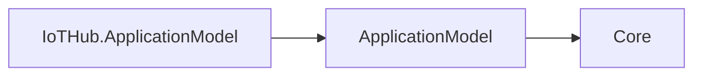

# IoTHub ApplicationModel design

IoTHubResource wraps a manifest snapshot and typed IoTHubResourceOptions, and delegates to its internal planner. AddIoTHub returns IIoTHubResourceDescriptor, a thin graph-descriptor wrapper retaining dependencies and the built plan. The planner validates the kind, Deployment workload, declared area endpoint schemes/protocols, and http control plane at /cohesion/v1, then delegates realization to GenericPlanner. Endpoint ports, extra endpoints, secret/configuration mounts, and generic deployer options remain manifest-driven; no platform types are referenced.

SDK defaults are http/tcp:8080 and a Deployment. Replica counts use generic manifest limits; there is no Scheduler singleton constraint.

This package describes resource manifests, dependencies and deployment plans. Its only direct Cohesion dependency is ApplicationModel, whose contracts depend only on Core. Sdk.ApplicationModel generates control-plane registration in the enabled resource executable; Hosting.Resources and the resource host own the runtime surface and apply the deployment record. The gateway observes infrastructure and delivers the record.

## Runtime-independent dependency direction

