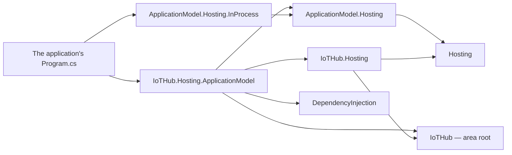

# Assimalign.Cohesion.IoTHub.Hosting.ApplicationModel — Design

> **Status (2026-10-31):** the area's integration with the Application Model, generated from
> the [EmailHub template](../../../EmailHub/Assimalign.Cohesion.EmailHub.Hosting.ApplicationModel/docs/DESIGN.md). The instance-side
> contracts are [ApplicationModel.Hosting](../../../../libraries/ApplicationModel/Assimalign.Cohesion.ApplicationModel.Hosting/docs/DESIGN.md);
> this package is their IoTHub implementation. Web's
> [Web.Hosting.ApplicationModel](../../../Web/Assimalign.Cohesion.Web.Hosting.ApplicationModel/docs/DESIGN.md)
> is the same shape with Web's own actions added.

## Purpose

`builder.Services.AddResource(name, resource => ...)` registers an IoTHub application as a
managed resource instance. The resource opts into each platform it runs on, such as
`resource.UseInProcess()`. When the instance's gateway names one of them, the instance publishes its
manifest and restores the state the gateway kept before the application's services start, through
that platform's client, and the gateway runs the resource's actions through the same client. Without
a named platform the application runs unmanaged and the package registers nothing.

## References

The package references the area root, the area's runtime module IoTHub.Hosting, whose
`builder.Services` it registers into, DependencyInjection, Hosting, and the ApplicationModel.Hosting
contracts. It references no platform: the application references the platforms it opts into. It is
a hosting-family package that references the exact runtime module `Assimalign.Cohesion.IoTHub.Hosting`,
which `COHRES001` permits for this one integration by name, with no exemption property. Arrows mean
"references".

## Composition

For a managed instance, `AddResource` makes one registration in `builder.Services`, a singleton
`IHostService` factory. The container runs it once, when the application is built: it creates the
added actions from the application's `IServiceProvider` and builds these pieces:

| Piece | Role |
| --- | --- |
| `IoTHubResourceOptions` | Derives from `ApplicationInstanceOptions`, so every platform's verb and `AddAction` apply to it. `GetGatewayClient()` selects the client of the platform the environment names, `Deployment` is the deployment that started the instance, and `CreateActions(provider)` creates the added actions. It adds only `Name`. |
| `IoTHubResource` (internal) | The `IApplicationInstance`: provider `IoTHub`, the resource's name, a new instance key, the deployment its environment names, and the actions the application added. It contributes no health. |
| `ApplicationInstanceControlPlane` | ApplicationModel.Hosting's control plane over the resource, writing JSON through the contexts the added actions came with. |
| `ApplicationInstanceService` | Publishes and restores in `StartingAsync` through the selected client, opens the control plane to the gateway's calls in `StartAsync`, and closes it and stops renewing in `StopAsync`. |

## Lifecycle

The area's host lists the application's lifecycle services in registration order and stops them in
reverse:

1. **Every `StartingAsync`.** The resource service publishes the manifest and restores the gateway's
   snapshots before any service starts, wherever `AddResource` sits in `Program.cs`. A refused
   publication fails the application's start.
2. **Services start.** The resource service is one of them: it starts the platform's client
   carrying the gateway's calls to the control plane.
3. **On stop.** Services stop in reverse order; the resource service closes the control plane to the
   gateway and stops renewing.

## Decisions

These are the EmailHub template's decisions; they hold here unchanged unless an area note says
otherwise.

**A1 — One integration package per area.** The area's integration with the Application Model is
`<Area>.Hosting.ApplicationModel`, referencing the area's runtime module, DependencyInjection,
Hosting, and ApplicationModel.Hosting. There is no area definition package: a gateway declares the
resource generically, by provider and name (`builder.AddResource("IoTHub", "devices")`).

**A2 — A resource is a registration.** `AddResource` extends `IServiceProviderBuilder`, so an
application writes `builder.Services.AddResource("devices", resource => ...)` beside its other
registrations. A managed resource is one singleton `IHostService` factory registration; an unmanaged
one registers nothing. The package references the runtime module and the container directly, so the
verb is an ordinary extension member, not a generated component integration.

**A3 — The resource does no transport.** `AddResource` registers the resource service with the
client of the platform the environment names and nothing else: no server, listener, or client of
its own. A platform the resource did not opt into fails the registration, naming the platform.

**A4 — The resource reads its environment, so it runs in process unchanged.** Its options read the
platform and the deployment through Core's `AppEnvironment` (ApplicationModel.Hosting D19), which
reads the program's `AppEnvironmentScope` when a gateway runs the application in its own process.
The area's host stops on that scope's shutdown, so the same `Program.cs` runs in process and on any
other platform it opts into. The in-process end-to-end test runs such a program under an
in-process gateway and writes and reads an added action through the gateway.

**A5 — Added actions come from the base options.** `AddAction`, `JsonContexts`, and `CreateActions`
belong to `ApplicationInstanceOptions` (ApplicationModel.Hosting D21). The resource lists its own
actions first, then the added ones; the control plane rejects a duplicate name, which fails the
application's start. IoTHub has no actions of its own yet, so its serializer is JSON over the
added actions' contexts alone. An area with actions of its own puts its internal context first, as
Web does.

**A6 — No health contributors yet.** The resource reports an empty contributor list. Health
aggregation is an open question of ApplicationModel.Hosting; an area adds contributors when it
answers it.

## Open questions

1. **The area's own actions.** IoTHub exposes no actions of its own yet; actions over its runtime
   (device disable, device twins) arrive with the area program.
2. **Authentication.** Publication and the gateway's calls are the platform's to authenticate; the
   in-process platform needs none.
