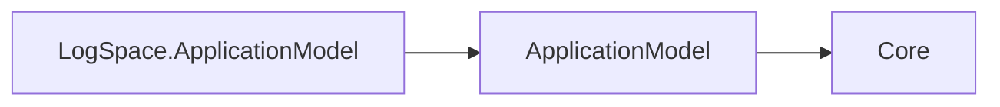

# LogSpace ApplicationModel design

LogSpaceResource wraps a manifest snapshot and typed LogSpaceResourceOptions, and delegates to its internal planner. AddLogSpace returns ILogSpaceResourceDescriptor, a thin graph-descriptor wrapper retaining dependencies and the built plan. The planner validates the kind, StatefulSet workload, declared area endpoint schemes/protocols, and query control plane at /cohesion/v1, then delegates realization to GenericPlanner. Endpoint ports, extra endpoints, secret/configuration mounts, and generic deployer options remain manifest-driven; no platform types are referenced.

The planner requires otlp https/tcp (SDK port 4318), alongside query https/tcp:8443, StatefulSet, and the data Volume at /data with 10Gi. The planner requires the sized data mount; deployer Storage.Size may override capacity. The control plane does not implement telemetry ingestion (item 31b).

This package describes resource manifests, dependencies and deployment plans. Its only direct Cohesion dependency is ApplicationModel, whose contracts depend only on Core. Sdk.ApplicationModel generates control-plane registration in the enabled resource executable; Hosting.Resources and the resource host own local state handlers. The gateway owns infrastructure observation and management reconciliation.

## Runtime-independent dependency direction

