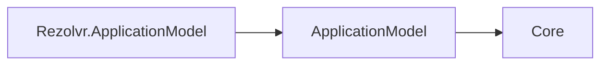

# Rezolvr ApplicationModel design

RezolvrResource wraps a manifest snapshot and typed RezolvrResourceOptions, and delegates to its internal planner. AddRezolvr returns IRezolvrResourceDescriptor, a thin graph-descriptor wrapper retaining dependencies and the built plan. The planner validates the kind, Deployment workload, declared area endpoint schemes/protocols, and admin control plane at /cohesion/v1, then delegates realization to GenericPlanner. Endpoint ports, extra endpoints, secret/configuration mounts, and generic deployer options remain manifest-driven; no platform types are referenced.

SDK defaults retain dns udp:53, dns-tcp tcp:53, and admin http/tcp:8081. Only admin hosts the control plane; the filler does not implement DNS service.

This package describes resource manifests, dependencies and deployment plans. Its only direct Cohesion dependency is ApplicationModel, whose contracts depend only on Core. Sdk.ApplicationModel generates control-plane registration in the enabled resource executable; Hosting.Resources and the resource host own the runtime surface and apply the deployment record. The gateway observes infrastructure and delivers the record.

## Declarative commands (item 31c)

| Wire kind | Descriptor verb | Ownership key |
|---|---|---|
| `rezolvr.add-a-record` | `AddARecord` | record name |
| `rezolvr.add-cname-record` | `AddCnameRecord` | record name |

Kinds use verb-noun kebab under the area prefix. The examples `rezolvr.record` and
`identityhub.audience` in developer-experience design section 7 are illustrative; item 27's design
rewrite should reflect the landed convention. Producer manifests no longer carry command catalogs; the existing command delivery surface is separate from runtime state management.
Typed verbs validate argument shape and use source-generated JSON metadata. Build validates the
advertised kind, canonical payload, deterministic id, and uniqueness of the target ownership key.
The default control plane handles id replay and owner isolation; each area handler also accepts
an identical reapplication with a different id. Conflicts return named Rejected details.

A-record declarations use a BCL IPv4 IPAddress serialized as a string. CNAME declarations
carry a DNS target string; TTL is a positive integer in seconds, defaulting to 300. COHAM001 keeps
Dns assemblies outside the ApplicationModel dependency closure.

Hosting stores records atomically in `records.json` under `ResourceContext.GetMount("data",
Path.GetFullPath(Path.Combine(ContentRootPath, "data")))`. Without a data mount, storage therefore
lives in the content-root-derived data directory. No CohesionMount or CohesionWorkloadKind change
is made: GenericPlanner requires StatefulSet for a Volume while RezolvrPlanner requires Deployment.
The command registry survives restart and restores ownership before the listener starts.

Records are stored, not served as DNS answers. ResolverEndpointService remains parked. DNS serving
and reconciling a durable Volume with the Deployment contract are deferred area work.

## Runtime-independent dependency direction

