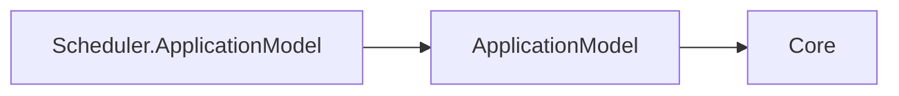

# Scheduler Application Model Design

The package is an opt-in orchestration adapter. SchedulerResource owns the typed manifest and delegates to an internal planner. The planner accepts Scheduler manifests with a singleton stateless Deployment, requires an http TCP endpoint for the control plane, and rejects persistent Volume mounts and storage overrides. Extra endpoints and non-persistent Configuration or Secret mounts retain the generic planner behavior.

This package describes resource manifests, dependencies and deployment plans. Its only direct Cohesion dependency is ApplicationModel, whose contracts depend only on Core. Sdk.ApplicationModel generates control-plane registration in the enabled resource executable; Hosting.Resources and the resource host own local state handlers. The gateway owns infrastructure observation and management reconciliation.

Horizontal scaling is deferred until the Scheduler area defines leader election or distributed occurrence coordination. Both the SDK defaults and planner therefore require one replica and a maximum of one.

## Runtime-independent dependency direction

