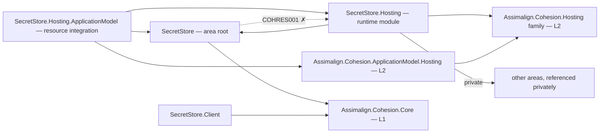

# SecretStore

SecretStore is the L3 operational service platform for protected secret persistence and private certificate workflows. The substantive runtime stores protected files in its durable `data` directory and issues durable private-CA leaves on first resolution of `certs/<name>`. A SecretStore application becomes a managed resource instance with `Assimalign.Cohesion.SecretStore.Hosting.ApplicationModel`: `builder.Services.AddResource("secrets", resource => resource.UseInProcess())` joins the gateway that runs it through the platform it opted into.

## Project map

An arrow means "references": `SecretStore.Hosting --> SecretStore` reads
`SecretStore.Hosting` references `Assimalign.Cohesion.SecretStore`.



Solid edges are the references this area permits. Dotted edges are references the build
rejects. The `COHRES001` edge is the rule for the whole area: **no library in the area may
reference its own `SecretStore.Hosting` runtime module**. The area root and its feature
libraries likewise reference no `Assimalign.Cohesion.Hosting*` library at all (`COHRES004`).

The one exception is the resource integration, `SecretStore.Hosting.ApplicationModel`, which joins
the runtime module to the application model's hosting; `COHRES001` sanctions that
reference by the integration's exact name, with no exemption property.

The full reference graph for every Cohesion assembly, including the exact external dependencies
collapsed above, is in [docs/DEPENDENCIES.md](../../docs/DEPENDENCIES.md).

## Projects

- `Assimalign.Cohesion.SecretStore` defines the public area-root application and builder contracts alongside the existing secret-store abstraction.
- `Assimalign.Cohesion.SecretStore.Hosting` provides the concrete creation entry point, protected file store, private CA, and `/cohesion/v1` HTTP protocol host.
- `Assimalign.Cohesion.SecretStore.Hosting.ApplicationModel` registers the application as a managed resource instance (`builder.Services.AddResource(name, ...)`) on the platform its gateway names, with the actions the application adds.
- `Assimalign.Cohesion.SecretStore.Client` is the thin, Core-only HTTP protocol client; a program that reads the store's secrets or certificates references it directly.

## Layering and dependencies

As an L3 service platform, SecretStore composes the L2 Hosting runtime rather than defining its own host lifecycle. Only `SecretStore.Hosting` crosses into the Web and Security implementations needed to serve HTTP/TLS and protect durable files. The area root remains free of those dependencies.

The client is Core-only and never references `*.Hosting` or an application-model assembly, and it is not delivered through the `App.SecretStore` shared framework. A program that reads the store's secrets or certificates references it directly.

A gateway references neither the client nor the store's runtime: it declares the resource generically (`builder.AddResource("SecretStore", "secrets")`) and runs the actions the instance's application adds through the platform the instance runs on. The resource integration, `SecretStore.Hosting.ApplicationModel`, builds on the instance-side `Assimalign.Cohesion.ApplicationModel.Hosting` contracts, which the App kernel framework carries.

## Certificate scope

- A store with no supplied authority material creates a self-signed development root on first start.
- `certs/<name>` creates a persistent private leaf, renews it near expiration, and returns a PEM bundle containing the leaf, its PKCS#8 key, and its issuer chain.
- `certs/public` (ACME/public-CA issuance) is intentionally deferred to a later design item.

## Project documentation

- [Root overview](./Assimalign.Cohesion.SecretStore/docs/OVERVIEW.md)
- [Root design](./Assimalign.Cohesion.SecretStore/docs/DESIGN.md)
- [Hosting overview](./Assimalign.Cohesion.SecretStore.Hosting/docs/OVERVIEW.md)
- [Hosting design](./Assimalign.Cohesion.SecretStore.Hosting/docs/DESIGN.md)
- [Resource integration overview](./Assimalign.Cohesion.SecretStore.Hosting.ApplicationModel/docs/OVERVIEW.md)
- [Resource integration design](./Assimalign.Cohesion.SecretStore.Hosting.ApplicationModel/docs/DESIGN.md)
- [Client overview](./Assimalign.Cohesion.SecretStore.Client/docs/OVERVIEW.md)
- [Client design](./Assimalign.Cohesion.SecretStore.Client/docs/DESIGN.md)

## Application composition (O34)

The root contracts are hosting-free (O34): `ISecretStoreApplication` exposes `Context`, `StartAsync`, and `StopAsync`; `ISecretStoreApplicationContext` exposes `ContentRootPath`. `ISecretStoreApplicationBuilder` owns area declarations and `Build()`. The root and feature packages reference no `Assimalign.Cohesion.Hosting*` library; COHRES004 enforces the boundary.

`SecretStoreApplication.CreateBuilder(args)` returns the public concrete `SecretStoreApplicationBuilder`; its `Build()` returns the public `SecretStoreApplication : Host<SecretStoreApplicationContext>`. The public `SecretStoreApplicationContext` implements `ISecretStoreApplicationContext`, reading `ContentRootPath` from the host environment. The application explicitly forwards the root lifecycle contract to `IHost`, and consumers use the concrete application for `RunAsync` and `await using`. Runtime options and supporting services remain internal.

```csharp
using Assimalign.Cohesion.SecretStore.Hosting;

SecretStoreApplicationBuilder builder = SecretStoreApplication.CreateBuilder(args);
// Add area declarations and optional hosting services before Build().
await using SecretStoreApplication application = builder.Build();
await application.RunAsync();
```
