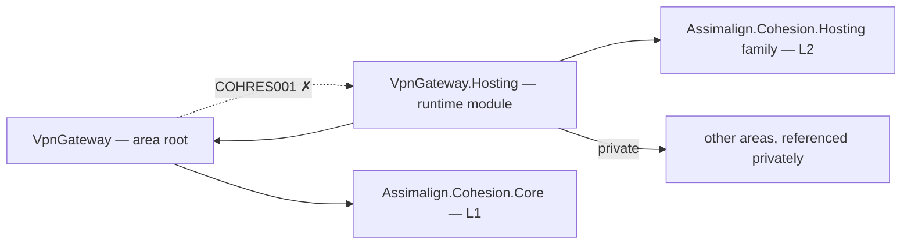

# VpnGateway

VpnGateway is the L3 networking service platform intended to manage tunnels, peers, key exchange policy, route advertisement, and VPN session lifecycle.

The retired resource integration (control plane, health, telemetry) was removed on 2026-10-31 with the application-model restart (assimalign/cohesion#1759), and the area's resource integration returns as `Assimalign.Cohesion.VpnGateway.Hosting.ApplicationModel`. Domain services remain fillers pending the area program.

## Project map

An arrow means "references": `VpnGateway.Hosting --> VpnGateway` reads
`VpnGateway.Hosting` references `Assimalign.Cohesion.VpnGateway`.



Solid edges are the references this area permits. The dotted edge is the one `COHRES001`
rejects: **no library in the area may reference its own `VpnGateway.Hosting` runtime
module**. The area root and its feature
libraries likewise reference no `Assimalign.Cohesion.Hosting*` library at all (`COHRES004`).

The full reference graph for every Cohesion assembly, including the exact external dependencies
collapsed above, is in [docs/DEPENDENCIES.md](../../docs/DEPENDENCIES.md).

## Projects

- `Assimalign.Cohesion.VpnGateway` defines the public area-root application and builder contracts.
- `Assimalign.Cohesion.VpnGateway.Hosting` provides the concrete creation entry point and the caller-configurable host-service lifecycle.

## Layering and dependencies

As an L3 service platform, VpnGateway composes the L2 `Assimalign.Cohesion.Hosting` runtime rather than defining its own host lifecycle. Hosting is built on the L1 `Assimalign.Cohesion.Core` foundation.

## Project documentation

- [Root overview](./Assimalign.Cohesion.VpnGateway/docs/OVERVIEW.md)
- [Root design](./Assimalign.Cohesion.VpnGateway/docs/DESIGN.md)
- [Hosting overview](./Assimalign.Cohesion.VpnGateway.Hosting/docs/OVERVIEW.md)
- [Hosting design](./Assimalign.Cohesion.VpnGateway.Hosting/docs/DESIGN.md)

## Application composition (O34)

The root contracts are hosting-free (O34): `IVpnGatewayApplication` exposes `Context`, `StartAsync`, and `StopAsync`; `IVpnGatewayApplicationContext` exposes `ContentRootPath`. `IVpnGatewayApplicationBuilder` exposes `Build()`; it currently declares no area-specific verbs. The root and feature packages reference no `Assimalign.Cohesion.Hosting*` library; COHRES004 enforces the boundary.

`VpnGatewayApplication.CreateBuilder(args)` returns the public concrete `VpnGatewayApplicationBuilder`; its `Build()` returns the public `VpnGatewayApplication : Host<VpnGatewayApplicationContext>`. The public `VpnGatewayApplicationContext` implements `IVpnGatewayApplicationContext`, reading `ContentRootPath` from the host environment. The application explicitly forwards the root lifecycle contract to `IHost`, and consumers use the concrete application for `RunAsync` and `await using`. Runtime options and supporting services remain internal.

```csharp
using Assimalign.Cohesion.VpnGateway.Hosting;

VpnGatewayApplicationBuilder builder = VpnGatewayApplication.CreateBuilder(args);
// Add area declarations and optional hosting services before Build().
await using VpnGatewayApplication application = builder.Build();
await application.RunAsync();
```
