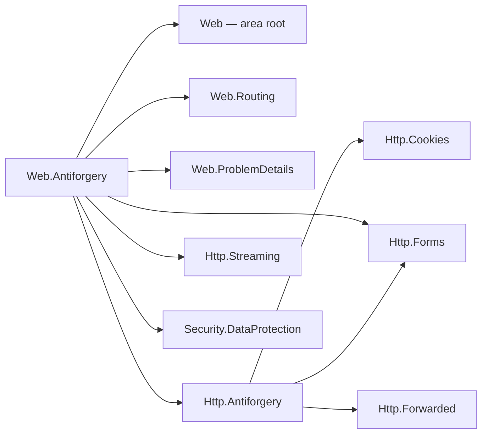
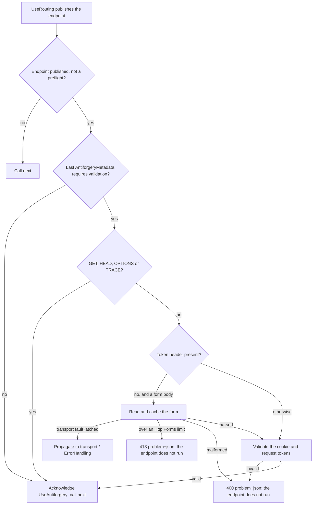

# Assimalign.Cohesion.Web.Antiforgery — Design

## Design intent

`Assimalign.Cohesion.Http.Antiforgery` shipped a complete token engine — a signed double-submit cookie
and request token behind `IHttpAntiforgery`, with a pluggable `IHttpAntiforgeryProtector` seam — but
nothing in the Web area used it, the source-generated form binding checked no token, and its default
protector signed with a per-process random key (issue #1057; D12 in
`docs/programs/HTTP_WEB_PROGRAM_PLAN.md` §7.2). This package is the Web-pipeline half. It owns three
things and nothing else:

- **Registration** — `builder.Services.AddAntiforgery(...)` creates the application's antiforgery
  service once and chooses the protector it seals tokens with.
- **Enforcement** — `UseAntiforgery` validates protected endpoints between `UseRouting` and the
  endpoint.
- **Declaration** — the sealed `AntiforgeryMetadata` carrier and the `RequireAntiforgery` /
  `DisableAntiforgery` convention verbs, plus the requirement the endpoint-binding generator attaches to
  form-bound typed endpoints.

Token framing, cryptography, cookie writing and the request-token read stay in `Http.Antiforgery`. Key
storage and rotation stay in `Security.DataProtection`.

## Home: a feature library, not `Web.Forms`

The issue left the choice open between a new feature library and `Web.Forms`. It is a new library,
recorded in the area README's project map, for three reasons:

- **Antiforgery is not a form concern.** The header-token flow protects any unsafe request — a `fetch`
  posting JSON, a `DELETE` from a single-page application — that never carries a form. Homing it in
  `Web.Forms` would make JSON-only applications take a form-parsing package to get CSRF protection, and
  would make a form package own an endpoint policy.
- **It is an endpoint policy, and the area has a shape for those.** Metadata carrier, middleware after
  `UseRouting`, acknowledgement, convention verbs, end-to-end tests over the real router: the same unit
  as `Web.RateLimiting` and `Web.RequestTimeouts`, each its own package.
- **`Web.Forms` is deliberately single-purpose.** Its design owns exactly `UseForms()`; its
  `RootNamespace` is the area root's, so the antiforgery types would have landed in
  `Assimalign.Cohesion.Web` next to the pipeline abstractions.

The cost is the new-project wiring (framework list, three solutions, CI matrix, release inventory,
docs), paid once.

## Family map

Arrows mean "references". The package composes the token engine, the routing seam and the
data-protection key ring; the token engine composes cookie storage, form parsing and the effective
request scheme that decides whether its cookie token is `Secure`.

| Package | Role |
| --- | --- |
| `Assimalign.Cohesion.Web.Antiforgery` | This package: registration, protector selection, middleware, metadata, verbs |
| `Assimalign.Cohesion.Http.Antiforgery` | The public sealed `HttpAntiforgery` implementation of `IHttpAntiforgery`, its options, the protector seam, `context.Antiforgery` |
| `Assimalign.Cohesion.Security.DataProtection` | The rotating, purpose-bound key ring the production protector derives from |
| `Assimalign.Cohesion.Web.Routing` | The published endpoint and its metadata, the acknowledgement, `IRouterConventionBuilder` |
| `Assimalign.Cohesion.Web.ProblemDetails` | The `application/problem+json` rejection |
| `Assimalign.Cohesion.Http.Forms` | The form read for the form-token flow (shared with the engine) |
| `Assimalign.Cohesion.Http.Streaming` | The committed-response check before a rejection |

The endpoint-binding generator (`analyzers/Assimalign.Cohesion.SourceGeneration.Web`) does not
reference this package. It names `AntiforgeryMetadata` by metadata name and emits the requirement only
when the consuming compilation resolves it (see "The generator integration").

## The validation flow

`UseRouting` selects the endpoint and calls `next`; the pipeline's terminal runs it (#1054). The
middleware sits between the two and decides, per request:

- **The endpoint** is the route match `UseRouting` published (`context.GetRouteMatch()`). No match (a 404)
  and a 405 publish no route match, so the middleware calls `next` and the terminal answers them.
- **A CORS preflight** publishes its candidate endpoint with `IsPreflight` set; the candidate never runs
  for the preflight, which by definition carries no credentials. The middleware neither validates nor
  acknowledges it.
- **The requirement** is the last `AntiforgeryMetadata` in the endpoint's metadata
  (`GetMetadata<AntiforgeryMetadata>()`), so the most specific declaration wins.
- **Exempt methods** are the bodiless safe methods, exactly the set `IHttpAntiforgery` exempts.
  `QUERY` is safe (RFC 10008) but carries a body — the vector antiforgery defends — so it is validated,
  as `Http.Antiforgery` decided. The middleware checks the set itself only so that an exempt request's
  body is never read.
- **Header first, then the form.** The middleware reads the form only when the request carries no token
  header (`HttpAntiforgeryOptions.HeaderName`) and has a `application/x-www-form-urlencoded` or
  `multipart/form-data` body. A client that sends the token in the header therefore keeps its body
  unread, which an endpoint streaming a large upload depends on. This is the order ASP.NET Core's token
  store uses for the same reason. If an earlier middleware such as `UseForms` already parsed the
  body, the validator prefers a nonempty configured form token over the header. Reading the cached
  `request.Form` does not consume the body.
- **The form is parsed once.** `context.ReadFormAsync` caches the parse on the exchange's
  `IHttpFormFeature`, so a form-bound typed endpoint binds from the same parse instead of a consumed
  body. A malformed body the form reader rejects (`InvalidDataException`) carries no token the server
  can verify, and is a validation failure (`400`). A body over a configured Http.Forms limit — the
  reader's `InvalidDataException` with an `HttpFormLimitExceededException` as its cause — is answered
  `413 Content Too Large` instead (RFC 9110 §15.5.14, #1061): the client must send less whatever its
  token, and the endpoint's own form binding answers the same body the same way, so the status does not
  depend on whether the token travels in the header or the form.
- **Transport faults keep their owner.** Both form-error catches require
  `IWebClientFaultFeature.StatusCode` to be null (or the feature to be absent).
  A latched fault, such as invalid chunk framing, propagates to transport /
  `UseErrorHandling` without an antiforgery response or rejection diagnostic
  (#1300 integration repair). The endpoint remains unexecuted.
- **Validation** is `IHttpAntiforgery.IsRequestValidAsync` on the exchange's service
  (`context.Antiforgery`): the one `AddAntiforgery` registered, unless a middleware replaced it for the
  exchange. The service that validates is therefore always the one handlers mint with.

### The rejection

A failed validation is answered with `400 Bad Request` as RFC 9457 `application/problem+json`
(`ProblemDetails.FromStatus`, written with `WriteProblemDetailsAsync`), and the middleware returns
without calling `next`. It is an ordinary short-circuit, not an exception, so no catch-all can turn it
into a 500. The detail is one generic sentence for every failure: whether the cookie, the request token,
or their binding failed is not disclosed. If a middleware ahead of this one already committed the
response head, the status can no longer be set, so the exchange is aborted at the protocol layer instead
and the endpoint still does not run — the same defensive path `Web.RateLimiting` takes.

## Fail closed when the middleware is missing or misordered

An endpoint that requires validation must not run unvalidated because a middleware was forgotten.
`AntiforgeryMetadata` implements routing's `IRouteMiddlewareMetadata`: `RequiredMiddleware` is
`UseAntiforgery` for `Required` and `null` for `Disabled`. The middleware acknowledges every non-preflight
endpoint it processes (`context.AcknowledgeEndpointMiddleware("UseAntiforgery")`), whether it validated,
exempted the method, or found no requirement. When routing dispatches an endpoint whose last
`AntiforgeryMetadata` requires the middleware and the request was never acknowledged — the middleware is
missing, or registered ahead of `UseRouting` where no endpoint is known — it throws
`InvalidOperationException` naming the endpoint and `UseAntiforgery()`.

Routing applies that check last-wins **per runtime type**. That is why both states are instances of one
sealed type: a route's `Disabled` under a group's `Required` supersedes it and requires nothing, so a
webhook route opted out of its group's requirement runs in an application without `UseAntiforgery`. A
second type for "disabled" (or an `IAntiforgeryMetadata` interface with several implementations) would
leave the group's requirement unsuperseded and fail the opted-out route.

## Endpoint metadata and the convention verbs

`AntiforgeryMetadata` is a sealed carrier with a private constructor and two shared instances,
`Required` and `Disabled`. It carries no options: the token names and cookie attributes are application
settings on the registered service, not per-endpoint policy.

`RequireAntiforgery()` and `DisableAntiforgery()` are generic extension members over routing's
`IRouterConventionBuilder`, so one verb serves a mapped route and a route group and returns the receiver's
own builder type. Each appends one instance; routing composes group items before route items when the
route table is built, in any call order.

## The generator integration

Every typed endpoint with a `[FromForm]` parameter or an uploaded-file parameter (`IHttpFormFile`, a
file sequence, `IHttpFormFileCollection`; #1061) requires antiforgery: a form post, files included, is
the request a cross-site page can forge. The endpoint-binding generator chains
`.WithMetadata(global::Assimalign.Cohesion.Web.Antiforgery.AntiforgeryMetadata.Required)` onto the route
its interceptor maps.

- **Only when the application can express it.** The generator emits the requirement only when the
  consuming compilation resolves `AntiforgeryMetadata`, it is accessible, and it exposes the static
  `Required`. An application that does not reference this package compiles exactly as before and needs
  no `UseAntiforgery`. Every `Sdk.Web` application references it through the `App.Web` framework, so
  form-bound endpoints in those applications are protected by default.
- **Route-level, so a group-level opt-out does not reach it.** The requirement is attached where the
  route is mapped, which makes it route-level metadata, more specific than any group declaration. A form
  endpoint under a group that calls `DisableAntiforgery()` is still validated; it opts out with its own
  `.DisableAntiforgery()`, which follows the generated item and wins. ASP.NET Core orders metadata the
  same way: what the request-delegate factory infers is more specific than group conventions. The
  alternative — an "inferred" requirement any explicit declaration overrides — needs resolution rules
  routing's fail-closed check does not share, and would let a group-wide opt-out silently strip form
  endpoints of protection.
- **Every form-bound endpoint, whatever its method.** The rule is "binds a form", not "is a POST": a
  `Map(method, ...)` call site has no static method to inspect, and a safe-method request passes the
  middleware anyway.

Application impact: a `Sdk.Web` application with `[FromForm]` endpoints must register
`builder.Services.AddAntiforgery()`
and `UseAntiforgery` (after `UseRouting`), or opt those endpoints out. Otherwise their requests fail at
dispatch, by design.

## Registration and protector selection

`builder.Services.AddAntiforgery(antiforgery => ...)` is a component integration (owner decision 34,
#1380): the package declares `[assembly: ComponentIntegration]` over the public `AntiforgeryBuilder.Build`
instance method in `src/Properties/ComponentIntegrations.cs`, and the generator projects `AddAntiforgery`
onto `IServiceProviderBuilder` in the application's compilation, so the package takes no
dependency-injection reference. Naming an instance method selects the builder template, whose configure
callback is optional (owner decision 39, 2026-10-10, #1395): `AddAntiforgery()` is the development
default, and the data-protection provider is a builder method,
`AddAntiforgery(antiforgery => antiforgery.UseDataProtection(dataProtectionProvider))`, because it is
optional and the template's only argument is the callback. Until #1395 the verb was two static-factory
overloads, `AddAntiforgery(configure)` and `AddAntiforgery(dataProtectionProvider, configure)`, behind a
hidden `AntiforgeryComponents` type.

`AntiforgeryBuilder` owns the `HttpAntiforgeryOptions` and exposes them as `Options`, as
`AuthenticationBuilder` does. `Build` selects the protector and creates the public sealed
`HttpAntiforgery` through `HttpAntiforgery.Create(options)`; its private constructor needs no
cross-assembly access. The feature exposes the service as `IHttpAntiforgery`, and the verb registers
the feature as an `IHttpFeature` singleton (an `IHttpAntiforgeryFeature`), the only lifetime
`Web.Hosting` accepts (decision 35). The service reads its
options on every request, so `Build` hands it a snapshot, as `ValidationBuilder` does: a copy of `Options`,
the key bytes included, carrying the selected protector. `Build` never writes to `Options`, so a change
made afterward, or a later `UseDataProtection` call, reaches only a later `Build`, never a registered
service. Every `HttpAntiforgeryOptions` member is copied by hand, so a new option needs a line in the
snapshot. A composition surface
without a container registers `Build`'s result through `IWebApplicationBuilder.AddFeature`. The host seeds application features onto every exchange, so the
render path mints with `context.RequireAntiforgery.GetAndStoreTokens(context)` on any route, protected or
not, and with or without `UseAntiforgery`.

The protector is chosen in this order:

1. **An explicit `Options.Protector`** set in the callback wins.
2. **A data-protection provider** passed to `UseDataProtection(dataProtectionProvider)` supplies the
   production default: an `IDataProtector` derived for the purpose chain
   `("Assimalign.Cohesion.Web.Antiforgery", "v1")` (under the provider's application discriminator),
   adapted to the engine's seam. The key ring persists and rotates its keys and names the producing key
   in every payload, so tokens survive restarts and validate on every instance that shares the key
   repository. The purpose isolates tokens from every other payload the ring protects: a cookie
   authentication ticket cannot stand in for a token, or the reverse. The purpose chain is part of the
   token format; changing it invalidates every outstanding token, so a new chain needs a new version
   segment.
3. **Otherwise** the engine's HMAC-SHA256 protector over a per-process random key. This is for
   development only: a restart invalidates every token, and instances behind a load balancer reject each
   other's tokens. It is documented that way on `AntiforgeryBuilder` (the bare `AddAntiforgery()`
   verb), `HttpAntiforgeryOptions.Key`, and
   `IHttpAntiforgeryProtector`.

The adapter maps `DataProtectionException` — every verification and key-lifecycle failure — to
"invalid", because the engine feeds it untrusted request input. That includes a key repository the ring
cannot read while it looks for a key id the token names and the ring does not hold: the token's sender
chooses that id, so it must not be able to turn a repository outage into a `500`. Anything else is an
infrastructure fault and propagates, and so does an unreadable key repository while a token is issued.
This is the adapter `Security.DataProtection`'s design promised; it lives here because this package is
where the Web application composes the two.

A forged token cannot make the ring re-read its repository on every request: an unknown key id reloads
the ring at most once per `DataProtectionOptions.UnknownKeyReloadInterval` (default 30 seconds), and
known keys never wait on that read (#1155; see `Security.DataProtection`'s DESIGN, "Reloads and the
unknown-key throttle").

### Why an explicit provider, not a discovered one

The application "has a data-protection provider" when it hands one over. Web composition is
dependency-free: there is no container to discover a provider in, and there is no application-level
data-protection contract both `Web.Authentication` and this package could read without one of them, or
the area root, owning a data-protection seam. Authentication's explicit provider set the precedent
(today `AuthenticationBuilder.UseDataProtection` inside `builder.Services.AddAuthentication`); sharing
one key ring is passing the same provider to both registrations. A shared application-level provider
feature is a recorded follow-up.

### Why not default to a file-system key ring

`AuthenticationBuilder` creates a file-system key ring under `AppContext.BaseDirectory` when no provider
is supplied. Antiforgery does not copy that default: D12 records that it fails in read-only and
multi-instance containers, and key placement is a deployment decision (#806–#808). Without a provider the
package keeps the engine's in-memory key and says plainly that it is for development.

## Registration semantics

- **One antiforgery service per exchange.** The registered feature reports
  `nameof(IHttpAntiforgeryFeature)` as its name, and so does `Http.Antiforgery`'s own feature (aligned in
  this change), so assigning `context.Antiforgery` on an exchange replaces the registered service rather
  than shadowing it.
- **The last registration wins.** Calling `AddAntiforgery` twice registers two features in the same slot;
  the host seeds them in registration order, so exchanges carry the last, and `UseAntiforgery` resolves
  the last as its fallback.
- **`UseAntiforgery` without `AddAntiforgery` fails the start.** The middleware resolves the registration
  from the application context when the pipeline is built, so a missing registration is an
  `InvalidOperationException` at startup, not a 500 on the first protected post.
- **A malformed cookie name or path fails the registration.** `AddAntiforgery` runs
  `AntiforgeryBuilder.Build`, which creates the service over its options snapshot, before it registers.
  `Http.Antiforgery` checks `HttpAntiforgeryOptions.CookieName` against RFC 6265 §4.1.1's non-empty
  `token` grammar (#1416), and `CookiePath` against `path-value` (#1153). A name such as `a b` set
  through `antiforgery.Options.CookieName`, or a path such as `/tenant;x`, causes `ArgumentException`
  from `AddAntiforgery` and nothing is registered. The exception has `ParamName` `options`, names the
  full option, and wraps the cookie constructor's or setter's exception; neither message echoes the
  invalid value. Valid token punctuation is accepted.

## Ordering

`UseForwardedHeaders` → `UseRouting` → `UseRequestTimeouts` → `UseRateLimiting` → `UseAntiforgery` → endpoint.
The area's [middleware order](../../../../docs/resources/Web/MIDDLEWARE_ORDER.md) places the rest.

- **After `UseRouting`** (required): the endpoint and its metadata are published when the middleware runs.
  Ahead of it, protected endpoints fail at dispatch.
- **After `UseRateLimiting`**: a flood is turned away before any body is read or token decrypted.
- **After `UseRequestTimeouts`**: the form read runs under the endpoint's timeout.
- **Authentication** may come anywhere before the endpoint: tokens are bound to the cookie secret, not to
  the user, so validation does not read `context.User`.

## Error model

| Condition | Outcome |
| --- | --- |
| Missing, malformed, forged, or unbound token on a protected unsafe request | `400` `application/problem+json`; the endpoint does not run |
| Malformed form body, with no token header | `400` `application/problem+json` |
| Form body over a configured Http.Forms limit, with no token header | `413` `application/problem+json` |
| Form read fails with `IWebClientFaultFeature.StatusCode` already latched | Propagates to transport / `UseErrorHandling`; no antiforgery rejection |
| Rejection after the response head was committed | The exchange is aborted |
| A protected endpoint dispatched without `UseAntiforgery` having processed it | `InvalidOperationException` at dispatch |
| `UseAntiforgery` without `AddAntiforgery` | `InvalidOperationException` when the pipeline is built |
| Invalid `HttpAntiforgeryOptions.CookieName` or `CookiePath` | `ArgumentException` from `AddAntiforgery`; no feature is registered |
| Key repository unreadable while the ring looks for a key id a token names | `400` `application/problem+json`, as for a forged token |
| Key repository unreadable while a token is issued, or another infrastructure fault | Propagates |

## Breaking behavior since 10.0.0-preview.1

The #1464 API shape change makes `HttpAntiforgery` the public sealed implementation and changes
both `Create` return types from `IHttpAntiforgery` to `HttpAntiforgery`. Web composition continues
using the same factory call and interface contract, with unchanged registration and request behavior.
Rebuild compiled consumers of the former static factory; the binary break against preview.1 is
recorded on decision 15's terms in
[Http.Antiforgery's design](../../../../libraries/Http/Assimalign.Cohesion.Http.Antiforgery/docs/DESIGN.md#breaking-changes-since-1000-preview1).

The underlying `Http.Antiforgery` service in 10.0.0-preview.1 accepted an invalid `CookieName` at
creation and failed only when a request stored a cookie token. Since #1416 it rejects that name during
composition, so `AddAntiforgery` inherits the earlier failure. This Web package did not ship in
10.0.0-preview.1. Defaults and other valid token names are unchanged; configurations with an invalid
name must be corrected before the application can register antiforgery.

The #1300 integration repair adds no break against 10.0.0-preview.1, which did
not contain this package. Relative to integrated Stage 14, transport-classified
form failures propagate instead of producing a second rejection. Transport still
owns the client response; normal form and token rejections retain their behavior.

## Diagnostics

The internal `AntiforgeryEventSource` uses the provider name
`Assimalign.Cohesion.Web.Antiforgery`. Its events explain rejection and recovery decisions without
reporting successful requests or duplicating server spans. Enable Verbose to investigate rejected
tokens; Warning reports that an already committed response forced the middleware to abort.

| Id | Event | Level | Payload |
| --- | --- | --- | --- |
| 1 | `RequestRejected` | Verbose | `reason` (`TokenInvalid`, `FormMalformed`, `FormTooLarge`), `statusCode:int`, `tokenLocation` (`Header`, `Form`, `None`), `routeTemplate`, `requestId` |
| 2 | `RejectionAborted` | Warning | `reason`, `routeTemplate`, `suppressedCount:int`, `requestId` |
| 3 | `TokenUnprotectFailed` | Verbose | `exceptionType`, `exceptionMessage`, `innerExceptionType` |

`RequestRejected.tokenLocation` follows the validator's parsed-form-first precedence: a nonempty
configured token field already in `request.Form` is `Form`, even when a token header is also present.
An empty or missing field falls back to the header. The middleware still reads the body only when no
token header is present and the content type is a form; a failed form read is also classified as `Form`.
The #1403 review correction changes only diagnostic attribution, preserves validation and streaming
behavior, and introduces no break against `10.0.0-preview.1`, which did not contain this package.

`rejected-requests` is a lazily published `PollingCounter` backed by an exact total maintained without
listeners. An internal exchange feature marks a request after its first rejection, so re-entering the
middleware counts it once. The counter includes every rejected exchange, including those whose abort
warning is suppressed. `RejectionAborted` is limited to one event per second across the process; the
next event reports the number suppressed. There is no unprotect-attempt counter because one request
can require two unprotect operations.

Transport-classified form failures belong exclusively to
`Assimalign.Cohesion.Http.Connections` and produce no antiforgery event or counter
increment. The combined-source `Web.Hosting` tests verify invalid chunk framing
on a protected form-token endpoint, with and without `UseErrorHandling`.

The two middleware events read `IWebRequestIdFeature` and `IRouterEndpointFeature.RouteTemplate` only
inside `IsEnabled`. They never use ambient activities. The protector seam has no request context:
`TokenUnprotectFailed` is the context-free attempt event specified by the scope, and has no fabricated
request id. In contrast, `RejectionAborted` includes the available request id in addition to the scope's
listed payload so an abort can be joined to the request's rejection.

`FormMalformed` includes no exception text: multipart-parser errors can quote the client's header
line. No event reports a header value, form field, cookie, token, body, claim, user, or request path.
Data-protection text is restricted to an allowlist of its six fixed verification and key-lifecycle
messages; custom protector messages become empty. `innerExceptionType` is set only for the fixed
key-repository-read failure, and never includes its message. This keeps custom-provider exceptions
from disclosing tokens or repository paths while retaining the built-in diagnosis.

These diagnostics add no public API or request-processing behavior change. This package did not
exist in `10.0.0-preview.1`. `AntiforgeryEventSourceTests` validates the strict manifest, all event
payloads, counter publication and exact deltas, malformed-form hygiene, custom-provider hygiene,
disabled-listener feature reads, abort throttling, and parsed-form precedence with both tokens present
for default and custom form-field names without additional body reads.

## AOT posture

No reflection, no runtime code generation, no configuration binding, no service location. The middleware
reads metadata with `is` tests, compares methods, parses one media type, and calls the engine; the
registration lookup at pipeline build is a LINQ `OfType` over the application features. Cryptography is
the BCL's (`HMACSHA256`, `AesGcm`, `HKDF`) behind the two seams. The generator's emitted code is a
static property read inside the interceptor it already generates.

## Non-goals

- **Identity-bound tokens.** Tokens bind to the cookie secret only, as `Http.Antiforgery` decided;
  identity binding can layer on later without changing this package's surface.
- **A global mode.** Only endpoints that carry the requirement are validated; there is no "validate every
  unsafe request" switch. Unrouted requests have no endpoint to protect.
- **Tokens in the query string.** Only the header and the form field are read; a token in a URL leaks
  through logs and `Referer`.
- **Automatic pipeline placement.** `Web.Hosting` references no feature package (COHRES002 forbade it
  until 2026-10-09), so the application registers `UseAntiforgery` itself; routing's fail-closed check catches a missing one.
- **Key storage.** Where keys live and how they are shared is `Security.DataProtection`'s and the
  deployment's concern (#806–#808).

## Scope-creep candidates (recorded, not taken)

- An application-level data-protection provider feature that authentication and antiforgery both read,
  so one registration serves both.
- An `OnRejected` hook, as rate limiting has, for applications that want an HTML error page rather than
  problem+json.

## Testing

`tests/AntiforgeryMiddlewareTests.cs` drives the middleware through `UseAntiforgery` over a composing
pipeline harness with an application context (`tests/TestObjects/`); a stage ahead of the middleware
publishes a fake route match, which is what `UseRouting` does. It covers every exempt and validated
method (QUERY included), the header-first read leaving the body unread, the form read and its failure,
last-wins metadata in both directions, the preflight skip, the problem+json body, the committed-head
abort, validation with the exchange's service, a custom header, and a missing registration failing the
build. `tests/AntiforgeryRegistrationTests.cs` covers protector selection: restart survival with a
provider, restart invalidation without one, the pinned purpose chain, rejection of another purpose's
payloads and of tampered tokens, the explicit protector winning, last-registration-wins, and a malformed
cookie path failing the registration. `tests/AntiforgeryCookieNameTests.cs` covers names with and without
a data-protection provider: null, empty, whitespace, separators, control and non-ASCII characters fail
with no feature added, errors wrap the cookie constructor's exception without disclosing the value, and
valid token punctuation reaches the issued cookie.
`tests/AntiforgeryEndToEndTests.cs` and `tests/AntiforgeryRouteConventionTests.cs` run over the in-memory
`WebApplicationTestFactory` with the real router: the cookie-and-header and form-token flows, a token
replayed without its cookie, safe methods, a real CORS preflight, fail-closed dispatch with the middleware
missing or misordered, startup failure without a registration, a multipart upload kept intact by a header
token, a replaced exchange service, and the verbs on routes and groups with and without the middleware.
`tests/AntiforgeryTypedEndpointTests.cs` compiles typed endpoints through the real generator and proves the
attached requirement: rejection without a token, binding from the parsed form, a header token, a route
opt-out, fail-closed dispatch, a group opt-out that does not reach the endpoint, and no requirement on
endpoints that bind no form.

## Data-protection example migration (#1465)

The overview's composition example now uses `FileSystemKeyRepository.Create(path)` inside the
existing `DataProtectionProvider.Create(...)` call. Applications following that example must
rename the repository call and rebuild against the updated DataProtection package; its DESIGN
records the source and binary breaks against 10.0.0-preview.1 on decision 15's terms. This
cleanup changes no Web.Antiforgery API, protector selection, or request behavior.
Advisory: not applicable: API shape.

## Exception messages (#1467)

Exception text lives in `src/Properties/ErrorMessages.resx`. The shared build targets generate
an internal `ErrorMessages` accessor in this project's root namespace under the intermediate
output directory; no designer is checked in. Formatted messages use
`string.Format(CultureInfo.CurrentCulture, ErrorMessages.<Name>, ...)`. Resource extraction
preserves the existing exception text and input-disclosure rules, including any diagnostic
type-only exclusions. EventSource templates, log messages and response bodies retain their
existing ownership. This is a conventions change with no public API or behavior break against
10.0.0-preview.1.

## Configured header grammar (#1476)

The builder's `HttpAntiforgeryOptions.HeaderName` now uses core Http's `HttpFieldName` grammar.
Malformed names and `default` fail during configuration, before the feature is registered; the
middleware unwraps the already checked name for its existing request lookup. The registration
snapshot preserves the typed value. Against 10.0.0-preview.1 the underlying Http option changes
from `string` to `HttpFieldName`, with no additional public Web signature change.
