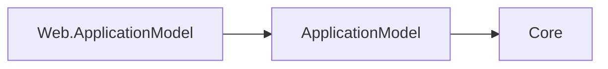

# Assimalign.Cohesion.Web.ApplicationModel - Design

## Intent

This package describes resource manifests, dependencies and deployment plans. Its only direct Cohesion dependency is ApplicationModel, whose contracts depend only on Core. Sdk.ApplicationModel generates control-plane registration in the enabled resource executable; Hosting.Resources and the resource host own local state handlers. The gateway owns infrastructure observation and management reconciliation.

## Manifest-backed resource and options

`WebResource` derives from `PlannedResource`; the base snapshots the supplied
`ResourceManifest` and projects its executable, endpoint, and mount compatibility
surfaces. Artifact identity, endpoints, probes, mounts, lifecycle constraints,
settings, and references remain executable-owned manifest facts.

`WebResourceOptions` derives from the shared `ResourceOptions`. `Replicas` is a
deployer override validated against the manifest's `maxReplicas` at application
build. Public exposure remains a build-produced manifest fact in the signed
`cohesion/plan/v1` contract. The inherited storage slot is not meaningful for this
stateless kind, so a configured storage-size override is rejected rather than ignored.

`AddWeb(manifest, options)` adds the typed resource and keeps plan computation
deferred until `IApplicationBuilder.Build()`.

## Web planner

`WebResource.CreatePlan(PlanContext)` is identified as `Web planner` in build
diagnostics. It requires `Kind = "Web"`, a `Deployment` workload, and no persistent
`Volume` mounts. It inherits the generic endpoint, probe, environment, and mount
mapping, verifies that the result has no stable identity or volume claims and exactly
one ordinary service per endpoint, and preserves the generic public-exposure mapping.

The result is `cohesion/plan/v1` IR only. Kubernetes Ingresses, load balancers,
Docker port publication, local bindings, and certificate resolution are owned by the
selected platform compiler and its gateway inputs. The Web planner neither references
nor identifies a platform.

## Runtime manifest boundary

The producer supplies runtime metadata; this package preserves it without referencing runtime types. The SDK registers the generic control plane in the executable. Producer manifests contain no command catalog or state declarations; configured runtime handlers provide the live state contracts.

The generic plane aggregates `Hosting.Resources` `IHealthContributor` instances, reports observed
endpoints, and accepts graceful-stop requests. Runtime state contracts come from registered handlers
after application configuration. `Web.Hosting` serves health probes at `/healthz`, `/readyz`, and
`/livez`, and the private state protocol below `/cohesion/v2` on the management binding.

## AOT posture

Construction, planning, and registration are static. Golden plan serialization uses
the source-generated `ResourcePlanJsonContext`. There is no assembly scanning,
reflection-based activation, or runtime code generation.

## Typed descriptor seam

`AddWeb` returns `IWebResourceDescriptor`; `RemoteReferenceWeb(declaration, configure)`
provides that surface for a manifest-backed Web external. The internal wrapper delegates to the
registered graph descriptor and retains its exact resource identity. Typed `DependsOn` chaining
retains the Web descriptor type. The shared `IResourceCommandDescriptor` seam is available for
future Web-owned verbs, but this slice adds no Web command kind or mutation handler.

## Exception messages (#1467, #1471)

Resource names are short PascalCase noun phrases naming the failure, at most 40 characters.
The internal naming cleanup preserves message text, placeholders and resource order.

Exception text lives in `src/Properties/ErrorMessages.resx`. The shared build targets generate
an internal `ErrorMessages` accessor in this project's root namespace under the intermediate
output directory; no designer is checked in. Formatted messages use
`string.Format(CultureInfo.CurrentCulture, ErrorMessages.<Name>, ...)`. Resource extraction
preserves the existing exception text and input-disclosure rules, including any diagnostic
type-only exclusions. EventSource templates, log messages and response bodies retain their
existing ownership. This is a conventions change with no public API or behavior break against
10.0.0-preview.1.

## Runtime-independent dependency direction

