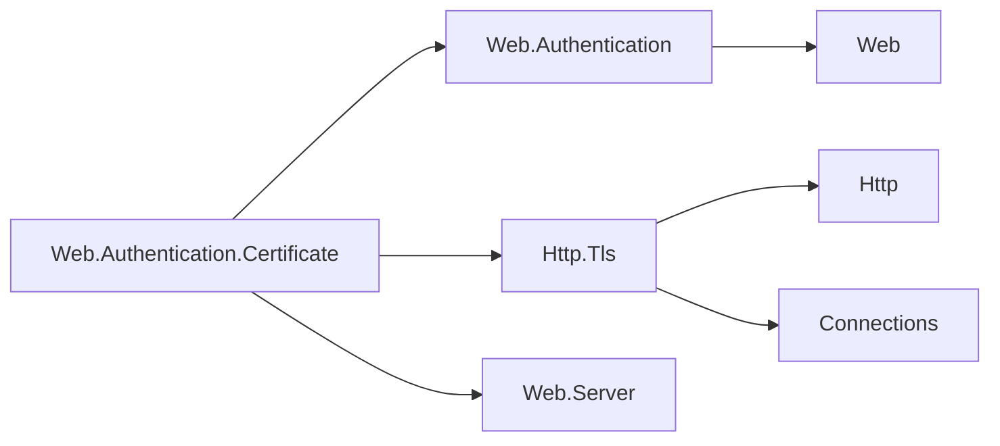

# Assimalign.Cohesion.Web.Authentication.Certificate — Design

## Intent and placement

Turn a validated TLS client certificate into the `ClaimsPrincipal` used by Web authentication and
authorization. Owner decision 31 places the scheme in its own package, alongside Cookie and Bearer.
`IAuthenticationHandler` remains the public contract; `CertificateAuthenticationHandler` is public and sealed
with a private constructor. `CertificateAuthenticationHandler.Create(options)` provides the container-free factory.

The package references the scheme model, TLS feature and Web.Server for its request-id contract.
Web.Server also carries the server engine and Http.Connections in the package closure, with no
connection-driver or Hosting dependency. Neither the transport nor Web.Hosting references this
package. The following arrows mean project references:

| Package | Responsibility |
| --- | --- |
| `Web.Authentication.Certificate` | Certificate claims, application mapping/validation, challenges and forbids |
| `Web.Authentication` | Scheme registry, per-request dispatch, principal and result features |
| `Http.Tls` | Lazy `context.TlsConnection` view over the transport's handshake facts |
| `Web.Server` | Request-id contract used to correlate rejection events |
| `Connections.Security` / `Connections.Quic` | TLS handshake and certificate trust policy, below HTTP |

`AddCertificate()` and `AddCertificate(name, configure)` are `extension(AuthenticationBuilder)`
members. Applications reach them through the existing generated
`builder.Services.AddAuthentication(auth => auth.AddCertificate(...))` verb. This package declares
no component-integration verb and takes no DI reference. The loopback test project opts into the
existing generator to compile that consumer spelling. The assembly is a public member of App.Web;
Web.Hosting's closure is unchanged.

## Trust belongs to the TLS endpoint

The scheme reads `context.TlsConnection?.ClientCertificate`, not a header and not a bare
`Features.Get<IHttpTlsConnectionFeature>()`: the latter can be empty until the accessor materializes
the feature from the connection-info facet (#1367).

The endpoint mode from #1065 determines what reaches this code:

| Endpoint policy | No certificate | Presented certificate rejected by TLS |
| --- | --- | --- |
| No certificate requested | Normally no certificate; `NoResult` | No authentication is attempted from headers |
| `AllowClientCertificate` | Handshake succeeds; scheme returns `NoResult` | Handshake fails; no HTTP exchange |
| `RequireClientCertificate` | Handshake fails; no HTTP exchange | Handshake fails; no HTTP exchange |

A presented certificate must satisfy platform validation, or the endpoint's explicit custom
validator. An untrusted certificate therefore fails authentication at TLS, before the Web handler
could return an `AuthenticateResult`. Tests pin this separation. A certificate accepted by TLS but
rejected by application validation returns `AuthenticateResult.Fail`.

There is no second platform chain build in this scheme. Revalidating against machine trust would
silently overrule endpoints using private roots or certificate pinning, and the TLS feature does not
carry chain errors or the endpoint's mode. No new public interface member is needed. TLS policy is
evaluated at handshake time; applications requiring account, revocation or validity checks on each
request put those additional checks in the callback.

Http.Tls permits an application-installed feature override. Its installer owns validation and the
trustworthiness of that feature, including any TLS-terminating proxy integration. This scheme does
not parse forwarded certificate headers or trust a caller's `Authorization: Certificate` header.

## Principal and callback lifecycle

The handler creates an identity whose authentication type is the registered scheme name, whose
name claim type is `ClaimTypes.X500DistinguishedName`, and whose role claim type is `ClaimTypes.Role`.
It maps four textual certificate properties without decoding or reformatting them:

| Claim type | `X509Certificate2` property |
| --- | --- |
| `ClaimTypes.X500DistinguishedName` | `Subject` |
| `CertificateClaimTypes.Issuer` (`urn:cohesion:certificate:issuer`) | `Issuer` |
| `ClaimTypes.Thumbprint` | `Thumbprint` (BCL hexadecimal SHA-1 identifier, not a trust check) |
| `ClaimTypes.SerialNumber` | `SerialNumber` (BCL hexadecimal representation) |

The default identity name is the full subject distinguished name. Claim issuer metadata remains
the local claims authority; the certificate's issuer DN is a separate claim, not an asserted claim
authority. No role or application account identifier is inferred from a certificate name.

`OnCertificateValidated` receives `CertificateValidatedContext` plus the authenticate call's
cancellation token. It can add claims or replace `Principal`, and `Fail(reason)` permanently marks
that attempt as rejected. A later replacement cannot undo failure; the first reason is retained.
A null principal or an unauthenticated primary identity fails closed. Callback exceptions propagate
as application errors, and cancellation propagates as cancellation rather than an invalid credential.
Failure messages remain in the result and are never copied to response headers or bodies.

The service creates a handler per request and scheme. The handler caches the authentication task,
including an in-flight callback, so repeated authenticate calls on that request use one mapping
attempt. There is no cross-request principal cache: an application can revoke account access on the
next request even on a reused TLS connection. Callback state must support concurrent requests.
Registration snapshots the display name and callback; the direct handler factory snapshots its
callback too. Mutating the options object later cannot alter a registered scheme's validation.

The connection owns the certificate. The callback borrows it and must not dispose it; code retaining
it beyond the exchange makes a copy. Claims hold strings, so they do not extend certificate ownership.
The handler creates no key material, holds no session, and does not implement sign-in or sign-out.

## Challenge and forbid

`ChallengeAsync` sends `401 Unauthorized` and appends `Certificate` to `WWW-Authenticate`,
preserving existing challenges and their parameters when a policy challenges multiple schemes.
`Certificate` is an application-specific challenge token, not a standardized HTTP credential
exchange. It stays constant even for a differently named registration. The listener must already
have requested the certificate: the challenge never initiates TLS renegotiation or post-handshake
authentication. `ForbidAsync` sends `403 Forbidden` with no added challenge or redirect.

Authorization policies can name any registered certificate scheme through
`AddAuthenticationSchemes(name)`. Existing authorization dispatch selects that scheme independently
of the default identity, then challenges anonymous/rejected callers or forbids authenticated callers
missing a policy requirement. The tests use an authenticated alternate default to verify isolation.

## Validation

Unit tests cover claims, absence, callback mapping/rejection, cancellation, per-request caching and
option snapshots. Loopback TLS tests generate certificates in-process and exercise the real host,
the generated AddAuthentication verb, optional and required modes, trust rejection, and named-policy
authorization. No certificate or private key is committed.

## Diagnostics

The internal `CertificateAuthenticationEventSource` reports the handler's failure decisions under
the provider name `Assimalign.Cohesion.Web.Authentication.Certificate`. The dispatcher in
`Web.Authentication` owns no source. The provider has no keywords and reports no authentication
successes.

| Id | Event | Level | Payload |
| --- | --- | --- | --- |
| 1 | `CertificateRejected` | Verbose | `scheme`, `reason` (`NoCertificate` or `ValidationFailed`), `requestId` |

`ValidationFailed` covers a callback's `Fail` result and a null or unauthenticated mapped principal.
`NoCertificate` is emitted only when the handler challenges a request without a certificate: at
that point application policy requires one. Optional authentication without a certificate remains
`NoResult` and emits nothing. A forbid is an authorization decision, so this source does not count
it as a rejected certificate. Callback exceptions and cancellation retain their existing propagation
and do not count as credential rejection.

The `rejected-certificates` total is a lazily created `PollingCounter`, backed by an always-maintained
atomic count. One atomic guard per handler counts once per request and scheme across authentication
and repeated challenges. Authentication's task cache ensures a named Authorization policy
reauthenticating the default scheme reuses the callback result. Reinitializing a handler starts a
new request and resets the guard.

The request id comes from `IWebRequestIdFeature`, read and formatted only when Verbose is enabled;
it is empty when a custom server supplies no feature. No certificate contents, subject, issuer,
thumbprint, serial, principal, claim or callback failure text is emitted. This implementation omits
the optional bounded thumbprint entirely. The Web.Server reference adds no hosting
dependency or framework member.

**Scope deviation: TLS rejection reasons are not observable here.** The requested `UntrustedChain`,
`Expired` and `NotYetValid` categories belong to handshake validation. A TLS-required missing
certificate also fails before there is an HTTP request. The existing `IHttpTlsConnectionFeature`
exposes neither chain errors nor endpoint mode, and `CertificateValidatedContext.Fail(string)`
provides no typed failure reason for optional application checks. Consequently the source reports
the two local reasons above, and does not invent transport events or parse callback text. A second
chain build or new request-time date check would overrule endpoint policy and change authentication
behavior. Richer attribution requires a separately designed validation contract; no public seam,
cross-assembly internal grant or reflection was added for diagnostics.

Source tests validate the provider name, strict manifest, event shape, guarded request-id access,
exact counters and publication. Integration tests show one rejection when Authorization
reauthenticates, and no handler event or counter change when certificate absence or trust failure
prevents the HTTP exchange.

## Compatibility and NativeAOT

This is an additive package absent from 10.0.0-preview.1. No existing interface, default scheme,
endpoint certificate mode or released behavior changes. It does not introduce a preview.1 advisory.

The package inherits `IsAotCompatible=true`. Mapping uses BCL certificate/claim APIs, typed feature
access and factory delegates; it uses no reflection, runtime code generation or service location.
Certificate acquisition, storage, chain-policy configuration, proxy forwarding and account lookup
remain application/transport responsibilities.

## Public implementation compatibility (#1465)

Owner decision 59 makes `CertificateAuthenticationHandler` public and sealed with a private
constructor. `Create(options)` returns the concrete handler, keeping the options snapshot and
null validation. `IAuthenticationHandler` remains the extension contract.

This package and its static `CertificateAuthentication.CreateHandler(options)` entry point
are absent from 10.0.0-preview.1, so there is no preview.1 consumer to migrate. Relative to
the intervening development API, deleting the static class is source- and binary-breaking:
use `CertificateAuthenticationHandler.Create(options)` and rebuild, on decision 15's preview
compatibility terms. Certificate authentication behavior is unchanged.

## Exception messages (#1467)

Exception text lives in `src/Properties/ErrorMessages.resx`. The shared build targets generate
an internal `ErrorMessages` accessor in this project's root namespace under the intermediate
output directory; no designer is checked in. Formatted messages use
`string.Format(CultureInfo.CurrentCulture, ErrorMessages.<Name>, ...)`. Resource extraction
preserves the existing exception text and input-disclosure rules, including any diagnostic
type-only exclusions. EventSource templates, log messages and response bodies retain their
existing ownership. This is a conventions change with no public API or behavior break against
10.0.0-preview.1.

The expected rejection or cancellation messages are cached in static readonly fields: `CertificatePrincipalNotAuthenticated`. Their ordinary lifecycle paths perform no resource lookup per exception.
