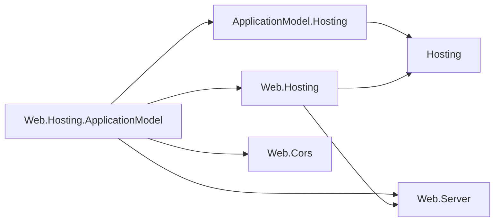

# Assimalign.Cohesion.Web.Hosting.ApplicationModel — Design

> **Status (2026-10-28):** the first resource area on the restarted Application Model. The
> instance-side contracts are [ApplicationModel.Hosting](../../../../libraries/ApplicationModel/Assimalign.Cohesion.ApplicationModel.Hosting/docs/DESIGN.md);
> this package is their Web implementation.

## Purpose

`builder.AddResource(name, resource => ...)` makes a Web application a managed resource instance.
When the gateway that provisioned it set a manifest endpoint, the instance publishes its manifest,
restores the state the gateway kept before the application serves, and serves its control plane
on a private listener. The resource's own actions come from the settings the application
registered, such as its default CORS policy as the `cors` action, and the application can add
actions of its own. Without a manifest endpoint the application runs unmanaged, with the state its
code defines.

## References

The package references the ApplicationModel.Hosting contracts, the Web.Hosting builder it extends,
Web.Server for the engine that serves the control plane, and Web.Cors for the `cors` action. Arrows
mean "references".

## Composition

`AddResource` adds nothing to the application's own composition: the application registers its
features the way it always does, and the resource exposes the settings they registered. For a
managed instance, `AddResource` builds these pieces and registers the last two as host services:

| Piece | Role |
| --- | --- |
| `WebResource` (internal) | The `IApplicationResourceInstance`: provider `Web`, the resource's name, a new instance key, one action for each registered setting the resource knows, then the actions the application added, built when the application is built. |
| `ResourceControlPlane` | ApplicationModel.Hosting' control plane over the resource, writing JSON through the resource's own context and the contexts the added actions came with. |
| `ResourceManifestPublisher` | The HTTP publisher for `COHESION_MANIFEST_ENDPOINT`, with the builder's optional HTTP client callback. |
| `ResourceService` | Publishes and restores in `StartingAsync`, then renews the lease until `StopAsync`. |
| `WebResourceControlPlaneServer` (internal) | Serves the control plane on `COHESION_CONTROL_PLANE_ENDPOINT`. |

## Lifecycle

The Web host lists the application's services, in registration order, ahead of its servers, and
stops them in reverse. A managed instance runs like this:

1. **Every `StartingAsync`.** The resource service publishes the manifest and restores the
   gateway's snapshots, before any service or server starts, wherever `AddResource` sits in
   `Program.cs`. A refused publication fails the application's start.
2. **Application services start.** The control-plane server is one of them: it opens the private
   listener.
3. **The application's servers start** and serve with the restored state.
4. **On stop.** The application's servers drain first while the control plane is still reachable.
   Then the application's services stop in reverse order: the control-plane server closes and the
   resource service stops renewing.

## Control-plane HTTP

| Route | Effect |
| --- | --- |
| `GET /manifest` | The instance's manifest. |
| `GET /actions/{name}` | Reads an action. |
| `POST /actions/{name}` | Writes an action; the body is its input. |
| `PUT /state/{name}` | Restores an action's state; the body is the snapshot's value. |

Bodies are JSON, labeled `application/json`. A result is
`{status, output?, reason?, state?: {action, value}}`. Statuses are 200 (succeeded), 400 (rejected),
404 (no such action), and 405 (operation not accepted); any other failure is the engine's 500.

The `cors` action's content is the default policy in camel case, such as
`{"origins": ["https://shop.example"], "methods": ["GET"], "allowCredentials": false}`. An empty
`origins` list means no default policy; `*` alone allows any origin, method, or header.

## Decisions

**W1 — The control plane runs on Web.Server's engine, not on a second Web application (owner
request, 2026-10-28).** The first version built a `WebApplication` inside the resource service: a
second host, with its own container, configuration, environment, interceptors and lifecycle, started
from inside one of the first host's services. The server is now a `WebApplicationServer` with a
one-handler `IWebApplicationPipeline` on the private listener: the engine the application's own
default server uses, without a host around it. The listener keeps Http.Connections' default limits,
a 30 MB body cap and its header and data-rate timeouts. The server is internal; it becomes public
when a second area's ApplicationModel.Hosting package needs an HTTP control plane.

**W2 — The server is a host service of its own, next to the resource service.** A host completes
every `StartingAsync` before any `StartAsync`, so the server listens only once the gateway's state
is in effect, and the Web host's stop order keeps it reachable while the application drains. The
resource service knows no server, so an in-process gateway registers none and calls
`IResourceService.ControlPlane` directly. A gateway push that arrives before the listener opens is
refused, and the gateway-to-instance channel retries it with the current state.

**W3 — The listener is private.** It binds the IP address or `localhost` in
`COHESION_CONTROL_PLANE_ENDPOINT` and is never mounted on the application's pipeline. The
application's middleware (authentication, CORS, rate limits) never sees a control-plane request,
and its public listener never exposes one.

**W4 — Actions come from the application's settings (owner decision, 2026-10-28).** A Web
application exposed as a resource keeps its own code: `builder.Services.AddCors(...)` and
`app.UseCors()` stay as they are. The resource builds its control plane when the application is
built, after the container exists, from `IWebApplicationContext.Settings`: each setting whose type
it knows becomes an action, and the last registration of a name wins, as it does for the feature.
The `cors` setting (`IWebApplicationSetting<CorsPolicy?>`) becomes the `cors` action. The action
keeps no copy of the state: a read reports the setting's value as a `WebCorsPolicy`, and a write or
a restore builds a `CorsPolicy` and sets it, which the CORS middleware applies from the next
request. A policy CORS refuses is rejected and the setting keeps its value. A setting the resource
has no action for, or a feature the application never registered, stays out of the manifest.
*Rejected:* configuring CORS on the resource (`AddCors` on the resource's builder, served by
`app.UseCors(resource)`), the first version. Exposing an existing application then meant rewriting
it, and the action rebuilt CORS through a capturing pipeline builder to swap the middleware.

**W5 — The resource's own actions are hidden; the application adds its own (owner request,
2026-10-28).** The actions the resource builds from settings, and their content types such as the
`cors` action's policy, are internal: the gateway and its platform see only content, described by
the manifest and this document. `WebResourceOptions.AddAction` adds an action the application
defines, as an instance or as a factory that runs once the application's container exists. Added
actions follow the resource's own in the manifest. A name already in use fails the application's
build, because the control plane rejects duplicate names, so an added action cannot replace one of
the resource's own.

**W6 — Control-plane content is JSON, written per action through its own context (owner request,
2026-10-28).** Hiding the resource's content types rules out a serializer the platform chooses:
such a serializer must know every type an instance exchanges, which only public types allow. The
serializer is therefore JSON over ApplicationModel.Hosting' context, the resource's internal context, and
the context each added action came with, in that order. A platform needs no resource's types: it
stores snapshots as opaque bytes and passes action content through. *Rejected:* the resource's
builder taking a platform's serializer, the previous version; it made every action's content type
public API, and a platform had to track every area's types.

## Open questions

1. **Authentication.** Publication and the control plane are anonymous.
2. **Content type.** The control plane does not check that a request's `Content-Type` is JSON.
3. **Predicate policies.** A CORS policy built with `SetIsOriginAllowed` holds code: it reads as a
   policy with no origins, and a write replaces it. Web.Cors needs to say when a policy has no data
   form, so the action can refuse to report or overwrite it.
4. **Named policies.** Only the default policy is a setting; named policies stay fixed in code.
