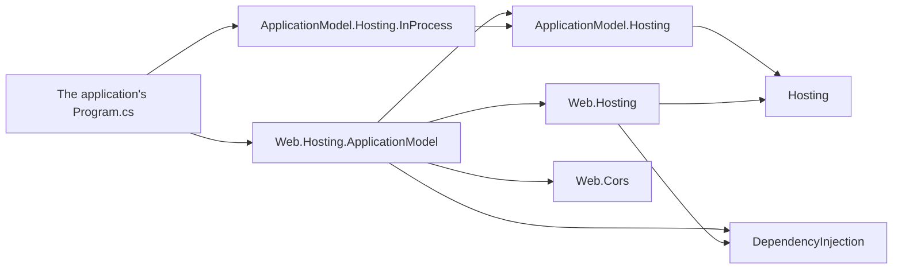

# Assimalign.Cohesion.Web.Hosting.ApplicationModel — Design

> **Status (2026-10-30):** the first resource area on the restarted Application Model. The
> instance-side contracts are [ApplicationModel.Hosting](../../../../libraries/ApplicationModel/Assimalign.Cohesion.ApplicationModel.Hosting/docs/DESIGN.md);
> this package is their Web implementation. Since 2026-10-30 it carries no transport: the platform
> a resource opts into publishes for it and carries the gateway's calls in (W9). Since 2026-10-31 a
> resource is a registration in `builder.Services` (W10), and it follows the model's renames of that
> day: it implements `IApplicationInstance`, `IApplicationInstanceAction`, and
> `IApplicationInstanceActionState`, and its instance client is the platform's
> `IApplicationInstanceGatewayClient`. Its public surface keeps the user's word, resource.

## Purpose

`builder.Services.AddResource(name, resource => ...)` registers a Web application as a managed
resource instance.
The resource opts into each platform it runs on, such as `resource.UseInProcess()`. When the
instance's gateway names one of them, the instance publishes its manifest and restores the state the
gateway kept before the application serves, through that platform's client, and the gateway runs
the resource's actions through the same client. The resource's own actions come from the settings
the application registered, such as its default CORS policy as the `cors` action, and the
application can add actions of its own. Without a named platform the application runs unmanaged,
with the state its code defines.

## References

The package references the ApplicationModel.Hosting contracts, Web.Hosting, DependencyInjection,
whose service registrations (`builder.Services`) it adds the resource to, and Web.Cors for the
`cors` action. It references no platform: the application references the platforms it opts into.
Arrows mean "references".

## Composition

`AddResource` changes nothing in the application's own composition: the application registers its
features the way it always does, and the resource exposes the settings they registered. For a
managed instance, `AddResource` makes one registration in `builder.Services`, a singleton
`IHostService` factory. The container runs it once, when the application is built: it resolves the
registered settings (`IEnumerable<IWebApplicationSetting>`), creates the added actions from the
application's `IServiceProvider`, and builds these pieces:

| Piece | Role |
| --- | --- |
| `WebResourceOptions` | Derives from `ApplicationInstanceOptions`, so every platform's verb applies to it; its `GetGatewayClient()` selects the client of the platform the environment names, and its `Deployment` is the deployment that started the instance. |
| `WebResource` (internal) | The `IApplicationInstance`: provider `Web`, the resource's name, a new instance key, the deployment its environment names, one action for each registered setting the resource knows, then the actions the application added, built when the application is built. |
| `ApplicationInstanceControlPlane` | ApplicationModel.Hosting's control plane over the resource, writing JSON through the resource's own context and the contexts the added actions came with. |
| `ApplicationInstanceService` | Publishes and restores in `StartingAsync` through the selected client, opens the control plane to the gateway's calls in `StartAsync`, and closes it and stops renewing in `StopAsync`. |

## Lifecycle

The Web host lists the application's services, in registration order, ahead of its servers, and
stops them in reverse. A managed instance runs like this:

1. **Every `StartingAsync`.** The resource service publishes the manifest and restores the
   gateway's snapshots, before any service or server starts, wherever `AddResource` sits in
   `Program.cs`. A refused publication fails the application's start.
2. **Application services start.** The resource service is one of them: it starts the platform's
   client carrying the gateway's calls to the control plane.
3. **The application's servers start** and serve with the restored state.
4. **On stop.** The application's servers drain first while the control plane is still reachable.
   Then the application's services stop in reverse order: the resource service closes the control
   plane to the gateway and stops renewing.

The `cors` action's content is the default policy in camel case, such as
`{"origins": ["https://shop.example"], "methods": ["GET"], "allowCredentials": false}`. An empty
`origins` list means no default policy; `*` alone allows any origin, method, or header.

## Decisions

**W1 — Superseded by W9 (2026-10-30).** The control plane ran on Web.Server's engine on a private
listener (`WebResourceControlPlaneServer`), serving the HTTP binding of the earlier ApplicationModel
C5. The server and the binding were removed: a platform carries the gateway's calls.

**W2 — Superseded by W9 (2026-10-30).** The server was a host service of its own beside the resource
service. Its timing survives in the resource service: the control plane opens in `StartAsync`, after
every `StartingAsync`, and closes in `StopAsync`, after the application's servers have drained.

**W3 — Superseded by W9 (2026-10-30).** The private listener is gone with the server, so the
application's middleware and public listener still never see a gateway's call.

**W4 — Actions come from the application's settings (owner decision, 2026-10-28).** A Web
application exposed as a resource keeps its own code: `builder.Services.AddCors(...)` and
`app.UseCors()` stay as they are. The resource builds its control plane when the application is
built, after the container exists, from `IWebApplicationContext.Settings`: each setting whose type
it knows becomes an action, and the last registration of a name wins, as it does for the feature.
The `cors` setting (`IWebApplicationSetting<CorsPolicy?>`) becomes the `cors` action. The action
keeps no copy of the state: a read reports the setting's value as a `WebCorsPolicy`, and a write or
a restore builds a `CorsPolicy` and sets it, which the CORS middleware applies from the next
request. A policy CORS refuses is rejected and the setting keeps its value. A setting the resource
has no action for, or a feature the application never registered, stays out of the manifest.
*Rejected:* configuring CORS on the resource (`AddCors` on the resource's builder, served by
`app.UseCors(resource)`), the first version. Exposing an existing application then meant rewriting
it, and the action rebuilt CORS through a capturing pipeline builder to swap the middleware.

**W5 — The resource's own actions are hidden; the application adds its own (owner request,
2026-10-28).** The actions the resource builds from settings, and their content types such as the
`cors` action's policy, are internal: the gateway and its platform see only content, described by
the manifest and this document. `WebResourceOptions.AddAction` adds an action the application
defines, as an instance or as a factory that runs once the application's container exists. Added
actions follow the resource's own in the manifest. A name already in use fails the application's
build, because the control plane rejects duplicate names, so an added action cannot replace one of
the resource's own.

**W6 — Control-plane content is JSON, written per action through its own context (owner request,
2026-10-28).** Hiding the resource's content types rules out a serializer the platform chooses:
such a serializer must know every type an instance exchanges, which only public types allow. The
serializer is therefore JSON over the contracts' own context, the resource's internal context, and
the context each added action came with, in that order. A platform needs no resource's types: it
stores snapshots as opaque bytes and passes action content through. *Rejected:* the resource's
builder taking a platform's serializer, the previous version; it made every action's content type
public API, and a platform had to track every area's types.

**W7 — The resource reads its environment, so it runs in process unchanged (2026-10-29).**
`WebResourceOptions` reads the platform and the deployment through Core's `AppEnvironment` (its base
does, ApplicationModel.Hosting D19), and a platform's client reads its own variables the same way.
That reads the program's `AppEnvironmentScope` when a gateway runs the application in its own process
(Gateway.InProcess). The resource repeats the deployment in its manifest, which is what makes its
gateway count the deployment ready (ApplicationModel.Gateway G34). With Web.Hosting binding the
platform's `http` endpoint, the same `Program.cs` (`CreateBuilder(args)`,
`builder.Services.AddResource(name, resource => resource.UseInProcess())`) runs in process and on
any other platform it opts into. The
in-process end-to-end test runs two such programs, one calling the other at the address its setting
received.

**W8 — The gateway manages the resource through its platform (2026-10-30).** The platform's client
names where the gateway reaches the control plane in the manifest it publishes (ApplicationModel.Hosting
D18), so the gateway runs an operator's action on the instance and restores a write made on another
instance (ApplicationModel.Gateway G38). The management end-to-end test runs `orders-api` in the
gateway's process and a second instance beside it, both on the in-process platform: a CORS write
through the gateway runs on the earliest instance by a direct call, is recorded, changes the origin
both instances allow, and a restarted instance starts with it. A restore reaches an instance only
once its client opened the control plane, after its publication; one sent earlier fails, the gateway
unregisters the instance, and the instance takes the state from its next publication.

**W9 — The resource does no transport (owner, 2026-10-30).** Transports belong to the platforms
(ApplicationModel C5). `AddResource` selects the client of the platform the instance's environment
names (`WebResourceOptions.GetGatewayClient()`), registers the resource service with it, and
registers nothing else: no server, no listener, no HTTP client. `ManifestEndpoint`,
`ControlPlaneEndpoint` and `HttpClientFactory` left `WebResourceOptions`; `Deployment` moved to its
base. A platform the resource did not opt into fails the application's build, naming the platform.
*Rejected:* keeping Web's HTTP server as the transport every area reuses; every area would carry a
transport, and a platform could not choose push or pull.

**W10 — A resource is a registration (owner, 2026-10-31).** `AddResource` extends
`IServiceProviderBuilder`, so an application writes `builder.Services.AddResource("orders-api",
resource => ...)` beside its features' registrations. A managed resource is one singleton
`IHostService` factory registration, which the container runs when the application is built; it
resolves the registered settings itself, and an added action's factory receives the application's
`IServiceProvider`. An unmanaged resource registers nothing. The package references Web.Hosting and
the container directly, so the verb is an ordinary extension member, not a generated component
integration. *Rejected:* the `WebApplicationBuilder` extension, the previous version; the resource
was the one input an application composed outside `builder.Services`, and its action factories
took the concrete Web context only to reach the provider.

## Open questions

1. **Authentication.** Publication and the gateway's calls are the platform's to authenticate; the
   in-process platform needs none.
2. **Predicate policies.** A CORS policy built with `SetIsOriginAllowed` holds code: it reads as a
   policy with no origins, and a write replaces it. Web.Cors needs to say when a policy has no data
   form, so the action can refuse to report or overwrite it.
3. **Named policies.** Only the default policy is a setting; named policies stay fixed in code.
