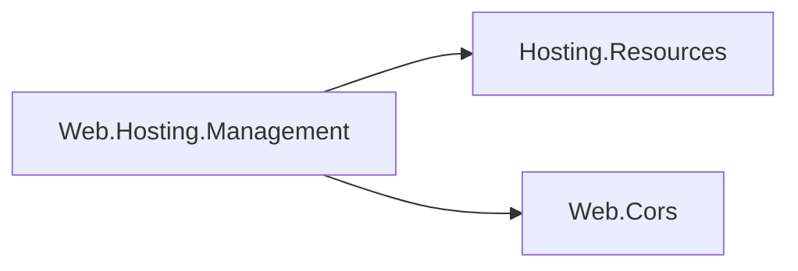

# Web hosting management design

This hosting-family integration turns Web feature stores into deployment-record configuration
sections. The arrows are references:

The package references neither the exact Web.Hosting runtime module, Application Model, nor a
gateway. Web.Cors keeps its dependency-free policy ownership: it may not reference Hosting.Resources
(COHRES004), so the section that needs both lives here. The package stays NuGet-only so its closure
does not land in every resource framework that carries Web.Hosting privately.

## CORS section

`CorsPolicyStore.AsResourceConfiguration()` creates `ResourceConfigurationSection.Create` over
`CorsJsonContext.Default.CorsConfiguration` at the path `Web:Cors` with `Live` mutability, `Process`
scope and no claims; an overload takes another path for an application that publishes more than one
store. The store's configuration when the section is created is its baseline, the value the
deployment record's layers merge over. Applying an effective value calls `CorsPolicyStore.Replace`,
which validates the whole replacement before publishing any of it, so a refusal leaves every policy
in force. The store's retention rule also holds: a named policy endpoints may use cannot be removed
while the process runs, so removing one is refused until the next restart.

A refusal is reported as `cors-invalid: <the store's message>` in the section's status. The store's
messages name policies, origins and headers, which the authenticated control plane may show; they
never contain configuration secrets because CORS has none. A value that does not bind through
`CorsJsonContext` (an unknown member, a null collection) is refused by Hosting.Resources before the
store sees it.

## Retired

The parked codex design put versioned CORS and TLS certificate state adapters here
(`CorsResourceStateHandler`, `CertificateResourceStateHandler`, embedded state schemas and a
certificate resolver). They are deleted. A certificate is delivered as a Secret-backed mount that the
listener reloads, not as configuration state.

## AOT posture

Binding and schema generation use the feature's source-generated metadata; nothing reflects at run
time. `samples/Assimalign.Cohesion.Web.Management.AotGuard` publishes with NativeAOT and runs the
schema export, record loading, merging and binding paths.
