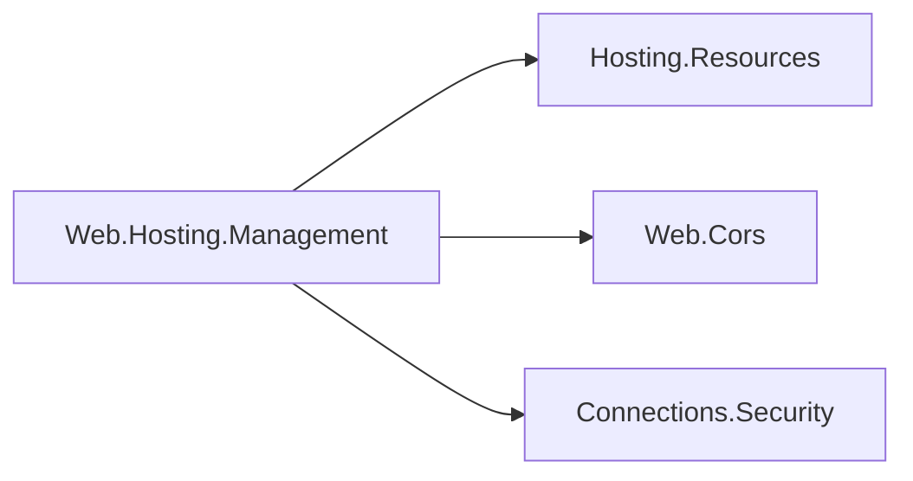

# Web hosting management design

This hosting-family integration adapts Web features to the generic runtime state protocol. The
dependency arrows mean references:

The integration does not reference the exact Web.Hosting runtime module, Application Model, or
gateways. Web.Cors retains its dependency-free policy ownership. The optional integration remains
NuGet-only so its feature closure is not pulled into all other resource frameworks.

## Metadata and registration

The SDK publishes only the management binding. Adapters load resource-owned embedded schemas and
compute canonical contract digests when registered at startup. Hosting.Resources freezes registered
capabilities and effective configured baselines before the host starts. The gateway discovers this
catalog through authenticated runtime transport. Build-time state items and generated state
accessors are retired; no resource executable is evaluated during manifest generation.

## CORS

`CorsResourceStateHandler` borrows the pipeline's store. The feature store publishes policy,
authority, revision and desired digest in one atomic snapshot. Equal revision/digest is idempotent;
older revisions and conflicting authorities are refused. The adapter captures a separate immutable
startup baseline after configuration is applied. Managed snapshots cannot be replaced
through the unversioned API. Retained named-policy checks and static middleware behavior remain.

## Certificates

`CertificateResourceStateHandler` borrows the startup certificate. Its explicitly supplied resolver
must authorize provider/key access and return the exact immutable version with its private key.
The adapter validates usability and owns subsequently resolved certificates. Listener configuration
installs a selection callback rather than replacing an application callback silently. State and
the certificate selected for new handshakes commit under one lock. Existing sessions are untouched.

Retired certificates remain owned until adapter disposal, after listeners drain. This avoids
disposing a certificate still referenced by an in-flight handshake. A failed/stale/concurrent
resolution disposes its unused candidate. The initial borrowed certificate stays caller-owned.

## Errors and AOT

Invalid inputs produce stable validation/application codes. Resolver failures propagate to the
gateway's per-instance operation result; private material is never serialized. Serialization uses
explicit source-generated metadata, and registration uses typed factories without reflection or
runtime discovery. Builds preserve all resource isolation and NativeAOT guards.
