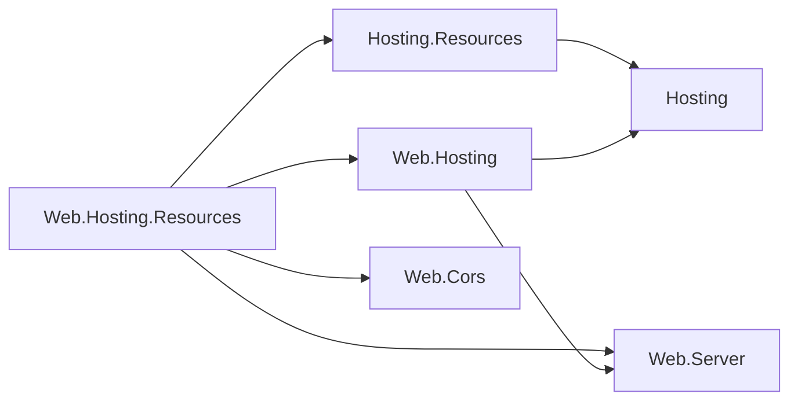

# Assimalign.Cohesion.Web.Hosting.Resources — Design

> **Status (2026-10-28):** the first resource area on the restarted Application Model. The
> instance-side contracts are [Hosting.Resources](../../../../libraries/Hosting/Assimalign.Cohesion.Hosting.Resources/docs/DESIGN.md);
> this package is their Web implementation.

## Purpose

`builder.AddResource(name, resource => ...)` makes a Web application a managed resource instance.
When the gateway that provisioned it set a manifest endpoint, the instance publishes its manifest,
restores the state the gateway kept before the application serves, and serves its control plane
on a private listener. The package also exposes the application's default CORS policy as the
resource's `cors` action. Without a manifest endpoint the application runs unmanaged, with the
state its code defines.

## References

The package references the Hosting.Resources contracts, the Web.Hosting builder it extends,
Web.Server for the engine that serves the control plane, and Web.Cors for the `cors` action. Arrows
mean "references".

## Composition

For a managed instance, `AddResource` builds these pieces and registers the last two as host
services:

| Piece | Role |
| --- | --- |
| `WebResource` | The `IResource`: provider `Web`, the resource's name, a new instance key, and its actions. |
| `ResourceControlPlane` | Hosting.Resources' control plane over the resource and the content serializer. |
| `ResourceManifestPublisher` | The HTTP publisher for `COHESION_MANIFEST_ENDPOINT`, with the builder's optional HTTP client callback. |
| `ResourceService` | Publishes and restores in `StartingAsync`, then renews the lease until `StopAsync`. |
| `WebResourceControlPlaneServer` (internal) | Serves the control plane on `COHESION_CONTROL_PLANE_ENDPOINT`. |

## Lifecycle

The Web host lists the application's services, in registration order, ahead of its servers, and
stops them in reverse. A managed instance runs like this:

1. **Every `StartingAsync`.** The resource service publishes the manifest and restores the
   gateway's snapshots, before any service or server starts, wherever `AddResource` sits in
   `Program.cs`. A refused publication fails the application's start.
2. **Application services start.** The control-plane server is one of them: it opens the private
   listener.
3. **The application's servers start** and serve with the restored state.
4. **On stop.** The application's servers drain first while the control plane is still reachable.
   Then the application's services stop in reverse order: the control-plane server closes and the
   resource service stops renewing.

## Control-plane HTTP

| Route | Effect |
| --- | --- |
| `GET /manifest` | The instance's manifest. |
| `GET /actions/{name}` | Reads an action. |
| `POST /actions/{name}` | Writes an action; the body is its input. |
| `PUT /state/{name}` | Restores an action's state; the body is the snapshot's value. |

Bodies are written by the control plane's content serializer and labeled with its media type. A
result is `{status, output?, reason?, state?: {action, value}}` in JSON. Statuses are 200
(succeeded), 400 (rejected), 404 (no such action), and 405 (operation not accepted); any other
failure is the engine's 500.

## Decisions

**W1 — The control plane runs on Web.Server's engine, not on a second Web application (owner
request, 2026-10-28).** The first version built a `WebApplication` inside the resource service: a
second host, with its own container, configuration, environment, interceptors and lifecycle, started
from inside one of the first host's services. The server is now a `WebApplicationServer` with a
one-handler `IWebApplicationPipeline` on the private listener: the engine the application's own
default server uses, without a host around it. The listener keeps Http.Connections' default limits,
a 30 MB body cap and its header and data-rate timeouts. The server is internal; it becomes public
when a second area's Hosting.Resources package needs an HTTP control plane.

**W2 — The server is a host service of its own, next to the resource service.** A host completes
every `StartingAsync` before any `StartAsync`, so the server listens only once the gateway's state
is in effect, and the Web host's stop order keeps it reachable while the application drains. The
resource service knows no server, so an in-process gateway registers none and calls
`IResourceService.ControlPlane` directly. A gateway push that arrives before the listener opens is
refused, and the gateway-to-instance channel retries it with the current state.

**W3 — The listener is private.** It binds the IP address or `localhost` in
`COHESION_CONTROL_PLANE_ENDPOINT` and is never mounted on the application's pipeline. The
application's middleware (authentication, CORS, rate limits) never sees a control-plane request,
and its public listener never exposes one.

**W4 — The `cors` action swaps the live CORS middleware.** Web.Cors has no seam for changing a
policy at run time, so the action builds a CORS middleware by calling `UseCors` on a capturing
builder and swaps it into the middleware `app.UseCors(resource)` registered. A write's snapshot is
what the gateway restores on new instances.

## Open questions

1. **Authentication.** Publication and the control plane are anonymous.
2. **Content type.** The control plane does not check a request's `Content-Type` against its
   serializer's media type, and nothing tells an instance which serializer its platform uses.
3. **CORS at run time.** W4's capture goes away once Web.Cors can change its policy at run time, or
   once CORS becomes restart-applied state.
