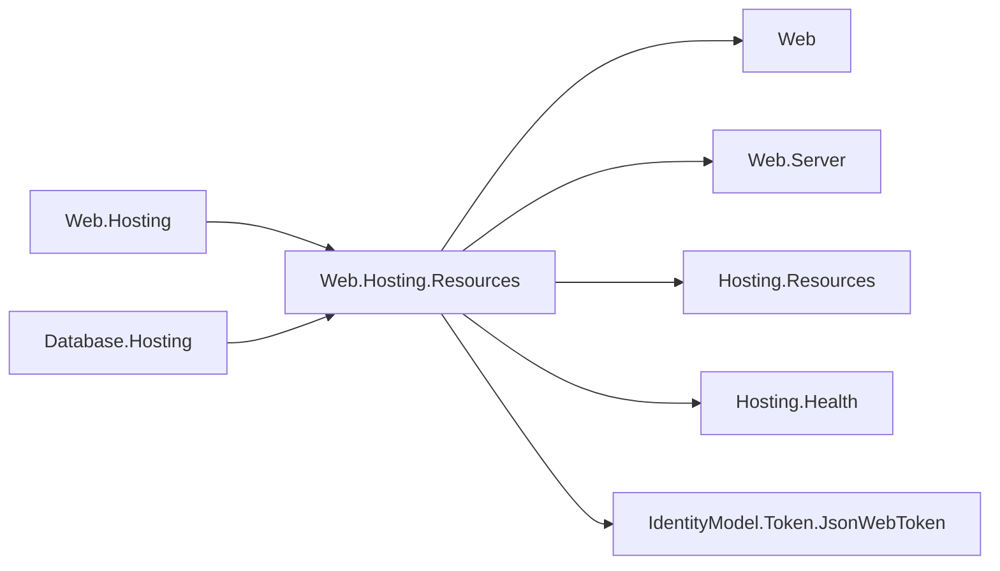

# Web.Hosting.Resources design

The hosting-family integration extends `IWebApplicationPipelineBuilder` with `UseResourceControlPlane(controlPlane, resourceContext, isApplicationReady, controlPlanePort = null)`. Callers install it first on a private listener. It owns no port, host, service container, or configuration provider. The readiness callback observes the owning resource host's `HostState.Started`, not merely listener startup.

The route and envelope contract matches Web.Hosting's terminal: public `/healthz`, `/readyz`, `/livez` aliases; namespaced health, readiness, liveness, endpoints, stop, and commands beneath `/cohesion/v1`. Reads allow GET/HEAD, stop allows POST, and commands allow GET/HEAD/POST/DELETE. Unknown namespaced routes are 404 after the access check. Health reports preserve diagnostic values and ordinal contribution/endpoint ordering. HEAD suppresses bodies. The bare probes are never authorized, so the health writer publishes only what the control plane reports: a contributor that throws appears with the fixed description `The contributor threw an exception.`, never its exception message, and an exception a contributor places in its data appears as `The contributor reported an exception.`, never its `ToString()` (Hosting.Resources design, #1409). The writer's own data switch writes the same fixed text for an `Exception` value, as defense in depth: a custom `IResourceControlPlane` (`ResourceRuntime.RegisterControlPlane` accepts any implementation) passes its report through unfiltered, and every shipped area's control plane is the default one. Other unrecognized values are still written through `ToString()`.

Managed namespaced requests first consult the resource's registered `IResourceCredentialVerifier` (`ResourceRuntime.TryGetCredentialVerifier(resourceContext)`, see the Hosting.Resources design), passing the `Authorization` value split into scheme and credential. A `NoResult` verdict falls through to the default application-key verification; any other verdict is final. The default verifies an ES256 JWT with the published application P-256 JWK: issuer/application, subject/gateway, key id, signature, required temporal claims and jti, and at most 24 hours from issuance to expiry. It configures the IdentityModel.Token.JsonWebToken validation profile with `ResourceCredentialProfile` constants (Hosting.Resources). Both packages compile the stateless `Es256JsonWebTokenValidation` helper owned by IdentityModel.Token.JsonWebToken, so issuer resolution, trusted key-id selection, signature verification, and claim rules remain in one source location. The helper accepts the existing `IJsonWebTokenSignatureVerifier` contract and adds no public JWT API. Either authorization path yields a `ResourceCaller`, and the management plane admits only `Kind=Gateway` callers whose `Application` is the ambient application and whose `Subject` is the ambient gateway — for application-key tokens exactly the former `iss`/`sub` rule. Invalid credentials are 401 with a Bearer challenge; an authentic credential for another resource audience, or a caller that is not this application's gateway, is 403.

The internal verifier, parsed application JWK and ES256 validation profile are cached once per
`ResourceContext` in a middleware-owned `ConditionalWeakTable` of `Lazy<BootstrapTokenVerifier>`
(#1412). Composition validation and requests use the same entry; concurrent first requests initialize
it once, and separate resource contexts never share trust. Weak keys allow completed in-process
invocations to be collected. `ResourceControlPlaneMiddleware.CreateLifetime(resourceContext)` returns
an idempotent `IDisposable` lease: the first active lease imports one ECDSA verification handle,
additional leases share it, and the last lease disposes it. A lock serializes signature verification,
lease acquisition and final release, so a handle cannot be disposed during verification. The cache
retains no verification handle without an active lease. Legacy static `InvokeAsync` calls without a
lease still reuse the parsed key and profile but create and dispose a temporary ECDSA handle for each
signed token. Manual hosts retain a lease until their requests have drained.

`UseResourceControlPlane` acquires its lease in the application-context middleware factory and
transfers it to `IWebApplicationLifetime.RegisterForDisposal`. Registration failure releases the
lease immediately. The Web host implements this optional generic root seam and releases registered
resources during final disposal after request drain; ordinary stop and restart preserve the lease.
Its automatic `EnabledResourcePipeline` owns a lease directly through `IDisposable`, released by the
service provider. A wrapper with no known listener port acquires none. Both composed paths reject
invocation after disposal instead of silently returning to temporary-handle validation.

**Breaking composition behavior from 10.0.0-preview.1 (#1412, decision 15's preview terms):** a custom
pipeline context used with `UseResourceControlPlane` for a gateway-managed resource must implement
`IWebApplicationLifetime`; otherwise pipeline composition throws with guidance to own
`CreateLifetime` and compose `InvokeAsync` manually. Existing public interfaces gain no members, and
standalone composition remains supported without this capability. Tokens rotated at reconciliation
remain accepted without byte-equality pinning, including concurrent requests using the retained
handle. Regression coverage uses valid signed tokens to compare allocations with and without an
active lease, covers teardown and shared-context owners, and exercises rotated tokens concurrently.

Without a gateway identity, standalone execution is for development: `/cohesion/v1` and every path beneath it admit only transport peers at `127.0.0.1`, `::1`, or IPv4-mapped `127.0.0.1`. The middleware reads `IHttpContext.ConnectionInfo.RemoteEndPoint` as an `IPEndPoint`, normalizes IPv4-mapped addresses, and refuses every other address, including absent and non-IP endpoints. Forwarded headers and effective forwarded-address features are not used. A refusal returns **403**, chosen to make the access restriction clear; it happens before route/method selection, body parsing, command dispatch, or stop registration. Unknown namespaced routes therefore return 403 to a refused standalone peer and 404 to an admitted one. The listener-port gate still applies first, and unrelated application routes are unchanged.

Bare `/healthz`, `/readyz`, and `/livez` probes stay open for orchestrators and load balancers. Their namespaced aliases have the same protection as other management routes. Gateway-managed requests retain the existing credential checks on every peer, including loopback. This is a behavioral breaking change from 10.0.0-preview.1 (#1431, owner decision 46, accepted on decision 15's preview terms): unauthenticated remote standalone management previously worked. Use a loopback connection for standalone development or a gateway identity and credentials for remote management.

Command discovery includes both acceptedCommandKinds and applied commands. Non-object envelopes, non-string/base64 payloads, and blank identity fields are 400. Unsupported kinds return 501 and ownership/replay rejections return 409, both with status=Rejected and detail. This package declares no command kinds or handlers.

O35 permits the exact Web.Hosting module to consume its own hosting family under COHRES002. COHRES001 still prevents roots and features from referencing it and prevents it from referencing Web.Hosting. Web.Hosting and Database.Hosting consume this single terminal. Web.Server's IWebResponseCompletionFeature defers stop until the transport has written 202; custom servers without the feature retain direct stop. The contract lived in the Web root until #1379 moved the server's per-exchange contracts to Web.Server (owner decision 33); its namespace stayed Assimalign.Cohesion.Web, so this package added a Web.Server reference and no code change. The executable regression compares the Web.Hosting wrapper through FromProgram with the direct verb, guarding both composition paths.

ResourceControlPlaneMiddleware exposes InvokeAsync for manually composed hosts, Validate for eager identity validation, and CreateLifetime for an explicit verification-handle owner. CreateLifetime also validates the context. UseResourceControlPlane calls Validate before registration and acquires its lease when the pipeline is composed. Its optional trailing controlPlanePort gates every route, including bare probes; null means no gate. Web.Hosting separately treats an unknown observed http/https port as disabled, so it forwards without invoking this terminal. Web and Database validate managed identity at Build only when their control-plane listener is installed.

**Breaking behavior change from 10.0.0-preview.1 (#1410).** The default Web server runs every response-completion callback in registration order even when an earlier callback throws, and reports each failure through its existing server logger. A middleware callback registered before the control plane can therefore no longer prevent the deferred stop after its `202` acknowledgement. The real-server regression authenticates as a gateway over the in-memory transport, whose non-IP peer is deliberately refused in standalone mode. It holds an earlier callback until the client receives `202`, lets it throw, and observes the control plane's stop request with `CancellationToken.None`.

Serialization uses Utf8JsonWriter and JsonDocument only. Dependencies are Web root, Web.Server, Hosting.Resources, Hosting.Health, and IdentityModel.Token.JsonWebToken. App.Web exposes the feature publicly; other areas consume its implementation privately. No ApplicationModel package enters a framework.

Tests may reference Web.Hosting and the sample Program: COHRES001/002 skip the tests leaf via `_CohesionHostingRuleApplies`; COHAM001/COHRES003 skip harness path segments via `_CohesionResourceBoundaryRulesApply` (Build.Rules.targets). These are separate gates, not exemptions.

The certificate contract is consumed by each owning host when it constructs an HTTPS listener. This middleware owns no TLS parser or listener and retains identical command and health behavior over either transport.

Web and Database compose the same terminal through its root contracts; the integration never references either runtime.

## Diagnostics

The internal `ResourceControlPlaneEventSource` is named `Assimalign.Cohesion.Web.Hosting.Resources`.
It reports every area's control plane that composes this middleware, identified by `resourceName`:
Web and the nested HTTP hosts in ApiManager, Database, EmailHub, EventHub, IoTHub, LoadBalancer,
LogSpace, MediaHub, MessageHub, NatGateway, NotificationHub, Rezolvr and VpnGateway. Non-Web
resource processes observe it through diagnostic tools or their own EventSource forwarder; nested
hosts do not receive entry-point Web default forwarding. Area-specific endpoints that bypass the
shared middleware are outside this source.

| Id | Event | Level | Payload |
| --- | --- | --- | --- |
| 1 | CredentialRejected | Warning | resourceName, requestId, status, reason, route, remoteEndPoint, suppressedCount |
| 2 | CommandMalformed | Warning | resourceName, requestId, httpMethod, phase, exceptionType, suppressedCount |
| 3 | StopAccepted | Informational | resourceName, requestId, deferred |

Credential rejection includes the standalone non-loopback refusal introduced by #1431, with
`reason=non-loopback-peer` and `status=Forbidden`. Other reasons are `missing-credential`,
`unsupported-scheme`, `invalid-token`, `audience-mismatch`, `caller-mismatch` and `verifier-rejected`.
A registered verifier's private reason is never copied. `route` is a fixed category (stop, commands,
endpoints, healthz, readyz, livez or unknown), never a path. The transport peer appears only in
CredentialRejected and is personal data in the diagnostic sink; forwarded client addresses are not
used. Request identifiers come from `IWebRequestIdFeature`, never an ambient Activity.

CredentialRejected and CommandMalformed each emit at most once per second across the provider.
Their next emission includes the number of suppressed enabled-listener occurrences (saturating at
`Int32.MaxValue`). The `rejected-credentials` PollingCounter remains exact, including refusals when
disabled or throttled. It is created on first enable, and its backing total uses Interlocked.
No request-total counter or Meter instrument is added. StopAccepted is the scope's unthrottled
management lifecycle acknowledgement, with `deferred` indicating response-completion scheduling.

Malformed JSON/base64/argument faults retain HTTP 400. `phase=Envelope` covers parsing and command
construction; it changes to `Handler` immediately before command dispatch. A handler failure
already reported by the shared control plane is omitted from this source (#1434); custom control
planes still report `Handler` when they throw a JSON, format or argument exception. Successful response
status, headers and body are written after these catches. A response adapter failure propagates to the
owning HTTP error boundary and never emits CommandMalformed or changes the applied command outcome.
Only the exception type is written: JSON and handler messages can contain command input. No event
contains an Authorization value, credential, claim, caller identity, command key or command payload.
Command execution outcomes
belong to Hosting.Resources, not this HTTP source.

The two assemblies compile one stateless internal `CommandFailureDiagnostics` helper. It uses the
existing exception metadata carrier to associate a reported failure with its original command
invocation. The BCL weak table stored there keys by reference identity and is consumed by this
middleware: repeated or concurrent reuse of an exception cannot suppress another command, and no
command payload is retained by the metadata. Registered control-plane wrappers pass the same
invocation through. No shared static state, reflection, public diagnostic API or shipped visibility
grant is involved. Marking happens even when the producer is disabled or throttled, so enabling
only the Web source never moves execution events into it. An application-defined exception whose
`Data` is read-only or throws cannot carry the marker; diagnostics preserve the original failure
and HTTP status, and the HTTP source may also report that unusual handler fault. Exact de-duplication
for such custom carriers needs a producer-owned public dispatch seam and remains an escalation.

**Contributor ownership adjustment (#1400).** A throwing contributor is caught and sanitized inside
Hosting.Resources. Existing contracts cannot carry its exception into this assembly without adding
a public exception member or a diagnostics forwarding API. The smallest internal hand-off is from
that catch to Hosting.Resources' own `HostingResourceEventSource.ContributorFailed`; this Web source
does not duplicate it. Health contributions and probe responses keep their fixed safe descriptions.
The producer's DESIGN documents the event, counter and exception-message policy. This departs from
the scope's requested Web-source ownership and is recorded for owner review, with no public API,
shipped visibility grant, or reverse dependency added.

These diagnostics add operator visibility relative to 10.0.0-preview.1; token acceptance and probe
serialization are unchanged. **Breaking behavior change from 10.0.0-preview.1 (#1400, decision 15's
preview terms):** failures while writing a successful command response now propagate instead of
being converted into a command-level 400, 501 or 409 after the command has already succeeded.
Envelope and handler failures retain their existing HTTP mappings.
