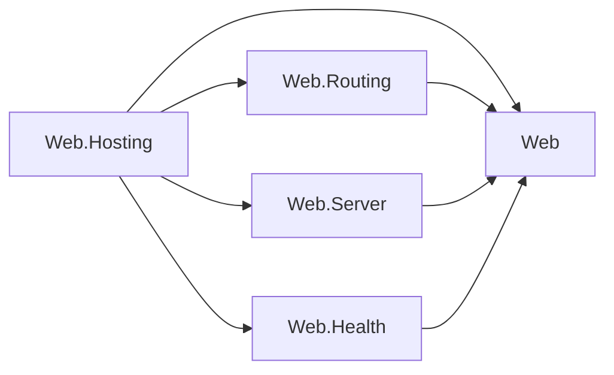
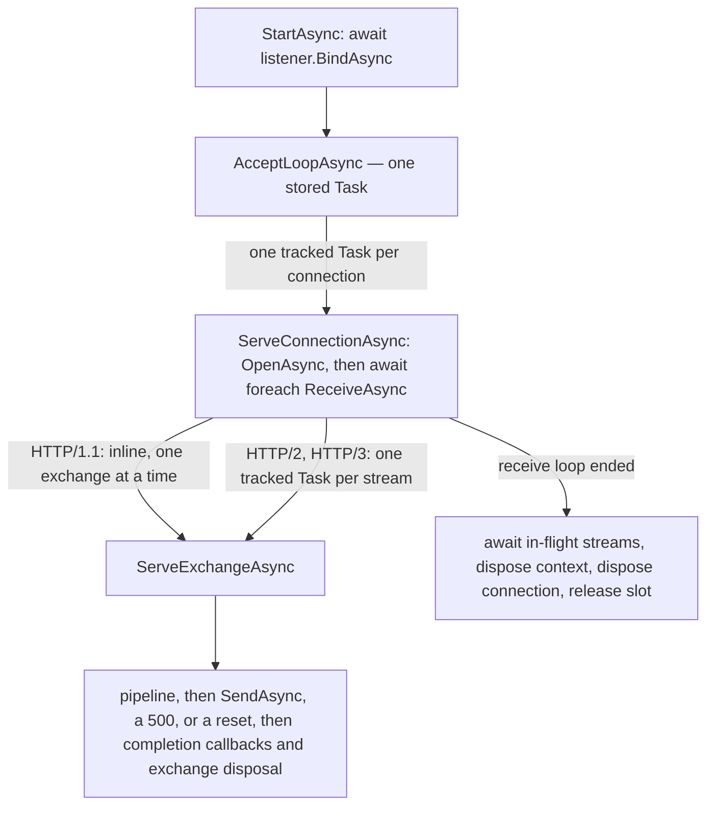
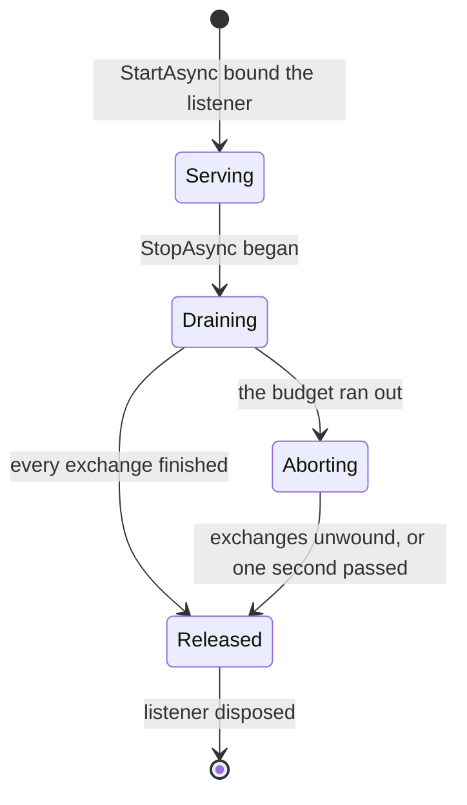
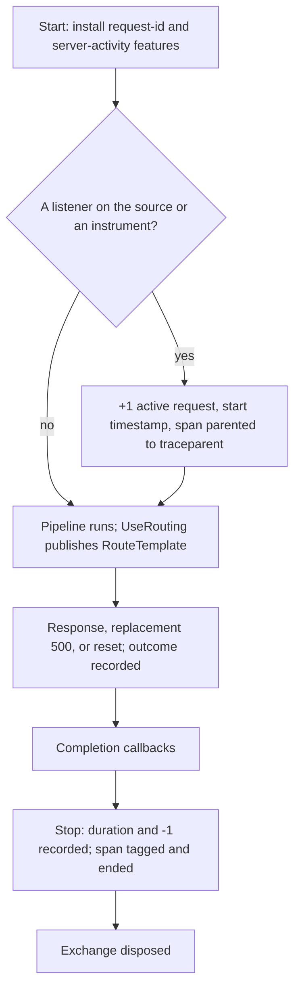
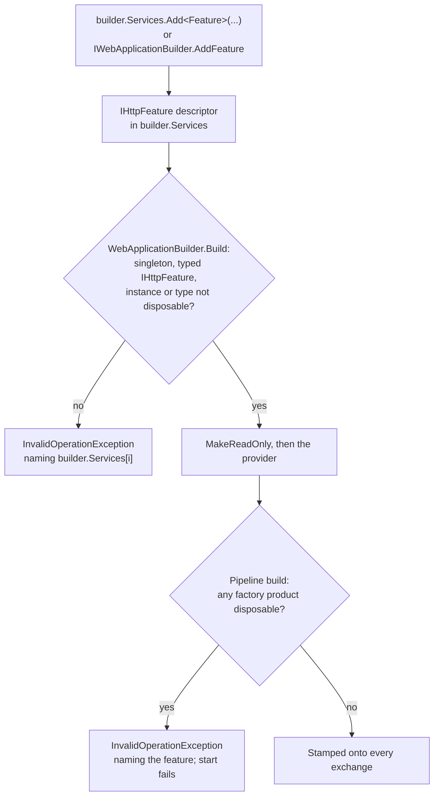

# Assimalign.Cohesion.Web.Hosting — Design

`Assimalign.Cohesion.Web.Hosting` is the composition root for the Web resource: it
builds a `WebApplication` (a `Host<WebApplicationContext>`), wires the middleware
pipeline, and owns the runtime server that turns accepted HTTP connections into
pipeline invocations. It is the **only** Web layer where DI, logging, and
configuration are integrated, and that integration is strictly builder-time —
nothing resolves services per request.

**The hosting module is dependency-isolated within the Web area** (rule adopted
2026-07-10, recorded in `resources/Web/README.md`): no Web feature library
references this package — a feature that did would drag the DI/configuration
composition surface into every consumer — and this package references three
Web feature libraries: `Web.Routing`, `Web.Server` (#1379), and `Web.Health` (owner decision 57,
2026-10-13). It references the root `Assimalign.Cohesion.Web` abstractions, those packages, and
non-Web infrastructure. The rule as adopted forbade this module's references to Web features too;
since its relaxation (COHRES002, owner decision 32 of 2026-10-09) the module may reference any Web
library except `Web.Testing`, `Web.ApplicationModel`, the `App.Web` producers, and harnesses, and
takes such a reference only for runtime machinery it composes itself, because each one ships in all
18 area frameworks. Routing and Server supply the contracts it runs or publishes, which left the Web root
under owner decision 33: `Web.Routing` for the pipeline terminal (`WebApplicationTerminal`) and the
`IWebEndpointFeature.RouteTemplate` its telemetry reads, and `Web.Server` for the request id,
response completion and drain features it installs on every exchange. Web.Health supplies the independent
health model that this module's Hosting.Health adapter uses. Applications still see the whole Web family because the
`App.Web` shared framework (via `Sdk.Web`) delivers every Web assembly; builder
verbs ship with their features: feature registration is a component integration each feature
package declares and the application's compilation projects onto `builder.Services`
(`builder.Services.AddAuthentication(auth => auth.AddCookie())`, owner decision 34), and pipeline
verbs extend the root `IWebApplicationPipelineBuilder` seam, so this module needs no reference to a
feature to host it. The one sanctioned
exception is `Web.Testing`, the harness that drives this concrete runtime.

This document focuses on the piece with the most load-bearing runtime behaviour:
`WebApplicationServer`, the default `IWebApplicationServer`. Its dispatch model
and stop semantics are the contract the rest of the Web middleware stack builds
on, so they are recorded here rather than left to be re-derived from the code.

The runtime's references within the Web area, with every arrow meaning "references":



The runtime references the root, `Web.Routing`, `Web.Server`, and `Web.Health`. These feature
packages reference the root within the area. Health and resource integrations are part of
Web.Hosting itself; the control plane reads Web.Server's completion feature to defer its stop
until the acknowledgement is written.

## Design intent

The server has one job: pull connections off a listener and drive each one
through the middleware pipeline, forever, without letting any single connection —
well-behaved or hostile — degrade the others or take down the host.

Four properties fall out of that intent and shape the whole implementation:

- **Connections are independent.** One connection's pace, idleness, or failure
  must never be observable by another. This rules out any design that serves
  connections from a shared loop.
- **Streams are independent.** HTTP/2 and HTTP/3 multiplex many exchanges over
  one connection; one stream's pace or failure must never be observable by its
  siblings. This rules out serving a connection's streams from its receive loop.
- **Application faults are contained.** Middleware is arbitrary user code. A
  throw from it is expected, not exceptional, and must cost exactly one
  exchange — never its siblings, never the accept loop, never the process.
- **Shutdown is deterministic.** Stopping the server lets what is in flight finish
  within the stop's budget, cancels only what outlives it, and releases every
  resource, without leaving an unobserved exception behind.

## Application lifecycle composition

`WebApplicationBuilder.Services` is the application's one composition registry. Every
dependency the host runs with is a registration in it, and the root
`IWebApplicationBuilder` verbs are explicit-interface shims over those registrations:

| Verb | Registration |
| --- | --- |
| `AddService(IHostService)` / `AddService(Func<WebApplicationContext, IHostService>)` | `IHostService` |
| `IWebApplicationBuilder.AddServer(...)`, `Server.UseServer<TServer>(...)` | `IWebApplicationServer` |
| `IWebApplicationBuilder.AddFeature(...)`, the feature packages' `builder.Services.Add<Feature>(...)` verbs | `IHttpFeature` (singleton only) |
| `AddHealthCheck(name, check)` | `IHealthContributor` |

A value becomes an instance registration, which stays owned by its caller; a
`Func<IWebApplicationContext, T>` becomes a factory registration invoked once with the
final context, and the application owns what it returns. Factories receive the context,
never the provider, which is what keeps the container out of the feature libraries that
call these verbs. A direct `Services.AddSingleton<IHostService>(...)` or
`AddSingleton<IWebApplicationServer>(...)` is equivalent to the matching verb.

**The service type is the lifecycle phase.** The host runs two phases, each in its own
registration order: every `IHostService` registration (the application services), then
every `IWebApplicationServer` registration (the servers). Because the phases are distinct
service types, registration order across them is irrelevant, so the default server
(registered when the builder is constructed) never precedes a later `AddService` call.
`WebApplicationContext.HostedServices` concatenates the two snapshots, adapting each
server that is not itself an `IHostService` exactly once. The Web host rejects concurrent
service start or stop, so every application service starts before any Web server and
reverse shutdown drains every server before stopping application services. Before this
registry held everything, `AddService` kept a private list beside the DI-owned server
slot to get the same guarantee.

**Resolve once, at the boundary that consumes it.** `Build` makes the container read-only
(a later registration throws instead of silently missing the provider), creates the
provider once, and resolves the application services, running each factory exactly once
against the final context. Servers resolve once at host start, because the default
server captures the composed pipeline and middleware is added to the built application.
Features resolve once at pipeline build (below). Nothing resolves per request.

**The application owns the provider.** Disposing a `WebApplication` stops the host, then
disposes the provider, which disposes every factory-created service in reverse creation
order; a failed `Build` disposes it before rethrowing. The provider was previously never
disposed.

`AddPipeline` is the one root verb that is not a registration: it replaces the default
pipeline with a single value, which the hosted `IWebApplicationPipeline` registered at
`Build` wraps with the enabled-resource terminals.

## Server dispatch model

The server runs three levels of work: one accept loop, one task per connection, and —
on a multiplexed connection — one task per stream. Each arrow below hands work to the
next level without waiting for it; only the drain at the bottom waits.



The accept loop optionally awaits a concurrency slot before each accept, and each
connection task releases its slot only after its drain completes.

**Bind before Started.** `StartAsync` first awaits the aggregate HTTP listener's
`BindAsync`. Only after every transport endpoint is bound does it schedule the
stored accept-loop task and return. A bind failure is surfaced as
`HostStartupException`, preserving the transport exception as its inner exception;
the `ResourceHost` from `Hosting.Resources` can therefore classify typed
configuration/dependency causes as
exit 64/69 and other pre-ready bind failures as exit 70. The default server is the
first `IWebApplicationServer` registration and implements `IHostService` itself, so the
host lifecycle drives this boundary directly. When an application registers only a
custom server and supplies no default-listener configuration, the default registration
resolves to an internal inert placeholder that `WebApplicationContext` excludes from both
`Servers` and `HostedServices`; it does not start an empty aggregate alongside the
custom server.

The root `IWebApplicationBuilder.AddServer` overloads accept servers that know nothing
about Hosting. They register the server as an `IWebApplicationServer`, and
`WebApplicationContext` wraps each one that is not an `IHostService` in one internal
lifecycle adapter when it snapshots the server phase, so `Servers` exposes the original
Web contract objects. A configured default and a custom server each start exactly once,
in registration order, and stop in reverse order. The factory overload is a singleton
registration that receives the final application context. `Web.Testing` starts the first
server registration, which is always the default server.

**One accept loop, one task per connection.** The loop accepts a connection and
*hands it off* to `ServeConnectionAsync` on its own `Task`, then loops straight
back to accept the next one. The loop never awaits a connection's service.

**Why this is the whole point.** The previous implementation queued one
`async void` thread-pool work item that accepted a connection and then
`await foreach`-ed its entire receive sequence inline before accepting the next.
A single idle HTTP/1.1 keep-alive client — parked in `ReceiveAsync` waiting for a
request it never sends — blocked that loop indefinitely, so every other accepted
connection sat unserved in the listener backlog. Per-connection dispatch removes
the shared bottleneck: the idle client parks on *its* task while every other task
runs.

**Stored `Task`, never `async void`.** The accept loop and each connection task
are stored/tracked `Task`s. An `async void` body escalates any escaped exception
to a process-terminating unhandled exception via the thread pool; a `Task` makes
the exception observable instead. The accept loop additionally swallows its own
terminal faults so the stored task always completes cleanly.

**In-flight tracking.** Connection tasks are registered in a
`ConcurrentDictionary<long, Task>` keyed by a monotonic id, added by the accept
loop and removed by each task as it completes. The map is the drain set
`StopAsync` awaits. A connection that completes synchronously (only possible with
a degenerate/empty receive sequence) is removed immediately after registration so
the map never leaks a completed entry.

## Dispatch within a connection (#1049)

A connection's receive loop dispatches by protocol, one exchange at a time for
HTTP/1.1 and one task per stream for HTTP/2 and HTTP/3.

**HTTP/1.1 stays sequential — the transport requires it.** An HTTP/1.1 connection
carries one exchange at a time, and its transport does the connection-level work for
the *next* request inside the receive enumerator's `MoveNextAsync`: it checks the
finished exchange's keep-alive decision, drains whatever request body the
application left unread (so the connection realigns on the next request's framing),
and only then parses the next request head. Asking for the next exchange before the
previous response is written would race that drain against a handler still reading
the body and could send responses out of order. So the loop serves an HTTP/1.1
exchange inline — pipeline, send, completion callbacks, dispose — and asks for the
next one only afterwards. Pipelined requests are therefore served strictly in order.

**HTTP/2 and HTTP/3 run one task per stream.** Neither transport needs an exchange
to finish before it can produce the next. The HTTP/2 frame pump dispatches a request
head the moment its header block completes and keeps feeding bodies, flow-control
credit, and resets while handlers run, and `SendAsync` is safe to call concurrently
for different exchanges (the write scheduler serializes frames on the wire). HTTP/3
carries each request on its own QUIC stream and writes each response to it. So the
server hands each multiplexed exchange to `MultiplexedExchangeTracker.Start` and goes
straight back for the next. Before #1049 the loop awaited each exchange's pipeline and
send before taking the next, so a slow request, a long poll, or a server-sent-events
stream held up every other stream on its connection. Since #1066 the HTTP/3 transport
yields each exchange once its request stream's HEADERS frame decodes and streams the
body afterwards, so a slowly uploading stream no longer delays the streams behind it.

- **How the server tells.** `IHttpContext.Version` is `Http20` or `Http30` for a
  multiplexed exchange. That is all the dispatch reads about the protocol; everything
  else about the wire stays below the connection-context contract.
- **Why `Task.Run`.** A pipeline may run synchronously for as long as it likes before
  its first `await`. Starting it on the receive loop's thread would hold back every
  sibling stream for that long, so each stream starts on the thread pool.
- **Concurrency is bounded by the transport.** The server adds no queue and no work of
  its own: a stream task exists only for an exchange the transport yielded, and the
  transport yields only streams it admitted — HTTP/2 refuses a stream beyond
  `SETTINGS_MAX_CONCURRENT_STREAMS` (`Http2Limits.MaxStreamsPerConnection`, default
  100) with `RST_STREAM(REFUSED_STREAM)`, and HTTP/3 peers cannot open request
  streams beyond the QUIC stream credit (`QuicConnectionListenerOptions.MaxBidirectionalStreamCount`,
  default 100). A reset does not reopen the gap on HTTP/2: since #1072 a reset stream,
  whether the peer or the transport reset it, keeps its slot until its exchange ends,
  which is when this server's `SendAsync` for it returns or its disposal runs, so an
  application that ignores `RequestCancelled` still occupies one slot per task (see
  the transport's `docs/DESIGN.md`, "A reset stream keeps its slot until its exchange
  ends").
- **The connection waits for its streams.** `MultiplexedExchangeTracker` is a
  countdown, not a task set: it starts at one (the receive loop's hold), rises as each
  stream starts, falls as each finishes, and the loop gives up its hold when it stops
  receiving. Whichever release reaches zero completes the drain, exactly once, with no
  lock. The connection task awaits that drain before it disposes the connection
  context — the HTTP/2 context's disposal is the RFC 9113 §6.8 graceful close
  (`GOAWAY`, then the pump stops and the output completes), which must not run under a
  stream still writing its response — and before it releases its concurrency slot and
  leaves the `StopAsync` drain set. An HTTP/1.1 connection never allocates a tracker.

## Layering boundary — what the server does *not* do

Wire-level failure isolation lives one layer down, in
`Assimalign.Cohesion.Http.Connections` (see its `docs/DESIGN.md`,
"Receive-loop failure isolation"). Truncated frames, malformed request lines,
peer resets, HTTP/2 `RST_STREAM`/`GOAWAY`, and per-stream HTTP/3 faults are all
classified and handled there: the receive enumerable simply stops yielding on a
wire error and the surrounding `await using` disposes the connection.

The server therefore owns **only** the concerns above that layer:

| Concern | Owner |
| --- | --- |
| Wire-protocol conformance, frame parsing, per-stream reset encoding | `Http.Connections` |
| Wire-level failure isolation (bad frames, peer reset) | `Http.Connections` |
| Stream admission (`SETTINGS_MAX_CONCURRENT_STREAMS`, QUIC stream credit) | `Http.Connections` |
| Announcing a graceful close on the wire (`Connection: close`, `GOAWAY`, refused streams) | `Http.Connections` |
| Application-exception isolation (middleware throws), per exchange | **this server** |
| Per-connection and per-stream dispatch | **this server** |
| Exchange + connection + context disposal | **this server** |
| In-flight tracking + the lame-duck drain and its budget, per connection and per stream | **this server** |
| Optional connection concurrency cap | **this server** |
| Request spans, HTTP server metrics and the request id (#1064) | **this server** |

The server never inspects a frame or a stream id. It sees `IHttpConnection` →
`IHttpConnectionContext` → `IHttpContext` and reads exactly two protocol facts off an
exchange: whether it is multiplexed (`IHttpContext.Version`), and — only when its
pipeline faulted — whether its response has started (the transport's
`HasResponseStarted` probe, below). Every outcome, including a replacement `500` and a
reset, goes on the wire through `IHttpConnectionContext.SendAsync`, so the wire encoding
of each stays in the transport.

## Error model — application-exception isolation

The isolation boundary is the **exchange** (`ServeExchangeAsync`), not the
connection. Every exchange is finalized through the connection context exactly
once, in one of three ways, chosen by how its pipeline ended:

| Pipeline outcome | Finalization | On the wire |
| --- | --- | --- |
| Returned without cancellation | `SendAsync` | the application's response |
| Returned, but the transport refused a field of its response (#1183) | as for a throw before the response started | `500 Internal Server Error` |
| Threw, response not started | the staged status, headers, trailers, and body are replaced by a bodyless `500`, starting-callback edits are restored, then `SendAsync` | `500 Internal Server Error` |
| Threw after the response started, or the exchange was cancelled | `IHttpContext.CancelAsync`, then `SendAsync` | a reset: HTTP/2 `RST_STREAM(CANCEL)`, HTTP/3 stream abort, HTTP/1.1 no further bytes and a connection that ends after the exchange |

- **Cancelled, not faulted.** An `OperationCanceledException` counts as a cancellation
  only when the server's shutdown token or the exchange's own `RequestCancelled`
  fired (server stop, peer reset, closed connection, `IHttpContext.Cancel`). An
  operation cancelled for any other reason — an application timeout — is a fault.
  The same generic cancellation signals are checked after a normal pipeline return (#1411).
  In particular, ErrorHandling may abort a started response and return normally: that is a
  cancelled exchange, so no completion callback runs, and telemetry records
  `error.type=request_canceled` with the status already sent. The original exception remains
  available through ErrorHandling's diagnostics; the server classifies the transport outcome.
  This changes preview.1 behavior, which could run completion callbacks after the abort, and
  corrects the later telemetry implementation's success report. No feature contract is added
  to the Web root; `IHttpContext.RequestCancelled` carries the cancellation.
- **Why "started" decides.** Once the final response head is on the wire (a
  streamed write or flush through the raw body sink — `Http.Streaming`, server-sent
  events), a replacement status can no longer reach the peer, and `SendAsync` would
  *finalize* the started response — `END_STREAM`, or the terminating chunk — handing the
  client a truncated body as if it were complete. A reset is the honest answer. The
  server reads the state through `HttpContextTransportExtensions.HasResponseStarted`, a
  probe `Http.Connections` exposes for exactly this decision; the runtime module takes
  no dependency on `Http.Streaming`, which would also have to enter every area
  framework that privately carries this module.
- **A refused response is a fault (#1183).** Every transport refuses a response field
  whose name is not a token or whose value holds CR, LF, NUL, or another control
  character, before it writes any of the head: a value reflected from the request would
  otherwise split an HTTP/1.1 response (CWE-113). `SendAsync` then throws an
  `HttpException` with `HttpErrorCode.InvalidResponseField` and the response has not
  started, so the server treats the exchange as faulted: the bodyless `500` replaces the
  refused response, its completion callbacks do not run, and an HTTP/1.1 connection stays
  usable. The same refusal from a streamed write, an early hint, or a protocol upgrade's
  accept surfaces inside the pipeline and is a fault there. A refused trailer section on a
  response already streamed cannot be replaced; the transport resets that stream itself.
- **The replacement `500` swaps the body rather than truncating it.** A seekable body
  the application supplied may be a file it owns, so the staged body is replaced with a
  fresh empty one and disposed, never `SetLength(0)`-ed. If the response object itself
  cannot be reshaped, the exchange is reset instead.
- **A failed send.** On a multiplexed connection it belongs to its stream alone — a
  response body that throws on read, a lifecycle hook that throws, a write cut off by
  shutdown — so the server resets that stream (`CancelAsync`, then `SendAsync` once
  more), which also releases its concurrency slot and the transport's drain
  accounting. On an HTTP/1.1 connection the response framing on the wire is then
  unknown, so the failure escapes to the connection loop, which aborts the connection;
  a send cut off by shutdown is a clean drain instead.
- **Post-response work is contained.** A throwing response-completion callback or a
  throwing exchange disposal costs nothing but its own exchange. Completion callbacks
  run only after the application's own response was sent — never after a replacement
  `500` or a reset. Each callback runs in registration order even if a previous one throws
  (#1410). Completion collects all failures in an `AggregateException`; the server reports each
  callback's exception separately through its event source, without changing the sent response.
  This is a behavioral break from 10.0.0-preview.1, which skipped the remaining callbacks; in
  particular, an earlier failure can no longer suppress the control plane's deferred stop.
- **The connection-level catch remains** for what is left: a receive-side failure the
  transport surfaced and an HTTP/1.1 send failure. Either way the connection cannot
  carry another request, so it is logged (see "Diagnostics"), `Abort`-ed, and the
  enclosing `await using` disposes it. The accept loop is untouched and keeps serving.

**Behaviour change for HTTP/1.1 (#1049).** Before #1049 a pipeline fault aborted the
whole connection, so an HTTP/1.1 client saw a dropped connection instead of a status.
It now receives a `500` on a connection that stays usable for keep-alive, the same as
Kestrel. The transport still decides reuse: if the faulted handler left a request body
that cannot be drained within the limits, the connection closes after the `500`. A
post-dispatch body-limit violation (`413` or `408` raised from the body read) faults the
pipeline like any exception, and the server stages its `500`. The HTTP/1.1 transport
latched the limit when it threw, so its `SendAsync` answers `413` or `408` with
`Connection: close` in place of the unstarted `500`, sets the exchange's status to match,
and closes the connection (#1339); a malformed body gets `400` the same way (#1333). No
`500` reaches the client. HTTP/2 and HTTP/3 answer an over-cap body with `413`, and a body
below the minimum data rate with `408` (#1085), on their own stream, and they too set the
exchange's status to the one they answered with, so the server's telemetry reports that status
rather than the `500` it staged.

**A client fault is not an application fault (#1340).** The read above throws an
`InvalidDataException` or an `IOException` for malformed framing or a body-limit violation.
Connection loss while the handler reads the body cancels the exchange instead (#1439; see below).
Before #1340 everything in the pipeline that
observed it treated it as an application defect: the HTTP logging middleware logged it at
`Error`, the exception boundary ran `OnException` and rendered a `500` problem, and the request
decompression middleware relabeled a framing failure under its decoders as malformed content.
Any client could trigger that at will. The server now publishes the transport's report,
`IHttpExchangeControl.ClientFaultStatusCode`, as `IWebClientFaultFeature` (`Web.Server`), which
those consumers read; see "Default interceptors" for how it is installed. The server's own
finalization needs no change: it still stages its `500`, the transport still replaces it, and
the exchange's telemetry reads the status the transport set, so the span and the duration carry
`http.response.status_code` `400`, `413` or `408`, no `error.type`, and an unset span status
(`WebServerTelemetryTests` pins it). The faulted pipeline is otherwise handled as before, since
it is the application's code that did not catch the read's exception. The one place the server
reads the feature itself is its telemetry, for a fault after the response started: the transport's
status can no longer replace that response, so the exchange is reset, and its `error.type` is
`client_fault` rather than `unhandled_exception` (see "Outcomes and `error.type`").

**HTTP/2 and HTTP/3 (#1378).** Both report the fault too, and the feature is installed on a request
that can have a body there as well (see "Default interceptors"). An over-cap or too-slow body is
answered with its `413` or `408` as above. A body that contradicts its content-length, or a malformed
trailer section, makes the request malformed on these versions, so the transport resets the stream
instead (RFC 9113 §8.1.1, RFC 9114 §4.1.2): the client gets no status, the feature reports `400`, and
the transport sets the exchange's status to that `400` when the server's finalization sends into the
reset stream, so the span and the access log read it rather than the `500` the server staged. The reset
also fires `RequestCancelled`, and so does the `RST_STREAM(NO_ERROR)` that follows HTTP/2's own `413` or
`408`. A body read still throws the fault's `IOException`, but a pipeline that was awaiting something else
meets the cancellation instead and ends as cancelled. The server's reset then sends into the stream, which
sets the exchange's status to the transport's, and the telemetry reads the feature too: before the
application's response started, that status is how the exchange ended, so the span carries the `4xx` with
no `error.type`, exactly as when the read met the fault; after it started, the reset cut a response off,
and the span reports `client_fault` rather than `request_canceled`. On HTTP/3 a connection error the body read finds (DATA
after the trailer section, a frame type a request stream may not carry, a truncated frame) closes the
connection, and the exchange whose read found it reports `400` as well, so it ends like a malformed body.
A client that resets its own request is not at fault on either version: the read throws the exchange's
cancellation with `RequestCancelled` already fired, so the pipeline ends as cancelled and the server resets
the exchange (`request_canceled`) instead of staging a `500`.

**HTTP/3 connection loss (#1430, owner decision 45).** A control-stream FIN or reset, forbidden
control frame, or another connection error after dispatch cancels every affected exchange. Its body
read throws `OperationCanceledException` with the exchange's `RequestCancelled` token and no client
fault status. The existing host cancellation boundary ends it as `request_canceled`, with no Error
log, `OnException`, or staged `500`; an unstarted response has no status on the server span. The
transport's former `IOException` made this an application fault. That streaming-body behavior was
introduced after 10.0.0-preview.1, which buffered the HTTP/3 body before dispatch.

**HTTP/1.1 and HTTP/2 connection loss (#1439, owner decision 45).** Both follow the same
exchange-cancellation contract. A pending body read throws `OperationCanceledException` carrying
the exchange's `RequestCancelled` token, already fired, even if the handler passed no read token.
HTTP/1.1 includes incomplete EOF after dispatch as well as a reset; HTTP/2 includes connection loss
and a peer's `RST_STREAM`. Neither latches a client-fault status. `UseErrorHandling()` lets the
cancellation reach the host, which reports `request_canceled` without an Error log, `OnException`,
or a staged `500`; no response status is reported before a response starts. This is a behavioral
break from 10.0.0-preview.1: HTTP/1.1 could surface an I/O failure and run the exception hook, and
HTTP/2 reported the stream token instead of the exchange token. It also changes the later
HTTP/1.1 `400` handling for an incomplete body ended by EOF into cancellation. Invalid framing and
body-limit violations retain their client-fault statuses.

**Response-side client faults (#1432).** The host publishes the transport's
`IHttpExchangeControl.ResponseAbortedByClient` latch as `IWebResponseClientFaultFeature` in
`Web.Server`. The existing `ResponseStartingFeature` implements the report and reads the control
on every access, adding no object, collection entry or interceptor. Its unconditional response
interceptor supplies the report even on a bodyless GET; the conditional request client-fault
interceptor continues to report only request-body faults. A slow reader reclaimed by the response
rate, or a peer that resets or abandons an ongoing response, latches the report before its write
failure reaches the pipeline. Local cancellation and application failures leave it false.

`UseErrorHandling()` reads this report before inspecting cancellation exceptions, so an adapter
that wraps a transport write failure still ends in cancellation with the exchange token, no
`OnException` or `OnError`, no replacement response and no Error log. The host's last-resort
pipeline boundary also reads the report when the application uses no exception middleware.
Telemetry records `request_canceled` with the started response's status, and completion callbacks
do not run. Compared with 10.0.0-preview.1, a peer-abandoned response whose exception is wrapped
no longer runs the application's fault observer. HTTP/1.1 already enforced its configured response
rate in preview.1; HTTP/2 and HTTP/3 response-rate reclamation arrived later in #1384. The additive
Web.Server feature leaves existing Web interfaces unchanged.

Catching bare `Exception` at each of these points is a deliberate, documented
departure from the "catch specific exceptions" rule. This is a **fault-isolation
boundary around arbitrary user code** — middleware, completion callbacks, application
bodies and features — the same pattern the transport's accept loop uses
(`HttpConnectionListener.RunStreamAcceptLoopAsync`). The alternative — letting an
unknown exception propagate out of a background task — is precisely the process-crash
hazard this component exists to remove. Each catch is annotated in source so future
readers do not "correct" it back to a narrow catch. `MultiplexedExchangeTracker`
observes the outcome of every stream task, so none can surface as an unobserved task
exception.

## Disposal contract

When a connection's loop ends — normally, by client disconnect, by shutdown, or by
a connection-level fault — the server disposes, in order:

1. **Each exchange** (`IHttpContext`) in a `finally` after its finalization and
   completion callbacks, on whichever task served it, so an exchange is released
   even if its pipeline or send throws. A multiplexed connection's exchanges are all
   disposed before step 2: the loop awaits its stream drain first.
2. **The connection context** (`IHttpConnectionContext`) in a `finally` after the
   receive loop and the stream drain.
3. **The connection** (`IHttpConnection`) via `await using`.

`IHttpConnectionContext` is intentionally *not* `IAsyncDisposable`: a context is a
projection over the connection, and the connection releases the underlying
transport on its own disposal (see `Http1Connection.DisposeAsync`). The server
still disposes any context that *does* implement `IAsyncDisposable`/`IDisposable`
through a type test (no reflection), so a stateful context is torn down
deterministically. The HTTP/2 context is one: its disposal is the RFC 9113 §6.8
graceful close (`GOAWAY`, a bounded wait for dispatched exchanges, then the frame
pump stops and the output completes), which is why the server drains the
connection's streams before it disposes the context.

## Stop semantics — the lame-duck drain (#146)

`StopAsync(cancellationToken)` is a lame-duck drain: the server accepts nothing new,
lets the exchanges in flight finish within the caller's budget, and cancels only what
outlives it. The token is the budget. `Host<TContext>.StopAsync` passes a token that
fires when its `ShutdownTimeout` elapses, which an orchestrated resource derives from
its stop grace (`ResourceHostOptions.DeriveShutdownTimeout`: grace − 5 s, floor 5 s), so
a Web app drains for at most that long.

The server holds two signals (`Internal/WebApplicationServerDrain`). Each live
connection registers on both once its context is open, so a connection accepted just
as the stop begins is handled the same way as the rest.

**QUIC delivery shares the stop budget (#1426).** The abort registration stays live until
`connection.DisposeAsync` completes, including delivery of completed QUIC streams. Its graceful-close
registration ends before context disposal, so a stop cannot call into an already-disposed context.
QUIC's `CloseDeliveryTimeout` (five seconds by default) bounds its delivery wait independently;
the host aborts that wait when the remaining stop budget expires first. Thus delivery receives
the shorter of those two budgets. When the host budget expires, the server keeps its existing
one-second abort-unwind allowance. A peer withholding receive credit cannot leave transport
delivery waiting for five seconds after a shorter host budget expires. Previously the abort
registration was disposed before connection disposal, so `StopAsync` could return after its abort grace while QUIC still
waited. That ordering defect arose after 10.0.0-preview.1; the tag had neither the two-phase
drain nor `CloseDeliveryTimeout`.

| Signal | Fires | Carries |
| --- | --- | --- |
| `Draining` | when the stop begins | the accept loop, a bind still in progress, every connection's graceful close, and every exchange's `IWebServerDrainFeature` |
| `Aborted` | when the budget runs out | every connection's open and receive, every exchange's pipeline and send, and every connection's abort |

`Draining` also reaches the exchanges themselves. A graceful close ends a connection after its
exchanges finish, but a long-lived exchange — a WebSocket, a server-sent event stream — would
finish only when the budget cuts it off, without a close of its own. So the server installs one
shared `IWebServerDrainFeature` (a `Web.Server` contract, `Internal/WebServerDrainFeature`) on every
exchange beside the response-completion feature, before the pipeline runs; its token is
`Draining`. A long-lived exchange registers on it and ends its own work while the budget lasts:
`UseWebSockets` (Web.WebSockets) closes each open socket with `1001 Going Away` (decision 16, Http
ADR 1). Firing it cancels nothing; an exchange that ignores it is cancelled only when the budget
runs out, like any other. The token is captured once, so it stays readable after the stop disposes
its sources.

The stop runs in order:

1. **Begin the drain.** `Draining` fires: the accept loop stops, and every live
   connection begins its graceful close through `IHttpConnectionContext.BeginGracefulClose`,
   which the transport implements per version (Http.Connections DESIGN, "The host
   contract"):
   - HTTP/1.1 (RFC 9112 §9.6): the response to the exchange in flight carries
     `Connection: close` and the connection ends after it; an idle keep-alive
     connection ends at once.
   - HTTP/2 (RFC 9113 §6.8): `GOAWAY(NO_ERROR)` carrying the last stream processed;
     new streams are refused with `RST_STREAM(REFUSED_STREAM)`; the frame pump keeps
     feeding the open streams.
   - HTTP/3 (RFC 9114 §5.2): no further request stream is accepted, and a `GOAWAY`
     names the first one that was not.

   Nothing is cancelled. An exchange already running finishes, and its response is
   delivered, because its send runs under `Aborted`, which has not fired.
2. **Wait for the accept loop**, so no connection task is added after the in-flight
   set is snapshotted.
3. **Drain in-flight connections and their streams**, within the budget. A
   connection's receive loop ends on its own once its transport has nothing left to
   yield, and a connection task completes only after every stream it dispatched has
   finished (see "Dispatch within a connection"), so the drain covers every in-flight
   exchange on every connection. Each task is self-contained — it swallows its own
   cancellation and faults and never rethrows — so the drain completes without
   surfacing an unobserved exception.
4. **Abort, when the budget runs out first.** The server logs how much was still in flight
   (see "Diagnostics"), then `Aborted` fires: every exchange still
   running observes `RequestCancelled`, which every transport version links to the
   receive token, and every connection still open is aborted with a
   `ConnectionAbortedException`. The stop then waits up to one second
   (`_abortGracePeriod`, Kestrel's figure) for them to unwind. An exchange that
   ignores cancellation keeps running after the stop completes.
5. **Dispose the listener**, then the drain's token sources and (if present) the
   concurrency semaphore. Listener disposal runs from a `finally`, so `StopAsync`
   never completes with the port still owned by this server.

The stop completes normally when the budget runs out, as Kestrel's does: the server
is stopped and its endpoint released; only the graceful part was cut short, which the
caller knows from its own token and which the host already reports as `DrainAborted`
(exit 130/143 for an orchestrated resource). Every later `StopAsync` call shares the
first call's task. Cancelling before starting, or stopping twice, is safe.

The server's states through a stop:



**Why two signals.** Before #146 one token did both jobs. It stopped the accept loop
and cancelled every exchange in flight: through `RequestCancelled` on HTTP/1.1 and
HTTP/3, and on every version through the send, which then failed. A request that
would have finished a moment later was cut off, and whatever an exchange produced
after the stop began was not delivered. Splitting the signal is what lets the budget
be spent finishing work.

Alternatives considered and rejected:

- **Cancelling each exchange from the server when the budget runs out**
  (`IHttpContext.Cancel` registered per exchange). It works over any transport, but it
  costs a registration per exchange on a shared token for what the transport does once
  per connection. The transport's receive token now cancels every exchange it yielded
  on all three versions; HTTP/2 used to leave a fully received request running, and now
  aborts it when its frame pump is cancelled (Http.Connections DESIGN, "HTTP/2 graceful
  close").
- **Failing the stop with `OperationCanceledException` when the budget runs out**, as
  it did before #146. Every later caller shares the stop task, so the cancellation of a
  test factory's or an explicit stop would be replayed to the host's own stop, failing
  it after the server had in fact stopped.
- **Waiting for the cancelled exchanges without a bound.** An exchange that ignores
  `RequestCancelled` would hold the stop, and the host's shutdown, open past the budget.
- **Draining inside connection disposal.** The HTTP/2 teardown's own drain is bounded
  at five seconds, so it cannot spend the host's budget, and the server disposes a
  connection only after its streams are done anyway.

## Concurrency cap (`MaxConcurrentConnections`)

Optional, configured builder-time via
`WebApplicationServerBuilder.LimitConcurrentConnections(int)` or from configuration
(`Http:Limits:MaxConcurrentConnections`, see "Configuration-bound server limits and
endpoints"), and carried on `WebApplicationServerOptions.MaxConcurrentConnections`. `null`
(the default) means **unlimited**. A cap set in code takes precedence over a configured one:
the configuration binding records its value while the default server's factory runs the
listener configurations, and the factory uses it only when `LimitConcurrentConnections` set
none.

When set to a positive `N`, a `SemaphoreSlim(N, N)` gates the accept loop: a slot
is acquired **before** accepting a connection and released when that connection's
task finishes. Once `N` connections are being served, the loop stops accepting, so
additional connections stay in the listener's backlog channel — accepted by the
transport but not opened or served — applying natural backpressure until an active
connection completes. A non-positive cap is rejected at construction.

A multiplexed connection's task finishes only after its streams drain, so a
connection whose peer has stopped sending still holds its slot while any of its
streams is running. The cap counts connections, not streams; the per-connection
stream limit is the transport's.

The gate is chosen for AOT-safety: a semaphore, stored `Task`s, and a
`ConcurrentDictionary` — no reflection, no dynamic code.

## Server telemetry (#1064)

The default server emits one span per request and the OpenTelemetry HTTP server metrics through
the BCL's `System.Diagnostics.ActivitySource` and `System.Diagnostics.Metrics.Meter`. It only emits.
Exporting stays with `Hosting.Telemetry` and the OpenTelemetry foundation (#317), whose OTLP
exporter is logs-only and does not subscribe to either yet. Any `ActivityListener` or
`MeterListener` subscribes by name: an exporter, `dotnet-counters`, or a test.

| Signal | Name | Emits |
| --- | --- | --- |
| Traces | `ActivitySource` `Assimalign.Cohesion.Web.Hosting` | one `Server` span per request |
| Metrics | `Meter` `Assimalign.Cohesion.Web.Hosting` | `http.server.request.duration` (histogram, `s`, the convention's bucket boundaries as advice) and `http.server.active_requests` (up-down counter, `{request}`) |

**Why that name.** An event source is named for the assembly that raises it
(`.claude/rules/event-source.md`), and the same rule names this source and this meter. Operators
enable one name, the `Assimalign.Cohesion.` prefix still covers every Cohesion signal, and the name
says which module emits. Rejected:

- `Assimalign.Cohesion.Web`, the area root, the way ASP.NET Core names its source
  `Microsoft.AspNetCore`. The root emits nothing, and the name would claim signals for every Web
  package.
- `Assimalign.Cohesion.Http.Connections`. The transport sees connections and frames, not the
  pipeline, the route, or how the exchange was finalized.
- Separate names for the source and the meter, as ASP.NET Core's `Microsoft.AspNetCore` and
  `Microsoft.AspNetCore.Hosting` are. That is two names to learn for one emitter.

### Placement: the span covers the whole exchange

`ServeExchangeAsync` starts the exchange's telemetry (`Internal/WebExchangeTelemetry`) before the
pipeline runs. It records how the exchange was finalized, and stops the telemetry in its `finally`.
That happens after the response, the replacement `500` or the reset was sent and the completion
callbacks ran, and before the exchange is disposed. So the span and `http.server.request.duration`
include writing the response. The two report the same value, because the span's end time is set from
the duration measurement. While the pipeline runs the span is `Activity.Current`, so a handler's own
activities and its outgoing `HttpClient` calls become its children. The server file gains only those
three calls; everything else lives in the two telemetry types.

The flow of one exchange's telemetry:



**The parent is the caller.** The server parses `traceparent` and `tracestate` per W3C Trace Context
(`WebServerTelemetry.TryParseTraceParent`). A missing, repeated or malformed `traceparent`, or an
all-zero id, gives no parent, and the request starts a new trace. Repeated `tracestate` fields are
joined into one list. Before it starts the span, the server clears an ambient `Activity.Current`. The
accept loop inherits whatever activity was current when `StartAsync` ran, and that activity is never
a request's parent; without the clear, every request of a host started inside an activity would
nest under it.

**A later version continues the trace (#1299).** W3C Trace Context §3.2.4, "Versioning of
traceparent", has a parser read a header of a version it does not know by its version-00 fields
and ignore what follows. `ActivityContext.TryParse` accepts exactly the 55 characters of a
version-00 header, so a later version with extra fields used to start a new trace, while HTTP
logging's former parser accepted it and recorded the caller's. The server now checks what the BCL
parser does not, then hands it the version-00 fields:

- the three separators are dashes (`TryParse` checks only the characters between them);
- a value longer than 55 characters belongs to a version other than `00`, and its flags are
  followed by a dash, so `00-…-01-extra` and `cc-…-01.extra` are rejected;
- of a later version's flags, only the sampled bit is kept; the specification defines the other bits
  for version `00` only.

`TryParse` still checks the rest: a lower-case hex version other than `ff`, lower-case hex ids that
are not all zeros, and lower-case hex flags. A later version's header costs one 55-character
substring; a version-00 header costs nothing more than before.

Decision 32 lets this module reference `Web.Diagnostics`. Reusing HTTP logging's former parser
was rejected because:

- its parser is internal, so reusing it needs a public API or shared source for one consumer;
- it yields hex strings, not an `ActivityContext` with its `tracestate`, and it accepts a version-00
  value with trailing fields, which W3C forbids;
- the reference would ship `Web.Diagnostics` in every area framework that carries this module.

The local check is one short method on top of the BCL parser. Since #1297 HTTP logging reads the
server's published request id and activity instead of parsing the header again.

**Attributes** follow the stable OpenTelemetry HTTP server conventions:

| Attribute | Span | Duration | Active requests | Value |
| --- | --- | --- | --- | --- |
| `http.request.method` | yes | yes | yes | the method when known, else `_OTHER` |
| `http.request.method_original` | when `_OTHER` | no | no | the method token |
| `url.scheme` | yes | yes | yes | `http` or `https`, as the transport saw the request |
| `url.path` | yes | no | no | the request path |
| `url.query` | when the request has a query | no | no | the query's parameters, each value replaced by `REDACTED` unless the application declared the parameter safe (#1298) |
| `server.address`, `server.port` | yes | no | no | the `Host` or `:authority` host, and its port when the value carries one |
| `network.protocol.version` | yes | yes | no | `1.1`, `2` or `3` |
| `http.route` | when routed | when routed | no | `IWebEndpointFeature.RouteTemplate` |
| `http.response.status_code` | when sent | when sent | no | the status sent |
| `error.type` | on failure | on failure | no | see the outcome table |

The span is named `{method}` when it starts (`HTTP` for `_OTHER`) and `{method} {route}` once the
route is known. The attributes known at the start are passed at creation, so samplers can read them.
A failure sets the span status to `Error`; a `4xx` leaves it unset, as the server-span rule requires.

**Known methods.** The default list is the convention's: RFC 9110's eight methods, `PATCH` and
`QUERY`, which are exactly the methods `HttpMethod` canonicalizes. The convention requires a way to
replace it, because a valid extension method would otherwise always report `_OTHER`.
`OTEL_INSTRUMENTATION_HTTP_KNOWN_METHODS` (comma-separated, case-sensitive, a full replacement) is
read once per process, as the source and meter are process-wide. Methods are case-sensitive
(RFC 9110 §9.1, #1301): the HTTP stack keeps the token as the client sent it, so a lower-case `get`
is an unknown method, reported as `_OTHER` with `http.request.method_original` = `get`. A method is
known only when it matches a list entry exactly, so its original never differs from
`http.request.method`, and `http.request.method_original` is set only for `_OTHER`.

**`url.query` shows the names and hides the values (#1298).** The convention makes `url.query`
conditionally required when a query was received, and asks for sensitive content to be scrubbed
rather than the attribute dropped. A query string carries tokens, signatures, one-time codes and
personal data that the server cannot recognize generically, so every value is replaced with
`REDACTED`, the convention's marker, and the parameter names stay: `?access_token=s3cr3t&page=2&debug`
is reported as `access_token=REDACTED&page=REDACTED&debug`. The span still shows the query's shape,
which is what an operator reads it for, and no value leaves the process unless the application said
it may.

- **Declaring values safe.** `builder.Server.AllowQueryValuesInTelemetry("page", "sort")` keeps those
  parameters' values. Names compare case-insensitively, as `HttpQueryKey` compares them, so the
  declaration covers every spelling the application itself reads as the same parameter. Calls add
  to one another, and a missing or empty name is rejected before anything is declared. The set is
  frozen when the default server is created and handed to it through
  `WebApplicationServerOptions.TelemetryQueryValues`; no exchange carries it.
- **A parameter without a value** is written as its name alone. There is nothing to hide, and
  `REDACTED` would claim a value was sent.
- **Names are treated as the application's schema.** An application that puts a secret in a
  parameter's name, such as a bare `?<token>`, gets it reported. Redacting names too would leave
  only a count of parameters, which is not the attribute the convention defines.
- **Rebuilt from the parsed query.** `IHttpRequest` carries only the parsed `IHttpQueryCollection`;
  no transport keeps the raw query string. So the value is normalized: names and shown values are
  percent-encoded again with `Uri.EscapeDataString`, a parameter with an empty name is left out (the
  parser skips it), and a repeated name appears once, holding the value the collection kept. The
  parameters appear in the collection's order, which for the transports' collections is the order
  they were received. When the collection gains a view of every value of a repeated name (#1335,
  Stage 13), this is the reader to switch to it.
- **The received query.** The server reads it before the pipeline runs, so it reports what the client
  sent, not a `Web.Rewrite` rewrite of it, as it does for `url.path`.
- **Cost.** It is built once per request while an `ActivityListener` subscribes to the source,
  before the sampler runs, whether or not a span is recorded: it is a creation-time attribute, so
  samplers can read it. A request with a query then pays one string, one `Uri.EscapeDataString` per
  name and shown value, and the query collection's boxed enumerator, even when a ratio sampler drops
  the span. Without a span listener the server never reads the query, and the metrics never carry
  `url.query`, as the convention defines them.

Rejected:

- **The convention's short list as the default.** It names `AWSAccessKeyId`, `Signature`, `sig` and
  `X-Goog-Signature`, and misses every application's own tokens (`access_token`, `code`, `state`,
  `api_key`). Redacting every value fails closed.
- **The raw query string from the transport.** It would need a new core request member and a change
  to all three transports' request parsing for one attribute; core Http holds base contracts only
  (owner decision 20), and the parsed form is enough to show the query's shape.
- **A process-wide environment variable,** as `OTEL_INSTRUMENTATION_HTTP_KNOWN_METHODS` is. Which
  parameters are safe is the application's knowledge, so the application declares them in code.

**Outcomes and `error.type`.** The server reports how it finalized the exchange; the exception
itself stays with the error boundary, which does not keep it, and with the hosting logs (#147).

| How the exchange ended | `http.response.status_code` | `error.type` |
| --- | --- | --- |
| A response was sent with a status below 500 | the status | none |
| The request body broke its framing or a limit while it was read, or the client cut it short, and the HTTP/1.1 transport answered it in place of the staged response (#1333, #1339, #1340) | the transport's `400`, `413`, `408` or `431`, which it also sets on the exchange | none |
| The request body fell below the minimum data rate while it was read, and the HTTP/2 or HTTP/3 transport answered its stream with `408` before the server's replacement `500` (#1085) | `408`, which the transport also sets on the exchange | none |
| The request body contradicted its content-length or carried a malformed trailer section, and the HTTP/2 or HTTP/3 transport reset its stream before a response started (#1378) | `400`, the client fault the transport reports and sets on the exchange; nothing reached the wire | none |
| A response was sent with a 5xx status, including the server's replacement `500` after a fault | the status | the status, for example `500` |
| The exchange was cancelled (a peer reset or closed connection, the server stopping, `IHttpContext.Cancel`) and reset | only when a streamed response had started | `request_canceled` |
| The exchange was cancelled by the HTTP/2 or HTTP/3 transport's answer to, or reset for, a client fault it reported (`IWebClientFaultFeature`, #1378), before the application's response started | the transport's `400`, `408` or `413`, which it sets on the exchange when the server's reset sends into the stream | none |
| The exchange was cancelled by that answer or reset after a streamed response had started (#1378) | the started response's status | `client_fault` |
| The pipeline threw after its response started, or its response could not be replaced, after the transport reported a client fault (`IWebClientFaultFeature`), and the exchange was reset (#1340) | only when the response had started | `client_fault` |
| The pipeline threw after its response started, or its response could not be replaced, and the exchange was reset | only when the response had started | `unhandled_exception` |
| The response could not be put on the wire (a body or lifecycle hook threw, the write was cut off) | none: the transport marks the head committed before it writes it, so whether it went out is unknown | `response_send_failed` |

**A client fault after the response started (#1340).** An endpoint that starts a streamed response
and then reads a malformed or over-limit body throws after its response started, so the
transport's status cannot replace it and the server resets the exchange. Before, that was
`unhandled_exception`, while the HTTP access log recorded the same exchange as a client fault at its
configured level; any client could raise it on such an endpoint. `WebExchangeTelemetry.Stop` now reads
`IWebClientFaultFeature` for a faulted exchange, and since #1378 for a cancelled one, and reports
`client_fault`, so `unhandled_exception` means the application's own defect again and `request_canceled`
a cancellation that was not the transport's answer to a client fault. A cancelled exchange whose response
had not started is the exception: the transport's answer is then the whole outcome, so the span reports its
status and no error (`IsCancellationAnsweringClientFault`, which also requires the exchange's status to be
the fault's, so a staged status the transport never set is not reported). It reads the feature only when the
exchange is instrumented and faulted or cancelled, so the fast path pays nothing. The span status stays `Error`, as for `request_canceled`:
the reset cut off a response whose status (usually a `2xx`) is not how the exchange ended, and the
semantic convention sets `Error` on a `1xx`–`3xx` span that ended in another error. The `4xx`-is-unset
rule covers a `4xx` that was sent, which is the case where the transport's status replaced the staged
response (the table's second row).

**How `http.route` reaches the span.** The template travels through `IWebEndpointFeature`, which
already carries the selected endpoint to the pipeline terminal. When this was designed COHRES002
forbade a `Web.Routing` reference, so the contract sat in the Web root; since #1379 it is
`Web.Routing`'s, and this module references `Web.Routing` to read it (owner decisions 32 and 33).
The reference adds no telemetry code to routing. Its default member `RouteTemplate` is `null`; routing's
matched route returns its template with a leading `/` (Web.Routing DESIGN, "The route template the
server's telemetry reports"). The server reads it once, when it stops the exchange's telemetry, and
only when a span or the duration is being recorded. Rejected:

- **Routing tags `Activity.Current` through BCL types only.** It needs no root member. But the
  duration metric must carry `http.route` when no span exists (a metrics-only listener), the current
  activity may be a child a middleware started, and the span's naming would move into routing.
- **A root telemetry feature that the server installs and routing writes into.** That is a second
  public type and a write path for one string the endpoint seam can already carry.

**The request id is the trace id.** The per-exchange telemetry object is also the exchange's
`IWebRequestIdFeature`, installed before the pipeline runs. Its `RequestId` is the span's trace id
when there is a span. Without one, it is the trace id of a valid `traceparent`, which is the id a span
would have had, or else a random trace id resolved on the first read and stable for the exchange.

**The activity belongs to the exchange (#1297).** That same telemetry object implements
`IWebRequestActivityFeature` from `Web.Server`, exposing its server `Activity` or `null` when
no span was created. Both contracts resolve from the existing feature instance; no second
object or new dependency is needed. The server owns the activity's lifetime. The feature stays
available while middleware runs and completion callbacks finish, so a consumer can read the
server span even while a child activity is current.

HTTP logging reads the trace id from `IWebRequestIdFeature` and the server span id through this
new feature, checking that it is a W3C `Server` activity with the same trace id. It never infers
exchange ownership from `Activity.Current`: the ambient clear above runs only when a span
listener exists, so an untraced exchange may retain an unrelated ambient activity. Checking
only a source name and trace id would still confuse different exchanges sharing a trace.
The optional contract belongs in `Web.Server`; existing interfaces and the Web root stay
unchanged. A custom server may omit it.

This is a behavior break from 10.0.0-preview.1 on decision 15's terms: HTTP logging formerly
copied the inbound parent span id and omitted correlation without a valid header. It now logs
the server span id when present, omits the span id otherwise, and logs the server's request id
even for an unparented request.

**No listener, no cost.** `Start` reads `ActivitySource.HasListeners()` and the two instruments'
`Enabled`. With all three off it creates no activity, reads no request state, records nothing, and
`Stop` returns at once. What is left on every exchange is the request id: one small object set on the
exchange's features, whose id is computed only when something reads it.

**A listener cannot cost the exchange.** Listener callbacks run inline, inside `Start` and `Stop`.
Both contain an exception a callback throws, so the exchange loses its telemetry, never its
response. This is the isolation boundary the server keeps around application code.

**Deliberately not emitted.**

- Query values the application has not declared safe (see `url.query` above).
- Proxy-resolved host and scheme. The convention prefers `Forwarded`/`X-Forwarded-*` values for
  `server.address` and `url.scheme`; the server reports what the transport saw. Those headers are
  believable only after `Web.ForwardedHeaders`' trust evaluation, and reading its result
  (`Http.Forwarded`) would add a reference that the seventeen area frameworks carrying this module
  privately would each have to carry.
- `client.address`, `network.peer.address` and `user_agent.original` (recommended). A client address
  is personal data, and it depends on the same forwarded-headers question.
- `server.address` and `server.port` on the metrics. They are opt-in there because they come from
  request headers, which makes them a cardinality attack vector.
- Requests the transport rejects before dispatch (400, 408, 413, 414, 421, 431 and 501 answered by
  `Http.Connections`; the 421 and 501 are HTTP/1.1-only). They never reach the server, so they have
  no span or measurement, and the transport does not report them yet either (Http.Connections
  DESIGN, "Diagnostics").
- W3C `baggage`.

**AOT.** `ActivitySource`, `Meter`, `TagList`, `ActivityContext.TryParse`, `FrozenSet`,
`Uri.EscapeDataString` and `DefaultInterpolatedStringHandler`: no reflection and no runtime code.
The Web AOT guard's smoke run subscribes with an `ActivityListener` and a `MeterListener` and
checks a routed request's span and duration. In-process listeners need no
`EventSourceSupport` in a NativeAOT application; tools that read meters out of process through
EventPipe (`dotnet-counters`) do, as they do for event sources.

## Diagnostics

The internal sealed `WebServerEventSource`, named `Assimalign.Cohesion.Web.Hosting`,
reports server lifecycle, failures, and the shared HTTP resource control plane. It replaces `WebApplicationServerLog` and the internal
`WebApplicationServerOptions.Logger`; the server has no second logging path. The same-named
ActivitySource owns request spans and the Meter owns `http.server.request.duration` and
`http.server.active_requests`. EventSource owns operator events and attribution counters,
with no request counts, per-request Start/Stop, pipeline exception, or transport rejection events.

Each server receives a process-unique monotonic `serverId`. Connection events also carry the
transport connection id. Server request-related failures read `IWebRequestIdFeature`, never ambient
`Activity.Current`, and use a route template rather than the raw path. All formatting and
feature reads for payloads happen only while the corresponding event level is enabled.

| Id | Event | Level | Payload |
| --- | --- | --- | --- |
| 1 | ServerBound | Informational | serverId:long, protocols, endPoints, maxConcurrentConnections:int |
| 2 | BindFailed | Critical | serverId:long, protocols, exceptionType, exceptionMessage |
| 3 | AcceptLoopFaulted | Error | serverId:long, exceptionType, exceptionMessage |
| 4 | ConnectionFaulted | Error | serverId:long, connectionId, localEndPoint, remoteEndPoint, protocolVersion, exceptionType, exceptionMessage |
| 5 | ConnectionEndedByPeer | Verbose | serverId:long, connectionId, localEndPoint, remoteEndPoint, protocolVersion, exceptionType, exceptionMessage |
| 6 | ServerDraining | Informational | serverId:long, connections:int, exchanges:int |
| 7 | DrainTimedOut | Warning | serverId:long, connections:int, exchanges:int, elapsedMilliseconds:double |
| 8 | AbortGraceExpired | Warning | serverId:long, exchanges:int, gracePeriodMilliseconds:double |
| 9 | ServerStopped | Informational | serverId:long, elapsedMilliseconds:double, aborted:bool |
| 10 | ResponseHeadRefused | Error | serverId:long, requestId, protocolVersion, routeTemplate, exceptionMessage, suppressedCount:int |
| 11 | CompletionCallbackFailed | Error | serverId:long, requestId, routeTemplate, exceptionType, exceptionMessage |
| 12 | ExchangeIsolationEscaped | Error | exceptionType, exceptionMessage |
| 13 | ConnectionCapReached | Verbose | serverId:long, maxConcurrentConnections:int |
| 14 | ControlPlaneDisabled | Warning | resourceName, observedEndpoints |
| 15 | TelemetryListenerFaulted | Warning | exceptionType, exceptionMessage, suppressedCount:int |
| 16 | CredentialRejected | Warning | resourceName, requestId, status, reason, route, remoteEndPoint, suppressedCount:int |
| 17 | CommandMalformed | Warning | resourceName, requestId, httpMethod, phase, exceptionType, suppressedCount:int |
| 18 | StopAccepted | Informational | resourceName, requestId, deferred:bool |

`endPoints` comma-joins `IHttpConnectionListener.EndPoints` after binding completes.
The transport listener supplies its actual endpoint, so TCP, TLS and QUIC port-zero
binds report the operating system's assigned port. The HTTP listener aggregates
all registrations, including raw `UseServer(Action<HttpConnectionListenerOptions>)`
instance and factory registrations. Each server reads its own listener's endpoint
set; it has no options-associated capture or `EndPointReaders` snapshot.
`WebServerEndPoints` and the hosting helpers' tracking calls have been deleted.
The server accepts through the typed listener's `AcceptAsync`; its accepted
connections participate in the shared `IConnection` identity and lifetime model.
Connection-fault endpoints still come from the opened context.
The four lazily created PollingCounters are `connection-faults`, `connection-cap-waits`,
`refused-response-heads`, and `rejected-credentials`. Their backing values stay exact with no listener. A local per-connection
flag counts faults once even if serving and teardown both fail. An IOException, SocketException,
ConnectionException, or failure after an aborted drain is `ConnectionEndedByPeer` at Verbose,
and never increments `connection-faults`; response-side client-fault cancellations likewise stay
out of it. The connection cap counts every failed immediate semaphore probe, before waiting.

`ResponseHeadRefused` and `TelemetryListenerFaulted` each use an independent process-wide
one-second throttle. Their next delivered event carries `suppressedCount`; refused heads are
counted even when suppressed or disabled. Telemetry reporting is never latched once per process.
Other server events are unthrottled: lifecycle events fire once per lifecycle transition, and
application callback/fault events preserve each failure. Accept-loop failures are Error because
existing connections still drain; bind failures remain Critical.

Payloads contain no request path, query, headers, body, cookie, token or user identity. Application
exception type and Message remain visible, including completion callbacks. No stack trace is
written. ResponseHeadRefused uses a fixed refusal description in exceptionMessage because the
transport exception can echo an unbounded response header name; header identifiers do not belong
at Error. A connection's transport peer address is personal data in the diagnostic sink; behind
a proxy it is the proxy. Pipeline failures belong to
[ErrorHandling](../../Assimalign.Cohesion.Web.ErrorHandling/docs/DESIGN.md#diagnostics), while
pre-dispatch rejections and protocol/client-fault classifications belong to Http.Connections.

The same `WebServerEventSource` reports the integrated resource control plane (ids 16–18).
It reports every area's control plane that composes this middleware, identified by `resourceName`:
Web and the nested HTTP hosts in ApiManager, Database, EmailHub, EventHub, IoTHub, LoadBalancer,
LogSpace, MediaHub, MessageHub, NatGateway, NotificationHub, Rezolvr and VpnGateway. Non-Web
resource processes observe it through diagnostic tools or their own EventSource forwarder; nested
hosts do not receive entry-point Web default forwarding. Area-specific endpoints that bypass the
shared middleware are outside this source.

Credential rejection includes the standalone non-loopback refusal introduced by #1431, with
`reason=non-loopback-peer` and `status=Forbidden`. Other reasons are `missing-credential`,
`unsupported-scheme`, `invalid-token`, `audience-mismatch`, `caller-mismatch` and `verifier-rejected`.
A registered verifier's private reason is never copied. `route` is a fixed category (stop, commands,
endpoints, healthz, readyz, livez or unknown), never a path. Among control-plane events, the
transport peer appears only in CredentialRejected and is personal data in the diagnostic sink; forwarded client addresses are not
used. Request identifiers come from `IWebRequestIdFeature`, never an ambient Activity.

CredentialRejected and CommandMalformed each emit at most once per second across the merged provider.
Their next emission includes the number of suppressed enabled-listener occurrences (saturating at
`Int32.MaxValue`). The `rejected-credentials` PollingCounter remains exact, including refusals when
disabled or throttled. It is created on first enable, and its backing total uses Interlocked.
No request-total counter or Meter instrument is added. StopAccepted is the scope's unthrottled
management lifecycle acknowledgement, with `deferred` indicating response-completion scheduling.

Malformed JSON/base64/argument faults retain HTTP 400. `phase=Envelope` covers parsing and command
construction; it changes to `Handler` immediately before command dispatch. A handler failure
already reported by the shared control plane is omitted from this source (#1434); custom control
planes still report `Handler` when they throw a JSON, format or argument exception. Successful response
status, headers and body are written after these catches. A response adapter failure propagates to the
owning HTTP error boundary and never emits CommandMalformed or changes the applied command outcome.
Only the exception type is written: JSON and handler messages can contain command input. No event
contains an Authorization value, credential, claim, caller identity, command key or command payload.
Command execution outcomes
belong to Hosting.Resources, not this HTTP source.

Web.Hosting and Hosting.Resources compile one stateless internal `CommandFailureDiagnostics` helper. It uses the
existing exception metadata carrier to associate a reported failure with its original command
invocation. The BCL weak table stored there keys by reference identity and is consumed by this
middleware: repeated or concurrent reuse of an exception cannot suppress another command, and no
command payload is retained by the metadata. Registered control-plane wrappers pass the same
invocation through. No shared static state, reflection, public diagnostic API or shipped visibility
grant is involved. Marking happens even when the producer is disabled or throttled, so enabling
only the Web source never moves execution events into it. An application-defined exception whose
`Data` is read-only or throws cannot carry the marker; diagnostics preserve the original failure
and HTTP status, and the HTTP source may also report that unusual handler fault. Exact de-duplication
for such custom carriers needs a producer-owned public dispatch seam and remains an escalation.

**Contributor ownership adjustment (#1400).** A throwing contributor is caught and sanitized inside
Hosting.Resources. Existing contracts cannot carry its exception into this assembly without adding
a public exception member or a diagnostics forwarding API. The smallest internal hand-off is from
that catch to Hosting.Resources' own `HostingResourceEventSource.ContributorFailed`; this Web source
does not duplicate it. Health contributions and probe responses keep their fixed safe descriptions.
The producer's DESIGN documents the event, counter and exception-message policy. This departs from
the scope's requested Web-source ownership and is recorded for owner review, with no public API,
shipped visibility grant, or reverse dependency added.

These diagnostics add operator visibility relative to 10.0.0-preview.1; token acceptance and probe
serialization are unchanged. **Breaking behavior change from 10.0.0-preview.1 (#1400, decision 15's
preview terms):** failures while writing a successful command response now propagate instead of
being converted into a command-level 400, 501 or 409 after the command has already succeeded.
Envelope and handler failures retain their existing HTTP mappings.

**Compatibility:** preview.1 had no server EventSource. Compared with the interim #147 logger,
the category changes from `Assimalign.Cohesion.Web.Hosting.WebApplicationServer` to
`Assimalign.Cohesion.Web.Hosting`, dotted attributes become the camelCase payload names above,
and exception stacks and per-host logger attribution are lost. Decision 49 accepts this preview
behavior change together with #1399's entry-point default forwarding in the same integration.

## AOT posture

`IsAotCompatible=true` holds with no special handling. The dispatch machinery is
`SemaphoreSlim`, `CancellationTokenSource`, `ConcurrentDictionary`, `Interlocked`,
`TaskCompletionSource`, `Task.Run`, and `await using`/`await foreach` — all
trim/AOT-clean. The defensive context disposal is a `switch` type test, the
multiplexing check is an enum comparison, and the response-started probe is a type
test inside `Http.Connections`; none is a reflection probe. No runtime code
generation, no `Assembly.LoadFrom`, no reflection-based serialization.

**The Web NativeAOT guard (#1052)** is the evidence for the area as a whole, not just this
module: `samples/Assimalign.Cohesion.Web.AotGuard` composes a representative application
(routing, source-generated typed binding and JSON, error handling, Cookie and JWT Bearer
authentication, static files, response compression, request decompression, rate limiting and
request timeouts). Its csproj promotes the trim/AOT analyzer diagnostics and ILC's per-assembly
summaries (IL2104/IL3053) to errors, so a trim or AOT warning in any library it reaches fails the
publish. `resource-web.yml`'s `aot-guard` job publishes it with `PublishAot` for linux-x64 and runs
the native binary with `--smoke`, which serves on a free loopback port and checks every feature
over real HTTP. The first run surfaced four DependencyInjection call-site diagnostics, resolved as
described in that library's DESIGN ("NativeAOT compatibility checks").
The validation smoke check verifies the registered camelCase contract's `errors.name` key and rejects the legacy CLR spelling (#1209).

## Application feature seeding

`IWebApplicationBuilder.AddFeature` and the feature packages' `builder.Services.Add<Feature>(...)`
verbs register `IHttpFeature` singletons (routing's per-application `IRouterFeature`, from
`builder.Services.AddRouting()`, is the canonical example), but a feature is only
useful once it is present on each exchange's `IHttpContext.Features` collection.
That bridging happens when the pipeline is built: `WebApplication`'s pipeline
`Build()` resolves the registered features **once** and, when any exist, wraps the
composed pipeline in a seeding middleware that stamps each feature onto every
exchange before any user middleware runs.

Two deliberate properties:

- **Builder-time snapshot, not request-time service location.** The feature set is
  materialized at pipeline build (which happens when the server is resolved). Per
  the hosting philosophy, nothing resolves services per request — the per-exchange
  work is a plain array walk. Registration closes at `Build`, before any pipeline
  exists, so the snapshot always holds every feature; a feature factory runs once,
  the first time the application's features resolve.
- **Application-registered features are per-application.** Each application seeds
  only its own DI-registered features, which is half of the process-wide isolation
  story (#789's per-application router state is the other half).

### Feature registrations are singletons (owner decision 35, #1380)

Seeding stamps one snapshot of the `IHttpFeature` aggregate onto every exchange, and composition-time
readers (`UseRouting`, `UseAntiforgery`, the OpenAPI document) resolve the same aggregate from the root
provider. A feature therefore has exactly one lawful shape, an `IHttpFeature` singleton, and the module
enforces it where it can see each violation; every error names the registration:

| Check | Where | Rejects | Why |
| --- | --- | --- | --- |
| Lifetime | `WebApplicationBuilder.Build`, before `MakeReadOnly` | an `IHttpFeature` registration that is scoped or transient | One scoped item makes the whole aggregate unresolvable from the root ("scoped from root" at host start); a transient one hands each reader its own instance, so routes mapped into one router are served by another |
| Contract | `WebApplicationBuilder.Build`, before `MakeReadOnly` | a registration whose service type derives from `IHttpFeature` but is not `IHttpFeature` | It never joins the aggregate, so it is never stamped |
| Disposal, descriptor | `WebApplicationBuilder.Build`, before `MakeReadOnly` | an `IHttpFeature` instance or implementation type that is `IDisposable` or `IAsyncDisposable` (`AddFeature(instance)`, every static-factory verb, `AddSingleton<IHttpFeature, T>()`) | The exchange disposes the disposable features it carries at teardown, so the shared instance would be disposed after its first request |
| Disposal, factory product | the pipeline build, where the aggregate is resolved | a feature a factory registration produced that is `IDisposable` or `IAsyncDisposable` (the builder-template verbs, `AddFeature(factory)`) | The same; the product exists only once the factory runs |

The provider's own `ValidateOnBuild` sees none of these: this module registers factories and
instances, whose implied lifetimes and products it does not inspect. The `Build` checks run
before `Build` adds its own registrations, so a rejected build leaves the builder as its caller
composed it. A factory registration's product exists only when it is resolved, so its disposal
check runs at the pipeline build, which still fails host start before any request. Decision 35
reads "at `Build`" for all three rejections; the factory-product case is the one place the check
cannot run there. Request-scoped services for handlers are a separate, future decision: a lazily
created scope owned by the server, for a separate service type, never a looser `IHttpFeature`
lifetime. A measured analysis found no performance or functional gain in scoped or transient
features (plan §7.4, decision 35).

How a registration reaches an exchange, and where each check stops it:



**The pipeline is built before any service starts (#1051, #1079).** The host resolves
`WebApplicationContext.HostedServices`, including the servers, pipeline and every middleware
factory, before entering service lifecycle callbacks. A composition failure such as an invalid
route table fails `StartAsync` and leaves the host `Failed`, even when resolving the same services
also fails during rollback. The generic host owns this guarantee; Web needs no startup-hook
workaround. `ExecuteAsync` runs no middleware for a token that is already cancelled; middleware
observe cancellation through `RequestCancelled`.

**Late middleware registration fails (#1078).** Once the pipeline has been built, every
`WebApplication.Use` / `IWebApplicationPipelineBuilder.Use` overload throws
`InvalidOperationException` explaining that the pipeline is already built. Each public `Use`
contract documents this exception in its XML reference. Register middleware
before starting the application (or explicitly building its pipeline). This is a behavioral
break from 10.0.0-preview.1, which accepted the registration but never executed it.

### Sizing each exchange's feature collection (owner decision 36, #1381)

Stamping used to grow each exchange's feature collection. Its dictionary starts with three slots and
grows to 7, 17 and 37, copying into a new array each time, and that growth was nearly all of the
stamping cost. The default server now tells the transport how many features an exchange carries,
through the transport's generic `HttpConnectionListenerOptions.ExchangeFeatureCapacity`. The
transport sizes every exchange's collection for that many features when it creates it. The
transport learns a number, not which features this module installs (owner decision 20).

The count is the application features the pipeline stamps plus
`WebApplicationServerBuilder.HostFeatureCount`, the five features every exchange of the default
server carries:

| Feature | Installed by |
| --- | --- |
| `IHttpMaxRequestBodySizeFeature`, `IHttpMinRequestBodyDataRateFeature` and `IHttpMinResponseDataRateFeature`, one object (#1383, #1384) | the first default interceptor, while the request is parsed |
| `IWebRequestIdFeature` | the server's exchange telemetry, before the pipeline runs |
| `IWebResponseCompletionFeature` | the server, before the pipeline runs |
| `IWebServerDrainFeature` | the server, before the pipeline runs |
| `IWebResponseStartingFeature` | the response-starting interceptor, before the pipeline runs |

- The pipeline build records how many features it stamps (`WebApplicationContext.StampedFeatureCount`).
  The default server resolves the pipeline before it composes the listener, so the count is known.
  A pipeline passed to `AddPipeline` stamps none, so the count is the host's five.
- The count is set before user `UseServer` configurations run, as the default interceptors are, so a
  configuration sees it and can add to it. After the last configuration the server rounds the result
  up (see "Rounding" below) and hands that to the listener.
- `WebApplicationExchangeFeatureCapacityTests` pins the count. A plain request on HTTP/1.1 and HTTP/2
  carries exactly as many features as are counted, so the test fails if the server starts installing
  another feature on every exchange without counting it.

#### What the count leaves out

The count covers only what the host knows every exchange carries. Middleware install features as an
exchange passes through them, and in an ordinary application those sit on most exchanges:

- **Routing** installs one feature on every matched request. `RouteMatchFeature` implements both
  `IRouteMatchFeature` and `IWebEndpointFeature` under the one name `IWebEndpointFeature`, so it takes
  one slot; a 405 takes the same slot with `MethodNotAllowedEndpointFeature`. In a routed application
  a matched request is the ordinary exchange. A `Map` branch also installs `IWebPathBaseFeature` on
  each request that enters it.
- **One feature on every exchange that passes through:** `UseForwardedHeaders`,
  `UseResponseCompression` (not on a `HEAD`, nor over HTTPS unless `EnableForHttps` is set),
  `UseSecurityHeaders`, `UseRequestTimeouts`, `UseRateLimiting`, `UseSessions`, `UseOutputCache` and
  `UseForms`.
- **Up to two:** `UseAuthentication` installs `IAuthenticationResultFeature` on every exchange when a
  default authenticate scheme is configured, and `IAuthenticationFeature` too on each exchange that
  authenticates. `UseCookiePolicy` installs `ICookieConsentFeature` and its
  `IHttpResponseCookieFeature`.
- **Only some exchanges:** the upgrade and extended CONNECT features, the client-fault feature on a
  request that can have a body (#1340, #1378), the WebSocket policy feature on a handshake, the rewrite feature
  on a rewritten request, the exception feature on a failure, and the TLS feature built on first read.

The server cannot count these itself: the transport learns only a number (owner decision 20), and
the pipeline's middleware are opaque delegates. A host adds one slot in a listener configuration for
each feature its middleware install on an ordinary exchange, for example
`options.ExchangeFeatureCapacity += 3` for routing, `UseResponseCompression` and `UseSecurityHeaders`.

#### Rounding: an overflow never costs more than not presizing

The dictionary rounds the size it is given up to a prime, and outgrown, it grows to the smallest prime
at least twice its size. An unsized dictionary therefore grows through 3, 7, 17, 37, 89, 197, 431 and
919 slots. A size between two of those grows to another size between them, and that overflow costs
more than never presizing. Handing the transport the exact count did that whenever the count's prime
fell between two of those sizes and the uncounted features pushed an exchange past it. With seven
application features the count is eleven. A matched request carries a twelfth feature, routing's, which grows an 11-slot dictionary to
23 slots. That is 144 B more per request than the unsized collection, which grows through 3, 7 and 17.

So after the last listener configuration the server rounds the capacity up to the smallest of those
sizes that holds it (`WebApplicationServerBuilder.RoundExchangeFeatureCapacity`). From there an overflow
grows exactly as an unsized dictionary does, so an exchange carrying any number of uncounted features
never allocates more than it would without presizing. A configuration that sets `0` opts out, and `0`
stays `0`. Rounding last matters: rounding the host's count first and letting a configuration add slots
to it would land between the sizes again.

The price is unused slots when the count falls between two sizes and nothing overflows: eight counted
features take a 17-slot dictionary where 11 slots would do (168 B more), and twenty take 37 where 23
would do (392 B more). Those slots are what the first uncounted feature lands in.

`WebApplicationExchangeFeatureCapacityTests` pins the rounding. For a range of application feature
counts it stamps every count from one past the host's count to twice the rounded capacity onto a
collection sized as the server sizes it, and asserts that this allocates no more than an unsized
collection holding the same features. Another test adds slots in a listener configuration, fills a real
exchange to the rounded capacity on HTTP/1.1 and HTTP/2, and asserts that this allocates nothing.

Measured with a loopback `HttpClient` in the same process, so the client's allocations are
included, a plain `GET` through the default server allocates the bytes below (median of five rounds of
20,000). "Uncounted" is how many more features the terminal middleware installs on every exchange,
standing in for routing's route match and the `Use*` features above. "Unsized" sets the capacity to
`0`, the state before #1381; "exact" hands the transport the count unrounded, as the first version of
this change did; "rounded" is the shipped behavior.

| Application features | Uncounted | HTTP/1.1 unsized | HTTP/1.1 exact | HTTP/1.1 rounded | HTTP/2 unsized | HTTP/2 exact | HTTP/2 rounded |
| --- | --- | --- | --- | --- | --- | --- | --- |
| 0 | 0 | 13,056 B | 12,920 B | 12,920 B | 10,875 B | 10,725 B | 10,724 B |
| 4 | 0 | 13,616 B | 13,064 B | 13,232 B | 11,433 B | 10,869 B | 11,036 B |
| 8 | 0 | 13,648 B | 13,264 B | 13,265 B | 11,453 B | 11,069 B | 11,069 B |
| 16 | 0 | 14,800 B | 13,496 B | 13,887 B | 12,622 B | 11,301 B | 11,695 B |
| 4 | 4 | 13,648 B | 13,792 B | 13,264 B | 11,462 B | 11,595 B | 11,071 B |
| 7 | 1 | 13,648 B | 13,792 B | 13,264 B | 11,453 B | 11,597 B | 11,068 B |
| 16 | 1 | 14,808 B | 13,504 B | 13,895 B | 12,611 B | 11,309 B | 11,703 B |
| 16 | 4 | 14,832 B | 14,896 B | 13,920 B | 12,637 B | 12,701 B | 11,725 B |

The exact count beat not presizing until an uncounted feature overflowed it, and then it lost: seven
application features plus a route match cost 144 B more than unsized, and sixteen plus four cost 64 B
more. Rounded, no row costs more than unsized. Rounding gives back part of the gain where the count
falls between two sizes and nothing overflows (168 B at four application features, 391 B at sixteen),
and it saves 528 B over the exact count on the routed seven-feature application. Sixteen application
features with four uncounted cost 1,000 B over a featureless application on HTTP/1.1, where unsized
they cost 1,776 B. An application with no features saves 136 B, because the host's own four features
no longer grow the collection past three slots.

## The pipeline terminal — endpoint dispatch and the bodyless 404 fallback (#881, #1054)

`WebApplication`'s pipeline `Build()` composes the innermost middleware — the
terminal reached only when every registered middleware chained to `next`.

**Endpoint dispatch (#1054).** When an endpoint-selecting middleware (`UseRouting`)
published an `IWebEndpointFeature`, the terminal runs that endpoint. That is
where a matched route's handler runs, after every middleware registered behind
`UseRouting`, and where routing's 405 is written. The terminal is
`WebApplicationTerminal.InvokeAsync` (#1056), shared with every non-rejoining pipeline
branch, so the application and its branches agree on what "unhandled" means. The terminal and
the endpoint contract are `Web.Routing`'s since #1379; until then they were the Web root's,
because COHRES002 forbade this module a `Web.Routing` reference.

**The 404 fallback (#881).** With no endpoint selected, the request went unhandled.
The terminal used to be a silent `Task.CompletedTask`, which handed the
transport an empty `200` for any unhandled request. It now sets a **bodyless
`404 Not Found`** when the response arrives untouched (still `200`, no body, no
`Content-Type`, no `Location`); a response a middleware already shaped — a non-`200`
status, a written body/content type, or a redirect `Location` — is left as-is.

Two deliberate properties:

- **Payload-free.** Neither this runtime module nor `Web.Routing` references `Web.ProblemDetails`:
  the resource hosting-isolation rule (COHRES002) forbade it when the fallback was
  written, and since the 2026-10-09 relaxation such a reference would still ship in every
  framework that carries this module. So the terminal can only *set the status*. Turning the
  bodyless 404 into an RFC 9457 problem+json body is the job of the opt-in
  `UseStatusCodePages()` middleware in `Web.ErrorHandling`, which the application
  composes over the top.
- **A deliberate empty `200` must be terminal.** A `200` with no body is
  indistinguishable from an untouched response, so a middleware that means to answer
  with an empty `200` must be terminal (not call `next`); a bodyless-`200`
  fall-through is read as unhandled. This is the accepted trade-off for turning
  no-match into a `404` without a routing-level "handled" signal.

## Testing

Behaviour is verified in `tests/` with xUnit + Shouldly against instrumented
doubles (`FakeHttpConnectionListener`, `FakeHttpConnection`,
`FakeHttpConnectionContext`, `FakeHttpContext`, `FakePipeline`) that let a test
script receive sequences, park connections, throw from the pipeline, and observe
opens/sends/aborts/disposals. The suite pins each acceptance property: idle
keep-alive non-starvation, single-connection fault isolation with continued
service, connection+context disposal on every exit path, graceful `StopAsync`
drain + listener disposal, and the concurrency cap holding connections back until
a slot frees.

The same properties are additionally pinned **end to end** by the full-pipeline
integration suite (`WebApplicationPipelineIntegrationTests`,
`WebApplicationServerIntegrationTests`, and `WebApplicationTerminalFallbackTests`
for the bodyless-404 terminal), which drives the real server over the in-memory
transport through `Assimalign.Cohesion.Web.Testing`'s `WebApplicationTestFactory` —
a real `HttpClient`, real HTTP/1.1 exchanges, no sockets. It covers middleware onion
ordering and short-circuiting, per-connection dispatch (a parked connection does not
starve others), application-fault isolation (a `500` on a connection that keeps
serving), the unhandled-request 404 fallback, and graceful shutdown draining
(in-flight unwind, idle keep-alive unblock, post-stop connection refusal). A raw
in-memory connection pipelines two HTTP/1.1 requests to pin that the second reaches
the pipeline only after the first's response.

Per-stream dispatch (#1049) is pinned at both levels. The unit suite drives
multiplexed doubles (`IHttpContext.Version` of HTTP/2) through concurrency (a stream
that completes only after its sibling's response was sent), fault isolation (`500`,
reset when the response cannot be replaced, reset on cancellation, reset on a failed
send), the stop drain (nothing is disposed under a running stream), and slot
accounting (a connection whose receive loop ended holds its slot until its stream
finishes); `MultiplexedExchangeTrackerTests` pins the countdown itself.
`WebApplicationServerHttp2IntegrationTests` repeats the concurrency, `500`, and drain
properties over prior-knowledge HTTP/2 with a real client and asserts every request
shared one connection, and adds the case the doubles cannot reach: a stream that
faults after streaming part of its body is reset, not completed. `WebHttp3HostingIntegrationTests`
pins concurrency over a real QUIC connection where the platform supports it.

Server telemetry (#1064) is pinned end to end by `WebServerTelemetryTests`, over the in-memory
transport with a real client and an `ActivityListener` and `MeterListener` subscribed by name
(`TestObjects/TelemetryRecorder`): one server span per request, parented to the caller's
`traceparent` and current while the pipeline runs; the attributes and the span name, a routed
request's `http.route` (through real `Web.Routing`); every outcome in the
`error.type` table; `_OTHER`, including a lower-case `get` written raw and reported with its original
case; one span per HTTP/2 stream; an ambient activity at server start that
must not parent requests; the duration and the active-request count; the request id with and
without a span; and no activity at all without a listener. A version-00 `traceparent` and a later
version's, with and without extra fields, continue the caller's trace (#1299). Version `ff`, a
version-00 value with extra fields, a later version whose flags are followed by something other than
a dash, upper-case hex, a short value and a separator other than a dash each start a new trace, and
a later version keeps only its sampled flag. `url.query` (#1298) is pinned end to end
with every value redacted, with values declared safe, and after a declaration rejected for a missing
or empty name, which leaves its other names redacted; its builder is pinned against empty and
valueless parameters, encoded names and case-insensitive declarations; a request double that counts
reads of its query (`TestObjects/ServerTestDoubles`, `FakeHttpRequest`) shows the query is read only
when a span listener subscribes. Listeners are process-wide, so the class runs in the non-parallel
`TelemetryCollection`.

The lame-duck drain (#146) is pinned by `WebApplicationServerDrainTests`. Against the
doubles: the stop begins every connection's graceful close and the exchange in flight
finishes and is sent under a token that was never cancelled; when the budget runs out,
the exchange is cancelled and reset, its connection is aborted with a
`ConnectionAbortedException`, and the stop still completes. End to end: an HTTP/1.1
request in flight when the stop begins completes in full with `Connection: close`; one
that outlives the budget observes `RequestCancelled` and its client gets no response;
and a raw prior-knowledge HTTP/2 client sees `GOAWAY(NO_ERROR)` naming its open stream
as the last processed while that stream is still running, then the stream's full
response. An exchange in flight sees its `IWebServerDrainFeature` fire when the stop begins,
while its `RequestCancelled` does not, and its response is still delivered. The per-version
announcements are pinned in the transport's own suite (`HttpConnectionGracefulCloseTests`). The
WebSocket close it enables (`1001` before the budget runs out) is pinned end to end in
`Web.WebSockets`' suite.

The default protocol-upgrade interceptor is pinned by `WebApplicationServerDefaultsTests` (slot 1,
by behavior) and by `WebApplicationProtocolUpgradeTests` over a real loopback connection: an
upgrade nobody accepts is served as an ordinary `200`, and an accepted one answers `101` and hands
the handler the raw connection. The default extended CONNECT interceptor is pinned by the same
defaults suite (slot 2, by behavior) and by `WebApplicationServerExtendedConnectTests`, a WebSocket
echo over a real HTTP/2 extended CONNECT. The client-fault interceptor (#1340, #1378) is pinned by the
defaults suite (slot 3, by behavior: it joins the response phase only for a request that can have a
body, on every version, and its feature reads the control on each access) and by
`WebApplicationServerClientFaultTests` over raw in-memory connections: on HTTP/1.1 a malformed chunked
body and a body over the cap are reported to the pipeline as the `400` and `413` the transport sends, a
well-formed body reports nothing, and a plain `GET` carries no feature; on HTTP/2 and HTTP/3 a body that
contradicts its content-length and a malformed trailer section are reported as `400` while the client
sees the stream reset, a body over the cap as the `413` the transport sends, and a request whose stream
ended with its head carries no feature; on HTTP/3, DATA after the trailer section is reported as `400`
too, and a client's `RESET_STREAM` mid-body reaches the pipeline as the exchange's cancellation, with no
fault reported, and ends in a reset rather than a `500`. `WebServerTelemetryTests` pins that the same
faults end the span with the transport's status (the `400` a reset records, on HTTP/2 and HTTP/3), no
`error.type` and an unset status, that an HTTP/2 exchange the fault's reset or the transport's `413`
cancels before its response started reports that `400` or `413` the same way, and that an HTTP/3 request
the client resets mid-body reports `request_canceled`.

`RequestBodyCancellationTests` covers a real HTTP/1.1 TCP reset and HTTP/2 connection EOF and
`RST_STREAM` while a tokenless body read is pending under `UseErrorHandling()`: the exact exchange
token is already cancelled when the read throws, the client-fault status remains null, the span
reports `request_canceled` without a response status, and neither an Error log nor `OnException`
runs. `WebApplicationServerClientFaultTests` also covers incomplete HTTP/1.1 EOF for fixed-length
and chunked bodies: both cancel without a response or client-fault status.

The diagnostics are pinned by `WebApplicationServerDiagnosticsTests` under the shared
EventSource recorder, including real TCP bind and response failures. `WebServerEventSourceTests`
checks the name, strict manifest, server lifecycle and counter publication. Serial collections,
server/connection identifiers and counter deltas isolate process-wide observation.

## Non-goals

- **A server-side per-connection stream cap.** Stream admission is the transport's
  (`SETTINGS_MAX_CONCURRENT_STREAMS`, QUIC stream credit); a second, server-owned
  limit would silently disagree with the one advertised to the peer. The remaining
  HTTP/2 peer-reset gap (see "Dispatch within a connection") belongs in the transport's
  admission accounting as well.
- **Per-request service resolution.** DI/logging/config are builder-time only;
  the server resolves nothing per connection or per request.
- **Re-implementing wire behaviour.** Protocol conformance and wire-level failure
  isolation stay in `Http.Connections` and are never duplicated here.
- **Host filtering.** Allowed-hosts enforcement ships as the
  `Assimalign.Cohesion.Web.HostFiltering` feature package (`UseHostFiltering`,
  registered at the front of the application's pipeline). The runtime module deliberately has no
  knowledge of it — pipeline composition is the application's, not the host's (the
  hosting-isolation rule also forbade the reference until 2026-10-09).
The Web resource's composition root: the `WebApplicationBuilder` /
`WebApplication` surface that wires the `Assimalign.Cohesion.Http.Connections`
transport, the request pipeline, DI, logging, and configuration into a runnable
host. Per the repo's hosting philosophy, **this is the one place DI / Logging /
Config integration happens** — the transport and protocol libraries stay free of
those concerns.

This document grows as areas are touched rather than re-documenting the whole
surface at once. The broader server/runtime shape (per-connection dispatch,
error isolation, graceful stop) is being reworked under issue #762; this file
currently captures only the design decisions that are settled.

## Enabled-resource control plane

`WebApplication.CreateBuilder(args)` uses the process entry assembly for standalone execution
and honors its generated `Hosting.Resources` `ResourceRuntime` registration. During an
in-process resource invocation, the ambient invocation's logical member assembly takes
precedence; no caller-stack reflection is required. When enabled, the builder
binds the ambient `http` endpoint, aggregates `AddHealthCheck` registrations and
DI-registered `Hosting.Health` `IHealthContributor`s, observes ambient endpoints, and attaches
the built host for graceful stop. A fixed terminal layer wraps the final resolved
pipeline — including a pipeline supplied through `IWebApplicationBuilder.AddPipeline` —
so it always runs before user dispatch. It serves `/healthz`, `/readyz`, and `/livez`
plus their `/cohesion/v1/healthz`, `/cohesion/v1/readyz`, and
`/cohesion/v1/livez` aliases, together with `/cohesion/v1/endpoints`,
`/cohesion/v1/stop`, and `/cohesion/v1/commands`.

The default server installs the public `IWebResponseCompletionFeature` contract (`Web.Server`)
with an internal implementation on each exchange.
The stop terminal uses it to register the host shutdown signal, returns `202 Accepted`,
and lets the server invoke that signal only after `SendAsync` has written the response.
This keeps the control-plane route terminal while preventing server cancellation from
racing delivery of its own acknowledgement.

The terminal is shared inside Web.Hosting (owner decision 57, 2026-10-13); see
[Resource control plane](#resource-control-plane) for the complete integration contract.
Gateway-managed contexts require an ES256 bootstrap JWT for every `/cohesion/v1/*` route:
application issuer, gateway subject, resource audience, key id, signature, required claims,
and at most 24 hours of lifetime. Invalid tokens return 401 with a Bearer challenge; a valid
token for another audience returns 403 without a challenge. Bare probes remain public.
Without a gateway name, `/cohesion/v1` and every path beneath it accept only transport peers
at `127.0.0.1`, `::1`, or IPv4-mapped `127.0.0.1`; other or unknown peers receive 403. Forwarded
headers cannot grant access. Bare probes stay public, and managed credential checks are unchanged.
This is a behavioral break from 10.0.0-preview.1 (#1431, owner decision 46): standalone remote
management previously worked. See [Resource control plane](#resource-control-plane) for the peer-check policy.

Build validates managed identity and the public P-256 trust key only when an ambient http/https
listener is bound. A managed control plane without a listener still builds. The pipeline factory
captures the observed http/https port lazily once; if it is unknown, the wrapper forwards to user
dispatch without calling the terminal. The shared terminal itself treats null as no port gate,
which preserves filler behavior. A known port gates all paths, including bare probes.

The enabled pipeline holds an explicit control-plane verifier lifetime lease (#1412), retaining
the ECDSA verification handle until the service provider disposes the pipeline after host shutdown.
An unknown listener port acquires no lease. The `UseResourceControlPlane` composition path transfers
its lease directly to `WebApplicationContext`'s internal disposal registration. That context releases registered objects once by reference identity, in
reverse registration order, after service-provider disposal, including build rollback. It attempts
every release even when the provider or another resource throws and then aggregates failures.
Registration after teardown begins fails. A normal stop leaves these resources alive for restart;
only final application disposal releases them. Final teardown attempts provider, middleware and
endpoint-certificate disposal even when host shutdown fails. It preserves a lone failure's identity
and stack and aggregates multiple failures. The host becomes terminal even when disposal reports a
failure, so a later start cannot use disposed services or middleware. **Breaking behavior change from 10.0.0-preview.1
(#1412, decision 15's preview terms):** a service stop failure no longer skips these final releases.
Existing public interfaces and borrowed instance ownership are unchanged.

This module consumes the plain `Hosting` lifecycle plus the opt-in `Hosting.Resources`
runtime/control-plane and `Hosting.Health` contribution contracts. It never references
`Web.ApplicationModel` or `Web.ApplicationModel.Orchestration` (COHRES002 exclusions). Its
health integration references `Web.Health`. The no-argument and options
overloads remain plain applications: they install no control-plane terminal, so the ordinary
bodyless-404 fallback handles those paths.

## Default application configuration

`WebApplication.CreateBuilder(args)` composes the application configuration in
increasing precedence order:

1. optional `appsettings.json`;
2. optional `appsettings.{Environment}.json`;
3. process environment variables prefixed with `COHESION_CONFIG__` (the prefix is
   removed and double underscores become configuration path separators);
4. command-line arguments.

The environment file name remains generic: `Local` selects `appsettings.Local.json`,
and `Development` selects `appsettings.Development.json`. `Local` denotes a developer
machine; `Development` denotes a deployable environment. Neither file is an alias for
the other, and the unset environment default remains `Production`.

The JSON files resolve from the content root: `WebApplicationOptions.ContentRootPath` when
set, otherwise the ambient `Hosting.Resources` `ResourceContext.ContentRootPath` for an
enabled resource, otherwise `AppContext.BaseDirectory`. The same content root is published on
`HostEnvironment.ContentRootPath` and `IWebApplicationContext.ContentRootPath`.

The **web root** — the directory `UseStaticFiles()` serves — is resolved against the content
root: `WebApplicationOptions.WebRootPath` when set (a relative path is combined with the content
root, and the value is kept even before the directory exists), otherwise `wwwroot` under the
content root when that directory exists, otherwise none. It is published on
`IWebApplicationContext.WebRootPath`. The content root itself is never a web root, because it
holds `appsettings*.json` and the application's binaries. An in-process
gateway supplies settings directly on that ambient `ResourceContext`, rather than
mutating process-wide environment variables. The builder folds those settings into
the deployment-setting layer before the caller's command-line arguments, so the
same keys work in process and out of process while explicit arguments retain the
highest precedence. The implementation uses only Cohesion's JSON, environment, and
command-line configuration providers; it adds no reflection binder or
`Microsoft.Extensions.*` dependency.

## Configuration-bound server limits and endpoints

### What it is

`WebApplicationServerBuilder.UseConfiguration(IConfiguration, sectionKey = "Http")`
(an extension member in `WebHostingExtensions`) binds the server's listener
**endpoints**, **server limits**, **connection cap**, and **listener policy** from a Cohesion
`IConfiguration` section, giving `appsettings`-style Kestrel-section parity:

```json
"Http": {
  "AllowAlternateSchemes": false,
  "AddDateHeader": true,
  "Endpoints": {
    "Public":   { "Protocol": "Https", "Host": "0.0.0.0", "Port": 443,
                  "Certificate": { "Path": "certs/site.pem", "KeyPath": "certs/site.key" } },
    "Quic":     { "Protocol": "Http3", "Host": "0.0.0.0", "Port": 443,
                  "HandshakeTimeout": "00:00:10",
                  "Certificate": { "Path": "certs/site.pfx", "Password": "…" } },
    "Internal": { "Protocol": "Http1", "Host": "localhost", "Port": 8080 }
  },
  "Limits": {
    "MaxConcurrentConnections": 1000,
    "MaxRequestLineSize": 8192,
    "MaxChunkFramingLineSize": 8192,
    "MaxRequestBodySize": 30000000,
    "KeepAliveTimeout": "00:02:10",
    "RequestHeadersTimeout": "00:00:30",
    "MinRequestBodyDataRate": { "BytesPerSecond": 240, "GracePeriod": "00:00:05" },
    "MinResponseDataRate": { "BytesPerSecond": 240, "GracePeriod": "00:00:05" },
    "Http2": { "MaxStreamsPerConnection": 100, "MaxRequestHeaderListSize": 16384 }
  }
}
```

The actual binding lives in the internal `HttpServerConfiguration.Bind`, invoked
from inside the `UseServer((serviceProvider, options) => …)` callback so it runs
when the `HttpConnectionListener` is composed. Limits are per HTTP version on
the transport, so the single `Limits` section is parsed eagerly (an unparseable
value fails loudly even with no endpoints) into an
`Http1ConnectionListenerOptions.Http1Limits` template and, for its `Http2`
object, an `Http2ConnectionListenerOptions.Http2Limits` template. Each endpoint the
section registers copies the bound values into its own per-registration limits
through the registration verbs' configure overloads:

| Endpoint protocol | Limits it receives |
|---|---|
| HTTP/1.1 (`Http1`, `Http1s`, and the HTTP/1.1 connections of `Https`) | every top-level key |
| HTTP/2 (`Http2`, `Http2s`, and the HTTP/2 connections of `Https`) | the shared `HttpConnectionListenerLimits` keys (`MaxRequestBodySize`, `KeepAliveTimeout`, `RequestHeadersTimeout`, `MinRequestBodyDataRate`, `MinResponseDataRate`) and the `Limits:Http2` keys (`MaxStreamsPerConnection`, `MaxRequestHeaderListSize`, `MaxResetStreamsPerWindow`, `MaxSettingsFramesPerWindow`, `MaxPingFramesPerWindow`, `FloodDetectionWindow`) |
| HTTP/3 (`Http3`) | the shared keys |

The HTTP/1.1 wire-format keys have no HTTP/2 or HTTP/3 meaning. HTTP/3's stream
and flow-control bounds belong to the QUIC transport, and its one HTTP/3-specific
limit (`Http3Limits.MaxRequestHeadersFrameSize`) is not bound yet. The shared
timeouts take effect on every version: HTTP/2 and HTTP/3 enforce
`KeepAliveTimeout` and `RequestHeadersTimeout` as HTTP/1.1 does (#1085; the
transport's DESIGN, "HTTP/2 and HTTP/3 connection timeouts and data rates").

The same change puts the default minimum request-body data rate on every HTTP/2
and HTTP/3 endpoint, as HTTP/1.1 already had it: 240 octets per second after a
5-second grace period, from the first body read. `Limits:MinRequestBodyDataRate`
binds the listener-wide value on every version (#1383): a section sets
`BytesPerSecond` (a positive, finite number) and `GracePeriod` (a positive
`TimeSpan`), keeping the built-in value of a dimension it leaves out, and the
scalar `none` (or `disabled`) turns the rate off. A JSON `null` reads as an
absent key and keeps the default, so it never switches the defence off by
accident, and a value that does not parse fails the bind. An endpoint registered
in code can still set it through the HTTP options callback of `UseHttp1s`,
`UseHttp2s`, `UseHttps` or `UseHttp3`, for example
`http2 => http2.Limits.MinRequestBodyDataRate = null`.

A request body that legitimately idles, such as a client-streaming call, needs
neither: its endpoint sets `context.MinRequestBodyDataRate!.MinDataRate = null`
before it reads the body, through the feature the default request-limits
interceptor attaches (#1383), and every other request keeps the listener's rate.
Without that, such a body fails with `408` (or a stream reset once the response
has started) when an idle gap outlasts its allowance, about 5 seconds plus 1
second per 240 octets already received.

`Limits:MinResponseDataRate` binds the slow-read defence the same way (#1384):
same shape, same `none`, onto every endpoint. Every version now holds every
response to it, so a client that grants no flow-control credit or stops reading
is reclaimed — the connection closed on HTTP/1.1, the stream reset (or the
connection ended, when its whole window stalls) on HTTP/2, the request stream
reset on HTTP/3 — and the exchange is cancelled. The server records that as a
cancelled exchange, not an application fault, because the stalled write throws
an `OperationCanceledException` carrying `RequestCancelled`. An endpoint whose
reader legitimately pauses sets `context.MinResponseDataRate!.MinDataRate = null`
before its response starts.

`Limits:MaxConcurrentConnections` is not an endpoint limit: it caps the default
server (see "Concurrency cap (`MaxConcurrentConnections`)"). The binder hands it to the
server builder, and a cap set through `LimitConcurrentConnections` takes precedence.

`AllowAlternateSchemes` binds the aggregate listener option of the same name, defaulting to
`false`. Cleartext HTTP/2 now answers `:scheme https` with `421` before the Web pipeline runs
(#1415, owner decision 44). A trusted gateway deployment can set `Http:AllowAlternateSchemes`
to `true` to accept that forwarded scheme; `Request.Scheme` then reports the gateway's value.
This is a behavioral break from 10.0.0-preview.1, which trusted the client's scheme on every
HTTP/2 listener. The boolean is read on both explicit `UseConfiguration` and entry-point
default binding, before endpoint registration; an invalid value fails startup. An absent key
preserves the listener's current setting, and a later `UseServer` callback can override it.

`AddDateHeader` binds the aggregate listener option controlling automatic response dates (#1417).
It defaults to `true`: HTTP/1.1, HTTP/2, and HTTP/3 add IMF-fixdate `Date` to every final response,
including `5xx`, while interim responses carry none. An application-provided date is preserved.
The cached default is visible before dispatch so static-file validators use the response's own
origination time. A deployment whose proxy adds dates can set `Http:AddDateHeader` to `false`;
that suppresses only the automatic value. StaticFiles keeps `Last-Modified` and date validators
working (#1449). A valid response `Date` remains its reference; when absent, invalid, or repeated,
one `TimeProvider.System.GetUtcNow()` read supplies its clamp and date validation, including the
`If-Range` strength check, without adding or replacing `Date`. Both binding paths parse the option
as a boolean and reject an invalid value. Automatic dates change 10.0.0-preview.1's response
header set, which contained no automatic `Date`. See `Http.Connections` DESIGN for the
process-wide, once-per-second formatting cache.

### Why explicit, hand-rolled binding

The binding is deliberately **not** reflection-based:

- **AOT is a hard repo requirement.** A reflection binder (`Bind<T>` over
  property setters) is exactly the pattern trimming and NativeAOT break. Every
  value is instead read by its known path (`GetValue`) and parsed with the
  invariant culture. There is no dynamic member discovery and no
  `Microsoft.Extensions.*` dependency.
- **Security config must fail loudly.** A mistyped limit is a security
  regression waiting to happen (`MaxRequestBodySize: "1O485760"` silently
  falling back to a default would be dangerous). A value that is *present but
  unparseable* throws; a value that is *absent* leaves the built-in
  Kestrel-parity default in place. The two cases are never conflated.

### Binding specifics

- **Body size.** `"unbounded"` / `"none"` bind to `null` (no cap); otherwise a
  non-negative integer.
- **Timeouts.** A `TimeSpan` string (`"00:00:30"`), a bare whole number of
  seconds, or `"infinite"` / `"-1"` for `Timeout.InfiniteTimeSpan`.
- **Endpoint handshake timeout.** `Http:Endpoints:<name>:HandshakeTimeout` applies to
  `Https`, `Http1s`, `Http2s`, and `Http3` and defaults to 10 seconds (#1311). It accepts a
  `TimeSpan` string or whole seconds (a bare `"3"` means three seconds), with `"infinite"`,
  `"-1"`, zero, or another non-positive duration disabling it. Malformed or unrepresentable
  values fail with an error naming the endpoint and key. The setting flows through
  `TlsServerOptions.HandshakeTimeout`; HTTP/3 maps a disabled value to QUIC's explicit
  `Timeout.InfiniteTimeSpan`; raw QUIC zero is passed to the runtime and may expire immediately.
- **Endpoint host.** Literal IP addresses, `localhost` (→ loopback), and the
  wildcards `*` / `+` / `0.0.0.0` (→ any) / `[::]` / `::` (→ IPv6 any). DNS is
  **not** resolved at bind time — a hostname that is not one of those is an
  error, because binding-time DNS is an I/O surprise the composition root should
  not hide.
- **Endpoint protocol.** Each value names the registration verb it binds to (see
  "TLS convenience surface" for the naming):

  | `Protocol` | Verb | Serves |
  |---|---|---|
  | `Http1` (default; also `Http/1.1`, `Http1.1`, `h1`) | `UseHttp1` | HTTP/1.1, cleartext |
  | `Http2` (also `Http/2`, `Http2.0`, `h2`) | `UseHttp2` | prior-knowledge HTTP/2, cleartext |
  | `Https` | `UseHttps` | HTTP/2 and HTTP/1.1 over TLS, chosen per connection through ALPN |
  | `Http1s` | `UseHttp1s` | HTTP/1.1 over TLS |
  | `Http2s` | `UseHttp2s` | HTTP/2 over TLS |
  | `Http3` (also `Http/3`, `Http3.0`, `h3`) | `UseHttp3` | HTTP/3 over QUIC |

  Anything else throws. `Https` meant HTTP/1.1 over TLS until #1063; it now offers `h2` as
  well, so an `https` origin answers browsers over HTTP/2 while `Http1s` keeps the HTTP/1.1-only
  endpoint. An `Http3` endpoint is refused with `PlatformNotSupportedException` on an operating
  system without `System.Net.Quic`; on one that has it but lacks a QUIC implementation, binding
  fails at start (see "Platform posture").
- **Alt-Svc.** Configuring an `Http3` endpoint turns on the RFC 7838 advertisement
  (`HttpConnectionListenerOptions.AltServiceAdvertisement.Enabled`): a client that reached a
  TCP endpoint can only discover h3 through it. The transport emits it only when a TCP
  endpoint exists to carry it, and derives the port from the bound QUIC listener. A later
  `UseServer` callback can still turn it off; the configuration has no key for it.
- **Endpoint certificate.** A TLS endpoint (`Https`, `Http1s`, `Http2s`, `Http3`) reads its
  certificate from `Certificate`:
  - a **scalar** names the Secret mount carrying a PEM bundle (see "HTTPS endpoint certificate
    contract"); an absent `Certificate` uses the endpoint's registered mount, or `tls`;
  - a **section** names a file. `Path` is a PEM or PKCS#12 (PFX) file; `KeyPath` names a
    separate PEM key file; `Password` decrypts an encrypted PEM key or a protected PFX. A file
    that opens with the DER `SEQUENCE` tag (`0x30`) is PKCS#12, anything else is PEM, and a
    `KeyPath` implies PEM. A relative path resolves against the content root. The leaf is the
    PEM file's first certificate (or the PFX entry carrying a private key); the rest of the
    file is its chain.

  Either way the leaf must carry its private key and be inside its validity window, and a
  file that cannot be read or decoded fails with an `InvalidOperationException` naming the
  endpoint and the path. A PEM key is re-imported through PKCS#12, as the Secret-mount loader
  does, because Windows Schannel rejects an ephemeral key for server authentication. The
  host owns and disposes the loaded certificates. A `Password` in a checked-in
  `appsettings.json` is plaintext; supply it through `COHESION_CONFIG__…` or the command line.
- **Client certificates.** A TLS endpoint's `ClientCertificateMode` is `NoCertificate` (the
  default), `AllowCertificate`, or `RequireCertificate` — Kestrel's names — and maps to
  `TlsServerOptions.AllowClientCertificate()` / `RequireClientCertificate()` (see "Client
  certificates (mutual TLS)"). Configuration cannot carry a callback, so a presented certificate
  passes only when it chains to a root the machine trusts; a private CA needs the code form. A
  cleartext endpoint (`Http1`, `Http2`) that declares a mode other than `NoCertificate` is refused,
  as is an unknown mode.

### Scope boundary

`UseConfiguration` binds HTTP, HTTPS, and HTTP/3 endpoints, their protocol-specific server
limits, their handshake timeout and client-certificate mode, the connection cap, `AllowAlternateSchemes`, and `AddDateHeader`.
Not bound: the HTTP/3
`MaxRequestHeadersFrameSize` and QPACK options, QUIC stream limits, and a client-certificate
validation callback. The minimum request-body and response data rates are bound
(`Limits:MinRequestBodyDataRate`, `Limits:MinResponseDataRate`; #1383, #1384).

### Entry-point defaults (#1047)

A **plain entry-point application** — `WebApplication.CreateBuilder(args)` with no generated
control plane — that configured no listener of its own gets one when it is built:

- the endpoints under `Http:Endpoints`, bound exactly as `UseConfiguration` binds them, from every
  configuration source the entry point composes (appsettings, `COHESION_CONFIG__*`, command line);
- otherwise HTTP/1.1 on the **development endpoint**, `127.0.0.1:5000` (loopback only, so an
  unconfigured application is never exposed beyond the machine), with any configured `Http:Limits`.

"Configured no listener" means no `Server.UseServer`/`UseConfiguration` call and no server
registered beside the default one (`AddServer`, `Server.UseServer<TServer>`, or a direct
`IWebApplicationServer` registration), checked in `Build` against the service container. The
configuration is read when the default server is created at host start, so sources added after
`CreateBuilder` still apply.

Before 2026-09 the default server was silently inactive in that case, so `dotnet new cohesion-web
&& dotnet run` started and listened on nothing. Explicit compositions keep that behavior on purpose:
`CreateBuilder(options)`, a custom-only composition, and tests that build an application without a
server are left exactly as composed. An orchestrated resource binds its ambient endpoint instead
(below), and never the development endpoint.

### AOT posture

No reflection, no codegen, no dynamic activation. The binder is straight-line
`GetValue` / `TryParse` calls; endpoints are wired through the already-AOT-safe
registration verbs, and certificate files load through the BCL's
`X509Certificate2.CreateFromPemFile` / `X509CertificateLoader` APIs.

## Response starting (#1156)

`IWebResponseStartingFeature` lives in Web.Server beside completion. A default response interceptor
publishes it, and the server binds its exchange before dispatch. The interceptor invokes callbacks
through `TransportHttpContext.InvokeBeforeResponseHeadAsync`, the existing single gate used by
buffered sends and streaming sinks on HTTP/1.1, HTTP/2 and HTTP/3. Web.Testing's in-memory factory
uses this same path. There is no Web-owned `HasStarted` flag and no streaming-feature decorator.

Callbacks run asynchronously, in reverse registration order, once per exchange. Registration closes
when they begin; late registration throws. Callbacks stage the head only: they must not start, write,
complete or take over the response recursively. A throwing callback cancels the exchange and stops
the callback list, so a handler that catches the failure cannot retry an incomplete head. The
transport aborts/reset the exchange before writing its final response, rather than sending a 500.
This differs from completion callbacks, which isolate failures after a response is already sent.

A starting callback may cancel its exchange and return normally. After `SendAsync` returns,
finalization rechecks the exchange and shutdown tokens, reports cancellation instead of a sent
response, and skips completion callbacks. The span and duration record `request_canceled` without
an unsent status. This corrects the new hook's behavior; 10.0.0-preview.1 had no starting callbacks.

A head refused by `InvalidResponseField` is still unstarted. Http.Streaming now reads the same
transport commitment state for `HasStarted` (#1388), so a refused `StartAsync` or `CompleteAsync`
can be retried, or the handler can stage a buffered replacement. This does not reopen starting
registration: successful starting callbacks do not run again. Their header edits (added/changed
values and removals) are captured as a delta, and the
server reapplies that delta immediately before an unstarted buffered send, after clearing a refused
response for its own bodyless 500. This also covers a boundary or handler that clears the refused
streamed head and stages a buffered replacement. Status, body, framing and representation metadata
are the replacement's. Replay excludes connection-specific fields, Content-Length, Trailer, content
type/encoding/language/location/range/disposition, validators, digests and Accept-Ranges, including
their removal or explicit preservation by a callback. The transport derives the new body length;
callback policy fields still survive. These replay corrections affect the hook introduced after
10.0.0-preview.1 and add no public surface or preview.1 behavior break. Application
fields that callbacks neither changed nor explicitly preserved are not carried into the server's 500. An invalid field added
by a callback is still rejected; it is never sanitized or sent. The no-callback path takes no header
snapshot. The optional `preservedHeaders` argument copies policy header keys at registration and
retains their final values or absence after all callbacks succeed, even if unchanged. This covers
SecurityHeaders' no-clobber framing and CORS' early cache-selection `Vary` and accepted grants,
without a middleware-specific list in Hosting or copying unrelated application fields.
Unchanged preserved fields must have a valid field name and no forbidden control character in any
value, matching transport validation. Invalid application values are omitted from replay so they
cannot defeat the replacement 500; valid policy fields survive. Callback-modified invalid fields
still fail transport validation. This is a correction to the post-preview.1 hook, with no released
preview.1 behavior change.

Compared with 10.0.0-preview.1, the contract is additive. Callback exceptions abort the exchange;
security/CORS fields now stage at commit, including error responses caught by an outer boundary.
Custom servers must publish and drive the contract for middleware that requires it. Clearing the
default interceptor list also removes this feature; SecurityHeaders and CORS fail explicitly when
they need it. Web.Server is already an App.Web member and the Hosting closure gains no assembly.

## Default interceptors

### What it is

When the web host composes the `HttpConnectionListener`, it installs the
default interceptors **before** any user `UseServer`
configuration runs (`WebApplicationServerBuilder.ApplyDefaultInterceptors`).
There are five, in this order:

1. `Http.RequestLimits`' request-limits interceptor (`HttpRequestLimits.CreateInterceptor()`, request
   scope), in slot 0, described below.
2. `Http.ProtocolUpgrade`'s interceptor (decision 16,
   [Http ADR 1](../../../../docs/libraries/Http/DECISIONS.md#adr-1-server-websockets)). It surfaces an
   HTTP/1.1 upgrade or `CONNECT` as `context.Upgrade`, so a WebSocket handshake
   (`context.WebSockets`, `Http.WebSockets`) works on every HTTP/1.1 listener with no listener
   configuration. Nothing changes for a request no application accepts: it is served exactly as
   before, and the upgrade is ignored (RFC 9110 §7.8).
3. `Http.ExtendedConnect`'s interceptor (#1368, owner decision 20). It surfaces an HTTP/2 or HTTP/3
   extended CONNECT (RFC 8441, RFC 9220) as `context.ExtendedConnect`, bound to the exchange
   control's `AcceptTunnelAsync`, so a WebSocket handshake works on every HTTP/2 and HTTP/3 listener
   too. A request no application accepts is served exactly as before.
4. `WebClientFaultInterceptor`, internal to this module (#1340, owner decision 28). It publishes the
   exchange control's client-fault report (`IHttpExchangeControl.ClientFaultStatusCode`) as
   `IWebClientFaultFeature`, so the pipeline can tell a malformed or over-limit request body from an
   application defect. The feature reads the control on each access, because the transport latches the
   status while the pipeline runs.

5. `WebResponseStartingInterceptor` (#1156), which publishes `IWebResponseStartingFeature` and
   runs callbacks through the transport's existing once-per-exchange head hook. Unlike the conditional
   interceptors above, it joins every response, including plain GETs. This adds a response sink and
   control to each exchange; the earlier fast-path measurements below describe the first four defaults
   without this fifth interceptor.
   The same object also publishes `IWebResponseClientFaultFeature` (#1432), reading the transport's
   response-side client-fault latch without another allocation or conditional request-body check.

`Web.Hosting` references `Http.ProtocolUpgrade` and `Http.ExtendedConnect` for this, references
outside the Web area (COHRES002 is about same-area references); both are private members of every
non-Web area framework that carries this module, and public members of `App.Web`.

The two transition interceptors need the exchange control, and a response-scoped interceptor
is what makes a transport build the per-exchange response sink and exchange control for every
exchange. So each declares the request scope only and joins the response phase of the exchanges
that ask for a transition (`HttpExchangeInterceptorRequestContext.AddResponseInterceptor`): the
upgrade interceptor an HTTP/1.1 upgrade's or `CONNECT`'s exchange, the extended CONNECT interceptor
an HTTP/2 or HTTP/3 exchange whose validated `:protocol` the transport passed on
(`HttpExchangeInterceptorRequestContext.Protocol`). Every other exchange stays on the transports'
fast path, so default-on WebSockets cost an ordinary request a version and header check, which
`HttpExchangeResponseInterceptorTests` pins on all three versions under all three defaults. An
extended CONNECT pays for the sink and the control once per WebSocket handshake. Measured with a
loopback `HttpClient` in one process, a plain `GET` allocates the same with the three default
interceptors as with the first two: 12,560 B over HTTP/1.1 and about 9,967 B over HTTP/2. Before
#1368, with two defaults, it allocated 12,552 B and about 9,962 B; the difference is the request
context's new `Protocol` field (8 B), paid by every exchange that runs a request hook. For comparison,
the upgrade interceptor cost 12,912 B and 10,125 B when it still sat in every exchange's response
phase (measured against 12,552 B and 9,840 B without it, before it moved to the request scope).

The client-fault interceptor follows the same rule with a wider condition. Only an exchange whose
body is read after dispatch can fault that way, so it joins the response phase of a request that can
have a body and installs the feature there. The transport decides that from the framing only it sees
(`HttpExchangeInterceptorRequestContext.CanHaveBody`, #1378): on HTTP/1.1 a `Transfer-Encoding` or a
`Content-Length` other than zero (RFC 9112 §6); on HTTP/2 a head that did not end the stream, whatever
`content-length` it declares; on HTTP/3 a request stream that had not ended with its HEADERS frame; never
a `CONNECT`. Until #1378 the interceptor read the HTTP/1.1 framing fields itself and left HTTP/2 and HTTP/3
alone, since their controls reported nothing; an HTTP/2 or HTTP/3 request need not declare its body, so
those fields cannot answer it there. Its head hook allocates nothing, so a request without a body (a plain
`GET`) keeps the fast path and carries no feature. `HostFeatureCount` counts no client-fault slot because the feature is not on
every exchange; when it overflows the rounded capacity, the collection grows as an unsized one would
(see "Rounding: an overflow never costs more than not presizing"), so it never costs more than not
presizing. That is not spare room: the rounding leaves a free slot only when the count falls between
two growth sizes, and a count already on one (three stamped application features make seven) is full.
A request with a body pays for the response sink, the control, the response context and the feature,
and for that growth when the count sits on a growth size. Measured over the in-memory transport with a
raw keep-alive client (Debug build, median of five rounds of 5,000 requests, three runs), a 3-byte
`POST` allocated about 470 B more with no stamped application features (36,837 B against 36,308 B),
where the host's four round up to seven slots and the feature takes a free one, and about 1,150 B more
with three (37,512 B against 36,351 B), where the count is seven and the feature grows the collection
to 17 slots. A plain `GET` stayed within the run-to-run noise in both. On HTTP/2 a `GET` ends its
stream with its head, so it keeps the fast path as on HTTP/1.1. On HTTP/3 it does only when the
transport has already seen the request stream's FIN: the in-memory pipe reports it directly, and
the QUIC driver's generic input-completion facet exposes it without a further read (#1427). The
transport also checks for unread pipe bytes, so DATA followed by FIN still gets the fault gate.
A positive declared content length retains the gate even with an empty, ended stream, so the
pipeline can observe the truncation fault raised by a body read.
Allocation coverage compares the actual defaults over stream-backed requests with the FIN visible
and hidden: a bodiless request saves the client-fault registration and feature. On Windows x64
.NET 10.0.12 Debug, the warmed 16-request comparison saved 3,840 B (240 B per request);
the test asserts a conservative minimum instead of pinning runtime object sizes. Since #1156, the
default response-starting interceptor independently requires a response sink, control and context;
FIN detection does not remove that response phase. Relative to 10.0.0-preview.1 this changes no
public contract; the body gate was added after that release (core Http DESIGN, "The body signal").

**Clearing the defaults removes WebSockets.** A `UseServer` callback that clears
`HttpConnectionListenerOptions.Interceptors` removes both transition interceptors: HTTP/1.1
upgrades no longer surface as `context.Upgrade`, and HTTP/2 and HTTP/3 extended CONNECT no longer
surface as `context.ExtendedConnect`. The transports still advertise
`SETTINGS_ENABLE_CONNECT_PROTOCOL = 1` on HTTP/2 and HTTP/3, so browsers keep sending WebSocket
handshakes as extended CONNECT, and `context.WebSockets.IsWebSocketRequest` reads `false` for them.
A host that clears the list and still serves WebSockets adds the two interceptors back. Clearing it
also removes the client-fault interceptor: a malformed or over-limit body is then logged at `Error`
and observed by `OnException` again, while the transport still answers it with its own status.

The request-limits interceptor occupies slot 0 of the interceptor order so every
request carries the typed `IHttpMaxRequestBodySizeFeature`,
`IHttpMinRequestBodyDataRateFeature` and `IHttpMinResponseDataRateFeature`, and
user-registered interceptors' `AfterRequestHead` hooks can observe them. All three
contracts sit on one feature object (#1383, #1384), so the rates added no slot and
`HostFeatureCount` is unchanged. The request-body rate's knob freezes at the first
body read on every protocol, and the response rate's at the response's first write,
so an endpoint can disable either for its own exchange before then. As of #819 the seam is
invoked on **all three** parse paths — HTTP/1.1, HTTP/2, and HTTP/3 — so the
feature is attached uniformly regardless of protocol. The cap is *enforced*
with 413 on all three: HTTP/1.1 inline in its parser, HTTP/2 against the value
the interceptor pipeline freezes (#1048), and HTTP/3 in its incrementally read
body (#1066). Http.RequestLimits' DESIGN, "Protocol coverage (honest gaps)", has the detail;
the transport-wide default is `HttpConnectionListenerLimits.MaxRequestBodySize`.

### Why default-on, and why here

The transport itself stays lean — with zero interceptors it allocates no
per-request interception state at all — so the "every request always has the
typed feature" and "a WebSocket handshake just works" guarantees are *hosting*
policy, not transport policy. They live here because this is the composition root:
apps that want a leaner pipeline can
inspect or clear `HttpConnectionListenerOptions.Interceptors` in their own
`UseServer` callback (user configurations run after the defaults), which keeps
the default overridable without a dedicated opt-out knob. The cost of clearing
them is stated above: the WebSocket handshake on every protocol.

The extended CONNECT interceptor is a default rather than a transport behavior
because the feature it installs is a package's, not the transport's: the
transport offers the tunnel as a mechanism on its exchange control and references
no feature package (core Http DESIGN, "The extended CONNECT seam"). There is no
Web-root seam through which a feature library could register an interceptor, so
the composition root registers it, as it does the upgrade interceptor.

The client-fault interceptor lives in this module, unlike the other three, because
the contract it fills is the server's: `IWebClientFaultFeature` sits beside the
other server-published features in `Web.Server`, whose readers are feature libraries
that may not reference this module (COHRES001). The transport reports the fault on
its exchange control rather than through a core feature contract (core Http DESIGN,
"The client-fault report"), and the control exists only in the response phase, so an
interceptor is the one place the server can reach it. A zero-cost alternative, an
`Http.Connections` extension read by the server like `HasResponseStarted`, was not
taken: decision 28 routes the fault through the control, so a package outside this
module can wrap it the same way.

### Non-goals

No other interceptor ships by default. Parse-time features under design
(digest fields, request decompression) register through the same seam when
their packages land, but each is an explicit opt-in. The WebSocket policy
(origins, keep-alive defaults, the drain close) is not an interceptor: it is
`UseWebSockets`, a middleware in `Web.WebSockets`, which this module does not
reference; the application composes it.

## TLS convenience surface

### What it is

`HttpConnectionListenerOptions.UseHttps(configure, tlsOptions)`,
`UseHttp1s(configure, tlsOptions)`, and `UseHttp2s(configure, tlsOptions)` (extension
members in `WebHostingExtensions`) are the secure siblings of the plaintext
`UseHttp1` / `UseHttp2` callback sugar. Each takes the same
`Action<TcpConnectionListenerOptions>` used to configure the endpoint plus a
`TlsServerOptions`, and registers a listener that serves HTTP over TLS:

```csharp
builder.Server.UseServer(options =>
{
    options.UseHttps(
        tcp => tcp.EndPoint = new IPEndPoint(IPAddress.Loopback, 8443),
        new TlsServerOptions
        {
            AuthenticationOptions = { ServerCertificate = certificate }
        });
});
```

`UseHttps` is the registration an `https` origin normally wants: it offers `h2` and
`http/1.1` through ALPN (RFC 7301) and serves each connection the protocol its handshake
negotiated, HTTP/1.1 when it negotiated none (#1063). The choice is made per connection
in `Http.Connections` (`UseHttp1AndHttp2`, see its DESIGN, "Serving HTTP/1.1 and HTTP/2
on one TLS listener"); this module only composes the surface. `UseHttp1s` and `UseHttp2s`
serve one protocol over TLS. Each verb also has an overload taking the protocol options
(`UseHttps` takes one callback per protocol), which is how the configuration binder
applies its limits.

**Naming.** A verb names the protocol it serves and whether TLS is composed onto its
listener, and the configuration's `Protocol` values are the verb names without `Use`:

| Verb | `Protocol` | Serves |
|---|---|---|
| `UseHttp1` | `Http1` | HTTP/1.1, cleartext |
| `UseHttp2` | `Http2` | prior-knowledge HTTP/2, cleartext |
| `UseHttp1s` | `Http1s` | HTTP/1.1 over TLS |
| `UseHttp2s` | `Http2s` | HTTP/2 over TLS |
| `UseHttps` | `Https` | HTTP/2 and HTTP/1.1 over TLS, chosen per connection through ALPN |
| `UseHttp3` | `Http3` | HTTP/3 over QUIC, whose TLS is inherent |

The trailing `s` marks TLS on a single protocol. `Https` names the scheme, because what it
serves is what a client expects of an `https` URI (RFC 9113 §3.2). `UseHttp3` has no `s` form
because QUIC has no cleartext mode. The transport-level verb is `UseHttp1AndHttp2` because the
transport does not run TLS and names what it serves; the hosting verb names the scheme the
composition produces.

### Why here, and why compose-before-register

TLS is a **pre-composed transport layer**, never an HTTP concern — the
`Assimalign.Cohesion.Http.Connections` `docs/DESIGN.md` records this boundary
("TLS is a pre-composed layer, not an HTTP concern"), and its
`HttpConnectionListenerOptions` deliberately carries no TLS or certificate
options. The convenience honors that boundary by composing
`TcpConnectionListener.Create(configure).UseTls(tlsOptions)` **before** handing
the listener to `UseHttp1` / `UseHttp2` / `UseHttp1AndHttp2`. Composition is deferred inside the same
factory the plaintext sugar uses, so the TCP listener is not bound until the
`HttpConnectionListener` materializes the registration.

Because the security layer wraps the listener first, the layered listener reports
`Capabilities.Security == ConnectionSecurity.Tls`. That capability is the single
source of truth for the `https` scheme — the HTTP layer reads it once per accept
loop; there is no registration-time `isSecure` parameter to thread through. A
request served over a `UseHttps` / `UseHttp1s` / `UseHttp2s` listener therefore carries
`HttpScheme.Https` end to end.

This is also the layering reason the surface lives in Web.Hosting rather than in
the transport: Web.Hosting is where the composition root is allowed to depend on
both `Http.Connections` (the registration surface) and
`Connections.Security` (the `UseTls` layer). The transport depends on neither
direction of that composition.

### ALPN defaulting

The .NET / browser HTTP client selects the HTTP version over TLS via ALPN
(RFC 7301), so a secured HTTP/2 listener is only reachable as HTTP/2 if it
advertises the `h2` protocol id. To make the common case work without ceremony,
each verb defaults `AuthenticationOptions.ApplicationProtocols` **when the caller
left the list unset** (null or empty): `UseHttps` to `h2` then `http/1.1` (the
server's preference order, so a client offering both gets HTTP/2), `UseHttp2s` to
`h2`, and `UseHttp1s` to `http/1.1`. A caller-supplied list is preserved unmodified.
The default is written onto the caller's `TlsServerOptions` (an intentional
mutation) so a later read observes the negotiated protocol.

Only `UseHttps` reads what ALPN negotiated. `UseHttp1s` and `UseHttp2s` serve their one
protocol on every connection, so a list that offers both `h2` and `http/1.1` to one of
them breaks every client that negotiates the other protocol. Until #1063 this section
suggested such a list as the way to share one endpoint between the protocols; nothing
then read the negotiated value, so that never worked, and `UseHttps` replaces it.

### Certificates are the caller's concern

The server certificate is supplied by the caller through
`TlsServerOptions.AuthenticationOptions.ServerCertificate` (or a selection
callback). Certificate sourcing, storage, and rotation are Security-area concerns
and are explicit non-goals of the security library's TLS surface, so they are not
re-modeled on this convenience.

### Client certificates (mutual TLS)

An endpoint asks for client certificates through the `TlsServerOptions` it is registered with,
using `Connections.Security`'s `RequireClientCertificate(validate)` or
`AllowClientCertificate(validate)`:

```csharp
options.UseHttps(
    tcp => tcp.EndPoint = new IPEndPoint(IPAddress.Any, 443),
    new TlsServerOptions { AuthenticationOptions = { ServerCertificate = certificate } }
        .RequireClientCertificate((client, chain, errors) => trustedThumbprints.Contains(client.Thumbprint)));
```

The policy rides on the TLS options, so every TLS verb honors it with no overload of its own:
`UseHttps`, `UseHttp1s`, `UseHttp2s`, and `UseHttp3(configure, tlsOptions)`, which hands the same
authentication options to the QUIC listener. The certificate is requested during the handshake,
never afterwards: HTTP/2 forbids post-handshake authentication and renegotiation (RFC 9113 §9.2.1,
§9.2.3), so there is no deferred mode. A configured endpoint sets the policy with
`ClientCertificateMode` (see "Configuration-bound server limits and endpoints"). A handler reads
the result as `context.TlsConnection` — the client certificate, TLS protocol, cipher suite, and
negotiated application protocol on HTTP/1.1, HTTP/2, and HTTP/3 alike. The accessor ships in
`Assimalign.Cohesion.Http.Tls`, an `App.Web` member, and builds its feature from the handshake facet
the transport publishes on each exchange's connection info (`Http.Connections` DESIGN, "The TLS
session on every exchange"). This module does not reference `Http.Tls`; the framework delivers it.

This module stops at exposing the certificate. Authenticating a request from it — mapping a
certificate to a `ClaimsPrincipal` under an authentication scheme — is a handler for
`Web.Authentication`, not yet written.

### Scope boundary

`UseHttps` / `UseHttp1s` / `UseHttp2s` cover the stream protocols. HTTP/3 has its own
always-on-TLS surface — QUIC's transport security is inherent and QUIC listeners
bind asynchronously — documented in "HTTP/3 (QUIC) registration surface" below
(issue #767).

### AOT posture

No reflection, no runtime codegen. The composition is plain delegate wiring
(`TcpConnectionListener.Create(...).UseTls(...)` inside a `Func<IDuplexConnectionListener>`),
and the ALPN default is a list assignment. `IsAotCompatible=true` holds with no
special handling.

## HTTP/3 (QUIC) registration surface

### What it is

`HttpConnectionListenerOptions.UseHttp3(configure)` and
`UseHttp3(configure, tlsOptions)` (extension members in `WebHostingExtensions`)
register an HTTP/3 listener over QUIC — the h3 counterpart of the TCP
`UseHttp1s` / `UseHttp2s` sugar:

```csharp
builder.Server.UseServer(options =>
{
    options.UseHttp3(quic =>
    {
        quic.EndPoint = new IPEndPoint(IPAddress.Loopback, 8443);
        quic.ServerAuthenticationOptions.ServerCertificate = certificate;
    });
});
```

There is no plaintext `UseHttp3`: QUIC's transport security is always-on (TLS 1.3
is inherent to the protocol, RFC 9001), so both members register a secured listener
whose `Capabilities.Security == ConnectionSecurity.Tls`, and the HTTP layer derives
the `https` scheme from that capability exactly as it does for `UseHttp1s` /
`UseHttp2s`. A request served over an h3 listener carries `HttpScheme.Https` and
reports `HttpVersion.Http30`.

Two overloads, one for each certificate-configuration ergonomic:

- **`UseHttp3(Action<QuicConnectionListenerOptions>)`** — the QUIC-native form. The
  callback configures the endpoint, the certificate (through
  `ServerAuthenticationOptions.ServerCertificate` — the QUIC equivalent of the
  `TlsServerOptions` surface), `HandshakeTimeout`, stream limits, and error codes in one place,
  mirroring the `Http.Connections` HTTP/3 example.
- **`UseHttp3(Action<QuicConnectionListenerOptions>, TlsServerOptions)`** — the
  cross-protocol-consistent form. The certificate flows through the *same*
  `TlsServerOptions` type as `UseHttp1s` / `UseHttp2s`; its `AuthenticationOptions`
  becomes the QUIC listener's `ServerAuthenticationOptions`, and its `HandshakeTimeout`
  becomes the QUIC handshake timeout after the callback. These TLS settings override any
  conflicting values in that callback, leaving it for the endpoint and QUIC tunables.
  This is the exact ergonomic mirror of
  `UseHttp2s(configure, tlsOptions)`.

Both default the ALPN application-protocol list to `h3` and the enabled TLS
protocols to TLS 1.3 when the caller leaves them unset (a caller-supplied list is
preserved unmodified); the `TlsServerOptions` overload applies those defaults
eagerly to the passed options so a later read observes them, matching `UseHttp2s`.
A third overload, `UseHttp3(configure, tlsOptions, configureHttp)`, also takes the
`Http3ConnectionListenerOptions` (limits, QPACK); the configuration binder uses it for
an `Http3` endpoint.

The handshake timeout defaults to 10 seconds, preserving `System.Net.Quic`'s default (#1311).
The TLS overload keeps TCP's disabling semantics: any non-positive `TlsServerOptions.HandshakeTimeout`
maps to `Timeout.InfiniteTimeSpan`. The raw QUIC overload follows the native options instead:
zero is passed to the runtime and may expire immediately, while `Timeout.InfiniteTimeSpan`
disables the timeout (see the QUIC driver's DESIGN for the .NET 10 server-path behavior). The
configuration key is `Http:Endpoints:<name>:HandshakeTimeout` (see "Binding specifics").
Tests capture the QUIC options when the deferred listener is materialized, without binding or
requiring msquic, and pin the configuration-to-TLS-to-QUIC flow and TLS precedence.
Relative to 10.0.0-preview.1, non-default TLS options and endpoint configuration now affect the
HTTP/3 handshake timeout where they were previously ignored. This changes behavior for callers
that supplied those values; the default remains 10 seconds.

### Async binding without sync-over-async

The registration surface remains synchronous: its deferred factory constructs an
*unbound* `QuicConnectionListener` and returns it immediately. Resource acquisition
does not occur in the factory or in the `HttpConnectionListener` constructor. The
aggregate listener's asynchronous `BindAsync` awaits the QUIC driver's asynchronous
bind from `WebApplicationServer.StartAsync`, alongside every configured stream
listener. This removes the previous sync-over-async bridge and makes TCP and QUIC obey
the same explicit start/release lifecycle. The callback is still deferred until the
HTTP listener materializes, so configuration time remains resource-free.

### Platform posture

`System.Net.Quic` is available only on Windows, Linux, and macOS, and only when the
platform ships a usable QUIC implementation (for example libmsquic). The h3 members
are annotated
`[SupportedOSPlatform("windows"/"linux"/"macos")]` to match the QUIC driver, so a call
site on another OS is flagged by the platform-compatibility analyzer. At run time, when
the platform lacks QUIC support (`QuicListener.IsSupported` is `false`), awaited binding
throws `PlatformNotSupportedException` **at start**, propagated from
`QuicConnectionListener.BindAsync`. The tests gate on `QuicListener.IsSupported` and
assert the bind on supported platforms or the `PlatformNotSupportedException` otherwise,
so a CI machine without QUIC never hard-fails.

### Coexistence and Alt-Svc composition

h1/h2/h3 register simultaneously on one `HttpConnectionListenerOptions` (different
endpoints), and each accepted exchange reports its own scheme and protocol — the QUIC
listener's `Capabilities.Security = Tls` yields `https` / `Http30`, independent of any
coexisting TCP listener. HTTP/3 `Alt-Svc` advertisement (issue #754) needs no extra
wiring from this surface: `UseHttp3` registers the multiplexed listener that
`HttpConnectionListener` reads when it computes the RFC 7838 `Alt-Svc` header, and the
advertised port is taken from that listener's bound endpoint. An application opts in with
`options.AdvertiseAltService(...)` alongside a stream listener; the server then injects
`Alt-Svc: h3=":<port>"` on the h1/h2 responses so clients can discover and upgrade to h3.
That includes both protocols of a `UseHttps` endpoint. The configuration binder opts in by
itself when it binds an `Http3` endpoint (see "Configuration-bound server limits and
endpoints").

### h3 response round-trip — verified end to end

The registration surface, the QUIC bind, the h3 connection accept, pipeline dispatch
(scheme + protocol), **and the full client response round-trip** (HTTP/3 status + body)
are verified end to end against a real .NET HTTP/3 client
(`WebHttp3HostingIntegrationTests`). The client round-trip was previously best-effort
because of a pre-existing HTTP/3 *server send-path* defect in
`Assimalign.Cohesion.Http.Connections` (issue #928): the request stream was never ended
when a response completed, so the client's response-content read never finished and
surfaced the eventual connection teardown as `H3_CLOSED_CRITICAL_STREAM` (0x104). That
defect is fixed in `Http.Connections` (the send path now ends the request stream per RFC
9114 §4.1), so the e2e test asserts the client-observed status and body alongside the
server-side dispatch observation.

### AOT posture

No reflection, no runtime codegen, and no sync-over-async bridge. Registration is plain
delegate wiring; the ALPN/TLS defaults are list/enum assignments; awaited transport
binding uses ordinary `ValueTask` APIs. `IsAotCompatible=true` holds with no special
handling.

## HTTPS endpoint certificate contract (31t)

The enabled resource's `http` listener consumes the shared Hosting.Resources endpoint certificate accessor. Endpoint metadata identifies an ordinary Secret mount (default `tls`), carrying one PEM leaf/private-key/chain document; existing hand-authored IdentityHub and LogSpace bundles retain the same format. Empty mounts are absent; malformed or multi-key bundles fail. TLS options are composed in Hosting from the returned leaf and chain, with no hosting-isolation exemptions or dependency changes. Plain application composition is unchanged. Ambient binding tries http and then https by endpoint name, admitting both URI schemes. An ambient `https` endpoint is registered through `UseHttps`, so it offers `h2` and `http/1.1` and serves each connection the protocol it negotiated; until #1063 it served HTTP/1.1 only. Manual Http:Endpoints configuration also accepts Protocol Https/Http1s/Http2s/Http3, with Certificate either a mount name or a file section (`Path`, `KeyPath`, `Password`; see "Configuration-bound server limits and endpoints"). Server.UseConfiguration stays opt-in for explicit compositions; a plain entry-point application with no listener of its own binds `Http:Endpoints` by default (see "Entry-point defaults").

## Optional telemetry (31b)

The registered resource constructor calls ResourceTelemetry.Configure using the invocation snapshot. With no gateway or telemetry endpoint, existing providers and hosted services are unchanged. When enabled, the shared Hosting.Telemetry sibling adds OTLP/HTTP JSON logging and a service registered before producers; reverse StopAsync drains producers before a flush bounded by five seconds and the host shutdown token. Logging remains composed only in Hosting. See libraries/Hosting/Assimalign.Cohesion.Hosting.Telemetry/docs/DESIGN.md for ordering and protocol limits.

That export is logs. The server's spans and HTTP metrics are emitted on their own `ActivitySource` and `Meter` (see "Server telemetry"); Hosting.Telemetry does not export them yet (#317).

## Hosting integrations (decision 57)

The root contracts and feature libraries reference no `Assimalign.Cohesion.Hosting*` library.
Web.Hosting integrates Hosting.Health and Hosting.Resources itself (owner decision 57,
2026-10-13). The public members retain their `.Hosting.Health` and `.Hosting.Resources`
namespaces under `src/Health/` and `src/Resources/`. No separate Web hosting-family package
exists. A future `<Area>.Hosting.<Suffix>` package is permitted only for an integration that
must not land in every framework carrying the module, with the existing COHRES001 family
constraints. The runtime's resolved closure includes neither Web.ApplicationModel nor
Web.ApplicationModel.Orchestration.

### Breaking changes from 10.0.0-preview.1 (decision 15)

- The `Assimalign.Cohesion.Web.Hosting.Health` and `Assimalign.Cohesion.Web.Hosting.Resources`
  packages, both shipped in preview.1, are removed. Replace a package reference to either with
  `Assimalign.Cohesion.Web.Hosting`. Code importing either namespace compiles unchanged.
- `IWebApplicationLifetime` is removed from the Web root. It did not ship. The control plane
  registers its disposable verifier lease directly with WebApplicationContext internally;
  final application teardown still releases the key exactly once. Custom managed pipelines
  use the explicit lifetime/InvokeAsync composition API described below.
- Control-plane events move from the `Assimalign.Cohesion.Web.Hosting.Resources` provider to
  `Assimalign.Cohesion.Web.Hosting`, with ids 16–18. Neither provider shipped in preview.1.
  Payloads, levels, messages, keywords, counter semantics, and throttling remain unchanged.

## Health integration

Web.Hosting integrates `Hosting.Health` contributors with the independently consumable
`Web.Health` model (owner decision 57, 2026-10-13). The public adapter lives in
`src/Health/`, keeping the `Assimalign.Cohesion.Web.Hosting.Health` namespace.
COHRES001 prevents Web roots and features from referencing this module; application
composition roots and other areas' hosting modules can consume the adapter.

### Adapter and lifecycle

`HealthChecksBuilderExtensions` exposes an `extension(IHealthChecksBuilder)` block.
`AddContributor` registers a delegate through the existing public `AddCheck` seam:

- The contributor name uses normal case-insensitive duplicate validation.
- An explicit switch maps Healthy, Degraded, and Unhealthy into the Web status enum.
- Description and diagnostic data retain their original values.
- Evaluation forwards the cancellation token; caller cancellation propagates.
- Exceptions and timeouts use the registration's Web failure policy.
- Missing tags default to ready and live; explicit tags replace them, including an
  empty collection for aggregate-only checks.

Builder `Build()` snapshots registrations into the Web health service. The adapter
neither starts nor disposes contributors; their lifetime belongs to the composition
root. Null arguments fail at registration, unknown contributor status fails during
evaluation, and the Web health service applies its normal exception policy.

### AOT posture and verification

The adapter uses static delegate/interface dispatch and an exhaustive named-status
mapping with a rejecting default. The adapter adds no reflection, dynamic code, DI, or runtime
service lookup. Existing contributor mapping, tags, failure, cancellation, duplicate,
and null-input tests live under `tests/Health/` in Web.Hosting.Tests.

### Delivery and non-goals

The integration ships with Web.Hosting in `App.Web` and the release inventory. Database's admin
service consumes the module through the private project/framework pair in `App.Database`,
preserving its separate accepting gate. The adapter owns no HTTP endpoint, transport, health
model, or service container. Web.Hosting now references Web.Health, so all 17 other area
frameworks carry Web.Health privately; the 16 besides Database gain that member in this roll-up.

## Resource control plane

The resource control-plane integration extends `IWebApplicationPipelineBuilder` with `UseResourceControlPlane(controlPlane, resourceContext, isApplicationReady, controlPlanePort = null)`. Callers install it first on a private listener. It owns no port, host, service container, or configuration provider. The readiness callback observes the owning resource host's `HostState.Started`, not merely listener startup.

The route and envelope contract is shared by the automatic Web pipeline and the explicit verb: public `/healthz`, `/readyz`, `/livez` aliases; namespaced health, readiness, liveness, endpoints, stop, and commands beneath `/cohesion/v1`. Reads allow GET/HEAD, stop allows POST, and commands allow GET/HEAD/POST/DELETE. Unknown namespaced routes are 404 after the access check. Health reports preserve diagnostic values and ordinal contribution/endpoint ordering. HEAD suppresses bodies. The bare probes are never authorized, so the health writer publishes only what the control plane reports: a contributor that throws appears with the fixed description `The contributor threw an exception.`, never its exception message, and an exception a contributor places in its data appears as `The contributor reported an exception.`, never its `ToString()` (Hosting.Resources design, #1409). The writer's own data switch writes the same fixed text for an `Exception` value, as defense in depth: a custom `IResourceControlPlane` (`ResourceRuntime.RegisterControlPlane` accepts any implementation) passes its report through unfiltered, and every shipped area's control plane is the default one. Other unrecognized values are still written through `ToString()`.

Managed namespaced requests first consult the resource's registered `IResourceCredentialVerifier` (`ResourceRuntime.TryGetCredentialVerifier(resourceContext)`, see the Hosting.Resources design), passing the `Authorization` value split into scheme and credential. A `NoResult` verdict falls through to the default application-key verification; any other verdict is final. The default verifies an ES256 JWT with the published application P-256 JWK: issuer/application, subject/gateway, key id, signature, required temporal claims and jti, and at most 24 hours from issuance to expiry. It configures the IdentityModel.Token.JsonWebToken validation profile with `ResourceCredentialProfile` constants (Hosting.Resources). Both packages compile the stateless `Es256JsonWebTokenValidation` helper owned by IdentityModel.Token.JsonWebToken, so issuer resolution, trusted key-id selection, signature verification, and claim rules remain in one source location. The helper accepts the existing `IJsonWebTokenSignatureVerifier` contract and adds no public JWT API. Either authorization path yields a `ResourceCaller`, and the management plane admits only `Kind=Gateway` callers whose `Application` is the ambient application and whose `Subject` is the ambient gateway — for application-key tokens exactly the former `iss`/`sub` rule. Invalid credentials are 401 with a Bearer challenge; an authentic credential for another resource audience, or a caller that is not this application's gateway, is 403.

The internal verifier, parsed application JWK and ES256 validation profile are cached once per
`ResourceContext` in a middleware-owned `ConditionalWeakTable` of `Lazy<BootstrapTokenVerifier>`
(#1412). Composition validation and requests use the same entry; concurrent first requests initialize
it once, and separate resource contexts never share trust. Weak keys allow completed in-process
invocations to be collected. `ResourceControlPlaneMiddleware.CreateLifetime(resourceContext)` returns
an idempotent `IDisposable` lease: the first active lease imports one ECDSA verification handle,
additional leases share it, and the last lease disposes it. A lock serializes signature verification,
lease acquisition and final release, so a handle cannot be disposed during verification. The cache
retains no verification handle without an active lease. Legacy static `InvokeAsync` calls without a
lease still reuse the parsed key and profile but create and dispose a temporary ECDSA handle for each
signed token. Manual hosts retain a lease until their requests have drained.

`UseResourceControlPlane` acquires its lease in the application-context middleware factory and
transfers it directly to `WebApplicationContext`'s internal disposal registration. Registration
failure releases the lease immediately. The context releases registered resources during final
disposal after request drain; ordinary stop and restart preserve the lease.
Its automatic `EnabledResourcePipeline` owns a lease directly through `IDisposable`, released by the
service provider. A wrapper with no known listener port acquires none. Both composed paths reject
invocation after disposal instead of silently returning to temporary-handle validation.

**Breaking composition behavior from 10.0.0-preview.1 (#1412, decision 15's preview terms):** a custom
pipeline context used with `UseResourceControlPlane` for a gateway-managed resource must be the
hosting module's `WebApplicationContext`; otherwise pipeline composition throws a clear
`InvalidOperationException` with guidance to own `CreateLifetime` and compose `InvokeAsync`
manually. Existing public interfaces gain no members, and standalone composition remains supported. Tokens rotated at reconciliation
remain accepted without byte-equality pinning, including concurrent requests using the retained
handle. Regression coverage uses valid signed tokens to compare allocations with and without an
active lease, covers teardown and shared-context owners, and exercises rotated tokens concurrently.

Without a gateway identity, standalone execution is for development: `/cohesion/v1` and every path beneath it admit only transport peers at `127.0.0.1`, `::1`, or IPv4-mapped `127.0.0.1`. The middleware reads `IHttpContext.ConnectionInfo.RemoteEndPoint` as an `IPEndPoint`, normalizes IPv4-mapped addresses, and refuses every other address, including absent and non-IP endpoints. Forwarded headers and effective forwarded-address features are not used. A refusal returns **403**, chosen to make the access restriction clear; it happens before route/method selection, body parsing, command dispatch, or stop registration. Unknown namespaced routes therefore return 403 to a refused standalone peer and 404 to an admitted one. The listener-port gate still applies first, and unrelated application routes are unchanged.

Bare `/healthz`, `/readyz`, and `/livez` probes stay open for orchestrators and load balancers. Their namespaced aliases have the same protection as other management routes. Gateway-managed requests retain the existing credential checks on every peer, including loopback. This is a behavioral breaking change from 10.0.0-preview.1 (#1431, owner decision 46, accepted on decision 15's preview terms): unauthenticated remote standalone management previously worked. Use a loopback connection for standalone development or a gateway identity and credentials for remote management.

Command discovery includes both acceptedCommandKinds and applied commands. Non-object envelopes, non-string/base64 payloads, and blank identity fields are 400. Unsupported kinds return 501 and ownership/replay rejections return 409, both with status=Rejected and detail. This package declares no command kinds or handlers.

Owner decision 57 (2026-10-13) places this terminal inside Web.Hosting, under `src/Resources/` with namespace `Assimalign.Cohesion.Web.Hosting.Resources`; its implementation types live under `src/Internal/`. COHRES001 still prevents Web roots and features from referencing the hosting module. Web.Hosting and Database.Hosting use this single terminal. Web.Server's IWebResponseCompletionFeature defers stop until the transport has written 202; custom servers without the feature retain direct stop. The contract lived in the Web root until #1379 moved the server's per-exchange contracts to Web.Server (owner decision 33); its namespace stayed Assimalign.Cohesion.Web, and the integration retains that contract through Web.Hosting's Web.Server reference. The executable regression compares the Web.Hosting wrapper through FromProgram with the direct verb, guarding both composition paths.

ResourceControlPlaneMiddleware exposes InvokeAsync for manually composed hosts, Validate for eager identity validation, and CreateLifetime for an explicit verification-handle owner. CreateLifetime also validates the context. UseResourceControlPlane calls Validate before registration and acquires its lease when the pipeline is composed. Its optional trailing controlPlanePort gates every route, including bare probes; null means no gate. Web.Hosting separately treats an unknown observed http/https port as disabled, so it forwards without invoking this terminal. Web and Database validate managed identity at Build only when their control-plane listener is installed.

**Breaking behavior change from 10.0.0-preview.1 (#1410).** The default Web server runs every response-completion callback in registration order even when an earlier callback throws, and reports each failure through `WebServerEventSource.CompletionCallbackFailed`. A middleware callback registered before the control plane can therefore no longer prevent the deferred stop after its `202` acknowledgement. The real-server regression authenticates as a gateway over the in-memory transport, whose non-IP peer is deliberately refused in standalone mode. It holds an earlier callback until the client receives `202`, lets it throw, and observes the control plane's stop request with `CancellationToken.None`.

Serialization uses Utf8JsonWriter and JsonDocument only. The control-plane dependencies are Web root, Web.Server, Hosting.Resources, Hosting.Health, and IdentityModel.Token.JsonWebToken, all referenced by Web.Hosting. App.Web exposes the integration publicly; other areas consume the hosting module privately. Neither Web.ApplicationModel nor Web.ApplicationModel.Orchestration enters Web.Hosting's resolved closure (COHRES002).

The tests now live under `tests/Resources/` in Web.Hosting.Tests and may reference the sample Program: COHRES001/002 skip the tests leaf via `_CohesionHostingRuleApplies`; COHAM001/COHRES003 skip harness path segments via `_CohesionResourceBoundaryRulesApply` (Build.Rules.targets). These are separate gates, not exemptions.

The certificate contract is consumed by each owning host when it constructs an HTTPS listener. This middleware owns no TLS parser or listener and retains identical command and health behavior over either transport.

## Default EventSource forwarding

`WebApplication.CreateBuilder(args)` forwards `Assimalign.Cohesion.Web.` sources and
`Assimalign.Cohesion.Http.Connections` into the application's configured log providers. It adds no
provider or filter rule. Set `builder.EnableEventSourceForwarding = false` to opt out, or register
`builder.Logging.AddEventSourceForwarding(options)` before Build to choose your own sources. Any
application forwarder registration takes precedence. Explicit/options-based builders used for nested
Web hosts register no automatic forwarder.

Listeners observe the entire process. Concurrent entry-point applications can forward the same event;
use `serverId` payloads for server identity and `resourceName` for the shared control plane, and opt
out in secondary hosts that share sinks. Control-plane events use the same Web.Hosting provider. Forwarding
ends when the application disposes its logger factory, after shutdown diagnostics. HTTP access logs
remain Information-level ILogger entries from Web.Diagnostics, independent of this forwarding.

Sdk.Web enables EventSource support for NativeAOT when unset. An explicit
`<EventSourceSupport>false</EventSourceSupport>` disables delivery. See the
[SDK design](../../../../sdks/Assimalign.Cohesion.Sdk.Web/Tasks/docs/DESIGN.md) for size measurements.

Compared with 10.0.0-preview.1, entry-point applications now forward these framework events into
their existing sinks. The built application owns its logger factory and disposes its providers and
forwarders at final teardown; a factory obtained from its service provider cannot outlive the app.
