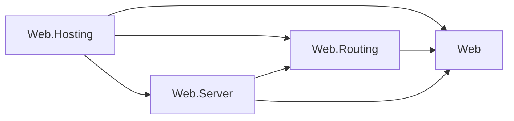
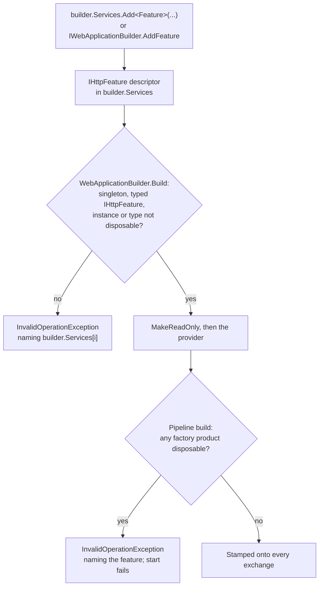

# Assimalign.Cohesion.Web.Hosting — Design

`Assimalign.Cohesion.Web.Hosting` is the composition root for the Web resource: it
builds a `WebApplication` (a `Host<WebApplicationContext>`), wires the middleware
pipeline, and composes Web.Server's public engine that turns accepted HTTP connections into
pipeline invocations. It is the **only** Web layer where DI, logging, and
configuration are integrated, and that integration is strictly builder-time —
nothing resolves services per request.

**The hosting module is dependency-isolated within the Web area** (rule adopted
2026-07-10, recorded in `resources/Web/README.md`): no Web feature library
references this package — a feature that did would drag the DI/configuration
composition surface into every consumer — and this package references two
Web feature libraries: `Web.Routing` and `Web.Server` (#1379). It references the root `Assimalign.Cohesion.Web` abstractions, those packages, and
non-Web infrastructure. The rule as adopted forbade this module's references to Web features too;
since its relaxation (COHRES002, owner decision 32 of 2026-10-09) the module may reference any Web
library except `Web.Testing`, `Web.ApplicationModel`, the `App.Web` producers, and harnesses, and
takes such a reference only for runtime machinery it composes itself, because each one ships in all
18 area frameworks. Routing and Server supply the terminal and server engine, whose contracts left the Web root
under owner decision 33: `Web.Routing` for the pipeline terminal (`WebApplicationTerminal`) and the
`IRouterEndpointFeature` it dispatches, and `Web.Server` for the engine and the per-exchange features
it publishes. Applications still see the whole Web family because the
`App.Web` shared framework (via `Sdk.Web`) delivers every Web assembly; builder
verbs ship with their features: feature registration is a component integration each feature
package declares and the application's compilation projects onto `builder.Services`
(`builder.Services.AddAuthentication(auth => auth.AddCookie())`, owner decision 34), and pipeline
verbs extend the root `IWebApplicationPipelineBuilder` seam, so this module needs no reference to a
feature to host it. The one sanctioned
exception is `Web.Testing`, the harness that drives this concrete runtime.

This document records hosting composition. The engine implementation and lifecycle are documented
in [Web.Server](../../Assimalign.Cohesion.Web.Server/docs/DESIGN.md).

The runtime's references within the Web area, with every arrow meaning "references":



The runtime references the root, `Web.Routing`, and `Web.Server`. These feature packages reference
the root within the area; Web.Server also references Web.Routing. The resource integration lives in
`Web.Hosting.Resources`, which references this module.

## Design intent

The server has one job: pull connections off a listener and drive each one
through the middleware pipeline, forever, without letting any single connection —
well-behaved or hostile — degrade the others or take down the host.

Four properties fall out of that intent and shape the whole implementation:

- **Connections are independent.** One connection's pace, idleness, or failure
  must never be observable by another. This rules out any design that serves
  connections from a shared loop.
- **Streams are independent.** HTTP/2 and HTTP/3 multiplex many exchanges over
  one connection; one stream's pace or failure must never be observable by its
  siblings. This rules out serving a connection's streams from its receive loop.
- **Application faults are contained.** Middleware is arbitrary user code. A
  throw from it is expected, not exceptional, and must cost exactly one
  exchange — never its siblings, never the accept loop, never the process.
- **Shutdown is deterministic.** Stopping the server lets what is in flight finish
  within the stop's budget, cancels only what outlives it, and releases every
  resource, without leaving an unobserved exception behind.

## Application lifecycle composition

`WebApplicationBuilder.Services` is the application's one composition registry. Every
dependency the host runs with is a registration in it, and the root
`IWebApplicationBuilder` verbs are explicit-interface shims over those registrations:

| Verb | Registration |
| --- | --- |
| `AddService(IHostService)` / `AddService(Func<WebApplicationContext, IHostService>)` | `IHostService` |
| `IWebApplicationBuilder.AddServer(...)`, `Server.UseServer<TServer>(...)` | `IWebApplicationServer` |
| `IWebApplicationBuilder.AddFeature(...)`, the feature packages' `builder.Services.Add<Feature>(...)` verbs | `IHttpFeature` (singleton only) |
| `IWebApplicationBuilder.AddSetting(...)`, setting registrations such as `builder.Services.AddCors(...)` | `IWebApplicationSetting` (singleton), listed on `WebApplicationContext.Settings` |
| HTTP policy defaults, `Services.AddSingleton<IHttpExchangeInterceptor>(...)` | `IHttpExchangeInterceptor` (singleton only; default server) |

A value becomes an instance registration, which stays owned by its caller; a
`Func<IWebApplicationContext, T>` becomes a factory registration invoked once with the
final context, and the application owns what it returns. Factories receive the context,
never the provider, which is what keeps the container out of the feature libraries that
call these verbs. A direct `Services.AddSingleton<IHostService>(...)` or
`AddSingleton<IWebApplicationServer>(...)` is equivalent to the matching verb.

**The service type is the lifecycle phase.** The host runs two phases, each in its own
registration order: every `IHostService` registration (the application services), then
every `IWebApplicationServer` registration (the servers). Because the phases are distinct
service types, registration order across them is irrelevant, so the default server
(registered when the builder is constructed) never precedes a later `AddService` call.
`WebApplicationContext.HostedServices` concatenates the two snapshots, wrapping each
server exactly once in `WebApplicationServerHostService`, including servers that implement
`IHostService`. The Web host rejects concurrent service start or stop, so every application
service starts before any Web server and
reverse shutdown drains every server before stopping application services. Before this
registry held everything, `AddService` kept a private list beside the DI-owned server
slot to get the same guarantee.

**Resolve once, at the boundary that consumes it.** `Build` makes the container read-only
(a later registration throws instead of silently missing the provider), creates the
provider once, and resolves the application services, running each factory exactly once
against the final context. Servers resolve once at host start, because the default
server captures the composed pipeline and middleware is added to the built application.
Features resolve once at pipeline build (below). HTTP exchange interceptors resolve once
inside the default server factory, before its listener configurations run. Custom servers own
their listeners and do not consume that aggregate. Nothing resolves per request.

**The application owns the provider.** Disposing a `WebApplication` stops the host, then
disposes the provider, which disposes every factory-created service in reverse creation
order; a failed `Build` disposes it before rethrowing. The provider was previously never
disposed.

`AddPipeline` is the one root verb that is not a registration: it replaces the default
pipeline with a single value, which the hosted `IWebApplicationPipeline` registered at
`Build` wraps with the enabled-resource terminals.

## Server engine and host wrapper (decision 57 (b), #1458)

The public `WebApplicationServer` and `WebApplicationServerOptions` now live in Web.Server,
namespace `Assimalign.Cohesion.Web`. The engine constructs its HTTP listener, installs its
client-fault and response-starting interceptors, sizes exchange features, dispatches connections
and multiplexed exchanges, isolates application faults, and drains on stop. Its complete
[dispatch, drain and telemetry design](../../Assimalign.Cohesion.Web.Server/docs/DESIGN.md#server-dispatch-model)
lives beside that implementation. Web.Server references Http.Connections, Connections and
Web.Routing, and no connection driver, HTTP policy feature or Hosting library.

Servers join the host lifecycle through `UseServer` or `AddServer`;
`WebApplicationServerHostService` is the internal, non-owning `IHostService` wrapper in
`Assimalign.Cohesion.Web.Hosting.Internal`. Its
constructor takes any `IWebApplicationServer`; `Server` exposes the original object and
`Id` is the wrapper's own `ServiceId`. Start and stop forward the caller's token. The wrapper
retains the default server's `HostStartupException` envelope for a bind failure, with the
transport exception inside; custom servers' errors and cancellation pass through unchanged.
It implements neither disposal interface and never disposes its server. Factory registrations
remain owned by the provider, while instance registrations remain borrowed.

`WebApplicationContext` creates one wrapper for every server, once when resolving the
server phase. A server that also implements `IHostService` still goes through the wrapper,
so start and stop always dispatch through `IWebApplicationServer`, even when the server
implements the two interfaces separately. `Servers` still contains original objects. Both
`WebApplicationServerBuilder.UseServer<TServer>` overloads accept any
`IWebApplicationServer`; the `IHostService` constraint is removed. The inert default placeholder
still disappears from both snapshots when no default listener was configured.

Hosting keeps configuration binding, the HTTP policy defaults (request limits, protocol upgrade
and extended CONNECT), TCP/TLS/QUIC helper composition, pipelines, control-plane and health
integration. The builder supplies the composed pipeline and listener options to the public engine.
Application services still start before servers and stop after their drain.

**Compatibility with 10.0.0-preview.1 (decision 15).** Making the engine/options public
is additive; relaxing `UseServer` accepts more implementations. #1458 also made the wrapper
public. Making it internal is a source and binary break for intervening code that wrapped a
server by hand; register the server through `UseServer` or `AddServer` instead.

**Breaking lifecycle behavior:** preview.1 bypassed the adapter for a server implementing
`IHostService`, invoking that interface's start and stop methods. Every server registration now
uses `IWebApplicationServer.StartAsync` and `StopAsync` through its own wrapper and service id.
Custom servers with separate interface implementations must put server lifecycle behavior on
`IWebApplicationServer`; instance/factory disposal ownership is unchanged.

The server EventSource, Meter and ActivitySource now use `Assimalign.Cohesion.Web.Server`;
none of these names shipped in preview.1. Configuration callbacks now see the hosting defaults
and application feature count; the server adds its own hooks and capacity afterward. Clearing
that list removes HTTP policy defaults but cannot remove the engine's required features.

## Diagnostics

The assembly owns one internal sealed `WebHostingEventSource`, named
`Assimalign.Cohesion.Web.Hosting`. It reports the integrated resource control plane only.
The engine's separate `WebServerEventSource`, Meter and ActivitySource belong to Web.Server.
Both sources are covered by the default `Assimalign.Cohesion.Web.` forwarding prefix.
Neither source's ids shipped, so each starts at 1 without gaps.

| Id | Event | Level | Payload |
| --- | --- | --- | --- |
| 1 | ControlPlaneDisabled | Warning | resourceName, observedEndpoints |
| 2 | CredentialRejected | Warning | resourceName, requestId, status, reason, route, remoteEndPoint, suppressedCount:int |
| 3 | CommandMalformed | Warning | resourceName, requestId, httpMethod, phase, exceptionType, suppressedCount:int |
| 4 | StopAccepted | Informational | resourceName, requestId, deferred:bool |

The lazy `rejected-credentials` PollingCounter counts every refusal, including disabled or
throttled events. This assembly owns its own `EventThrottle` instances; nothing is shared with
Web.Server. No spans or HTTP request metrics originate here. Every area composing the shared
control plane reports through this provider, identified by `resourceName`; nested hosts need
their own forwarding registration or an external diagnostic listener.

Credential rejection includes the standalone non-loopback refusal introduced by #1431, with
`reason=non-loopback-peer` and `status=Forbidden`. Other reasons are `missing-credential`,
`unsupported-scheme`, `invalid-token`, `audience-mismatch`, `caller-mismatch` and `verifier-rejected`.
A registered verifier's private reason is never copied. `route` is a fixed category (stop, commands,
endpoints, healthz, readyz, livez or unknown), never a path. Among control-plane events, the
transport peer appears only in CredentialRejected and is personal data in the diagnostic sink; forwarded client addresses are not
used. Request identifiers come from `IWebRequestIdFeature`, never an ambient Activity.

CredentialRejected and CommandMalformed each emit at most once per second across the merged provider.
Their next emission includes the number of suppressed enabled-listener occurrences (saturating at
`Int32.MaxValue`). The `rejected-credentials` PollingCounter remains exact, including refusals when
disabled or throttled. It is created on first enable, and its backing total uses Interlocked.
No request-total counter or Meter instrument is added. StopAccepted is the scope's unthrottled
management lifecycle acknowledgement, with `deferred` indicating response-completion scheduling.

Malformed JSON/base64/argument faults retain HTTP 400. `phase=Envelope` covers parsing and command
construction; it changes to `Handler` immediately before command dispatch. A handler failure
already reported by the shared control plane is omitted from this source (#1434); custom control
planes still report `Handler` when they throw a JSON, format or argument exception. Successful response
status, headers and body are written after these catches. A response adapter failure propagates to the
owning HTTP error boundary and never emits CommandMalformed or changes the applied command outcome.
Only the exception type is written: JSON and handler messages can contain command input. No event
contains an Authorization value, credential, claim, caller identity, command key or command payload.
Command execution outcomes
belong to Hosting.Resources, not this HTTP source.

Web.Hosting and Hosting.Resources compile one stateless internal `CommandFailureDiagnostics` helper. It uses the
existing exception metadata carrier to associate a reported failure with its original command
invocation. The BCL weak table stored there keys by reference identity and is consumed by this
middleware: repeated or concurrent reuse of an exception cannot suppress another command, and no
command payload is retained by the metadata. Registered control-plane wrappers pass the same
invocation through. No shared static state, reflection, public diagnostic API or shipped visibility
grant is involved. Marking happens even when the producer is disabled or throttled, so enabling
only the Web source never moves execution events into it. An application-defined exception whose
`Data` is read-only or throws cannot carry the marker; diagnostics preserve the original failure
and HTTP status, and the HTTP source may also report that unusual handler fault. Exact de-duplication
for such custom carriers needs a producer-owned public dispatch seam and remains an escalation.

**Contributor ownership adjustment (#1400).** A throwing contributor is caught and sanitized inside
Hosting.Resources. Existing contracts cannot carry its exception into this assembly without adding
a public exception member or a diagnostics forwarding API. The smallest internal hand-off is from
that catch to Hosting.Resources' own `HostingResourceEventSource.ContributorFailed`; this Web source
does not duplicate it. Health contributions and probe responses keep their fixed safe descriptions.
The producer's DESIGN documents the event, counter and exception-message policy. This departs from
the scope's requested Web-source ownership and is recorded for owner review, with no public API,
shipped visibility grant, or reverse dependency added.

These diagnostics add operator visibility relative to 10.0.0-preview.1; token acceptance and probe
serialization are unchanged. **Breaking behavior change from 10.0.0-preview.1 (#1400, decision 15's
preview terms):** failures while writing a successful command response now propagate instead of
being converted into a command-level 400, 501 or 409 after the command has already succeeded.
Envelope and handler failures retain their existing HTTP mappings.

## AOT posture

Composition uses typed delegates and static calls, without reflection or dynamic code. The Web
NativeAOT guard in `samples/Assimalign.Cohesion.Web.AotGuard` validates the integrated application,
including the separately owned server diagnostics, with a native publish and `--smoke` run.

## Application feature seeding

`IWebApplicationBuilder.AddFeature` and the feature packages' `builder.Services.Add<Feature>(...)`
verbs register `IHttpFeature` singletons (routing's per-application `IRouterFeature`, from
`builder.Services.AddRouting()`, is the canonical example), but a feature is only
useful once it is present on each exchange's `IHttpContext.Features` collection.
That bridging happens when the pipeline is built: `WebApplication`'s pipeline
`Build()` resolves the registered features **once** and, when any exist, wraps the
composed pipeline in a seeding middleware that stamps each feature onto every
exchange before any user middleware runs.

Two deliberate properties:

- **Builder-time snapshot, not request-time service location.** The feature set is
  materialized at pipeline build (which happens when the server is resolved). Per
  the hosting philosophy, nothing resolves services per request — the per-exchange
  work is a plain array walk. Registration closes at `Build`, before any pipeline
  exists, so the snapshot always holds every feature; a feature factory runs once,
  the first time the application's features resolve.
- **Application-registered features are per-application.** Each application seeds
  only its own DI-registered features, which is half of the process-wide isolation
  story (#789's per-application router state is the other half).

### Feature registrations are singletons (owner decision 35, #1380)

Seeding stamps one snapshot of the `IHttpFeature` aggregate onto every exchange, and composition-time
readers (`UseRouting`, `UseAntiforgery`, the OpenAPI document) resolve the same aggregate from the root
provider. A feature therefore has exactly one lawful shape, an `IHttpFeature` singleton, and the module
enforces it where it can see each violation; every error names the registration:

| Check | Where | Rejects | Why |
| --- | --- | --- | --- |
| Lifetime | `WebApplicationBuilder.Build`, before `MakeReadOnly` | an `IHttpFeature` registration that is scoped or transient | One scoped item makes the whole aggregate unresolvable from the root ("scoped from root" at host start); a transient one hands each reader its own instance, so routes mapped into one router are served by another |
| Contract | `WebApplicationBuilder.Build`, before `MakeReadOnly` | a registration whose service type derives from `IHttpFeature` but is not `IHttpFeature` | It never joins the aggregate, so it is never stamped |
| Disposal, descriptor | `WebApplicationBuilder.Build`, before `MakeReadOnly` | an `IHttpFeature` instance or implementation type that is `IDisposable` or `IAsyncDisposable` (`AddFeature(instance)`, every static-factory verb, `AddSingleton<IHttpFeature, T>()`) | The exchange disposes the disposable features it carries at teardown, so the shared instance would be disposed after its first request |
| Disposal, factory product | the pipeline build, where the aggregate is resolved | a feature a factory registration produced that is `IDisposable` or `IAsyncDisposable` (the builder-template verbs, `AddFeature(factory)`) | The same; the product exists only once the factory runs |

The provider's own `ValidateOnBuild` sees none of these: this module registers factories and
instances, whose implied lifetimes and products it does not inspect. The `Build` checks run
before `Build` adds its own registrations, so a rejected build leaves the builder as its caller
composed it. A factory registration's product exists only when it is resolved, so its disposal
check runs at the pipeline build, which still fails host start before any request. Decision 35
reads "at `Build`" for all three rejections; the factory-product case is the one place the check
cannot run there. Request-scoped services for handlers are a separate, future decision: a lazily
created scope owned by the server, for a separate service type, never a looser `IHttpFeature`
lifetime. A measured analysis found no performance or functional gain in scoped or transient
features (plan §7.4, decision 35).

How a registration reaches an exchange, and where each check stops it:



**The pipeline is built before any service starts (#1051, #1079).** The host resolves
`WebApplicationContext.HostedServices`, including the servers, pipeline and every middleware
factory, before entering service lifecycle callbacks. A composition failure such as an invalid
route table fails `StartAsync` and leaves the host `Failed`, even when resolving the same services
also fails during rollback. The generic host owns this guarantee; Web needs no startup-hook
workaround. `ExecuteAsync` runs no middleware for a token that is already cancelled; middleware
observe cancellation through `RequestCancelled`.

**Late middleware registration fails (#1078).** Once the pipeline has been built, every
`WebApplication.Use` / `IWebApplicationPipelineBuilder.Use` overload throws
`InvalidOperationException` explaining that the pipeline is already built. Each public `Use`
contract documents this exception in its XML reference. Register middleware
before starting the application (or explicitly building its pipeline). This is a behavioral
break from 10.0.0-preview.1, which accepted the registration but never executed it.

### Sizing each exchange's feature collection (owner decision 36, #1381)

Stamping used to grow each exchange's feature collection. Its dictionary starts with three slots and
grows to 7, 17 and 37, copying into a new array each time, and that growth was nearly all of the
stamping cost. The default server now tells the transport how many features an exchange carries,
through the transport's generic `HttpConnectionListenerOptions.ExchangeFeatureCapacity`. The
transport sizes every exchange's collection for that many features when it creates it. The
transport learns a number, not which features this module installs (owner decision 20).

The count is the application features the pipeline stamps plus
`WebApplicationServer.HostFeatureCount`, the five features every exchange of the default
server carries:

| Feature | Installed by |
| --- | --- |
| `IHttpMaxRequestBodySizeFeature`, `IHttpMinRequestBodyDataRateFeature` and `IHttpMinResponseDataRateFeature`, one object (#1383, #1384) | the first default interceptor, while the request is parsed |
| `IWebRequestIdFeature` | the server's exchange telemetry, before the pipeline runs |
| `IWebResponseCompletionFeature` | the server, before the pipeline runs |
| `IWebServerDrainFeature` | the server, before the pipeline runs |
| `IWebResponseStartingFeature` | the response-starting interceptor, before the pipeline runs |

- The pipeline build records how many features it stamps (`WebApplicationContext.StampedFeatureCount`).
  The default server resolves the pipeline before it composes the listener, so the count is known.
  A pipeline passed to `AddPipeline` stamps none, so the count is the host's five.
- The application count is set before user `UseServer` configurations run, so a configuration
  can add its own slots. The server then adds its five-slot allowance and rounds the sum once
  (see "Rounding" below) before constructing the listener.
- `WebApplicationExchangeFeatureCapacityTests` pins the count. A plain request on HTTP/1.1 and HTTP/2
  carries exactly as many features as are counted, so the test fails if the server starts installing
  another feature on every exchange without counting it.

#### What the count leaves out

The count covers only what the host knows every exchange carries. Middleware install features as an
exchange passes through them, and in an ordinary application those sit on most exchanges:

- **Routing** installs one feature on every matched request. `RouteMatchFeature` implements both
  `IRouteMatchFeature` and `IRouterEndpointFeature` under the one name `IRouterEndpointFeature`, so it takes
  one slot; a 405 takes the same slot with `MethodNotAllowedRouterEndpointFeature`. In a routed application
  a matched request is the ordinary exchange. A `Map` branch also installs `IRouterPathBaseFeature` on
  each request that enters it.
- **One feature on every exchange that passes through:** `UseForwardedHeaders`,
  `UseResponseCompression` (not on a `HEAD`, nor over HTTPS unless `EnableForHttps` is set),
  `UseSecurityHeaders`, `UseRequestTimeouts`, `UseRateLimiting`, `UseSessions`, `UseOutputCache` and
  `UseForms`.
- **Up to two:** `UseAuthentication` installs `IAuthenticationResultFeature` on every exchange when a
  default authenticate scheme is configured, and `IAuthenticationFeature` too on each exchange that
  authenticates. `UseCookiePolicy` installs `ICookieConsentFeature` and its
  `IHttpResponseCookieFeature`.
- **Only some exchanges:** the upgrade and extended CONNECT features, the client-fault feature on a
  request that can have a body (#1340, #1378), the WebSocket policy feature on a handshake, the rewrite feature
  on a rewritten request, the exception feature on a failure, and the TLS feature built on first read.

The server cannot count these itself: the transport learns only a number (owner decision 20), and
the pipeline's middleware are opaque delegates. A host adds one slot in a listener configuration for
each feature its middleware install on an ordinary exchange, for example
`options.ExchangeFeatureCapacity += 3` for routing, `UseResponseCompression` and `UseSecurityHeaders`.

#### Rounding: an overflow never costs more than not presizing

The dictionary rounds the size it is given up to a prime, and outgrown, it grows to the smallest prime
at least twice its size. An unsized dictionary therefore grows through 3, 7, 17, 37, 89, 197, 431 and
919 slots. A size between two of those grows to another size between them, and that overflow costs
more than never presizing. Handing the transport the exact count did that whenever the count's prime
fell between two of those sizes and the uncounted features pushed an exchange past it. With seven
application features the count is eleven. A matched request carries a twelfth feature, routing's, which grows an 11-slot dictionary to
23 slots. That is 144 B more per request than the unsized collection, which grows through 3, 7 and 17.

So after the last listener configuration the server rounds the capacity up to the smallest of those
sizes that holds it (`WebApplicationServer.RoundExchangeFeatureCapacity`). From there an overflow
grows exactly as an unsized dictionary does, so an exchange carrying any number of uncounted features
never allocates more than it would without presizing. A configuration that sets `0` requests no additional application slots; the engine still adds
its own allowance. Rounding last matters: rounding the host's count first and letting a configuration add slots
to it would land between the sizes again.

The price is unused slots when the count falls between two sizes and nothing overflows: eight counted
features take a 17-slot dictionary where 11 slots would do (168 B more), and twenty take 37 where 23
would do (392 B more). Those slots are what the first uncounted feature lands in.

`WebApplicationExchangeFeatureCapacityTests` pins the rounding. For a range of application feature
counts it stamps every count from one past the host's count to twice the rounded capacity onto a
collection sized as the server sizes it, and asserts that this allocates no more than an unsized
collection holding the same features. Another test adds slots in a listener configuration, fills a real
exchange to the rounded capacity on HTTP/1.1 and HTTP/2, and asserts that this allocates nothing.

Measured with a loopback `HttpClient` in the same process, so the client's allocations are
included, a plain `GET` through the default server allocates the bytes below (median of five rounds of
20,000). "Uncounted" is how many more features the terminal middleware installs on every exchange,
standing in for routing's route match and the `Use*` features above. "Unsized" sets the capacity to
`0`, the state before #1381; "exact" hands the transport the count unrounded, as the first version of
this change did; "rounded" is the shipped behavior.

| Application features | Uncounted | HTTP/1.1 unsized | HTTP/1.1 exact | HTTP/1.1 rounded | HTTP/2 unsized | HTTP/2 exact | HTTP/2 rounded |
| --- | --- | --- | --- | --- | --- | --- | --- |
| 0 | 0 | 13,056 B | 12,920 B | 12,920 B | 10,875 B | 10,725 B | 10,724 B |
| 4 | 0 | 13,616 B | 13,064 B | 13,232 B | 11,433 B | 10,869 B | 11,036 B |
| 8 | 0 | 13,648 B | 13,264 B | 13,265 B | 11,453 B | 11,069 B | 11,069 B |
| 16 | 0 | 14,800 B | 13,496 B | 13,887 B | 12,622 B | 11,301 B | 11,695 B |
| 4 | 4 | 13,648 B | 13,792 B | 13,264 B | 11,462 B | 11,595 B | 11,071 B |
| 7 | 1 | 13,648 B | 13,792 B | 13,264 B | 11,453 B | 11,597 B | 11,068 B |
| 16 | 1 | 14,808 B | 13,504 B | 13,895 B | 12,611 B | 11,309 B | 11,703 B |
| 16 | 4 | 14,832 B | 14,896 B | 13,920 B | 12,637 B | 12,701 B | 11,725 B |

The exact count beat not presizing until an uncounted feature overflowed it, and then it lost: seven
application features plus a route match cost 144 B more than unsized, and sixteen plus four cost 64 B
more. Rounded, no row costs more than unsized. Rounding gives back part of the gain where the count
falls between two sizes and nothing overflows (168 B at four application features, 391 B at sixteen),
and it saves 528 B over the exact count on the routed seven-feature application. Sixteen application
features with four uncounted cost 1,000 B over a featureless application on HTTP/1.1, where unsized
they cost 1,776 B. An application with no features saves 136 B, because the host's own four features
no longer grow the collection past three slots.

## The pipeline terminal — endpoint dispatch and the bodyless 404 fallback (#881, #1054)

`WebApplication`'s pipeline `Build()` composes the innermost middleware — the
terminal reached only when every registered middleware chained to `next`.

**Endpoint dispatch (#1054).** When an endpoint-selecting middleware (`UseRouting`)
published an `IRouterEndpointFeature`, the terminal runs that endpoint. That is
where a matched route's handler runs, after every middleware registered behind
`UseRouting`, and where routing's 405 is written. The terminal is
`WebApplicationTerminal.InvokeAsync` (#1056), shared with every non-rejoining pipeline
branch, so the application and its branches agree on what "unhandled" means. The terminal and
the endpoint contract are `Web.Routing`'s since #1379; until then they were the Web root's,
because COHRES002 forbade this module a `Web.Routing` reference.

**The 404 fallback (#881).** With no endpoint selected, the request went unhandled.
The terminal used to be a silent `Task.CompletedTask`, which handed the
transport an empty `200` for any unhandled request. It now sets a **bodyless
`404 Not Found`** when the response arrives untouched (still `200`, no body, no
`Content-Type`, no `Location`); a response a middleware already shaped — a non-`200`
status, a written body/content type, or a redirect `Location` — is left as-is.

Two deliberate properties:

- **Payload-free.** Neither this runtime module nor `Web.Routing` references `Web.ProblemDetails`:
  the resource hosting-isolation rule (COHRES002) forbade it when the fallback was
  written, and since the 2026-10-09 relaxation such a reference would still ship in every
  framework that carries this module. So the terminal can only *set the status*. Turning the
  bodyless 404 into an RFC 9457 problem+json body is the job of the opt-in
  `UseStatusCodePages()` middleware in `Web.ErrorHandling`, which the application
  composes over the top.
- **A deliberate empty `200` must be terminal.** A `200` with no body is
  indistinguishable from an untouched response, so a middleware that means to answer
  with an empty `200` must be terminal (not call `next`); a bodyless-`200`
  fall-through is read as unhandled. This is the accepted trade-off for turning
  no-match into a `404` without a routing-level "handled" signal.

## Testing

Engine behavior is verified in `Web.Server.Tests`; hosting composition remains in this project's `tests/`. Both use xUnit + Shouldly. Engine tests use instrumented
doubles (`FakeHttpConnectionListener`, `FakeHttpConnection`,
`FakeHttpConnectionContext`, `FakeHttpContext`, `FakePipeline`) that let a test
script receive sequences, park connections, throw from the pipeline, and observe
opens/sends/aborts/disposals. The suite pins each acceptance property: idle
keep-alive non-starvation, single-connection fault isolation with continued
service, connection+context disposal on every exit path, graceful `StopAsync`
drain + listener disposal, and the concurrency cap holding connections back until
a slot frees.

The same properties are additionally pinned **end to end** by the full-pipeline
integration suite (`WebApplicationPipelineIntegrationTests`,
`WebApplicationServerIntegrationTests`, and `WebApplicationTerminalFallbackTests`
for the bodyless-404 terminal), which drives the real server over the in-memory
transport through `Assimalign.Cohesion.Web.Testing`'s `WebApplicationTestFactory` —
a real `HttpClient`, real HTTP/1.1 exchanges, no sockets. It covers middleware onion
ordering and short-circuiting, per-connection dispatch (a parked connection does not
starve others), application-fault isolation (a `500` on a connection that keeps
serving), the unhandled-request 404 fallback, and graceful shutdown draining
(in-flight unwind, idle keep-alive unblock, post-stop connection refusal). A raw
in-memory connection pipelines two HTTP/1.1 requests to pin that the second reaches
the pipeline only after the first's response.

Per-stream dispatch (#1049) is pinned at both levels. The unit suite drives
multiplexed doubles (`IHttpContext.Version` of HTTP/2) through concurrency (a stream
that completes only after its sibling's response was sent), fault isolation (`500`,
reset when the response cannot be replaced, reset on cancellation, reset on a failed
send), the stop drain (nothing is disposed under a running stream), and slot
accounting (a connection whose receive loop ended holds its slot until its stream
finishes); `MultiplexedExchangeTrackerTests` pins the countdown itself.
`WebApplicationServerHttp2IntegrationTests` repeats the concurrency, `500`, and drain
properties over prior-knowledge HTTP/2 with a real client and asserts every request
shared one connection, and adds the case the doubles cannot reach: a stream that
faults after streaming part of its body is reset, not completed. `WebHttp3HostingIntegrationTests`
pins concurrency over a real QUIC connection where the platform supports it.

Server telemetry (#1064) is pinned end to end by `WebServerTelemetryTests`, over the in-memory
transport with a real client and an `ActivityListener` and `MeterListener` subscribed by name
(`TestObjects/TelemetryRecorder`): one server span per request, parented to the caller's
`traceparent` and current while the pipeline runs; the attributes and the span name, a routed
request's `http.route` (through real `Web.Routing`); every outcome in the
`error.type` table; `_OTHER`, including a lower-case `get` written raw and reported with its original
case; one span per HTTP/2 stream; an ambient activity at server start that
must not parent requests; the duration and the active-request count; the request id with and
without a span; and no activity at all without a listener. A version-00 `traceparent` and a later
version's, with and without extra fields, continue the caller's trace (#1299). Version `ff`, a
version-00 value with extra fields, a later version whose flags are followed by something other than
a dash, upper-case hex, a short value and a separator other than a dash each start a new trace, and
a later version keeps only its sampled flag. `url.query` (#1298) is pinned end to end
with every value redacted, with values declared safe, and after a declaration rejected for a missing
or empty name, which leaves its other names redacted; its builder is pinned against empty and
valueless parameters, encoded names and case-insensitive declarations; a request double that counts
reads of its query (`TestObjects/ServerTestDoubles`, `FakeHttpRequest`) shows the query is read only
when a span listener subscribes. Listeners are process-wide, so the class runs in the non-parallel
`TelemetryCollection`.

The lame-duck drain (#146) is pinned by `WebApplicationServerDrainTests`. Against the
doubles: the stop begins every connection's graceful close and the exchange in flight
finishes and is sent under a token that was never cancelled; when the budget runs out,
the exchange is cancelled and reset, its connection is aborted with a
`ConnectionAbortedException`, and the stop still completes. End to end: an HTTP/1.1
request in flight when the stop begins completes in full with `Connection: close`; one
that outlives the budget observes `RequestCancelled` and its client gets no response;
and a raw prior-knowledge HTTP/2 client sees `GOAWAY(NO_ERROR)` naming its open stream
as the last processed while that stream is still running, then the stream's full
response. An exchange in flight sees its `IWebServerDrainFeature` fire when the stop begins,
while its `RequestCancelled` does not, and its response is still delivered. The per-version
announcements are pinned in the transport's own suite (`HttpConnectionGracefulCloseTests`). The
WebSocket close it enables (`1001` before the budget runs out) is pinned end to end in
`Web.WebSockets`' suite.

The default protocol-upgrade interceptor is pinned by `WebApplicationServerDefaultsTests` (slot 1,
by behavior) and by `WebApplicationProtocolUpgradeTests` over a real loopback connection: an
upgrade nobody accepts is served as an ordinary `200`, and an accepted one answers `101` and hands
the handler the raw connection. The default extended CONNECT interceptor is pinned by the same
defaults suite (slot 2, by behavior) and by `WebApplicationServerExtendedConnectTests`, a WebSocket
echo over a real HTTP/2 extended CONNECT. The client-fault interceptor (#1340, #1378) is pinned by the
Web.Server's `WebClientFaultInterceptorTests` (it joins the response phase only for a request that can have a
body, on every version, and its feature reads the control on each access) and by
`WebApplicationServerClientFaultTests` over raw in-memory connections: on HTTP/1.1 a malformed chunked
body and a body over the cap are reported to the pipeline as the `400` and `413` the transport sends, a
well-formed body reports nothing, and a plain `GET` carries no feature; on HTTP/2 and HTTP/3 a body that
contradicts its content-length and a malformed trailer section are reported as `400` while the client
sees the stream reset, a body over the cap as the `413` the transport sends, and a request whose stream
ended with its head carries no feature; on HTTP/3, DATA after the trailer section is reported as `400`
too, and a client's `RESET_STREAM` mid-body reaches the pipeline as the exchange's cancellation, with no
fault reported, and ends in a reset rather than a `500`. `WebServerTelemetryTests` pins that the same
faults end the span with the transport's status (the `400` a reset records, on HTTP/2 and HTTP/3), no
`error.type` and an unset status, that an HTTP/2 exchange the fault's reset or the transport's `413`
cancels before its response started reports that `400` or `413` the same way, and that an HTTP/3 request
the client resets mid-body reports `request_canceled`.

`RequestBodyCancellationTests` covers a real HTTP/1.1 TCP reset and HTTP/2 connection EOF and
`RST_STREAM` while a tokenless body read is pending under `UseErrorHandling()`: the exact exchange
token is already cancelled when the read throws, the client-fault status remains null, the span
reports `request_canceled` without a response status, and neither an Error log nor `OnException`
runs. `WebApplicationServerClientFaultTests` also covers incomplete HTTP/1.1 EOF for fixed-length
and chunked bodies: both cancel without a response or client-fault status.

The diagnostics are pinned by `WebApplicationServerDiagnosticsTests` under the shared
EventSource recorder, including real TCP bind and response failures. `WebServerEventSourceTests`
in Web.Server checks the name, strict manifest, server lifecycle and counter publication. Serial collections,
server/connection identifiers and counter deltas isolate process-wide observation.

## Non-goals

- **A server-side per-connection stream cap.** Stream admission is the transport's
  (`SETTINGS_MAX_CONCURRENT_STREAMS`, QUIC stream credit); a second, server-owned
  limit would silently disagree with the one advertised to the peer. The remaining
  HTTP/2 peer-reset gap (see "Dispatch within a connection") belongs in the transport's
  admission accounting as well.
- **Per-request service resolution.** DI/logging/config are builder-time only;
  the server resolves nothing per connection or per request.
- **Re-implementing wire behaviour.** Protocol conformance and wire-level failure
  isolation stay in `Http.Connections` and are never duplicated here.
- **Host filtering.** Allowed-hosts enforcement ships as the
  `Assimalign.Cohesion.Web.HostFiltering` feature package (`UseHostFiltering`,
  registered at the front of the application's pipeline). The runtime module deliberately has no
  knowledge of it — pipeline composition is the application's, not the host's (the
  hosting-isolation rule also forbade the reference until 2026-10-09).
The Web resource's composition root: the `WebApplicationBuilder` /
`WebApplication` surface that wires the `Assimalign.Cohesion.Http.Connections`
transport, the request pipeline, DI, logging, and configuration into a runnable
host. Per the repo's hosting philosophy, **this is the one place DI / Logging /
Config integration happens** — the transport and protocol libraries stay free of
those concerns.

This document grows as areas are touched rather than re-documenting the whole
surface at once. The broader server/runtime shape (per-connection dispatch,
error isolation, graceful stop) is being reworked under issue #762; this file
currently captures only the design decisions that are settled.

## Resources

This module knows nothing of resources. `Web.Hosting.ApplicationModel` makes a Web application a managed
resource with `builder.Services.AddResource(name, ...)`: it registers the resource service as a host
service, and exposes the application's settings as actions. Until the application
model restarted on 2026-10-27, this module carried the resource integration itself: an ambient
`ResourceRuntime` registration, a control-plane terminal with health probes, and a Hosting.Health
adapter. The restart removed the integration, and the adapter left with Hosting.Health on
2026-10-28.

## Default application configuration

`WebApplication.CreateBuilder(args)` composes the application configuration in
increasing precedence order:

1. optional `appsettings.json`;
2. optional `appsettings.{Environment}.json`;
3. process environment variables prefixed with `COHESION_CONFIG__` (the prefix is
   removed and double underscores become configuration path separators);
4. command-line arguments.

The environment file name remains generic: `Local` selects `appsettings.Local.json`,
and `Development` selects `appsettings.Development.json`. `Local` denotes a developer
machine; `Development` denotes a deployable environment. Neither file is an alias for
the other, and the unset environment default remains `Production`.

The JSON files resolve from the content root: `WebApplicationOptions.ContentRootPath` when
set, otherwise the ambient `Hosting.Resources` `ResourceContext.ContentRootPath` for an
enabled resource, otherwise `AppContext.BaseDirectory`. The same content root is published on
`HostEnvironment.ContentRootPath` and `IWebApplicationContext.ContentRootPath`.

The **web root** — the directory `UseStaticFiles()` serves — is resolved against the content
root: `WebApplicationOptions.WebRootPath` when set (a relative path is combined with the content
root, and the value is kept even before the directory exists), otherwise `wwwroot` under the
content root when that directory exists, otherwise none. It is published on
`IWebApplicationContext.WebRootPath`. The content root itself is never a web root, because it
holds `appsettings*.json` and the application's binaries. An in-process
gateway supplies settings directly on that ambient `ResourceContext`, rather than
mutating process-wide environment variables. The builder folds those settings into
the deployment-setting layer before the caller's command-line arguments, so the
same keys work in process and out of process while explicit arguments retain the
highest precedence. The implementation uses only Cohesion's JSON, environment, and
command-line configuration providers; it adds no reflection binder or
`Microsoft.Extensions.*` dependency.

## Configuration-bound server limits and endpoints

### What it is

`WebApplicationServerBuilder.UseConfiguration(IConfiguration, sectionKey = "Http")`
(an extension member in `WebHostingExtensions`) binds the server's listener
**endpoints**, **server limits**, **connection cap**, and **listener policy** from a Cohesion
`IConfiguration` section, giving `appsettings`-style Kestrel-section parity:

```json
"Http": {
  "AllowAlternateSchemes": false,
  "AddDateHeader": true,
  "Endpoints": {
    "Public":   { "Protocol": "Https", "Host": "0.0.0.0", "Port": 443,
                  "Certificate": { "Path": "certs/site.pem", "KeyPath": "certs/site.key" } },
    "Quic":     { "Protocol": "Http3", "Host": "0.0.0.0", "Port": 443,
                  "HandshakeTimeout": "00:00:10",
                  "Certificate": { "Path": "certs/site.pfx", "Password": "…" } },
    "Internal": { "Protocol": "Http1", "Host": "localhost", "Port": 8080 }
  },
  "Limits": {
    "MaxConcurrentConnections": 1000,
    "MaxRequestLineSize": 8192,
    "MaxChunkFramingLineSize": 8192,
    "MaxRequestBodySize": 30000000,
    "KeepAliveTimeout": "00:02:10",
    "RequestHeadersTimeout": "00:00:30",
    "MinRequestBodyDataRate": { "BytesPerSecond": 240, "GracePeriod": "00:00:05" },
    "MinResponseDataRate": { "BytesPerSecond": 240, "GracePeriod": "00:00:05" },
    "Http2": { "MaxStreamsPerConnection": 100, "MaxRequestHeaderListSize": 16384 }
  }
}
```

The actual binding lives in the internal `HttpServerConfiguration.Bind`, invoked
from inside the `UseServer((serviceProvider, options) => …)` callback so it runs
when the `HttpConnectionListener` is composed. Limits are per HTTP version on
the transport, so the single `Limits` section is parsed eagerly (an unparseable
value fails loudly even with no endpoints) into an
`Http1ConnectionListenerOptions.Http1Limits` template and, for its `Http2`
object, an `Http2ConnectionListenerOptions.Http2Limits` template. Each endpoint the
section registers copies the bound values into its own per-registration limits
through the registration verbs' configure overloads:

| Endpoint protocol | Limits it receives |
|---|---|
| HTTP/1.1 (`Http1`, `Http1s`, and the HTTP/1.1 connections of `Https`) | every top-level key |
| HTTP/2 (`Http2`, `Http2s`, and the HTTP/2 connections of `Https`) | the shared `HttpConnectionListenerLimits` keys (`MaxRequestBodySize`, `KeepAliveTimeout`, `RequestHeadersTimeout`, `MinRequestBodyDataRate`, `MinResponseDataRate`) and the `Limits:Http2` keys (`MaxStreamsPerConnection`, `MaxRequestHeaderListSize`, `MaxResetStreamsPerWindow`, `MaxSettingsFramesPerWindow`, `MaxPingFramesPerWindow`, `FloodDetectionWindow`) |
| HTTP/3 (`Http3`) | the shared keys |

The HTTP/1.1 wire-format keys have no HTTP/2 or HTTP/3 meaning. HTTP/3's stream
and flow-control bounds belong to the QUIC transport, and its one HTTP/3-specific
limit (`Http3Limits.MaxRequestHeadersFrameSize`) is not bound yet. The shared
timeouts take effect on every version: HTTP/2 and HTTP/3 enforce
`KeepAliveTimeout` and `RequestHeadersTimeout` as HTTP/1.1 does (#1085; the
transport's DESIGN, "HTTP/2 and HTTP/3 connection timeouts and data rates").

The same change puts the default minimum request-body data rate on every HTTP/2
and HTTP/3 endpoint, as HTTP/1.1 already had it: 240 octets per second after a
5-second grace period, from the first body read. `Limits:MinRequestBodyDataRate`
binds the listener-wide value on every version (#1383): a section sets
`BytesPerSecond` (a positive, finite number) and `GracePeriod` (a positive
`TimeSpan`), keeping the built-in value of a dimension it leaves out, and the
scalar `none` (or `disabled`) turns the rate off. A JSON `null` reads as an
absent key and keeps the default, so it never switches the defence off by
accident, and a value that does not parse fails the bind. An endpoint registered
in code can still set it through the HTTP options callback of `UseHttp1s`,
`UseHttp2s`, `UseHttps` or `UseHttp3`, for example
`http2 => http2.Limits.MinRequestBodyDataRate = null`.

A request body that legitimately idles, such as a client-streaming call, needs
neither: its endpoint sets `context.MinRequestBodyDataRate!.MinDataRate = null`
before it reads the body, through the feature the default request-limits
interceptor attaches (#1383), and every other request keeps the listener's rate.
Without that, such a body fails with `408` (or a stream reset once the response
has started) when an idle gap outlasts its allowance, about 5 seconds plus 1
second per 240 octets already received.

`Limits:MinResponseDataRate` binds the slow-read defence the same way (#1384):
same shape, same `none`, onto every endpoint. Every version now holds every
response to it, so a client that grants no flow-control credit or stops reading
is reclaimed — the connection closed on HTTP/1.1, the stream reset (or the
connection ended, when its whole window stalls) on HTTP/2, the request stream
reset on HTTP/3 — and the exchange is cancelled. The server records that as a
cancelled exchange, not an application fault, because the stalled write throws
an `OperationCanceledException` carrying `RequestCancelled`. An endpoint whose
reader legitimately pauses sets `context.MinResponseDataRate!.MinDataRate = null`
before its response starts.

`Limits:MaxConcurrentConnections` is not an endpoint limit: it caps the default
server (see "Concurrency cap (`MaxConcurrentConnections`)"). The binder hands it to the
server builder, and a cap set through `LimitConcurrentConnections` takes precedence.

`AllowAlternateSchemes` binds the aggregate listener option of the same name, defaulting to
`false`. Cleartext HTTP/2 now answers `:scheme https` with `421` before the Web pipeline runs
(#1415, owner decision 44). A trusted gateway deployment can set `Http:AllowAlternateSchemes`
to `true` to accept that forwarded scheme; `Request.Scheme` then reports the gateway's value.
This is a behavioral break from 10.0.0-preview.1, which trusted the client's scheme on every
HTTP/2 listener. The boolean is read on both explicit `UseConfiguration` and entry-point
default binding, before endpoint registration; an invalid value fails startup. An absent key
preserves the listener's current setting, and a later `UseServer` callback can override it.

`AddDateHeader` binds the aggregate listener option controlling automatic response dates (#1417).
It defaults to `true`: HTTP/1.1, HTTP/2, and HTTP/3 add IMF-fixdate `Date` to every final response,
including `5xx`, while interim responses carry none. An application-provided date is preserved.
The cached default is visible before dispatch so static-file validators use the response's own
origination time. A deployment whose proxy adds dates can set `Http:AddDateHeader` to `false`;
that suppresses only the automatic value. StaticFiles keeps `Last-Modified` and date validators
working (#1449). A valid response `Date` remains its reference; when absent, invalid, or repeated,
one `TimeProvider.System.GetUtcNow()` read supplies its clamp and date validation, including the
`If-Range` strength check, without adding or replacing `Date`. Both binding paths parse the option
as a boolean and reject an invalid value. Automatic dates change 10.0.0-preview.1's response
header set, which contained no automatic `Date`. See `Http.Connections` DESIGN for the
process-wide, once-per-second formatting cache.

### Why explicit, hand-rolled binding

The binding is deliberately **not** reflection-based:

- **AOT is a hard repo requirement.** A reflection binder (`Bind<T>` over
  property setters) is exactly the pattern trimming and NativeAOT break. Every
  value is instead read by its known path (`GetValue`) and parsed with the
  invariant culture. There is no dynamic member discovery and no
  `Microsoft.Extensions.*` dependency.
- **Security config must fail loudly.** A mistyped limit is a security
  regression waiting to happen (`MaxRequestBodySize: "1O485760"` silently
  falling back to a default would be dangerous). A value that is *present but
  unparseable* throws; a value that is *absent* leaves the built-in
  Kestrel-parity default in place. The two cases are never conflated.

### Binding specifics

- **Body size.** `"unbounded"` / `"none"` bind to `null` (no cap); otherwise a
  non-negative integer.
- **Timeouts.** A `TimeSpan` string (`"00:00:30"`), a bare whole number of
  seconds, or `"infinite"` / `"-1"` for `Timeout.InfiniteTimeSpan`.
- **Endpoint handshake timeout.** `Http:Endpoints:<name>:HandshakeTimeout` applies to
  `Https`, `Http1s`, `Http2s`, and `Http3` and defaults to 10 seconds (#1311). It accepts a
  `TimeSpan` string or whole seconds (a bare `"3"` means three seconds), with `"infinite"`,
  `"-1"`, zero, or another non-positive duration disabling it. Malformed or unrepresentable
  values fail with an error naming the endpoint and key. The setting flows through
  `TlsServerOptions.HandshakeTimeout`; HTTP/3 maps a disabled value to QUIC's explicit
  `Timeout.InfiniteTimeSpan`; raw QUIC zero is passed to the runtime and may expire immediately.
- **Endpoint host.** Literal IP addresses, `localhost` (→ loopback), and the
  wildcards `*` / `+` / `0.0.0.0` (→ any) / `[::]` / `::` (→ IPv6 any). DNS is
  **not** resolved at bind time — a hostname that is not one of those is an
  error, because binding-time DNS is an I/O surprise the composition root should
  not hide.
- **Endpoint protocol.** Each value names the registration verb it binds to (see
  "TLS convenience surface" for the naming):

  | `Protocol` | Verb | Serves |
  |---|---|---|
  | `Http1` (default; also `Http/1.1`, `Http1.1`, `h1`) | `UseHttp1` | HTTP/1.1, cleartext |
  | `Http2` (also `Http/2`, `Http2.0`, `h2`) | `UseHttp2` | prior-knowledge HTTP/2, cleartext |
  | `Https` | `UseHttps` | HTTP/2 and HTTP/1.1 over TLS, chosen per connection through ALPN |
  | `Http1s` | `UseHttp1s` | HTTP/1.1 over TLS |
  | `Http2s` | `UseHttp2s` | HTTP/2 over TLS |
  | `Http3` (also `Http/3`, `Http3.0`, `h3`) | `UseHttp3` | HTTP/3 over QUIC |

  Anything else throws. `Https` meant HTTP/1.1 over TLS until #1063; it now offers `h2` as
  well, so an `https` origin answers browsers over HTTP/2 while `Http1s` keeps the HTTP/1.1-only
  endpoint. An `Http3` endpoint is refused with `PlatformNotSupportedException` on an operating
  system without `System.Net.Quic`; on one that has it but lacks a QUIC implementation, binding
  fails at start (see "Platform posture").
- **Alt-Svc.** Configuring an `Http3` endpoint turns on the RFC 7838 advertisement
  (`HttpConnectionListenerOptions.AltServiceAdvertisement.Enabled`): a client that reached a
  TCP endpoint can only discover h3 through it. The transport emits it only when a TCP
  endpoint exists to carry it, and derives the port from the bound QUIC listener. A later
  `UseServer` callback can still turn it off; the configuration has no key for it.
- **Endpoint certificate.** A TLS endpoint (`Https`, `Http1s`, `Http2s`, `Http3`) reads its
  certificate from `Certificate`:
  - a **scalar** names the Secret mount carrying a PEM bundle (see "HTTPS endpoint certificate
    contract"); an absent `Certificate` uses the endpoint's registered mount, or `tls`;
  - a **section** names a file. `Path` is a PEM or PKCS#12 (PFX) file; `KeyPath` names a
    separate PEM key file; `Password` decrypts an encrypted PEM key or a protected PFX. A file
    that opens with the DER `SEQUENCE` tag (`0x30`) is PKCS#12, anything else is PEM, and a
    `KeyPath` implies PEM. A relative path resolves against the content root. The leaf is the
    PEM file's first certificate (or the PFX entry carrying a private key); the rest of the
    file is its chain.

  Either way the leaf must carry its private key and be inside its validity window, and a
  file that cannot be read or decoded fails with an `InvalidOperationException` naming the
  endpoint and the path. A PEM key is re-imported through PKCS#12, as the Secret-mount loader
  does, because Windows Schannel rejects an ephemeral key for server authentication. The
  host owns and disposes the loaded certificates. A `Password` in a checked-in
  `appsettings.json` is plaintext; supply it through `COHESION_CONFIG__…` or the command line.
- **Client certificates.** A TLS endpoint's `ClientCertificateMode` is `NoCertificate` (the
  default), `AllowCertificate`, or `RequireCertificate` — Kestrel's names — and maps to
  `TlsServerOptions.AllowClientCertificate()` / `RequireClientCertificate()` (see "Client
  certificates (mutual TLS)"). Configuration cannot carry a callback, so a presented certificate
  passes only when it chains to a root the machine trusts; a private CA needs the code form. A
  cleartext endpoint (`Http1`, `Http2`) that declares a mode other than `NoCertificate` is refused,
  as is an unknown mode.

### Scope boundary

`UseConfiguration` binds HTTP, HTTPS, and HTTP/3 endpoints, their protocol-specific server
limits, their handshake timeout and client-certificate mode, the connection cap, `AllowAlternateSchemes`, and `AddDateHeader`.
Not bound: the HTTP/3
`MaxRequestHeadersFrameSize` and QPACK options, QUIC stream limits, and a client-certificate
validation callback. The minimum request-body and response data rates are bound
(`Limits:MinRequestBodyDataRate`, `Limits:MinResponseDataRate`; #1383, #1384).

### Entry-point defaults (#1047)

A **plain entry-point application** — `WebApplication.CreateBuilder(args)` with no generated
control plane — that configured no listener of its own gets one when it is built:

- the endpoints under `Http:Endpoints`, bound exactly as `UseConfiguration` binds them, from every
  configuration source the entry point composes (appsettings, `COHESION_CONFIG__*`, command line);
- otherwise HTTP/1.1 on the **platform's endpoint**: the runtime contract's `http` endpoint
  (`COHESION_ENDPOINT_HTTP_HOST`, `_PORT`, and `_SCHEME` `http`), when the application's platform
  assigned one. A gateway that runs its resources in its own process does, because its resources share
  the machine's ports; inside the program's scope Core's `AppEnvironment` reads the values
  (2026-10-29). An `https` endpoint needs a certificate the application configures itself, so it is
  not bound here;
- otherwise HTTP/1.1 on the **development endpoint**, `127.0.0.1:5000` (loopback only, so an
  unconfigured application is never exposed beyond the machine), with any configured `Http:Limits`.

"Configured no listener" means no `Server.UseServer`/`UseConfiguration` call and no server
registered beside the default one (`AddServer`, `Server.UseServer<TServer>`, or a direct
`IWebApplicationServer` registration), checked in `Build` against the service container. The
configuration is read when the default server is created at host start, so sources added after
`CreateBuilder` still apply.

Before 2026-09 the default server was silently inactive in that case, so `dotnet new cohesion-web
&& dotnet run` started and listened on nothing. Explicit compositions keep that behavior on purpose:
`CreateBuilder(options)`, a custom-only composition, and tests that build an application without a
server are left exactly as composed. An orchestrated resource binds its ambient endpoint instead
(below), and never the development endpoint.

### AOT posture

No reflection, no codegen, no dynamic activation. The binder is straight-line
`GetValue` / `TryParse` calls; endpoints are wired through the already-AOT-safe
registration verbs, and certificate files load through the BCL's
`X509Certificate2.CreateFromPemFile` / `X509CertificateLoader` APIs.

## Response starting (#1156)

The implementation and its callback lifetime belong to
[Web.Server](../../Assimalign.Cohesion.Web.Server/docs/DESIGN.md#response-starting-1156).
The hosted and directly constructed engines install the same required hook. Clearing hosting's
HTTP policy defaults does not remove response starting or client-fault reporting.

## Default interceptors

### Public HTTP interceptor construction (#1465)

`WebApplicationServerBuilder` registers the three HTTP policy defaults as
`IHttpExchangeInterceptor` singleton instances in its constructor, before application code runs:

`new HttpRequestLimitsInterceptor()`, `new HttpProtocolUpgradeInterceptor()`, and
`new HttpExtendedConnectInterceptor()`, in that order. These are the public sealed
implementations introduced with private constructors by owner decision 59.
Owner decision 61, 2026-10-15 replaces their parameterless factories with public constructors. The server's own
client-fault and response-starting interceptors keep their existing descriptive names and behavior.
The defaults retain their relative order. Their registrations can now be removed or replaced
before the application is built.

The removed Http factory calls are source- and binary-breaking API changes on decision 15's preview
terms; their package DESIGN files record exactly which calls shipped in `10.0.0-preview.1` and the
replacement spellings. Hosted applications using only `WebApplicationServerBuilder` keep the same
source calls. Applications constructing those Http interceptors themselves must update the calls and
rebuild against the updated packages.

The bootstrap credential verifier also uses `EcdsaJsonWebTokenSignatureVerifier.Create` and
IdentityModel.Token's `token.HasAudience(...)`. For null or blank expected audiences it retains
the former ordinal audience-list lookup locally, because the extension rejects those inputs.
This preserves the previous authorization result. Existing Hosting public calls remain
source-compatible; consumers must rebuild for the IdentityModel binary changes recorded in
that package's preview.1 compatibility section.

### What it is

The default server factory resolves `IEnumerable<IHttpExchangeInterceptor>` once and adds every
registration to `HttpConnectionListenerOptions.Interceptors` in registration order, before any
`UseServer` listener callback runs. The server then prepends its own client-fault and
response-starting hooks. With the default registrations retained, the effective order is:

1. Web.Server client fault.
2. Web.Server response starting.
3. Http.RequestLimits.
4. Http.ProtocolUpgrade.
5. Http.ExtendedConnect.
6. Application `IHttpExchangeInterceptor` registrations, in registration order.
7. Interceptors added by `UseServer` callbacks, in callback order.

Only the default server consumes the interceptor aggregate. Custom servers own their listeners;
a custom-only composition with no listener configured does not resolve the aggregate at all.
Direct construction in Web.Server remains DI-free and adds only that engine's own interceptors.

**Override through Services.** Add an interceptor with
`builder.Services.AddSingleton<IHttpExchangeInterceptor>(interceptor)` (a factory is supported
too). To replace a default, remove its descriptor first; the defaults use instances so their
concrete types identify them without resolving a service. With `System.Linq` and
`Assimalign.Cohesion.DependencyInjection` imported:

```csharp
var defaultUpgrade = builder.Services.Container.Single(descriptor =>
    descriptor.ServiceType == typeof(IHttpExchangeInterceptor) &&
    descriptor.ImplementationInstance is HttpProtocolUpgradeInterceptor);
builder.Services.Container.Unregister(defaultUpgrade);
builder.Services.AddSingleton<IHttpExchangeInterceptor>(replacement);
```

Here `replacement` is the application's `IHttpExchangeInterceptor` instance. It follows the
remaining defaults because it was registered later. Unregister without adding a replacement to
drop just that default. To replace the entire list, call
`builder.Services.RemoveAll<IHttpExchangeInterceptor>()` before registering replacements.
Both APIs are available on `WebApplicationBuilder.Services`; no hosting-specific override API
is needed. A callback may still edit the listener's list after these registrations are added.

**Validate the aggregate's contract.** Beside feature validation, `WebApplicationBuilder.Build`
checks descriptors before adding build-owned registrations or calling `MakeReadOnly`. Every
`IHttpExchangeInterceptor` registration must be a singleton: the listener shares the stateless
instance across all connections and requests. A service type assignable to
`IHttpExchangeInterceptor` but narrower than that exact contract (including
`HttpExchangeInterceptor` or a concrete implementation) is rejected because it would never
join the aggregate. Each resource-backed error names the descriptor's position, lifetime,
service type and known implementation, using the same description as feature errors. Validation
also applies to custom-only compositions, while only the default server resolves the aggregate.

The first two hooks only publish their own features and attach response callbacks; they neither
read nor change the HTTP policy features. The HTTP defaults retain their relative order and still
precede user hooks. Upgrade and extended CONNECT response hooks do not implement the response-head
callback, so moving response starting before them does not change response commitment. Existing
client-fault, response-starting, upgrade and extended-CONNECT suites exercise this equivalence;
a new test pins the effective order. The server installs these two hooks on direct construction
as well, without referencing the three HTTP policy packages.

`Web.Hosting` references `Http.ProtocolUpgrade` and `Http.ExtendedConnect` for this, references
outside the Web area (COHRES002 is about same-area references); both are private members of every
non-Web area framework that carries this module, and public members of `App.Web`.

The two transition interceptors need the exchange control, and a response-scoped interceptor
is what makes a transport build the per-exchange response sink and exchange control for every
exchange. So each declares the request scope only and joins the response phase of the exchanges
that ask for a transition (`HttpExchangeInterceptorRequestContext.AddResponseInterceptor`): the
upgrade interceptor an HTTP/1.1 upgrade's or `CONNECT`'s exchange, the extended CONNECT interceptor
an HTTP/2 or HTTP/3 exchange whose validated `:protocol` the transport passed on
(`HttpExchangeInterceptorRequestContext.Protocol`). Every other exchange stays on the transports'
fast path, so default-on WebSockets cost an ordinary request a version and header check, which
`HttpExchangeResponseInterceptorTests` pins on all three versions under all three defaults. An
extended CONNECT pays for the sink and the control once per WebSocket handshake. Measured with a
loopback `HttpClient` in one process, a plain `GET` allocates the same with the three default
interceptors as with the first two: 12,560 B over HTTP/1.1 and about 9,967 B over HTTP/2. Before
#1368, with two defaults, it allocated 12,552 B and about 9,962 B; the difference is the request
context's new `Protocol` field (8 B), paid by every exchange that runs a request hook. For comparison,
the upgrade interceptor cost 12,912 B and 10,125 B when it still sat in every exchange's response
phase (measured against 12,552 B and 9,840 B without it, before it moved to the request scope).

The client-fault interceptor follows the same rule with a wider condition. Only an exchange whose
body is read after dispatch can fault that way, so it joins the response phase of a request that can
have a body and installs the feature there. The transport decides that from the framing only it sees
(`HttpExchangeInterceptorRequestContext.CanHaveBody`, #1378): on HTTP/1.1 a `Transfer-Encoding` or a
`Content-Length` other than zero (RFC 9112 §6); on HTTP/2 a head that did not end the stream, whatever
`content-length` it declares; on HTTP/3 a request stream that had not ended with its HEADERS frame; never
a `CONNECT`. Until #1378 the interceptor read the HTTP/1.1 framing fields itself and left HTTP/2 and HTTP/3
alone, since their controls reported nothing; an HTTP/2 or HTTP/3 request need not declare its body, so
those fields cannot answer it there. Its head hook allocates nothing, so a request without a body (a plain
`GET`) keeps the fast path and carries no feature. `HostFeatureCount` counts no client-fault slot because the feature is not on
every exchange; when it overflows the rounded capacity, the collection grows as an unsized one would
(see "Rounding: an overflow never costs more than not presizing"), so it never costs more than not
presizing. That is not spare room: the rounding leaves a free slot only when the count falls between
two growth sizes, and a count already on one (three stamped application features make seven) is full.
A request with a body pays for the response sink, the control, the response context and the feature,
and for that growth when the count sits on a growth size. Measured over the in-memory transport with a
raw keep-alive client (Debug build, median of five rounds of 5,000 requests, three runs), a 3-byte
`POST` allocated about 470 B more with no stamped application features (36,837 B against 36,308 B),
where the host's four round up to seven slots and the feature takes a free one, and about 1,150 B more
with three (37,512 B against 36,351 B), where the count is seven and the feature grows the collection
to 17 slots. A plain `GET` stayed within the run-to-run noise in both. On HTTP/2 a `GET` ends its
stream with its head, so it keeps the fast path as on HTTP/1.1. On HTTP/3 it does only when the
transport has already seen the request stream's FIN: the in-memory pipe reports it directly, and
the QUIC driver's generic input-completion facet exposes it without a further read (#1427). The
transport also checks for unread pipe bytes, so DATA followed by FIN still gets the fault gate.
A positive declared content length retains the gate even with an empty, ended stream, so the
pipeline can observe the truncation fault raised by a body read.
Allocation coverage compares the actual defaults over stream-backed requests with the FIN visible
and hidden: a bodiless request saves the client-fault registration and feature. On Windows x64
.NET 10.0.12 Debug, the warmed 16-request comparison saved 3,840 B (240 B per request);
the test asserts a conservative minimum instead of pinning runtime object sizes. Since #1156, the
default response-starting interceptor independently requires a response sink, control and context;
FIN detection does not remove that response phase. Relative to 10.0.0-preview.1 this changes no
public contract; the body gate was added after that release (core Http DESIGN, "The body signal").

**Clearing the defaults removes WebSockets.** A `UseServer` callback that clears
`HttpConnectionListenerOptions.Interceptors` removes both transition interceptors: HTTP/1.1
upgrades no longer surface as `context.Upgrade`, and HTTP/2 and HTTP/3 extended CONNECT no longer
surface as `context.ExtendedConnect`. The transports still advertise
`SETTINGS_ENABLE_CONNECT_PROTOCOL = 1` on HTTP/2 and HTTP/3, so browsers keep sending WebSocket
handshakes as extended CONNECT, and `context.WebSockets.IsWebSocketRequest` reads `false` for them.
A host that clears the list and still serves WebSockets adds the two interceptors back. Clearing it
retains the server-owned client-fault and response-starting hooks, which the server adds afterward.

The request-limits interceptor precedes every user interceptor so every
request carries the typed `IHttpMaxRequestBodySizeFeature`,
`IHttpMinRequestBodyDataRateFeature` and `IHttpMinResponseDataRateFeature`, and
user-registered interceptors' `AfterRequestHead` hooks can observe them. All three
contracts sit on one feature object (#1383, #1384), so the rates added no slot and
`HostFeatureCount` is unchanged. The request-body rate's knob freezes at the first
body read on every protocol, and the response rate's at the response's first write,
so an endpoint can disable either for its own exchange before then. As of #819 the seam is
invoked on **all three** parse paths — HTTP/1.1, HTTP/2, and HTTP/3 — so the
feature is attached uniformly regardless of protocol. The cap is *enforced*
with 413 on all three: HTTP/1.1 inline in its parser, HTTP/2 against the value
the interceptor pipeline freezes (#1048), and HTTP/3 in its incrementally read
body (#1066). Http.RequestLimits' DESIGN, "Protocol coverage (honest gaps)", has the detail;
the transport-wide default is `HttpConnectionListenerLimits.MaxRequestBodySize`.

### Why default-on, and why here

The transport itself stays lean — with zero interceptors it allocates no
per-request interception state at all — so the "every request always has the
typed feature" and "a WebSocket handshake just works" guarantees are *hosting*
policy, not transport policy. They live here because this is the composition root:
apps that want a leaner pipeline can
inspect or clear `HttpConnectionListenerOptions.Interceptors` in their own
`UseServer` callback (user configurations run after the defaults), which keeps
the default overridable without a dedicated opt-out knob. The cost of clearing
them is stated above: the WebSocket handshake on every protocol.

The extended CONNECT interceptor is a default rather than a transport behavior
because the feature it installs is a package's, not the transport's: the
transport offers the tunnel as a mechanism on its exchange control and references
no feature package (core Http DESIGN, "The extended CONNECT seam"). There is no
Web-root seam through which a feature library could register an interceptor, so
the composition root registers it, as it does the upgrade interceptor.

The client-fault interceptor lives in Web.Server, unlike the three HTTP policy defaults, because
the contract it fills is the server's: `IWebClientFaultFeature` sits beside the
other server-published features in `Web.Server`, whose readers are feature libraries
that may not reference this module (COHRES001). The transport reports the fault on
its exchange control rather than through a core feature contract (core Http DESIGN,
"The client-fault report"), and the control exists only in the response phase, so an
interceptor is the one place the server can reach it. A zero-cost alternative, an
`Http.Connections` extension read by the server like `HasResponseStarted`, was not
taken: decision 28 routes the fault through the control, so a package outside this
module can wrap it the same way.

### Non-goals

No other interceptor ships by default. Parse-time features under design
(digest fields, request decompression) register through the same seam when
their packages land, but each is an explicit opt-in. The WebSocket policy
(origins, keep-alive defaults, the drain close) is not an interceptor: it is
`UseWebSockets`, a middleware in `Web.WebSockets`, which this module does not
reference; the application composes it.

## TLS convenience surface

### What it is

`HttpConnectionListenerOptions.UseHttps(configure, tlsOptions)`,
`UseHttp1s(configure, tlsOptions)`, and `UseHttp2s(configure, tlsOptions)` (extension
members in `WebHostingExtensions`) are the secure siblings of the plaintext
`UseHttp1` / `UseHttp2` callback sugar. Each takes the same
`Action<TcpConnectionListenerOptions>` used to configure the endpoint plus a
`TlsServerOptions`, and registers a listener that serves HTTP over TLS:

```csharp
builder.Server.UseServer(options =>
{
    options.UseHttps(
        tcp => tcp.EndPoint = new IPEndPoint(IPAddress.Loopback, 8443),
        new TlsServerOptions
        {
            AuthenticationOptions = { ServerCertificate = certificate }
        });
});
```

`UseHttps` is the registration an `https` origin normally wants: it offers `h2` and
`http/1.1` through ALPN (RFC 7301) and serves each connection the protocol its handshake
negotiated, HTTP/1.1 when it negotiated none (#1063). The choice is made per connection
in `Http.Connections` (`UseHttp1AndHttp2`, see its DESIGN, "Serving HTTP/1.1 and HTTP/2
on one TLS listener"); this module only composes the surface. `UseHttp1s` and `UseHttp2s`
serve one protocol over TLS. Each verb also has an overload taking the protocol options
(`UseHttps` takes one callback per protocol), which is how the configuration binder
applies its limits.

**Naming.** A verb names the protocol it serves and whether TLS is composed onto its
listener, and the configuration's `Protocol` values are the verb names without `Use`:

| Verb | `Protocol` | Serves |
|---|---|---|
| `UseHttp1` | `Http1` | HTTP/1.1, cleartext |
| `UseHttp2` | `Http2` | prior-knowledge HTTP/2, cleartext |
| `UseHttp1s` | `Http1s` | HTTP/1.1 over TLS |
| `UseHttp2s` | `Http2s` | HTTP/2 over TLS |
| `UseHttps` | `Https` | HTTP/2 and HTTP/1.1 over TLS, chosen per connection through ALPN |
| `UseHttp3` | `Http3` | HTTP/3 over QUIC, whose TLS is inherent |

The trailing `s` marks TLS on a single protocol. `Https` names the scheme, because what it
serves is what a client expects of an `https` URI (RFC 9113 §3.2). `UseHttp3` has no `s` form
because QUIC has no cleartext mode. The transport-level verb is `UseHttp1AndHttp2` because the
transport does not run TLS and names what it serves; the hosting verb names the scheme the
composition produces.

### Why here, and why compose-before-register

TLS is a **pre-composed transport layer**, never an HTTP concern — the
`Assimalign.Cohesion.Http.Connections` `docs/DESIGN.md` records this boundary
("TLS is a pre-composed layer, not an HTTP concern"), and its
`HttpConnectionListenerOptions` deliberately carries no TLS or certificate
options. The convenience honors that boundary by composing
`TcpConnectionListener.Create(configure).UseTls(tlsOptions)` **before** handing
the listener to `UseHttp1` / `UseHttp2` / `UseHttp1AndHttp2`. Composition is deferred inside the same
factory the plaintext sugar uses, so the TCP listener is not bound until the
`HttpConnectionListener` materializes the registration.

Because the security layer wraps the listener first, the layered listener reports
`Capabilities.Security == ConnectionSecurity.Tls`. That capability is the single
source of truth for the `https` scheme — the HTTP layer reads it once per accept
loop; there is no registration-time `isSecure` parameter to thread through. A
request served over a `UseHttps` / `UseHttp1s` / `UseHttp2s` listener therefore carries
`HttpScheme.Https` end to end.

This is also the layering reason the surface lives in Web.Hosting rather than in
the transport: Web.Hosting is where the composition root is allowed to depend on
both `Http.Connections` (the registration surface) and
`Connections.Security` (the `UseTls` layer). The transport depends on neither
direction of that composition.

### ALPN defaulting

The .NET / browser HTTP client selects the HTTP version over TLS via ALPN
(RFC 7301), so a secured HTTP/2 listener is only reachable as HTTP/2 if it
advertises the `h2` protocol id. To make the common case work without ceremony,
each verb defaults `AuthenticationOptions.ApplicationProtocols` **when the caller
left the list unset** (null or empty): `UseHttps` to `h2` then `http/1.1` (the
server's preference order, so a client offering both gets HTTP/2), `UseHttp2s` to
`h2`, and `UseHttp1s` to `http/1.1`. A caller-supplied list is preserved unmodified.
The default is written onto the caller's `TlsServerOptions` (an intentional
mutation) so a later read observes the negotiated protocol.

Only `UseHttps` reads what ALPN negotiated. `UseHttp1s` and `UseHttp2s` serve their one
protocol on every connection, so a list that offers both `h2` and `http/1.1` to one of
them breaks every client that negotiates the other protocol. Until #1063 this section
suggested such a list as the way to share one endpoint between the protocols; nothing
then read the negotiated value, so that never worked, and `UseHttps` replaces it.

### Certificates are the caller's concern

The server certificate is supplied by the caller through
`TlsServerOptions.AuthenticationOptions.ServerCertificate` (or a selection
callback). Certificate sourcing, storage, and rotation are Security-area concerns
and are explicit non-goals of the security library's TLS surface, so they are not
re-modeled on this convenience.

### Client certificates (mutual TLS)

An endpoint asks for client certificates through the `TlsServerOptions` it is registered with,
using `Connections.Security`'s `RequireClientCertificate(validate)` or
`AllowClientCertificate(validate)`:

```csharp
options.UseHttps(
    tcp => tcp.EndPoint = new IPEndPoint(IPAddress.Any, 443),
    new TlsServerOptions { AuthenticationOptions = { ServerCertificate = certificate } }
        .RequireClientCertificate((client, chain, errors) => trustedThumbprints.Contains(client.Thumbprint)));
```

The policy rides on the TLS options, so every TLS verb honors it with no overload of its own:
`UseHttps`, `UseHttp1s`, `UseHttp2s`, and `UseHttp3(configure, tlsOptions)`, which hands the same
authentication options to the QUIC listener. The certificate is requested during the handshake,
never afterwards: HTTP/2 forbids post-handshake authentication and renegotiation (RFC 9113 §9.2.1,
§9.2.3), so there is no deferred mode. A configured endpoint sets the policy with
`ClientCertificateMode` (see "Configuration-bound server limits and endpoints"). A handler reads
the result as `context.TlsConnection` — the client certificate, TLS protocol, cipher suite, and
negotiated application protocol on HTTP/1.1, HTTP/2, and HTTP/3 alike. The accessor ships in
`Assimalign.Cohesion.Http.Tls`, an `App.Web` member, and builds its feature from the handshake facet
the transport publishes on each exchange's connection info (`Http.Connections` DESIGN, "The TLS
session on every exchange"). This module does not reference `Http.Tls`; the framework delivers it.

This module stops at exposing the certificate. Authenticating a request from it — mapping a
certificate to a `ClaimsPrincipal` under an authentication scheme — is a handler for
`Web.Authentication`, not yet written.

### Scope boundary

`UseHttps` / `UseHttp1s` / `UseHttp2s` cover the stream protocols. HTTP/3 has its own
always-on-TLS surface — QUIC's transport security is inherent and QUIC listeners
bind asynchronously — documented in "HTTP/3 (QUIC) registration surface" below
(issue #767).

### AOT posture

No reflection, no runtime codegen. The composition is plain delegate wiring
(`TcpConnectionListener.Create(...).UseTls(...)` inside a `Func<IDuplexConnectionListener>`),
and the ALPN default is a list assignment. `IsAotCompatible=true` holds with no
special handling.

## HTTP/3 (QUIC) registration surface

### What it is

`HttpConnectionListenerOptions.UseHttp3(configure)` and
`UseHttp3(configure, tlsOptions)` (extension members in `WebHostingExtensions`)
register an HTTP/3 listener over QUIC — the h3 counterpart of the TCP
`UseHttp1s` / `UseHttp2s` sugar:

```csharp
builder.Server.UseServer(options =>
{
    options.UseHttp3(quic =>
    {
        quic.EndPoint = new IPEndPoint(IPAddress.Loopback, 8443);
        quic.ServerAuthenticationOptions.ServerCertificate = certificate;
    });
});
```

There is no plaintext `UseHttp3`: QUIC's transport security is always-on (TLS 1.3
is inherent to the protocol, RFC 9001), so both members register a secured listener
whose `Capabilities.Security == ConnectionSecurity.Tls`, and the HTTP layer derives
the `https` scheme from that capability exactly as it does for `UseHttp1s` /
`UseHttp2s`. A request served over an h3 listener carries `HttpScheme.Https` and
reports `HttpVersion.Http30`.

Two overloads, one for each certificate-configuration ergonomic:

- **`UseHttp3(Action<QuicConnectionListenerOptions>)`** — the QUIC-native form. The
  callback configures the endpoint, the certificate (through
  `ServerAuthenticationOptions.ServerCertificate` — the QUIC equivalent of the
  `TlsServerOptions` surface), `HandshakeTimeout`, stream limits, and error codes in one place,
  mirroring the `Http.Connections` HTTP/3 example.
- **`UseHttp3(Action<QuicConnectionListenerOptions>, TlsServerOptions)`** — the
  cross-protocol-consistent form. The certificate flows through the *same*
  `TlsServerOptions` type as `UseHttp1s` / `UseHttp2s`; its `AuthenticationOptions`
  becomes the QUIC listener's `ServerAuthenticationOptions`, and its `HandshakeTimeout`
  becomes the QUIC handshake timeout after the callback. These TLS settings override any
  conflicting values in that callback, leaving it for the endpoint and QUIC tunables.
  This is the exact ergonomic mirror of
  `UseHttp2s(configure, tlsOptions)`.

Both default the ALPN application-protocol list to `h3` and the enabled TLS
protocols to TLS 1.3 when the caller leaves them unset (a caller-supplied list is
preserved unmodified); the `TlsServerOptions` overload applies those defaults
eagerly to the passed options so a later read observes them, matching `UseHttp2s`.
A third overload, `UseHttp3(configure, tlsOptions, configureHttp)`, also takes the
`Http3ConnectionListenerOptions` (limits, QPACK); the configuration binder uses it for
an `Http3` endpoint.

The handshake timeout defaults to 10 seconds, preserving `System.Net.Quic`'s default (#1311).
The TLS overload keeps TCP's disabling semantics: any non-positive `TlsServerOptions.HandshakeTimeout`
maps to `Timeout.InfiniteTimeSpan`. The raw QUIC overload follows the native options instead:
zero is passed to the runtime and may expire immediately, while `Timeout.InfiniteTimeSpan`
disables the timeout (see the QUIC driver's DESIGN for the .NET 10 server-path behavior). The
configuration key is `Http:Endpoints:<name>:HandshakeTimeout` (see "Binding specifics").
Tests capture the QUIC options when the deferred listener is materialized, without binding or
requiring msquic, and pin the configuration-to-TLS-to-QUIC flow and TLS precedence.
Relative to 10.0.0-preview.1, non-default TLS options and endpoint configuration now affect the
HTTP/3 handshake timeout where they were previously ignored. This changes behavior for callers
that supplied those values; the default remains 10 seconds.

### Async binding without sync-over-async

The registration surface remains synchronous: its deferred factory constructs an
*unbound* `QuicConnectionListener` and returns it immediately. Resource acquisition
does not occur in the factory or in the `HttpConnectionListener` constructor. The
aggregate listener's asynchronous `BindAsync` awaits the QUIC driver's asynchronous
bind from `WebApplicationServer.StartAsync`, alongside every configured stream
listener. This removes the previous sync-over-async bridge and makes TCP and QUIC obey
the same explicit start/release lifecycle. The callback is still deferred until the
HTTP listener materializes, so configuration time remains resource-free.

### Platform posture

`System.Net.Quic` is available only on Windows, Linux, and macOS, and only when the
platform ships a usable QUIC implementation (for example libmsquic). The h3 members
are annotated
`[SupportedOSPlatform("windows"/"linux"/"macos")]` to match the QUIC driver, so a call
site on another OS is flagged by the platform-compatibility analyzer. At run time, when
the platform lacks QUIC support (`QuicListener.IsSupported` is `false`), awaited binding
throws `PlatformNotSupportedException` **at start**, propagated from
`QuicConnectionListener.BindAsync`. The tests gate on `QuicListener.IsSupported` and
assert the bind on supported platforms or the `PlatformNotSupportedException` otherwise,
so a CI machine without QUIC never hard-fails.

### Coexistence and Alt-Svc composition

h1/h2/h3 register simultaneously on one `HttpConnectionListenerOptions` (different
endpoints), and each accepted exchange reports its own scheme and protocol — the QUIC
listener's `Capabilities.Security = Tls` yields `https` / `Http30`, independent of any
coexisting TCP listener. HTTP/3 `Alt-Svc` advertisement (issue #754) needs no extra
wiring from this surface: `UseHttp3` registers the multiplexed listener that
`HttpConnectionListener` reads when it computes the RFC 7838 `Alt-Svc` header, and the
advertised port is taken from that listener's bound endpoint. An application opts in with
`options.AdvertiseAltService(...)` alongside a stream listener; the server then injects
`Alt-Svc: h3=":<port>"` on the h1/h2 responses so clients can discover and upgrade to h3.
That includes both protocols of a `UseHttps` endpoint. The configuration binder opts in by
itself when it binds an `Http3` endpoint (see "Configuration-bound server limits and
endpoints").

### h3 response round-trip — verified end to end

The registration surface, the QUIC bind, the h3 connection accept, pipeline dispatch
(scheme + protocol), **and the full client response round-trip** (HTTP/3 status + body)
are verified end to end against a real .NET HTTP/3 client
(`WebHttp3HostingIntegrationTests`). The client round-trip was previously best-effort
because of a pre-existing HTTP/3 *server send-path* defect in
`Assimalign.Cohesion.Http.Connections` (issue #928): the request stream was never ended
when a response completed, so the client's response-content read never finished and
surfaced the eventual connection teardown as `H3_CLOSED_CRITICAL_STREAM` (0x104). That
defect is fixed in `Http.Connections` (the send path now ends the request stream per RFC
9114 §4.1), so the e2e test asserts the client-observed status and body alongside the
server-side dispatch observation.

### AOT posture

No reflection, no runtime codegen, and no sync-over-async bridge. Registration is plain
delegate wiring; the ALPN/TLS defaults are list/enum assignments; awaited transport
binding uses ordinary `ValueTask` APIs. `IsAotCompatible=true` holds with no special
handling.

## HTTPS endpoint certificate contract (31t)

The enabled resource's `http` listener consumes the shared Hosting.Resources endpoint certificate accessor. Endpoint metadata identifies an ordinary Secret mount (default `tls`), carrying one PEM leaf/private-key/chain document; existing hand-authored IdentityHub and LogSpace bundles retain the same format. Empty mounts are absent; malformed or multi-key bundles fail. TLS options are composed in Hosting from the returned leaf and chain, with no hosting-isolation exemptions or dependency changes. Plain application composition is unchanged. Ambient binding tries http and then https by endpoint name, admitting both URI schemes. An ambient `https` endpoint is registered through `UseHttps`, so it offers `h2` and `http/1.1` and serves each connection the protocol it negotiated; until #1063 it served HTTP/1.1 only. Manual Http:Endpoints configuration also accepts Protocol Https/Http1s/Http2s/Http3, with Certificate either a mount name or a file section (`Path`, `KeyPath`, `Password`; see "Configuration-bound server limits and endpoints"). Server.UseConfiguration stays opt-in for explicit compositions; a plain entry-point application with no listener of its own binds `Http:Endpoints` by default (see "Entry-point defaults").

## Hosting integrations

The root contracts and feature libraries reference no `Assimalign.Cohesion.Hosting*` library. This
module references plain Hosting only. The resource integration is `Web.Hosting.Resources`, a separate
package that references this module, so the module stays free of resource contracts; `App.Web`
delivers both.

## Default EventSource forwarding

`WebApplication.CreateBuilder(args)` forwards `Assimalign.Cohesion.Web.` sources and
`Assimalign.Cohesion.Http.Connections` into the application's configured log providers. It adds no
provider or filter rule. Set `builder.EnableEventSourceForwarding = false` to opt out, or register
`builder.Logging.AddEventSourceForwarding(options)` before Build to choose your own sources. Any
application forwarder registration takes precedence. Explicit/options-based builders used for nested
Web hosts register no automatic forwarder.

Listeners observe the entire process. Concurrent entry-point applications can forward the same event;
use `serverId` payloads for server identity and `resourceName` for the shared control plane, and opt
out in secondary hosts that share sinks. Control-plane events use Web.Hosting; server events use Web.Server. Forwarding
ends when the application disposes its logger factory, after shutdown diagnostics. HTTP access logs
remain Information-level ILogger entries from Web.Diagnostics, independent of this forwarding.

Sdk.Web enables EventSource support for NativeAOT when unset. An explicit
`<EventSourceSupport>false</EventSourceSupport>` disables delivery. See the
[SDK design](../../../../sdks/Assimalign.Cohesion.Sdk.Web/Tasks/docs/DESIGN.md) for size measurements.

Compared with 10.0.0-preview.1, entry-point applications now forward these framework events into
their existing sinks. The built application owns its logger factory and disposes its providers and
forwarders at final teardown; a factory obtained from its service provider cannot outlive the app.

## Exception messages (#1467, #1471)

Resource names are short PascalCase noun phrases naming the failure, at most 40 characters.
The internal naming cleanup preserves message text, placeholders and resource order.

Exception text lives in `src/Properties/ErrorMessages.resx`. The shared build targets generate
an internal `ErrorMessages` accessor in this project's root namespace under the intermediate
output directory; no designer is checked in. Formatted messages use
`string.Format(CultureInfo.CurrentCulture, ErrorMessages.<Name>, ...)`. Resource extraction
preserves the existing exception text and input-disclosure rules, including any diagnostic
type-only exclusions. EventSource templates, log messages and response bodies retain their
existing ownership. This is a conventions change with no public API or behavior break against
10.0.0-preview.1.


