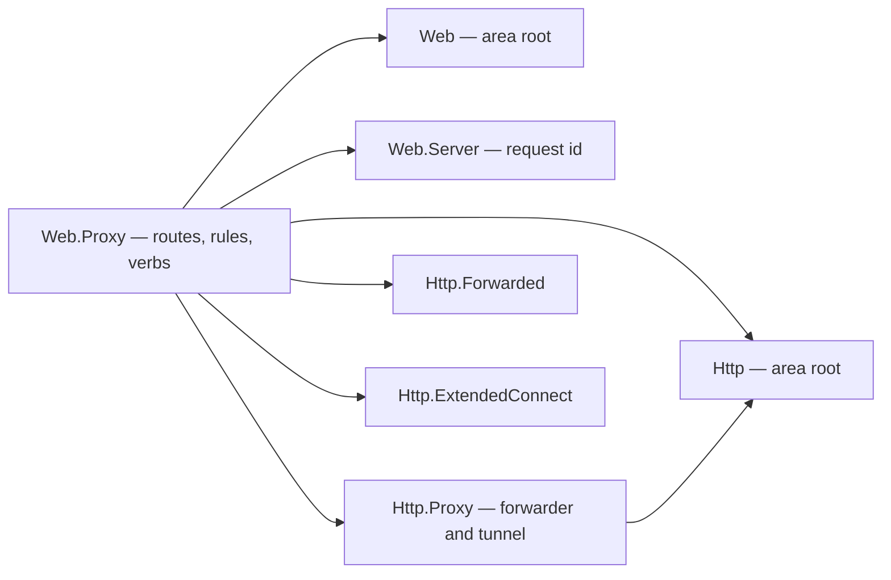
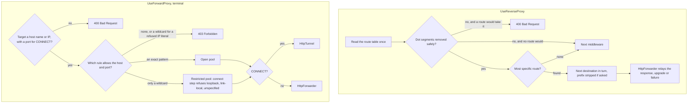

# Assimalign.Cohesion.Web.Proxy — Design

## Design intent

A proxy is policy over a mechanism. `Assimalign.Cohesion.Http.Proxy` is the mechanism: it rewrites
a request for the next hop, streams it, relays the response or the upgrade, tunnels a `CONNECT`,
and answers a failure the way a gateway must. This package is the policy for the two proxies a
Web application can be:

- **A reverse proxy**, a gateway in front of other services. Its routes decide which requests it
  takes, by host and path, and where each goes. A request no route takes is the application's own.
- **A forward proxy**, an egress point for clients. Its rules decide which destinations a client
  may reach, by host and port. Every request that reaches it is a proxy request, and a target no
  rule allows is refused.

Both are configured where they are registered and changed, while the application runs, through an
`IWebApplicationSetting`. Issue #1893 holds the requirements; #1891 is the feature they belong to.

## Family map

`Web.Proxy` references the Web root for the pipeline and setting seams, Web.Server for the request
id its events carry, and four HTTP packages. The arrows mean "references".

| Package | Role here |
| --- | --- |
| `Assimalign.Cohesion.Web.Proxy` | This package: `ReverseProxyRoute`, `ForwardProxyRule`, their options and builders, `UseReverseProxy`, `UseForwardProxy`, and the internal settings and middleware |
| `Assimalign.Cohesion.Web` | `IWebApplicationPipelineBuilder`, `IWebApplicationSetting<TValue>`, `IWebApplicationContext.Settings` |
| `Assimalign.Cohesion.Web.Server` | `IWebRequestIdFeature`, the request id that joins a refusal event to the HTTP access log, as in every instrumented Web package |
| `Assimalign.Cohesion.Http.Proxy` | `HttpForwarder` (one exchange, upgrades included), `HttpTunnel` (`CONNECT`), `HttpForwarderOptions`, `HttpTunnelOptions`, and the path and destination checks both proxies share |
| `Assimalign.Cohesion.Http.Forwarded` | `context.EffectiveHost`, the host a reverse-proxy route matches |
| `Assimalign.Cohesion.Http.ExtendedConnect` | `context.ExtendedConnect`, which tells a WebSocket's extended `CONNECT` (forwarded) from a tunnel request |
| `Assimalign.Cohesion.Http` | The exchange, `HttpHost`, `HttpPath`, `HttpHostMatcher` |

The package also compiles Core's `ComponentIntegration` shared module, which declares the
registration verbs without a reference to DI.

## How a request flows

The diagram shows the decisions each middleware makes, in the order a request meets them; the two
sections below give each one in words.

## Why one package for both proxies

The two proxies share their grammar (host patterns), their outbound handler defaults and their
checks of it, their setting lifecycle, and the mechanism package. Splitting them into
`Web.ReverseProxy` and `Web.ForwardProxy` would duplicate that internal code in two framework
members, or move it into a third package or a shared module for two consumers, while neither
package could be taken without `Http.Proxy` anyway. *Rejected* for that reason. The two halves
stay independent inside the package: neither middleware, setting or option type references the
other's.

## Registration: a setting, configured by `Add`, placed by `Use`

Each proxy follows the Web area's "`Add` configures, `Use` places" rule (owner decision,
2026-10-28) and registers a **setting**, the form that rule gives a value an operator may change
while the application runs. Precedent: `AddCors` registers the `cors` setting.

- `builder.Services.AddReverseProxy(proxy => ...)` and `builder.Services.AddForwardProxy(proxy => ...)`
  are component integrations over `ReverseProxyBuilder` and `ForwardProxyBuilder`, with contract
  `IWebApplicationSetting`. Each verb is projected twice: the `Builder` template, which builds the
  setting while the verb runs, so an invalid route fails the registration; and the
  `BuilderWithServiceProvider` template, `(services, proxy) => ...`, which builds it when the
  setting is first resolved, for a callback that needs a service. `fixtures/IntegrationCheck`
  calls all four.
- `Build()` takes a snapshot of the options: changing them afterwards does nothing. The routes or
  rules are the only part that changes later (below); the forwarder options, the tunnel options
  and the handler belong to the connection pools, which a change would have to replace.
- `UseReverseProxy()` and `UseForwardProxy()` take no arguments. Each finds the last setting of
  its type in `IWebApplicationContext.Settings` when the pipeline is composed, so the last
  registration wins. Neither proxy has a safe default (a route needs a destination, and a forward
  proxy with no rule refuses everything), so with no registration the composition fails, at the
  application's start, with a message naming the `Add` verb (`ReverseProxyNotRegistered`,
  `ForwardProxyNotRegistered`).
- **The setting owns its connection pools.** It is `IDisposable`, and both templates register a
  factory-created singleton, which the application's container disposes with the application. A
  setting whose creation fails disposes the pools it had already created.

## The reverse proxy

### Routes and matching

A route names the hosts and the path prefix it takes, and its destinations. The route table picks
the most specific route that matches a request:

1. **Host.** The route's closest host pattern ranks it: an exact host first, then the longest
   `*.suffix`, then `*` or no pattern at all (any host). `*.example.com` does not match
   `example.com`. The port is ignored, and hosts compare case-insensitively (`HttpHostMatcher`).
   The host is `context.EffectiveHost`: the host a trusted proxy forwarded when
   `UseForwardedHeaders` ran first, otherwise the request's own.
2. **Path prefix.** Among routes with the same host rank, the longest prefix that matches on a
   segment boundary wins. Prefixes compare case-insensitively: `/api` takes `/api`, `/API/items`
   and `/api/`, but not `/apis`.
3. **Registration order** breaks a remaining tie.

The path the table matches is the request's path with its dot segments removed
(`HttpForwarder.TryNormalizePath`), the same path the destination receives, so `/api/../admin` is
matched and forwarded as `/admin`. A path whose dot segments hide behind an encoded slash or a
backslash (`/api/..%2Fadmin`) has no safe normalized form, because destinations decode it
differently. When a route would take its raw form, the proxy answers 400; otherwise it goes to the
next middleware, which never forwards anything.

### Destinations, paths and `Host`

- **Round-robin.** A route takes its destinations in turn, through one lock-free counter per
  route. Replacing the routes starts new counters. Health checks and failover are #1898.
- **The destination URI** is the destination prefix, the forwarded path below it, and the query
  the client sent (`HttpForwarder.CreateDestination`). A destination is an absolute `http` or
  `https` URI with no query, fragment or user information (`HttpForwarder.IsValidDestinationPrefix`)
  and may carry a base path: `http://orders.internal:8080/v1`.
- **`StripPrefix`** forwards the path below the prefix: with `/orders`, `/orders/42` becomes `/42`
  and `/orders` becomes `/`.
- **`PreserveHost`** on the route, or `HttpForwarderOptions.PreserveHost` when the route leaves it
  unset, keeps the client's `Host`; otherwise the forwarded request names the destination's
  authority. The setting creates two forwarders over one pool, one for each answer, from one
  options instance, so they share the `Via` pseudonym: a request that comes back through either
  one is answered 508 (Loop Detected).
- **Forwarded headers.** The reverse proxy keeps `HttpForwarderOptions`' default,
  `HttpForwardedHeaderAction.Set`, right for a gateway clients reach directly. Behind another proxy
  whose chain the destinations read, `Append` keeps it.

### Validation

`AddRoute` validates each route as it is added, and `Set` validates the whole list. A route needs
a name, unique by ordinal comparison; host patterns `HttpHostMatcher` accepts (no port, a `*` only
as a whole label at the start); a path prefix that is an absolute path without `.` or `..`
segments; and at least one valid destination. `HttpPath` itself refuses a relative prefix, `?` and
`#` when the string is converted, before the route exists; the route refuses the asterisk form and
dot segments. A trailing `/` on the prefix is ignored.

## The forward proxy

### The target, and why the proxy needs a port of its own

The target is `IHttpRequest.Host`, which the transport takes from an absolute-form request target
(`GET http://example.com/ HTTP/1.1`) or a `CONNECT` authority. Forwarded headers never decide where
a forward proxy connects. The transport does not yet say which form a request target had (#1895),
so an origin-form request that reaches the middleware is forwarded to its `Host` on the same rules.
That is why the forward proxy goes on a port or in a branch of its own, never in front of the
application's own endpoints.

A plain `CONNECT` opens a tunnel. An extended `CONNECT` (a WebSocket over HTTP/2 or HTTP/3) is
forwarded like any request, and the forwarder bridges the socket. A `CONNECT` without a port is
answered 400 (RFC 9110 §9.3.6); every transport already refuses that target before middleware runs
(RFC 9112 §3.2.3), so the check is for a server that builds requests otherwise. The HTTP/1.1
transport closes the connection without a response today (#1926).

### Rules

A rule allows its host patterns on its ports. With no ports, it allows the default port of the
request: 80 for `http`, 443 for `https` and for `CONNECT`. The rule table evaluates every rule and
keeps the most open answer:

| Answer | When | Then |
| --- | --- | --- |
| Open | An exact pattern matches the host, and the port is allowed | The open pool connects wherever the name resolves: the operator named it |
| Restricted | Only a wildcard pattern (`*.example.com`, `*`) matches | The restricted pool connects only to an address the policy allows |
| Denied | No rule matches the host and port | 403 Forbidden |

### The address policy

A destination reached only through a wildcard may not resolve to an address on the proxy's own
host or its link: loopback (`127.0.0.0/8`, `::1`), link-local (`169.254.0.0/16`, which holds the
cloud metadata address `169.254.169.254`, and `fe80::/10`), the unspecified addresses
(`0.0.0.0/8`, `::`), or any address that is not IPv4 or IPv6. An IPv4-mapped IPv6 address is judged
as its IPv4 address.

- **The check is at the connect step**, in the restricted pool's `SocketsHttpHandler.ConnectCallback`
  and the restricted tunnel's `HttpTunnelOptions.ConnectCallback`. The proxy resolves the name,
  drops the refused addresses, and connects to what remains, so the address checked is the address
  used: a name that resolves differently a second time (DNS rebinding) gains nothing.
- **A literal refused address** is answered 403 before any connection. A name that resolves only
  to refused addresses fails to connect (`SocketError.AccessDenied`), which the forwarder and the
  tunnel answer 502. Each is reported, as `RequestRefused` and `ConnectionRefused`
  ([Diagnostics](#diagnostics)).
- **Two pools, not one.** The connect callback belongs to the handler, so the two access levels
  need two handlers, and two tunnels. Keeping them apart also means a connection pooled for an
  exactly named destination never carries a request that only a wildcard allowed.
- **Private ranges are allowed** (`10.0.0.0/8`, `172.16.0.0/12`, `192.168.0.0/16`, `fc00::/7`): an
  egress proxy in a private network usually exists to reach them. Name such destinations with
  exact patterns, or keep the proxy's network from reaching what wildcard clients must not.

### Defaults that differ from the reverse proxy

`ForwardProxyOptions.Forwarder` starts with `ForwardedHeaderAction = None`, so the sites a client
visits are not told who the client is, and `AddViaToResponses = true`, because a proxy sends `Via`
in each message it forwards, responses included (RFC 9110 §7.6.3). `Tunnel.ConnectCallback` must
stay null, and `ConfigureHandler` may not set `ConnectCallback` or turn `UseProxy` on: the proxy
connects to each destination itself so it can check the address (`ForwardProxyTunnelConnects`,
`ForwardProxyHandlerConnects`).

## The outbound handler

Each pool is a `SocketsHttpHandler` behind an `HttpMessageInvoker`, created with what proxying
needs: no proxy of its own, no automatic redirects, no cookie container, no automatic
decompression, no `traceparent` of its own (the client's trace continues through the proxy), a
15-second connect timeout, and more than one HTTP/2 connection per destination when one fills.
`ConfigureHandler` adjusts the rest, such as TLS to the destinations or connection limits. After
it runs, registration fails if it turned on redirects or cookies or set a decompression method
(`HandlerCannotProxy`), because the proxy would then change what it relays. The forward proxy runs
the callback once for each of its two pools.

## Changing routes and rules while the application runs

The setting's value is the route or rule list. `Set(value)` validates and compiles the whole list
first, then swaps it in with one volatile write: a request is routed against the old list or the
new one, never a mix, and the middleware reads the table once per request so one request sees one
list. A list with one invalid entry is refused whole, with an `ArgumentException` (parameter
`value`) naming the route or the rule's index, and the old list stays. An empty route list forwards
nothing; an empty rule list allows nothing. The routes and rules are immutable records, and the
setting keeps copies of their lists.

## Error model

| When | What | Who |
| --- | --- | --- |
| A route or rule is added | `ArgumentNullException`, `ArgumentException` naming the route or the rule's index, `InvalidOperationException` for a duplicate route name | `AddRoute`, `AddRule` |
| The verb runs (or the setting is resolved) | `InvalidOperationException` when `ConfigureHandler` breaks proxying or the tunnel has a connect callback | `ReverseProxyBuilder.Build`, `ForwardProxyBuilder.Build` |
| The pipeline is composed | `InvalidOperationException` naming the `Add` verb | `UseReverseProxy`, `UseForwardProxy` |
| An operator sets a list | `ArgumentNullException` or `ArgumentException` (parameter `value`); nothing changes | `Set` |
| A request is refused | 400 (malformed target, a `CONNECT` without a port, hidden dot segments), 403 (no rule, or a refused literal reached through a wildcard, reported as `RequestRefused`) | The middleware |
| A wildcard name resolves only to refused addresses | 502, reported as `ConnectionRefused` | The address policy, then `HttpForwarder` or `HttpTunnel` |
| Forwarding fails | 502, 504, 508, as Http.Proxy's failure model gives them | `HttpForwarder`, `HttpTunnel` |

Exception text lives in `src/Properties/ErrorMessages.resx`, read through the build-generated
internal `ErrorMessages` class; each resource name is a short name for the failure. A refused
request is answered with a status code, never an exception.

## Diagnostics

The package owns one event source, `Assimalign.Cohesion.Web.Proxy` (`WebProxyEventSource`), for
what only the forward proxy knows: why it refused a destination. How a forwarded exchange or a
tunnel ends, failures included, is reported by Http.Proxy's source,
`Assimalign.Cohesion.Http.Proxy`, whose `DestinationFailed` names the destination's authority and
the error. So the reverse proxy raises no event of its own: a request no route takes goes on to the
next middleware, and a route's forwarding failure is Http.Proxy's to report.

| Id | Event | Level | Payload | When |
| --- | --- | --- | --- | --- |
| 1 | `RequestRefused` | Verbose | `reason` (`NotAllowed` or `AddressRefused`), `host`, `port`, `requestId` | The forward proxy answered 403: no rule allows the host and port, or the host is an IP literal the address policy refuses and only a wildcard allows it |
| 2 | `ConnectionRefused` | Verbose | `host`, `port`, `addressCount` | A name reached only through a wildcard resolved to `addressCount` addresses and the policy refused every one; the forwarder or the tunnel answers 502, and Http.Proxy reports the failed destination as well |

| Counter | Display name | Counts |
| --- | --- | --- |
| `refused-requests` | Refused forward-proxy requests | Every `RequestRefused`, whether or not anyone listens |
| `refused-connections` | Refused forward-proxy connections | Every `ConnectionRefused`, whether or not anyone listens |

- **The host is the diagnosis**, so it is written, at Verbose only, truncated to 253 characters
  inside the enabled check, and treated as untrusted text. The request target's path and query
  never are (`event-source.md`, rule 11), and neither are the addresses a name resolved to.
- **`RequestRefused` carries `requestId`** from `IWebRequestIdFeature`, which joins it to the HTTP
  access log. `ConnectionRefused` has none: the connect step runs inside the outbound handler,
  whose connections outlive the request that opened them.
- **A malformed target (400) raises no event.** The status says what went wrong, and the event
  could only echo input that is not a usable host.
- **Neither event is throttled.** Both are Verbose; the once-a-second rule covers repeatable
  Warning and Error events (rule 13).

## AOT posture

Records, value objects, delegates and the BCL's `SocketsHttpHandler`, `HttpMessageInvoker` and
`Dns`: no reflection, no runtime code generation, no reflection-based serialization
(`IsAotCompatible=true`, and the build's trim and AOT analyzers are clean). The registration verbs
are generated at the application's compile time.

## Known constraints

- **The forward proxy serves every request as a proxy request** until the transport exposes the
  request-target form (#1895): put it on a port or in a branch of its own.
- **Tunnels are HTTP/1.1 only.** No transport accepts a classic `CONNECT` on HTTP/2 or HTTP/3 yet
  (#1896); a WebSocket's extended `CONNECT` is forwarded on every protocol.
- **No authentication, authorization or rate limits per route.** `UseReverseProxy` runs ahead of
  routing, so endpoint policy does not see forwarded requests until routes become endpoints
  (#1897).
- **No health checks or failover** across a route's destinations (#1898).
- **No proxy authentication** (`Proxy-Authorization`, 407) for the forward proxy (#1899). Do not
  expose one where untrusted clients can reach it.
- **Tunnels and relayed upgrades are not closed when the server drains** (#1900).
- **A path whose decoded form holds a space, `?` or `#` never reaches a route** (#1922); on
  HTTP/1.1 the connection is closed without a response (#1926).
- **Host patterns compare as written**, apart from case. Write an internationalized name as its
  A-label (`xn--bcher-kva.example`), which is what clients send; a host with a trailing dot does not
  match a pattern without one. Both fail closed.
- **A wildcard reaches the proxy's own non-loopback addresses.** A wildcard that allows a port the
  proxy's host serves on a public or private address reaches that service. A forwarded request
  that comes back to the proxy itself is answered 508, but a tunnel is not; allow such ports only
  with exact patterns.
- **Response bodies stream when the exchange can stream** (`IHttpResponseStreamingFeature`), and
  are otherwise buffered up to `HttpForwarderOptions.MaxBufferedResponseBodySize` (4 MiB by
  default). Http.Proxy's design lists its own constraints, request bodies over HTTP/2 and HTTP/3
  among them (#1921).

## Non-goals

- **Configuration files and binding.** Routes and rules are code; an operator changes them through
  the settings. Binding them from a file is the application's choice, outside the package.
- **Load-balancing policies beyond round-robin** (weights, least requests, session affinity) until
  #1898 settles health, which they depend on.
- **Request and response transforms** beyond prefix stripping and `Host`. Header changes belong to
  middleware ahead of the proxy or to the destination; Http.Proxy already removes hop-by-hop fields
  and writes the forwarded headers and `Via`.
- **Service discovery.** A destination is a URI; resolving a service name is DNS's job or the
  operator's, through `Set`.
- **TLS interception.** A tunnel moves bytes and never terminates the client's TLS.
- **SOCKS and PAC files.** The forward proxy speaks HTTP: absolute-form requests and `CONNECT`.

## Testing

The test project covers each part on its own and end to end over loopback TCP:

- route matching, prefix stripping, round-robin (including concurrent turns) and route validation;
- rule evaluation, rule validation and the address policy, including connect attempts to loopback
  addresses that never reach a listener;
- the settings: snapshots, whole-value `Set`, the forwarder each route uses, and the separate pools;
- composition: all four verb overloads, last registration wins, the `Use` verbs failing without
  their `Add` verbs, and the container disposing every pool;
- the middleware's refusals, called directly with requests no transport delivers;
- the event source: its name and strict manifest, each refusal event with its payload and request
  correlation, silence for an allowed target, the bounded host, counters that count without a
  listener or an allocation, and both counters publishing;
- end to end: forwarding, request bodies, `Host` handling, forwarded headers and `Via`, 502 and 508,
  a runtime `Set`, `CONNECT` tunnels and their refusals, and WebSockets through both proxies
  (an HTTP/2 extended `CONNECT` bridged to an HTTP/1.1 upgrade included).

## Exception messages

Resource names are short PascalCase noun phrases naming the failure, at most 40 characters.
Formatted messages use `string.Format(CultureInfo.CurrentCulture, ErrorMessages.<Name>, ...)`. No
message echoes request input; the only values they quote are the application's own route names,
prefixes, destinations, rule indexes and ports.
