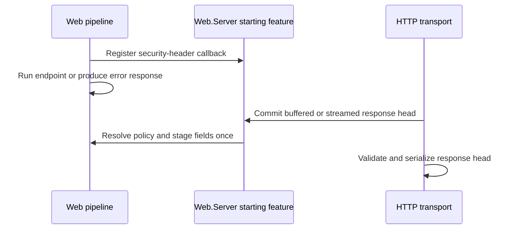
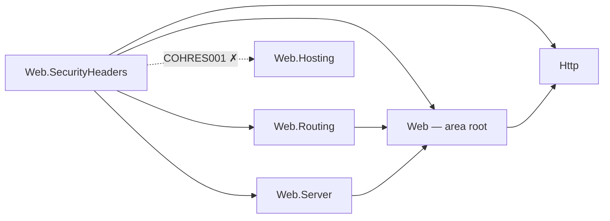

# Assimalign.Cohesion.Web.SecurityHeaders — Design

## Design intent

Browsers enforce a set of response fields that limit what a page can do to its user: whether a
response may be sniffed into another media type, framed by another site, leak its URL through
`Referer`, load scripts from arbitrary origins, share a browsing context group with a cross-origin
opener, or use the camera. None of them are emitted unless a server says so. This package says so,
with safe defaults on every response and opt-in policies for the rest (issue #1058, owner decision 4
of the HTTP/Web program: in v1).

The package owns one pipeline verb (`UseSecurityHeaders`), one policy type, validating builders for the
two fields with a real grammar (Content Security Policy and Permissions Policy), a framing policy, four
enumerations, one sealed endpoint-metadata carrier with three convention verbs, and one typed feature
that carries the per-request nonce. Everything is composed at builder time; request-time work is a
presence check and an assignment per field, plus one string join when a policy carries a nonce.

## Why a new package, and not HttpsPolicy

`Web.HttpsPolicy` already emits one security header, HSTS. It stays where it is: HSTS is a statement
about the transport (it is only valid over TLS, RFC 6797 §7.2, and it is excluded on loopback), while
everything here is a statement about the document and applies to every response regardless of scheme.
Folding them together would give one package two unrelated emission rules. The fields here are also the
set other stacks group as "security headers" (Helmet, NetEscapades.AspNetCore.SecurityHeaders), which is
what an application author looks for.

## The fields and their defaults

| Field | Default | Configured by |
| --- | --- | --- |
| `X-Content-Type-Options: nosniff` | on | `SecurityHeadersPolicy.ContentTypeOptions` |
| `Content-Security-Policy: frame-ancestors 'none'` | on | `SecurityHeadersPolicy.Framing` (`FramingPolicy`) |
| `X-Frame-Options: DENY` | on | `SecurityHeadersPolicy.Framing` (same policy) |
| `Referrer-Policy: strict-origin-when-cross-origin` | on | `SecurityHeadersPolicy.ReferrerPolicy` |
| `Content-Security-Policy` directives | opt-in | `SecurityHeadersPolicy.ContentSecurityPolicy` |
| `Content-Security-Policy-Report-Only` | opt-in | `SecurityHeadersPolicy.ContentSecurityPolicyReportOnly` |
| `Cross-Origin-Opener-Policy` | opt-in | `SecurityHeadersPolicy.CrossOriginOpenerPolicy` |
| `Cross-Origin-Embedder-Policy` | opt-in | `SecurityHeadersPolicy.CrossOriginEmbedderPolicy` |
| `Cross-Origin-Resource-Policy` | opt-in | `SecurityHeadersPolicy.CrossOriginResourcePolicy` |
| `Permissions-Policy` | opt-in | `SecurityHeadersPolicy.PermissionsPolicy` |

The defaults are the ones that cannot break a working page: `nosniff` only stops a user agent from
guessing, frame denial only affects pages nobody meant to embed, and `strict-origin-when-cross-origin`
is what current browsers already do. A full CSP, the cross-origin isolation fields, and a
Permissions Policy all change what a page may load or do, so each is a deliberate, per-application
decision.

## When the fields are written

The middleware registers one callback on `IWebResponseStartingFeature`, the server-published contract
in Web.Server. Web.Hosting drives it from the transport's existing response-head commit point for HTTP/1.1,
HTTP/2 and HTTP/3. The same callback covers buffered responses and a handler's first streamed start, write,
flush or completion; this package neither tracks response start nor decorates the streaming feature.

The server runs callbacks once in reverse registration order, before serializing any head byte. The
callback resolves endpoint overrides and applies the no-clobber rule at that moment. A boundary registered
on either side of this middleware can clear a failed response and write an error page: the registered
callback survives unwinding and stages the fields on that final response.

The callback follows the exchange through its final head commit:

If encode-time field validation refuses the head (`InvalidResponseField`), the server preserves the
callback's added, changed and removed fields for a replacement buffered response without running the
callback again. The middleware also registers every security-policy field above as an explicitly
preserved key, including both `Content-Security-Policy` and `X-Frame-Options`. The server snapshots
these keys at registration and captures their final values or absence after every callback succeeds.
This keeps application-owned values honored by no-clobber, including framing ownership, even when the
callback left them unchanged. Before retaining an unchanged application field, the server checks its
name and every value against the transport's syntax rules. An invalid value (including CR, LF, NUL
or another disallowed control character) is omitted from replacement replay, so it cannot defeat the
clean server 500. Valid application policy fields and the callback's protections still survive.
This corrects the post-preview.1 starting hook; the package did not exist in that release.
Other unchanged application fields are excluded; the replacement owns
its status and body.
The nonce stays the exchange's nonce. A callback failure faults the exchange before any bytes are sent;
no partially applied security policy is sent as a fallback response.

A custom server must publish `IWebResponseStartingFeature`. If it does not, `UseSecurityHeaders` throws
an actionable `InvalidOperationException` instead of silently omitting protection.

### Compatibility against 10.0.0-preview.1 (#1156)

The released tag contains no Web.SecurityHeaders package. No released
implementation changes behavior. The integration requirements and behavior changes below apply to the
post-tag development implementation.

Header staging moves from middleware unwind and a streaming decorator to the server's starting callback.
An outer exception boundary's response now carries the configured policy, and fields are no longer
observable immediately after `next` returns but before the server commits the head. A nonce or endpoint
adjustment failure at commit aborts the exchange without a response head. Custom servers must implement
the new Web.Server feature. The package replaces its Http.Streaming dependency with Web.Server, which is
already an App.Web member.

### What does not get the fields

- **A response a middleware ahead of `UseSecurityHeaders` writes.** It never passes through the
  middleware. That is why the documented position is the front of the pipeline, behind only
  `UseHttpLogging`, which writes no response.
- **A head already committed.** Registration after the server has started running its callbacks fails;
  fields cannot be added to a head already sent.
- **Heads outside pipeline dispatch.** Transport-generated rejections and protocol-takeover heads do not
  run response-starting callbacks. A parse-time rejection never reaches this middleware.
- **`101 Switching Protocols` and upgraded exchanges.** WebSocket and extended-CONNECT acceptance
  bypass response-starting callbacks in the default server. A `101` is also excluded explicitly
  when a custom server invokes the callback for it. These exchanges are not unprotected documents.
- **`304 Not Modified`.** A `304` freshens a response the user agent has already stored, and RFC 9111
  §4.3.4 replaces only the stored fields the `304` carries. The stored response already has the fields
  of the response that created it. Re-emitting them would change nothing, except that a fresh nonce
  would replace the stored policy's nonce while the stored body still carries the old one in its
  `nonce` attributes, and every inline script would stop running. So a `304` gets no fields.

## Never clobber a field the application set

A field that is present when the middleware stages the headers was set by something downstream: a
handler, another middleware, or a nested `UseSecurityHeaders`. It is kept. Setting a policy property to
`null` or `false` only stops the middleware from emitting that field; it never removes one something
else set. `SecurityHeadersPolicy.OverwriteExistingHeaders` reverses this: every field the policy emits
replaces whatever is there.

Framing gets one extra rule, because it is expressed by two fields that interact. A user agent that
implements `frame-ancestors` ignores `X-Frame-Options` when an enforced policy carries the directive
(HTML Standard, "check a navigation response's adherence to X-Frame-Options"). If an application sets
`X-Frame-Options: SAMEORIGIN` to allow same-origin framing and the middleware then added its default
`frame-ancestors 'none'`, the default would silently override the application's choice in every
current browser. So the application owns framing once it has set `X-Frame-Options` or an enforced
`Content-Security-Policy` whose directives include `frame-ancestors` (matched by name, ASCII
case-insensitively, across a comma-separated policy list). The middleware then emits neither framing
field and leaves `frame-ancestors` out of its own policy. An application CSP without `frame-ancestors`
does not take ownership: the middleware still emits `X-Frame-Options`, so clickjacking protection is
kept without contradicting the application's policy.

## The endpoint override model

`SecurityHeadersMetadata` is a sealed carrier in the routing metadata bag, attached with convention
verbs that work on routes and groups alike (`extension<TBuilder>(TBuilder) where TBuilder :
IRouterConventionBuilder`):

| Verb | Metadata | Effect for the endpoint |
| --- | --- | --- |
| `WithSecurityHeaders(policy => ...)` | `new SecurityHeadersMetadata(Action<SecurityHeadersPolicy>)` | adjust a copy of the pipeline's policy |
| `WithSecurityHeaders(policy)` | `new SecurityHeadersMetadata(SecurityHeadersPolicy)` | replace the pipeline's policy (a copy, compiled at map time) |
| `DisableSecurityHeaders()` | `SecurityHeadersMetadata.Disabled` | emit nothing |

**Adjust is the common case.** "Like every other page, but partners may frame it" should not mean
re-declaring the application's CSP on the endpoint. An adjustment receives a copy of the policy
configured on the `UseSecurityHeaders` that serves the request, so it depends on that middleware. It
is compiled the first time the middleware stages a response for the endpoint, then cached per metadata
instance in that middleware; the route table bounds the cache. The cost is that an exception thrown by
the adjustment surfaces on that first request rather than at startup, the same trade
`Web.RateLimiting` makes for an unknown policy name. A replacement does not depend on the pipeline, so
it is copied and compiled when the metadata is created, and an invalid value fails at map time.

**Resolution.** The override is read, last-wins, from the endpoint `UseRouting` published, at the
moment the fields are staged. By then the endpoint is known, wherever the middleware sits. A route-level
declaration overrides a group-level one.

**Coexistence with responses that never reach an endpoint.** The rule is simple: a request routed to an
endpoint gets that endpoint's policy on every response it produces, its error page included (the
boundary renders the error after routing published the endpoint); everything else, which means unmatched
requests and their `404`, `405`s, static files served ahead of routing, and short-circuits before
routing, gets the pipeline's own policy. The candidate endpoint a CORS preflight publishes never runs
for the preflight, so its override does not apply to the preflight response, matching
`Web.Diagnostics`.

**Why not `IRouteMiddlewareMetadata`.** Rate-limit and timeout metadata make routing fail an endpoint
whose middleware never acknowledged it, because a silently missing policy weakens a guarantee. That
contract requires the middleware to acknowledge the endpoint between `UseRouting` and dispatch. This
middleware belongs ahead of `UseRouting`, so it covers responses that never reach an endpoint, and from
there it cannot acknowledge anything before dispatch. It reads the override afterwards instead, which is
the same reason `HttpLoggingMetadata` does not implement the interface. The failure mode of a missing
`UseSecurityHeaders` is an application with no security headers on any response, not one endpoint
quietly losing its policy.

## The Content Security Policy builder

A free-form CSP string fails silently: a user agent drops what it cannot parse and enforces the rest,
so a typo weakens the policy and nothing reports it. The builder makes those mistakes fail when the
policy is built:

- **Directives are typed.** Every fetch directive, `base-uri`, `form-action`, `sandbox`,
  `upgrade-insecure-requests`, `report-to` and `report-uri` has its own method, and re-setting one
  replaces it in place, because CSP itself would ignore the second occurrence. `Directive(name, value)`
  covers directives the builder does not model, with the generic CSP3 directive grammar enforced.
- **Sources are typed.** Keywords come from methods (`Self()`, `StrictDynamic()`, …), so their quotes
  are always right. A bare keyword name passed as a host (`Host("self")`) is refused: CSP would read it
  as a host named `self`, which is never what was meant. Host and scheme sources are checked against the
  CSP3 `host-source` and `scheme-source` grammar, hash digests against `base64-value`, and `'none'`
  must stand alone.
- **Nothing a caller passes can split the policy.** Every check rejects `;`, `,`, whitespace where the
  grammar has none, control characters and non-ASCII, so no configured value can inject a directive, a
  policy, or a header line.
- **`frame-ancestors` is not on the builder.** Framing is owned by `FramingPolicy`, which emits the
  directive together with the matching `X-Frame-Options`; a second source of truth could disagree with
  it. The framing directive is appended to the enforced policy, and never to the report-only one, so
  clickjacking protection stays enforced while a policy is trialed in report-only mode.

`X-Frame-Options` is derived, not configured: `DENY` for `FramingPolicy.Deny`, `SAMEORIGIN` for
`FramingPolicy.SameOrigin`, and absent for any other ancestor list, which the field cannot express (its
`ALLOW-FROM` form is obsolete and ignored by current user agents).

### The nonce

`ContentSecurityPolicySourceListBuilder.Nonce()` adds a placeholder. When the policy is compiled, the
serialized policy is split around each placeholder, so rendering it for a response is one
`string.Join` with that exchange's nonce, and a policy without a placeholder is a constant string.

- **Generation.** The default `ISecurityHeadersFeature` draws 128 bits from
  `RandomNumberGenerator` and base64-encodes them (CSP3 §7.1 asks for at least 128 bits). It is
  generated on first read, so a policy without a nonce source, and a handler that never asks, cost
  nothing. The first value published wins if two tasks of one exchange race to read it.
- **Exposure.** Handlers read `context.Features.Get<ISecurityHeadersFeature>()!.Nonce` and stamp it on
  their `<script nonce>` and `<style nonce>` elements. The same value goes into every nonce source of
  both the enforced and the report-only policy.
- **One nonce per exchange.** The middleware reuses an `ISecurityHeadersFeature` that is already
  installed, either a nested `UseSecurityHeaders` or an application's own implementation (a test that
  needs a fixed value, for example). A supplied nonce that is not a CSP `base64-value` fails the
  exchange with `InvalidOperationException` rather than be written into a header.
- **Caching.** A cached body embeds the nonce of the request that produced it. Do not output-cache a
  response whose markup carries a nonce; use hash sources for cacheable inline content. `304`s get no
  fields for the same reason (above).

## Permissions Policy

The `Permissions-Policy` field is an RFC 9651 Structured Field Dictionary. `PermissionsPolicyBuilder`
builds it with the Structured Field toolkit in `Assimalign.Cohesion.Http`, so key and string syntax are
canonical and validated there, and the builder adds the policy-level checks: feature names follow the
RFC 9651 key grammar, and allowlist entries are serialized origins (`scheme://host[:port]`, with an
optional `*.` subdomain wildcard). The four forms map to `Disable` (`()`), `AllowAll` (`*`), `AllowSelf`
(`(self ...)`) and `AllowOrigins` (`("..." ...)`).

## Ordering

`UseHttpLogging` → `UseSecurityHeaders` → `UseForwardedHeaders` → `UseHostFiltering` →
`UseHttpsRedirection` → `UseHsts` → `UseErrorHandling` → `UseStaticFiles` → `UseRouting` → policy
middleware → endpoint. The area's [middleware order](../../../../docs/resources/Web/MIDDLEWARE_ORDER.md) places every Web middleware.

- **At the front**, so every response that passes through the pipeline gets the fields, the rejections
  of the middleware after it included. Only `UseHttpLogging`, which writes no response, goes ahead of
  it, and since this middleware reads no client identity it can precede `UseForwardedHeaders`.
- **Either side of `UseErrorHandling`** preserves the fields on an error response once this middleware
  has run. The recommended front position also covers earlier short-circuits and redirects.
- **Ahead of `UseRouting`** is fine: endpoint overrides still apply, because they are read when the
  fields are staged, after routing has run.

## Family map

The package references the Web root (pipeline abstractions), Web.Routing (endpoint metadata and the
convention-builder seam), Web.Server (the response-starting contract), and the Http core (header keys,
the feature collection, the Structured Field toolkit). It references no hosting library.

The dotted edge is the reference `COHRES001` rejects: like every Web feature library, this one never
references the runtime module, and its composition is dependency-free (values captured at builder time,
no container, no configuration binding). Applications get it through the `App.Web` shared framework.

## Error model

There is no package exception root; every failure is a BCL argument or state exception thrown when
the policy is composed:

- `ArgumentException` for a value outside its grammar (a host source, digest, directive name or value,
  sandbox keyword, reporting endpoint, feature name, origin, ancestor source) and for an empty or
  `'none'`-mixed source list.
- `ArgumentOutOfRangeException` for an undefined enumeration value, thrown when the policy is compiled:
  at `UseSecurityHeaders` for the pipeline's policy, at map time for a replacement.
- `InvalidOperationException` for a CSP or Permissions Policy built with nothing in it, and, at request
  time, for an application-supplied nonce outside the CSP grammar or a missing response-starting feature.

A missing response-starting feature fails when the middleware runs. The nonce check and an exception
thrown by an endpoint adjustment on its first use fail the starting callback at head commit; the server
aborts the exchange without sending a head.

## AOT posture

No reflection, no runtime code generation, no configuration binding. Enumerations map to their tokens
through switch expressions. Field values are computed once when a policy is compiled; per response the
middleware does feature-collection lookups, header presence checks and assignments, and one
`string.Join` for a nonce-bearing policy. The Structured Field serializer and `RandomNumberGenerator` are
AOT-safe.

## Diagnostics

The internal `SecurityHeadersEventSource` is named `Assimalign.Cohesion.Web.SecurityHeaders`.
It reports a policy that could not be staged because the starting callback saw read-only response
headers. Successful staging, including a policy deliberately configured without CSP and application
framing ownership, emits nothing. `304`, `101`, protocol takeovers (including HTTP/2 extended CONNECT),
and `DisableSecurityHeaders` endpoints are excluded before the read-only check. Protocol takeovers
do not run the default server's starting callbacks at all.

| Id | Event | Level | Payload |
| --- | --- | --- | --- |
| 1 | `HeadersNotApplied` | Warning | `statusCode:int`, `routeTemplate`, `committedBeforeTurn:bool`, `suppressedCount:int`, `requestId` |

The callback is the sole raising site. The pre-#1156 unwind and streaming-decorator sites no longer
exist, so `committedBeforeTurn` is always `false`: staging happens before the server commits the head.
Registering after commit fails instead of silently sending an unprotected response. A nonce or
endpoint-adjustment failure aborts the exchange and raises no unprotected-response warning or count,
because no response is sent. The diagnostic describes the skipped staging attempt; it cannot prove
that a custom server subsequently completed the response or that another callback supplied a policy.

The process-wide warning is limited to one event per second. `suppressedCount` reports earlier
warnings withheld during the interval (saturating at `Int32.MaxValue`); the `unprotected-responses`
PollingCounter counts every read-only staging skip exactly with `Interlocked`, even with no listener
or when the warning is suppressed. The counter is created on the first enable command. Route-template
and request-id reads occur only inside `IsEnabled`. An internal failure marker shared by nested
registrations counts each exchange once; it is allocated only on the read-only failure path. The
request id comes from `IWebRequestIdFeature`, never an ambient activity. No request path, header value,
nonce, or exception text is emitted.

### Compatibility against 10.0.0-preview.1 (#1402)

The released tag has no Web.SecurityHeaders package. This change introduces diagnostics for the
post-tag implementation and explicitly skips a `101` passed to a starting callback by a custom server.
There is no released public API or response behavior break. No shipped dependency or framework closure
changes; the WebSocket acceptance tests add a test-only Web.WebSockets reference.

## Non-goals

- **HSTS.** It stays in `Web.HttpsPolicy` (`UseHsts`), for the reasons above.
- **Reporting endpoints.** `report-to` names an endpoint, and the application declares it in its own
  `Reporting-Endpoints` field. The `report-to` parameters of COOP and COEP, and their `-Report-Only`
  variants, are not modeled.
- **`Referrer-Policy` fallback lists.** The field may list several tokens for older user agents; the
  policy emits one.
- **Request-dependent policies.** An endpoint adjustment is cached, so it cannot depend on the request.
  An application that needs a per-request policy sets the fields itself in the handler; they are never
  clobbered.
- **Removing fields set elsewhere.** A policy property set to `null` stops this middleware from emitting
  the field; it does not strip one set downstream.
- **Deprecated fields.** `X-XSS-Protection` (removed from current browsers, and harmful in old ones),
  `Expect-CT` and `Feature-Policy` are not emitted.

## Scope-creep candidates (recorded, not taken)

- A per-response policy override on `ISecurityHeadersFeature`, for middleware-only branches that need a
  different policy without routing.
- Hash-source helpers that compute the digest of a known inline script at startup.
- Typed `require-trusted-types-for` and `trusted-types` directives (the `Directive` escape hatch covers
  them today).

## Testing

`tests/SecurityHeadersEndToEndTests.cs` drives the middleware over the in-memory
`WebApplicationTestFactory`: the defaults and their opt-outs, every opt-in field with its exact wire
value, an unmatched route's `404`, a short-circuiting middleware, the exception boundary's error page on either side of the middleware,
a static file and its `304`, the no-clobber and framing-ownership rules, `OverwriteExistingHeaders`,
the nonce (matching the handler's, unique per request, 128 bits, shared by both policies, supplied by
the application, never read without a nonce source, refused when outside the grammar), streamed
responses over HTTP/1.1 (chunked framing proves the handler committed the head) and HTTP/2, and
composition-time validation. `tests/SecurityHeadersRouteConventionTests.cs` covers the overrides
through the real router: adjust, replace (copied at map time), disable, group-versus-route precedence,
the override on an endpoint's error and streamed responses, the CORS preflight, an adjustment compiled
once, and map-time validation. The builder, framing and feature suites cover serialization and every
grammar rule in isolation.

## HTTP interceptor consumer compatibility (#1465)

The streamed-response test hosts now register `new HttpResponseStreamingInterceptor()` in place
of `HttpResponseStreaming.CreateInterceptor()`. Applications that register this Http.Streaming
interceptor directly make the same replacement and rebuild for its upstream source and binary
break against `10.0.0-preview.1`, accepted on decision 15's terms and documented in
[Http.Streaming's design](../../../../libraries/Http/Assimalign.Cohesion.Http.Streaming/docs/DESIGN.md#public-interceptor-and-breaking-changes-since-1000-preview1-1465).
This consumer update changes no API or response behavior owned by this package.

## Exception messages (#1467, #1471)

Resource names are short PascalCase noun phrases naming the failure, at most 40 characters.
The internal naming cleanup preserves message text, placeholders and resource order.

Exception text lives in `src/Properties/ErrorMessages.resx`. The shared build targets generate
an internal `ErrorMessages` accessor in this project's root namespace under the intermediate
output directory; no designer is checked in. Formatted messages use
`string.Format(CultureInfo.CurrentCulture, ErrorMessages.<Name>, ...)`. Resource extraction
preserves the existing exception text and input-disclosure rules, including any diagnostic
type-only exclusions. EventSource templates, log messages and response bodies retain their
existing ownership. This is a conventions change with no public API or behavior break against
10.0.0-preview.1.
