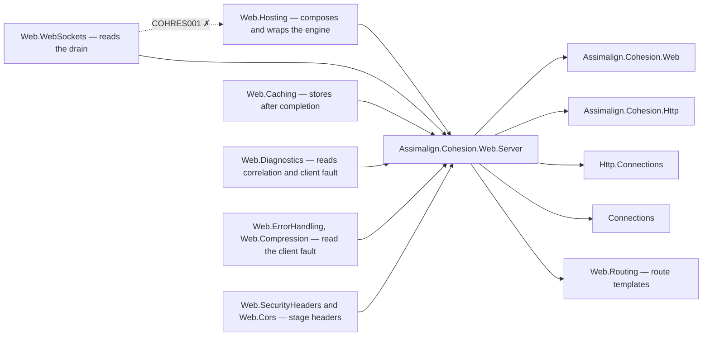
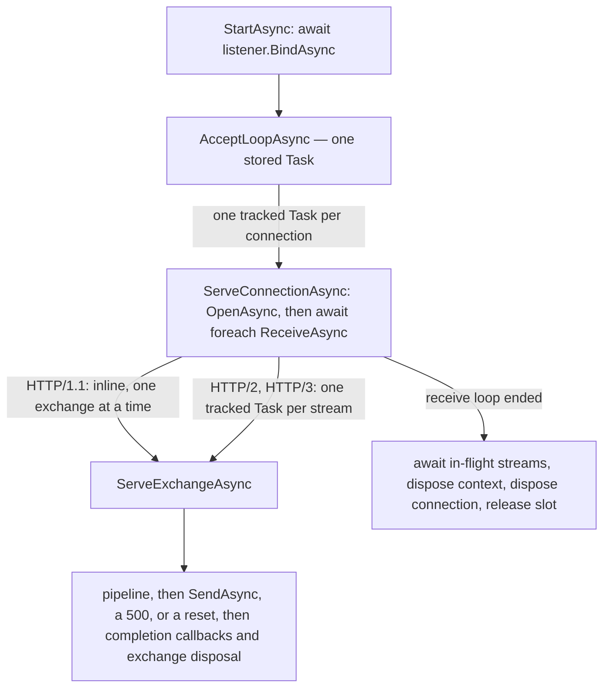
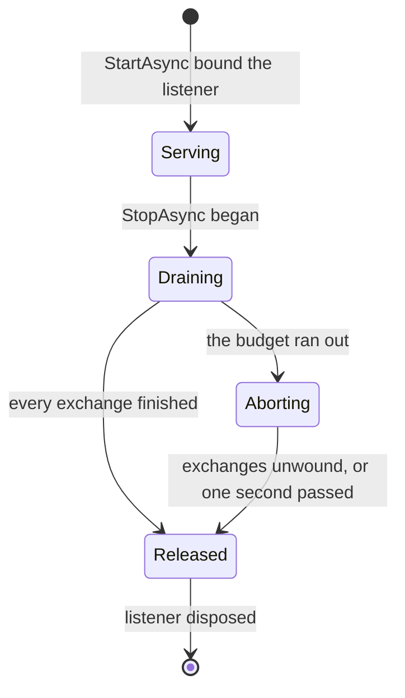
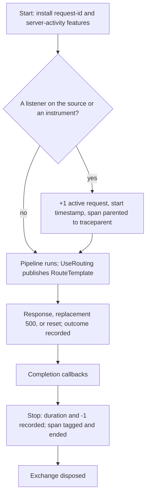

# Assimalign.Cohesion.Web.Server — Design

## Design intent

`Assimalign.Cohesion.Web.Server` owns the public `WebApplicationServer` engine and the
per-exchange contracts it publishes:
`IWebRequestIdFeature`, `IWebRequestActivityFeature`, `IWebResponseCompletionFeature`,
`IWebServerDrainFeature`, `IWebClientFaultFeature`, `IWebResponseClientFaultFeature` and
`IWebResponseStartingFeature`. Applications can construct the engine without Web.Hosting;
its own interceptors install the same features on both direct and hosted paths. Web.Hosting
composes options, pipelines and a non-owning host-service wrapper.

The package exists because of two rules that point in opposite directions:

- **The area root holds no feature contracts** (owner decision 33 of 2026-10-09, extending decision
  20's rule for core Http to `Assimalign.Cohesion.Web`; #1379). The three contracts lived in the
  root until then.
- **No feature library may reference the runtime module** (COHRES001). The contracts cannot live in
  `Web.Hosting`, which originally implemented them, because their readers are feature libraries: `Web.WebSockets`
  reads the drain signal and `Web.Caching` the completion callbacks.

A package between the two satisfies both. `Web.Hosting` references it, which decision 32's
relaxation of COHRES002 allows, and every reader references it like any other feature package.

## Family map

The packages that publish, declare and read the contracts, with every arrow meaning "references":

| Package | Role | Reference to `Web.Server` |
|---|---|---|
| `Assimalign.Cohesion.Web.Server` | implements the engine and declares its seven exchange contracts | — |
| `Assimalign.Cohesion.Web.Hosting` | runtime module: composes the engine, HTTP defaults and non-owning host-service wrapper; its control plane defers stop until the `202` is written | project reference (COHRES002) |
| `Assimalign.Cohesion.Web.WebSockets` | closes open sockets with `1001 Going Away` when `Draining` fires | project reference |
| `Assimalign.Cohesion.Web.Caching` | stores the final response only after successful completion | project reference |
| `Assimalign.Cohesion.Web.Diagnostics` | reads the request id and server activity for correlation; logs a client fault at the configured level with the status sent | project reference |
| `Assimalign.Cohesion.Web.ErrorHandling` | skips `OnException` and the `500` problem for a client fault | project reference |
| `Assimalign.Cohesion.Web.SecurityHeaders` and `Assimalign.Cohesion.Web.Cors` | stage policy headers immediately before commit | project reference |
| `Assimalign.Cohesion.Web.Compression` | leaves the transport's framing failure under a decoder unrelabeled | project reference |

The dotted edge is the reference COHRES001 rejects: a feature library may never reference the
runtime module, which is why the contracts could not move into `Web.Hosting`. `Web.Diagnostics` correlates its logs with the server's request id
and the activity published on this exchange (#1297).

Web.Server references Web.Routing to read `IWebEndpointFeature.RouteTemplate` for `http.route`
and bounded diagnostic route payloads. **Web.Routing must never reference Web.Server:** that edge
would form a dependency cycle. The engine depends on Connections and Http.Connections, but no
connection driver, Http.RequestLimits, Http.ProtocolUpgrade, Http.ExtendedConnect or Hosting
library. Applications compose transport listeners explicitly; Web.Hosting supplies its transport
helpers and HTTP defaults. COHRES004 applies to Web.Server like every other feature library.

## Public construction and option snapshots

`new WebApplicationServer(WebApplicationServerOptions)` builds a concrete `HttpConnectionListener`
from `Listener` and retains the required `Pipeline`. Constructor validation rejects missing options,
pipeline or listener options, a nonpositive connection cap, a capacity that cannot accommodate the
server's features, and empty telemetry query names. `MaxConcurrentConnections` defaults to unlimited.
The get-only `TelemetryQueryValues` set compares names case-insensitively; the constructor snapshots
it into a frozen set so later option changes do not change live query redaction.

The server inserts client-fault then response-starting interceptors before the supplied listener
interceptors. In the hosted path the full order is client fault, response starting, request limits,
protocol upgrade, extended CONNECT, then each configuration's interceptors. The two server hooks
publish independent features and perform no protocol takeover or request-limit work, so moving them
before the HTTP defaults preserves those defaults' relative order and behavior. Existing starting,
client-fault, upgrade and extended-CONNECT coverage is retained; a direct-server test pins the order.
No shipped assembly can inject an `IHttpConnectionListener`: the fake-listener constructor is
internal and visible only to Web.Server.Tests.

The server adds its five reserved feature slots to `Listener.ExchangeFeatureCapacity` and rounds
once using `RoundExchangeFeatureCapacity` to the ordinary dictionary growth sequence (3, 7, 17,
37, 89, 197, 431, 919). The reserve covers request telemetry, starting/response-client-fault,
completion and drain, plus the hosted path's request-limits object. Conditional and middleware
features can still grow the collection. Hosting supplies its application-feature count before
constructing the server. The original capacity and interceptor list are restored after the
listener snapshots them, so reusing options does not accumulate server hooks or double-count slots.

The server implements `IWebApplicationServer`, never `IHostService`. Start and stop retain the
Web lifecycle contract. The hosting wrapper owns its own service id and forwards that contract;
it never disposes the server. Direct usage is shown in [OVERVIEW.md](OVERVIEW.md#direct-use).

**Compatibility with 10.0.0-preview.1 (decision 15).** Making the formerly internal server public is
additive, and `UseServer<TServer>` relaxes its constraint from `IWebApplicationServer, IHostService`
to `IWebApplicationServer`. Server EventSource, Meter and ActivitySource now use
`Assimalign.Cohesion.Web.Server`; none of their former names shipped in preview.1. The Web.Hosting
provider retains only host/control-plane signals. Existing feature contracts keep their namespaces.

## Why the contracts share one package

They have one publisher, the server, and one lifetime, the exchange. A package per contract
would add four packages to every framework that carries `Web.Hosting`, for interfaces of one or two
members each. The owner chose two homes over one shared features package (decision 33): contracts a
feature publishes go with that feature (the endpoint and the path base went to `Web.Routing`), and
contracts the server publishes come here.

## The contracts

**`IWebRequestIdFeature`** is the request-id seam (#1064). Its `RequestId` is a BCL
`ActivityTraceId`: the request id *is* the W3C trace id, so one value finds the request in the
server's span, in logs and in anything returned to the caller. The default server installs it on
every exchange before the pipeline runs. With a server span the id is the span's trace id; without
one it is the trace id of a valid `traceparent`, or else a random id generated on first read, stable
for the exchange. It is a Web contract, not an `Assimalign.Cohesion.Http` one, because a request id
is a server concern and the protocol core models only the wire.

**`IWebRequestActivityFeature`** exposes this exchange's server `Activity`, or `null` when no
activity was created (#1297). The default server's existing telemetry object implements both
this interface and `IWebRequestIdFeature`; the feature collection resolves either interface
from that one object. A listener can decline to create a span, and no listener creates none.
Readers borrow the activity; the server owns its start and stop. The feature names the server
activity even while a handler's child activity is current, and remains `null` when an unrelated
ambient activity flows into an untraced exchange.

This is an optional new contract, leaving `IWebRequestIdFeature` unchanged. Putting it here
respects the server-published feature boundary; putting it in Web.Hosting would require a
forbidden reference from Web.Diagnostics, and the Web root holds no feature contracts. Merely
matching an ambient activity's source name and trace id cannot prove which exchange owns it.
The public BCL activity also lets diagnostics inspect or enrich the server span without
depending on the runtime module's implementation.

**Compatibility with 10.0.0-preview.1.** The activity contract is additive; existing interface
implementations need no new member. HTTP logging's behavior changes: its `span.id` now names
the exchange's server span, rather than the inbound parent span, and its `trace.id` reads the
server's request-id feature even without an inbound header (decision 15).

**`IWebResponseStartingFeature`** registers `OnStarting(Func<object?, Task>, object?)` callbacks
before final-head serialization (#1156). They run once in reverse registration order, whether the
response is buffered or streamed. The default server delegates timing to the transport's existing
head-commit hook, shared by HTTP/1.1, HTTP/2 and HTTP/3; it maintains no second started flag.
Registration after callbacks begin or the response starts throws. Callbacks stage status/headers;
they must not recursively start, write, complete or take over the response. A callback failure stops
the list and aborts the exchange before its head is written, even if middleware catches the failure.
Protocol takeover and transport-generated rejection responses retain the transport hook's exclusions.

If `InvalidResponseField` refuses the head, callbacks never rerun. Their added/changed header values
and removals are reapplied before the server sends an unstarted buffered replacement, including its
own 500 after discarding application headers. Replacement status, body, framing and representation
metadata remain the replacement's: connection-specific fields, Content-Length, Trailer, content
metadata, validators and digests are excluded even when explicitly preserved, so the transport
calculates the new length. This corrects the hook added after preview.1 without a preview.1 break;
invalid callback fields are refused again. The optional `preservedHeaders` registration argument
also retains final values or absence of policy headers that a callback accepts without changing.
Only syntactically valid unchanged application fields are retained; a refused application value
cannot reappear on the clean replacement. Callback-modified invalid fields are still refused.
Keys are copied at registration and values are captured after all callbacks succeed. SecurityHeaders
declares its policy fields (including no-clobber framing), and CORS declares its grant fields and
early cache-selection `Vary`. The server has no middleware-specific header list. An outer error
boundary no longer removes their fields. A custom server must honor this lifetime to use those
middleware; they throw explicitly when the feature is missing. There is no DI dependency.

**Compatibility with 10.0.0-preview.1.** The new contract adds no members to existing interfaces.
Header staging now happens at head commit and survives an outer boundary; custom servers using
SecurityHeaders or CORS must provide the hook. Web.Server is already public in App.Web, so their
new references require no framework-member change.

**`IWebResponseCompletionFeature`** is the response-transmission seam. The default server installs
it on every exchange and invokes callbacks in registration order after writing the response to the
transport. Callback failures are isolated: every callback runs even if a preceding one throws,
and the default server retains and reports each failure (#1410). This changes the preview.1
behavior, which skipped later callbacks after the first failure. Registration after completion throws `InvalidOperationException`. This lets a terminal
defer lifecycle signals until its acknowledgement has been sent: the resource control plane's stop
route answers `202` and stops the application only once the `202` is on the wire.
Output caching also uses this seam so starting-callback policy changes and transmission failure govern
storage. A custom server without completion notification can serve existing hits but stores no misses.

**`IWebServerDrainFeature`** is the drain seam (decision 16, Http ADR 1). Its `Draining` token is
cancelled when the server begins its lame-duck drain: the server stops accepting and lets the
exchanges in flight finish within the stop's budget. An ordinary exchange finishes on its own; a
long-lived one (a WebSocket, a stream of server-sent events) registers on the token and ends its
own work cleanly. The token is not the exchange's cancellation: the exchange keeps running and its
response is delivered; `RequestCancelled` fires only if it is still running when the budget runs
out. The default server installs one shared instance on every exchange. It is a feature rather
than a member of `IWebApplicationServer` because the consumer is code running inside an exchange,
which sees the exchange's features and not the server.

**`IWebClientFaultFeature`** is the client-fault seam (#1340, owner decision 28). Its `StatusCode` is
the `4xx` the transport answers an exchange with because the client's request was at fault while the
application read its body: `400` for a malformed body, `413` over the body-size cap, `408` below
the minimum data rate, `431` for a trailer section over its bounds. The read throws as any stream
read does; this feature is how the code that sees the exception learns it was not an application defect.
`Web.Diagnostics` then logs the exchange at its configured level with the status sent,
`Web.ErrorHandling` skips `OnException` and the `500` problem, and `Web.Compression` leaves the
transport's framing failure under a decoder unrelabeled. It is a Web contract because decision 20
keeps the core to generic seams: the transport reports the fault on
`IHttpExchangeControl.ClientFaultStatusCode`, which exists only in the exchange's response phase, and
the default server publishes it from an interceptor. To keep the transport's fast path, the server
installs the feature only on a request that can have a body, as the transport reports it
(`HttpExchangeInterceptorRequestContext.CanHaveBody`): on HTTP/1.1 one that declares a body, on HTTP/2
one whose head did not end the stream, on HTTP/3 one whose request stream had not ended with its head
or whose positive declared content length still needs validation (#1378). The QUIC driver's generic
input-completion facet exposes an end already received, so a bodiless head followed by FIN skips the
client-fault feature even before its input pipe reads zero bytes (#1427). It reads `null` until a fault
is latched. On HTTP/2 and HTTP/3 a body that contradicts its
content-length, or a malformed trailer section, resets the stream rather than drawing a status, and the
feature reports `400` for it. The value is read through on each access, because the fault is latched while the pipeline
runs.

A connection lost before the body completes is cancellation, including an HTTP/1.1 body cut short
by EOF (#1439, owner decision 45). The read throws `OperationCanceledException` with the exchange's
`RequestCancelled` token, and the client-fault feature remains `null`. This replaces #1340's
incomplete-body `400` and changes the transport exception observable in 10.0.0-preview.1 on the
terms of decision 15; malformed syntax and configured limits still report their status.

**`IWebResponseClientFaultFeature`** reports `ResponseAbortedByClient` (#1432): the transport ended
the response because the peer abandoned it or failed the minimum response data rate. The value
reads through to `IHttpExchangeControl.ResponseAbortedByClient` and stays true once latched.
The default server's response-starting object implements both interfaces; the feature
collection resolves the new interface from that object, so there is no extra per-exchange object,
feature entry or interceptor. Every exchange receives it, including a bodyless GET. The request
client-fault interceptor remains conditional because only request bodies need its status report.

`Web.ErrorHandling` reads the response report before classifying an exception by its type. A
content adapter can wrap a failed write in an unrelated exception and the boundary still cancels
with the exchange token, skipping `OnException`, `OnError` and the error response. The server's
last-resort pipeline boundary makes the same classification without ErrorHandling installed.
Local application cancellation does not set this report. An absent feature means no response
client fault was reported; the existing cancellation and application-fault paths remain in place.

**Compatibility with 10.0.0-preview.1.** This Web contract is additive and changes no existing Web
interface. A response abandoned by the peer now avoids fault observation even when its transport
exception was wrapped; preview.1 relied on an `OperationCanceledException` and the request token.
HTTP/1.1 already enforced its configured response rate in preview.1; HTTP/2 and HTTP/3 rate
reclamation arrived later in #1384. The generic default member on the transport control is the
public-interface addition sanctioned by #1432; no Web-root contract or dependency is added.

**A custom server chooses which contracts it supports.** A custom `IWebApplicationServer` may omit any of them, so each
reader handles an absent feature (SecurityHeaders and CORS require starting and throw without it): the control plane falls back to a direct stop, WebSockets has
no drain-time close, so a socket ends by its own close or by the exchange's cancellation, and a
reader of the client fault treats an absent feature as no fault reported. HTTP logging omits
trace correlation when the request-id feature is absent and omits the span id when there is no
activity feature or server activity.

## Namespace: `Assimalign.Cohesion.Web`

The package pins its `RootNamespace` to the family name, `Assimalign.Cohesion.Web`, and its
contracts declare it. That is the namespace they shipped in, so moving them out of the root changed
their assembly and nothing a call site names. `general-rules.md` sanctions a family pin ("a family
that shares one namespace pins the family name"); `Web.Api`, `Web.Forms` and `Web.ProblemDetails`
pin the same name, as `Http.Cookies` and `Http.Forwarded` pin `Assimalign.Cohesion.Http`.

Binary consumers do break: a library compiled against the root's copies must be rebuilt, because
the types now live in another assembly. Every in-repository reader was rebuilt with the move.

## Framework membership

`App.Web` carries the package publicly, so applications compile against the contracts. Every other
area framework carries `Web.Hosting` privately (the area's control plane runs on it), and so carries
`Web.Server`, with `Web.Routing` and its `Http.Forwarded` dependency, privately too. The App.Runtime
framework-closure tests prove each list covers the project graph.

## Contract AOT posture

The engine and contracts use no reflection or runtime code generation (`IsAotCompatible=true`).
`IWebRequestIdFeature` and `IWebRequestActivityFeature` expose the BCL `ActivityTraceId` and
`Activity` from `System.Diagnostics.DiagnosticSource`, which the shared framework carries;
no package is added.

## Adding a contract

A new per-exchange contract belongs here only when the server publishes it and a feature library
must read it. A contract a feature publishes goes in that feature's package; a contract only the
runtime reads stays internal to `Web.Hosting`. Each addition lands in every framework that carries
`Web.Hosting`, so it stays an interface with no new dependency.

## Non-goals

- **Hosting composition.** DI, configuration binding, control plane, health integration and TCP/QUIC
  convenience helpers stay in Web.Hosting; a direct application supplies its pipeline and listeners.
- **Feature-published contracts.** The endpoint and the path base are `Web.Routing`'s, and a feature
  package owns any contract it publishes.
- **Builder verbs.** The server installs these features itself; there is nothing to register.

## Server dispatch model

The server runs three levels of work: one accept loop, one task per connection, and —
on a multiplexed connection — one task per stream. Each arrow below hands work to the
next level without waiting for it; only the drain at the bottom waits.

The accept loop optionally awaits a concurrency slot before each accept, and each
connection task releases its slot only after its drain completes.

**Bind before Started.** `StartAsync` first awaits the aggregate HTTP listener's
`BindAsync`. Only after every transport endpoint is bound does it schedule the
stored accept-loop task and return. A direct server reports and propagates the original
transport exception. In the hosted path, `WebApplicationServerHostService` wraps a default
server's bind failure in `HostStartupException`, retaining the original inner exception for
host startup classification. The wrapper has its own service id and does not own or dispose
the server. `WebApplicationContext` wraps every server that is not already an `IHostService`.
See [hosting lifecycle composition](../../Assimalign.Cohesion.Web.Hosting/docs/DESIGN.md#application-lifecycle-composition)
for registration, ordering and inactive default servers.

**One accept loop, one task per connection.** The loop accepts a connection and
*hands it off* to `ServeConnectionAsync` on its own `Task`, then loops straight
back to accept the next one. The loop never awaits a connection's service.

**Why this is the whole point.** The previous implementation queued one
`async void` thread-pool work item that accepted a connection and then
`await foreach`-ed its entire receive sequence inline before accepting the next.
A single idle HTTP/1.1 keep-alive client — parked in `ReceiveAsync` waiting for a
request it never sends — blocked that loop indefinitely, so every other accepted
connection sat unserved in the listener backlog. Per-connection dispatch removes
the shared bottleneck: the idle client parks on *its* task while every other task
runs.

**Stored `Task`, never `async void`.** The accept loop and each connection task
are stored/tracked `Task`s. An `async void` body escalates any escaped exception
to a process-terminating unhandled exception via the thread pool; a `Task` makes
the exception observable instead. The accept loop additionally swallows its own
terminal faults so the stored task always completes cleanly.

**In-flight tracking.** Connection tasks are registered in a
`ConcurrentDictionary<long, Task>` keyed by a monotonic id, added by the accept
loop and removed by each task as it completes. The map is the drain set
`StopAsync` awaits. A connection that completes synchronously (only possible with
a degenerate/empty receive sequence) is removed immediately after registration so
the map never leaks a completed entry.

## Dispatch within a connection (#1049)

A connection's receive loop dispatches by protocol, one exchange at a time for
HTTP/1.1 and one task per stream for HTTP/2 and HTTP/3.

**HTTP/1.1 stays sequential — the transport requires it.** An HTTP/1.1 connection
carries one exchange at a time, and its transport does the connection-level work for
the *next* request inside the receive enumerator's `MoveNextAsync`: it checks the
finished exchange's keep-alive decision, drains whatever request body the
application left unread (so the connection realigns on the next request's framing),
and only then parses the next request head. Asking for the next exchange before the
previous response is written would race that drain against a handler still reading
the body and could send responses out of order. So the loop serves an HTTP/1.1
exchange inline — pipeline, send, completion callbacks, dispose — and asks for the
next one only afterwards. Pipelined requests are therefore served strictly in order.

**HTTP/2 and HTTP/3 run one task per stream.** Neither transport needs an exchange
to finish before it can produce the next. The HTTP/2 frame pump dispatches a request
head the moment its header block completes and keeps feeding bodies, flow-control
credit, and resets while handlers run, and `SendAsync` is safe to call concurrently
for different exchanges (the write scheduler serializes frames on the wire). HTTP/3
carries each request on its own QUIC stream and writes each response to it. So the
server hands each multiplexed exchange to `MultiplexedExchangeTracker.Start` and goes
straight back for the next. Before #1049 the loop awaited each exchange's pipeline and
send before taking the next, so a slow request, a long poll, or a server-sent-events
stream held up every other stream on its connection. Since #1066 the HTTP/3 transport
yields each exchange once its request stream's HEADERS frame decodes and streams the
body afterwards, so a slowly uploading stream no longer delays the streams behind it.

- **How the server tells.** `IHttpContext.Version` is `Http20` or `Http30` for a
  multiplexed exchange. That is all the dispatch reads about the protocol; everything
  else about the wire stays below the connection-context contract.
- **Why `Task.Run`.** A pipeline may run synchronously for as long as it likes before
  its first `await`. Starting it on the receive loop's thread would hold back every
  sibling stream for that long, so each stream starts on the thread pool.
- **Concurrency is bounded by the transport.** The server adds no queue and no work of
  its own: a stream task exists only for an exchange the transport yielded, and the
  transport yields only streams it admitted — HTTP/2 refuses a stream beyond
  `SETTINGS_MAX_CONCURRENT_STREAMS` (`Http2Limits.MaxStreamsPerConnection`, default
  100) with `RST_STREAM(REFUSED_STREAM)`, and HTTP/3 peers cannot open request
  streams beyond the QUIC stream credit (`QuicConnectionListenerOptions.MaxBidirectionalStreamCount`,
  default 100). A reset does not reopen the gap on HTTP/2: since #1072 a reset stream,
  whether the peer or the transport reset it, keeps its slot until its exchange ends,
  which is when this server's `SendAsync` for it returns or its disposal runs, so an
  application that ignores `RequestCancelled` still occupies one slot per task (see
  the transport's `docs/DESIGN.md`, "A reset stream keeps its slot until its exchange
  ends").
- **The connection waits for its streams.** `MultiplexedExchangeTracker` is a
  countdown, not a task set: it starts at one (the receive loop's hold), rises as each
  stream starts, falls as each finishes, and the loop gives up its hold when it stops
  receiving. Whichever release reaches zero completes the drain, exactly once, with no
  lock. The connection task awaits that drain before it disposes the connection
  context — the HTTP/2 context's disposal is the RFC 9113 §6.8 graceful close
  (`GOAWAY`, then the pump stops and the output completes), which must not run under a
  stream still writing its response — and before it releases its concurrency slot and
  leaves the `StopAsync` drain set. An HTTP/1.1 connection never allocates a tracker.

## Layering boundary — what the server does *not* do

Wire-level failure isolation lives one layer down, in
`Assimalign.Cohesion.Http.Connections` (see its `docs/DESIGN.md`,
"Receive-loop failure isolation"). Truncated frames, malformed request lines,
peer resets, HTTP/2 `RST_STREAM`/`GOAWAY`, and per-stream HTTP/3 faults are all
classified and handled there: the receive enumerable simply stops yielding on a
wire error and the surrounding `await using` disposes the connection.

The server therefore owns **only** the concerns above that layer:

| Concern | Owner |
| --- | --- |
| Wire-protocol conformance, frame parsing, per-stream reset encoding | `Http.Connections` |
| Wire-level failure isolation (bad frames, peer reset) | `Http.Connections` |
| Stream admission (`SETTINGS_MAX_CONCURRENT_STREAMS`, QUIC stream credit) | `Http.Connections` |
| Announcing a graceful close on the wire (`Connection: close`, `GOAWAY`, refused streams) | `Http.Connections` |
| Application-exception isolation (middleware throws), per exchange | **this server** |
| Per-connection and per-stream dispatch | **this server** |
| Exchange + connection + context disposal | **this server** |
| In-flight tracking + the lame-duck drain and its budget, per connection and per stream | **this server** |
| Optional connection concurrency cap | **this server** |
| Request spans, HTTP server metrics and the request id (#1064) | **this server** |

The server never inspects a frame or a stream id. It sees `IHttpConnection` →
`IHttpConnectionContext` → `IHttpContext` and reads exactly two protocol facts off an
exchange: whether it is multiplexed (`IHttpContext.Version`), and — only when its
pipeline faulted — whether its response has started (the transport's
`HasResponseStarted` probe, below). Every outcome, including a replacement `500` and a
reset, goes on the wire through `IHttpConnectionContext.SendAsync`, so the wire encoding
of each stays in the transport.

## Error model — application-exception isolation

The isolation boundary is the **exchange** (`ServeExchangeAsync`), not the
connection. Every exchange is finalized through the connection context exactly
once, in one of three ways, chosen by how its pipeline ended:

| Pipeline outcome | Finalization | On the wire |
| --- | --- | --- |
| Returned without cancellation | `SendAsync` | the application's response |
| Returned, but the transport refused a field of its response (#1183) | as for a throw before the response started | `500 Internal Server Error` |
| Threw, response not started | the staged status, headers, trailers, and body are replaced by a bodyless `500`, starting-callback edits are restored, then `SendAsync` | `500 Internal Server Error` |
| Threw after the response started, or the exchange was cancelled | `IHttpContext.CancelAsync`, then `SendAsync` | a reset: HTTP/2 `RST_STREAM(CANCEL)`, HTTP/3 stream abort, HTTP/1.1 no further bytes and a connection that ends after the exchange |

- **Cancelled, not faulted.** An `OperationCanceledException` counts as a cancellation
  only when the server's shutdown token or the exchange's own `RequestCancelled`
  fired (server stop, peer reset, closed connection, `IHttpContext.Cancel`). An
  operation cancelled for any other reason — an application timeout — is a fault.
  The same generic cancellation signals are checked after a normal pipeline return (#1411).
  In particular, ErrorHandling may abort a started response and return normally: that is a
  cancelled exchange, so no completion callback runs, and telemetry records
  `error.type=request_canceled` with the status already sent. The original exception remains
  available through ErrorHandling's diagnostics; the server classifies the transport outcome.
  This changes preview.1 behavior, which could run completion callbacks after the abort, and
  corrects the later telemetry implementation's success report. No feature contract is added
  to the Web root; `IHttpContext.RequestCancelled` carries the cancellation.
- **Why "started" decides.** Once the final response head is on the wire (a
  streamed write or flush through the raw body sink — `Http.Streaming`, server-sent
  events), a replacement status can no longer reach the peer, and `SendAsync` would
  *finalize* the started response — `END_STREAM`, or the terminating chunk — handing the
  client a truncated body as if it were complete. A reset is the honest answer. The
  server reads the state through `HttpContextTransportExtensions.HasResponseStarted`, a
  probe `Http.Connections` exposes for exactly this decision; the server takes
  no dependency on `Http.Streaming`, which would also have to enter every area
  framework that privately carries the engine.
- **A refused response is a fault (#1183).** Every transport refuses a response field
  whose name is not a token or whose value holds CR, LF, NUL, or another control
  character, before it writes any of the head: a value reflected from the request would
  otherwise split an HTTP/1.1 response (CWE-113). `SendAsync` then throws an
  `HttpException` with `HttpErrorCode.InvalidResponseField` and the response has not
  started, so the server treats the exchange as faulted: the bodyless `500` replaces the
  refused response, its completion callbacks do not run, and an HTTP/1.1 connection stays
  usable. The same refusal from a streamed write, an early hint, or a protocol upgrade's
  accept surfaces inside the pipeline and is a fault there. A refused trailer section on a
  response already streamed cannot be replaced; the transport resets that stream itself.
- **The replacement `500` swaps the body rather than truncating it.** A seekable body
  the application supplied may be a file it owns, so the staged body is replaced with a
  fresh empty one and disposed, never `SetLength(0)`-ed. If the response object itself
  cannot be reshaped, the exchange is reset instead.
- **A failed send.** On a multiplexed connection it belongs to its stream alone — a
  response body that throws on read, a lifecycle hook that throws, a write cut off by
  shutdown — so the server resets that stream (`CancelAsync`, then `SendAsync` once
  more), which also releases its concurrency slot and the transport's drain
  accounting. On an HTTP/1.1 connection the response framing on the wire is then
  unknown, so the failure escapes to the connection loop, which aborts the connection;
  a send cut off by shutdown is a clean drain instead.
- **Post-response work is contained.** A throwing response-completion callback or a
  throwing exchange disposal costs nothing but its own exchange. Completion callbacks
  run only after the application's own response was sent — never after a replacement
  `500` or a reset. Each callback runs in registration order even if a previous one throws
  (#1410). Completion collects all failures in an `AggregateException`; the server reports each
  callback's exception separately through its event source, without changing the sent response.
  This is a behavioral break from 10.0.0-preview.1, which skipped the remaining callbacks; in
  particular, an earlier failure can no longer suppress the control plane's deferred stop.
- **The connection-level catch remains** for what is left: a receive-side failure the
  transport surfaced and an HTTP/1.1 send failure. Either way the connection cannot
  carry another request, so it is logged (see "Diagnostics"), `Abort`-ed, and the
  enclosing `await using` disposes it. The accept loop is untouched and keeps serving.

**Behaviour change for HTTP/1.1 (#1049).** Before #1049 a pipeline fault aborted the
whole connection, so an HTTP/1.1 client saw a dropped connection instead of a status.
It now receives a `500` on a connection that stays usable for keep-alive, the same as
Kestrel. The transport still decides reuse: if the faulted handler left a request body
that cannot be drained within the limits, the connection closes after the `500`. A
post-dispatch body-limit violation (`413` or `408` raised from the body read) faults the
pipeline like any exception, and the server stages its `500`. The HTTP/1.1 transport
latched the limit when it threw, so its `SendAsync` answers `413` or `408` with
`Connection: close` in place of the unstarted `500`, sets the exchange's status to match,
and closes the connection (#1339); a malformed body gets `400` the same way (#1333). No
`500` reaches the client. HTTP/2 and HTTP/3 answer an over-cap body with `413`, and a body
below the minimum data rate with `408` (#1085), on their own stream, and they too set the
exchange's status to the one they answered with, so the server's telemetry reports that status
rather than the `500` it staged.

**A client fault is not an application fault (#1340).** The read above throws an
`InvalidDataException` or an `IOException` for malformed framing or a body-limit violation.
Connection loss while the handler reads the body cancels the exchange instead (#1439; see below).
Before #1340 everything in the pipeline that
observed it treated it as an application defect: the HTTP logging middleware logged it at
`Error`, the exception boundary ran `OnException` and rendered a `500` problem, and the request
decompression middleware relabeled a framing failure under its decoders as malformed content.
Any client could trigger that at will. The server now publishes the transport's report,
`IHttpExchangeControl.ClientFaultStatusCode`, as `IWebClientFaultFeature` (`Web.Server`), which
those consumers read; see "Default interceptors" for how it is installed. The server's own
finalization needs no change: it still stages its `500`, the transport still replaces it, and
the exchange's telemetry reads the status the transport set, so the span and the duration carry
`http.response.status_code` `400`, `413` or `408`, no `error.type`, and an unset span status
(`WebServerTelemetryTests` pins it). The faulted pipeline is otherwise handled as before, since
it is the application's code that did not catch the read's exception. The one place the server
reads the feature itself is its telemetry, for a fault after the response started: the transport's
status can no longer replace that response, so the exchange is reset, and its `error.type` is
`client_fault` rather than `unhandled_exception` (see "Outcomes and `error.type`").

**HTTP/2 and HTTP/3 (#1378).** Both report the fault too, and the feature is installed on a request
that can have a body there as well (see "Default interceptors"). An over-cap or too-slow body is
answered with its `413` or `408` as above. A body that contradicts its content-length, or a malformed
trailer section, makes the request malformed on these versions, so the transport resets the stream
instead (RFC 9113 §8.1.1, RFC 9114 §4.1.2): the client gets no status, the feature reports `400`, and
the transport sets the exchange's status to that `400` when the server's finalization sends into the
reset stream, so the span and the access log read it rather than the `500` the server staged. The reset
also fires `RequestCancelled`, and so does the `RST_STREAM(NO_ERROR)` that follows HTTP/2's own `413` or
`408`. A body read still throws the fault's `IOException`, but a pipeline that was awaiting something else
meets the cancellation instead and ends as cancelled. The server's reset then sends into the stream, which
sets the exchange's status to the transport's, and the telemetry reads the feature too: before the
application's response started, that status is how the exchange ended, so the span carries the `4xx` with
no `error.type`, exactly as when the read met the fault; after it started, the reset cut a response off,
and the span reports `client_fault` rather than `request_canceled`. On HTTP/3 a connection error the body read finds (DATA
after the trailer section, a frame type a request stream may not carry, a truncated frame) closes the
connection, and the exchange whose read found it reports `400` as well, so it ends like a malformed body.
A client that resets its own request is not at fault on either version: the read throws the exchange's
cancellation with `RequestCancelled` already fired, so the pipeline ends as cancelled and the server resets
the exchange (`request_canceled`) instead of staging a `500`.

**HTTP/3 connection loss (#1430, owner decision 45).** A control-stream FIN or reset, forbidden
control frame, or another connection error after dispatch cancels every affected exchange. Its body
read throws `OperationCanceledException` with the exchange's `RequestCancelled` token and no client
fault status. The existing host cancellation boundary ends it as `request_canceled`, with no Error
log, `OnException`, or staged `500`; an unstarted response has no status on the server span. The
transport's former `IOException` made this an application fault. That streaming-body behavior was
introduced after 10.0.0-preview.1, which buffered the HTTP/3 body before dispatch.

**HTTP/1.1 and HTTP/2 connection loss (#1439, owner decision 45).** Both follow the same
exchange-cancellation contract. A pending body read throws `OperationCanceledException` carrying
the exchange's `RequestCancelled` token, already fired, even if the handler passed no read token.
HTTP/1.1 includes incomplete EOF after dispatch as well as a reset; HTTP/2 includes connection loss
and a peer's `RST_STREAM`. Neither latches a client-fault status. `UseErrorHandling()` lets the
cancellation reach the host, which reports `request_canceled` without an Error log, `OnException`,
or a staged `500`; no response status is reported before a response starts. This is a behavioral
break from 10.0.0-preview.1: HTTP/1.1 could surface an I/O failure and run the exception hook, and
HTTP/2 reported the stream token instead of the exchange token. It also changes the later
HTTP/1.1 `400` handling for an incomplete body ended by EOF into cancellation. Invalid framing and
body-limit violations retain their client-fault statuses.

**Response-side client faults (#1432).** The host publishes the transport's
`IHttpExchangeControl.ResponseAbortedByClient` latch as `IWebResponseClientFaultFeature` in
`Web.Server`. The existing `ResponseStartingFeature` implements the report and reads the control
on every access, adding no object, collection entry or interceptor. Its unconditional response
interceptor supplies the report even on a bodyless GET; the conditional request client-fault
interceptor continues to report only request-body faults. A slow reader reclaimed by the response
rate, or a peer that resets or abandons an ongoing response, latches the report before its write
failure reaches the pipeline. Local cancellation and application failures leave it false.

`UseErrorHandling()` reads this report before inspecting cancellation exceptions, so an adapter
that wraps a transport write failure still ends in cancellation with the exchange token, no
`OnException` or `OnError`, no replacement response and no Error log. The host's last-resort
pipeline boundary also reads the report when the application uses no exception middleware.
Telemetry records `request_canceled` with the started response's status, and completion callbacks
do not run. Compared with 10.0.0-preview.1, a peer-abandoned response whose exception is wrapped
no longer runs the application's fault observer. HTTP/1.1 already enforced its configured response
rate in preview.1; HTTP/2 and HTTP/3 response-rate reclamation arrived later in #1384. The additive
Web.Server feature leaves existing Web interfaces unchanged.

Catching bare `Exception` at each of these points is a deliberate, documented
departure from the "catch specific exceptions" rule. This is a **fault-isolation
boundary around arbitrary user code** — middleware, completion callbacks, application
bodies and features — the same pattern the transport's accept loop uses
(`HttpConnectionListener.RunStreamAcceptLoopAsync`). The alternative — letting an
unknown exception propagate out of a background task — is precisely the process-crash
hazard this component exists to remove. Each catch is annotated in source so future
readers do not "correct" it back to a narrow catch. `MultiplexedExchangeTracker`
observes the outcome of every stream task, so none can surface as an unobserved task
exception.

## Disposal contract

When a connection's loop ends — normally, by client disconnect, by shutdown, or by
a connection-level fault — the server disposes, in order:

1. **Each exchange** (`IHttpContext`) in a `finally` after its finalization and
   completion callbacks, on whichever task served it, so an exchange is released
   even if its pipeline or send throws. A multiplexed connection's exchanges are all
   disposed before step 2: the loop awaits its stream drain first.
2. **The connection context** (`IHttpConnectionContext`) in a `finally` after the
   receive loop and the stream drain.
3. **The connection** (`IHttpConnection`) via `await using`.

`IHttpConnectionContext` is intentionally *not* `IAsyncDisposable`: a context is a
projection over the connection, and the connection releases the underlying
transport on its own disposal (see `Http1Connection.DisposeAsync`). The server
still disposes any context that *does* implement `IAsyncDisposable`/`IDisposable`
through a type test (no reflection), so a stateful context is torn down
deterministically. The HTTP/2 context is one: its disposal is the RFC 9113 §6.8
graceful close (`GOAWAY`, a bounded wait for dispatched exchanges, then the frame
pump stops and the output completes), which is why the server drains the
connection's streams before it disposes the context.

## Stop semantics — the lame-duck drain (#146)

`StopAsync(cancellationToken)` is a lame-duck drain: the server accepts nothing new,
lets the exchanges in flight finish within the caller's budget, and cancels only what
outlives it. The token is the budget. `Host<TContext>.StopAsync` passes a token that
fires when its `ShutdownTimeout` elapses, which an orchestrated resource derives from
its stop grace (`ResourceHostOptions.DeriveShutdownTimeout`: grace − 5 s, floor 5 s), so
a Web app drains for at most that long.

The server holds two signals (`Internal/WebApplicationServerDrain`). Each live
connection registers on both once its context is open, so a connection accepted just
as the stop begins is handled the same way as the rest.

**QUIC delivery shares the stop budget (#1426).** The abort registration stays live until
`connection.DisposeAsync` completes, including delivery of completed QUIC streams. Its graceful-close
registration ends before context disposal, so a stop cannot call into an already-disposed context.
QUIC's `CloseDeliveryTimeout` (five seconds by default) bounds its delivery wait independently;
the host aborts that wait when the remaining stop budget expires first. Thus delivery receives
the shorter of those two budgets. When the host budget expires, the server keeps its existing
one-second abort-unwind allowance. A peer withholding receive credit cannot leave transport
delivery waiting for five seconds after a shorter host budget expires. Previously the abort
registration was disposed before connection disposal, so `StopAsync` could return after its abort grace while QUIC still
waited. That ordering defect arose after 10.0.0-preview.1; the tag had neither the two-phase
drain nor `CloseDeliveryTimeout`.

| Signal | Fires | Carries |
| --- | --- | --- |
| `Draining` | when the stop begins | the accept loop, a bind still in progress, every connection's graceful close, and every exchange's `IWebServerDrainFeature` |
| `Aborted` | when the budget runs out | every connection's open and receive, every exchange's pipeline and send, and every connection's abort |

`Draining` also reaches the exchanges themselves. A graceful close ends a connection after its
exchanges finish, but a long-lived exchange — a WebSocket, a server-sent event stream — would
finish only when the budget cuts it off, without a close of its own. So the server installs one
shared `IWebServerDrainFeature` (a `Web.Server` contract, `Internal/WebServerDrainFeature`) on every
exchange beside the response-completion feature, before the pipeline runs; its token is
`Draining`. A long-lived exchange registers on it and ends its own work while the budget lasts:
`UseWebSockets` (Web.WebSockets) closes each open socket with `1001 Going Away` (decision 16, Http
ADR 1). Firing it cancels nothing; an exchange that ignores it is cancelled only when the budget
runs out, like any other. The token is captured once, so it stays readable after the stop disposes
its sources.

The stop runs in order:

1. **Begin the drain.** `Draining` fires: the accept loop stops, and every live
   connection begins its graceful close through `IHttpConnectionContext.BeginGracefulClose`,
   which the transport implements per version (Http.Connections DESIGN, "The host
   contract"):
   - HTTP/1.1 (RFC 9112 §9.6): the response to the exchange in flight carries
     `Connection: close` and the connection ends after it; an idle keep-alive
     connection ends at once.
   - HTTP/2 (RFC 9113 §6.8): `GOAWAY(NO_ERROR)` carrying the last stream processed;
     new streams are refused with `RST_STREAM(REFUSED_STREAM)`; the frame pump keeps
     feeding the open streams.
   - HTTP/3 (RFC 9114 §5.2): no further request stream is accepted, and a `GOAWAY`
     names the first one that was not.

   Nothing is cancelled. An exchange already running finishes, and its response is
   delivered, because its send runs under `Aborted`, which has not fired.
2. **Wait for the accept loop**, so no connection task is added after the in-flight
   set is snapshotted.
3. **Drain in-flight connections and their streams**, within the budget. A
   connection's receive loop ends on its own once its transport has nothing left to
   yield, and a connection task completes only after every stream it dispatched has
   finished (see "Dispatch within a connection"), so the drain covers every in-flight
   exchange on every connection. Each task is self-contained — it swallows its own
   cancellation and faults and never rethrows — so the drain completes without
   surfacing an unobserved exception.
4. **Abort, when the budget runs out first.** The server logs how much was still in flight
   (see "Diagnostics"), then `Aborted` fires: every exchange still
   running observes `RequestCancelled`, which every transport version links to the
   receive token, and every connection still open is aborted with a
   `ConnectionAbortedException`. The stop then waits up to one second
   (`_abortGracePeriod`, Kestrel's figure) for them to unwind. An exchange that
   ignores cancellation keeps running after the stop completes.
5. **Dispose the listener**, then the drain's token sources and (if present) the
   concurrency semaphore. Listener disposal runs from a `finally`, so `StopAsync`
   never completes with the port still owned by this server.

The stop completes normally when the budget runs out, as Kestrel's does: the server
is stopped and its endpoint released; only the graceful part was cut short, which the
caller knows from its own token and which the host already reports as `DrainAborted`
(exit 130/143 for an orchestrated resource). Every later `StopAsync` call shares the
first call's task. Cancelling before starting, or stopping twice, is safe.

The server's states through a stop:

**Why two signals.** Before #146 one token did both jobs. It stopped the accept loop
and cancelled every exchange in flight: through `RequestCancelled` on HTTP/1.1 and
HTTP/3, and on every version through the send, which then failed. A request that
would have finished a moment later was cut off, and whatever an exchange produced
after the stop began was not delivered. Splitting the signal is what lets the budget
be spent finishing work.

Alternatives considered and rejected:

- **Cancelling each exchange from the server when the budget runs out**
  (`IHttpContext.Cancel` registered per exchange). It works over any transport, but it
  costs a registration per exchange on a shared token for what the transport does once
  per connection. The transport's receive token now cancels every exchange it yielded
  on all three versions; HTTP/2 used to leave a fully received request running, and now
  aborts it when its frame pump is cancelled (Http.Connections DESIGN, "HTTP/2 graceful
  close").
- **Failing the stop with `OperationCanceledException` when the budget runs out**, as
  it did before #146. Every later caller shares the stop task, so the cancellation of a
  test factory's or an explicit stop would be replayed to the host's own stop, failing
  it after the server had in fact stopped.
- **Waiting for the cancelled exchanges without a bound.** An exchange that ignores
  `RequestCancelled` would hold the stop, and the host's shutdown, open past the budget.
- **Draining inside connection disposal.** The HTTP/2 teardown's own drain is bounded
  at five seconds, so it cannot spend the host's budget, and the server disposes a
  connection only after its streams are done anyway.

## Concurrency cap (`MaxConcurrentConnections`)

Optional, configured directly by `WebApplicationServerOptions.MaxConcurrentConnections`.
Web.Hosting also exposes `WebApplicationServerBuilder.LimitConcurrentConnections(int)` and
configuration binding (`Http:Limits:MaxConcurrentConnections`; see the
[hosting configuration design](../../Assimalign.Cohesion.Web.Hosting/docs/DESIGN.md#configuration-bound-server-limits-and-endpoints)). `null`
(the default) means **unlimited**. A cap set in code takes precedence over a configured one:
the configuration binding records its value while the default server's factory runs the
listener configurations, and the factory uses it only when `LimitConcurrentConnections` set
none.

When set to a positive `N`, a `SemaphoreSlim(N, N)` gates the accept loop: a slot
is acquired **before** accepting a connection and released when that connection's
task finishes. Once `N` connections are being served, the loop stops accepting, so
additional connections stay in the listener's backlog channel — accepted by the
transport but not opened or served — applying natural backpressure until an active
connection completes. A non-positive cap is rejected at construction.

A multiplexed connection's task finishes only after its streams drain, so a
connection whose peer has stopped sending still holds its slot while any of its
streams is running. The cap counts connections, not streams; the per-connection
stream limit is the transport's.

The gate is chosen for AOT-safety: a semaphore, stored `Task`s, and a
`ConcurrentDictionary` — no reflection, no dynamic code.

## Server telemetry (#1064)

The default server emits one span per request and the OpenTelemetry HTTP server metrics through
the BCL's `System.Diagnostics.ActivitySource` and `System.Diagnostics.Metrics.Meter`. It only emits.
Exporting stays with `Hosting.Telemetry` and the OpenTelemetry foundation (#317), whose OTLP
exporter is logs-only and does not subscribe to either yet. Any `ActivityListener` or
`MeterListener` subscribes by name: an exporter, `dotnet-counters`, or a test.

| Signal | Name | Emits |
| --- | --- | --- |
| Traces | `ActivitySource` `Assimalign.Cohesion.Web.Server` | one `Server` span per request |
| Metrics | `Meter` `Assimalign.Cohesion.Web.Server` | `http.server.request.duration` (histogram, `s`, the convention's bucket boundaries as advice) and `http.server.active_requests` (up-down counter, `{request}`) |

**Why that name.** An event source is named for the assembly that raises it
(`.claude/rules/event-source.md`), and the same rule names this source and this meter. Operators
enable one name, the `Assimalign.Cohesion.` prefix still covers every Cohesion signal, and the name
says which assembly emits. Rejected:

- `Assimalign.Cohesion.Web`, the area root, the way ASP.NET Core names its source
  `Microsoft.AspNetCore`. The root emits nothing, and the name would claim signals for every Web
  package.
- `Assimalign.Cohesion.Http.Connections`. The transport sees connections and frames, not the
  pipeline, the route, or how the exchange was finalized.
- Separate names for the source and the meter, as ASP.NET Core's `Microsoft.AspNetCore` and
  `Microsoft.AspNetCore.Hosting` are. That is two names to learn for one emitter.

### Placement: the span covers the whole exchange

`ServeExchangeAsync` starts the exchange's telemetry (`Internal/WebExchangeTelemetry`) before the
pipeline runs. It records how the exchange was finalized, and stops the telemetry in its `finally`.
That happens after the response, the replacement `500` or the reset was sent and the completion
callbacks ran, and before the exchange is disposed. So the span and `http.server.request.duration`
include writing the response. The two report the same value, because the span's end time is set from
the duration measurement. While the pipeline runs the span is `Activity.Current`, so a handler's own
activities and its outgoing `HttpClient` calls become its children. The server file gains only those
three calls; everything else lives in the two telemetry types.

The flow of one exchange's telemetry:

**The parent is the caller.** The server parses `traceparent` and `tracestate` per W3C Trace Context
(`WebServerTelemetry.TryParseTraceParent`). A missing, repeated or malformed `traceparent`, or an
all-zero id, gives no parent, and the request starts a new trace. Repeated `tracestate` fields are
joined into one list. Before it starts the span, the server clears an ambient `Activity.Current`. The
accept loop inherits whatever activity was current when `StartAsync` ran, and that activity is never
a request's parent; without the clear, every request of a host started inside an activity would
nest under it.

**A later version continues the trace (#1299).** W3C Trace Context §3.2.4, "Versioning of
traceparent", has a parser read a header of a version it does not know by its version-00 fields
and ignore what follows. `ActivityContext.TryParse` accepts exactly the 55 characters of a
version-00 header, so a later version with extra fields used to start a new trace, while HTTP
logging's former parser accepted it and recorded the caller's. The server now checks what the BCL
parser does not, then hands it the version-00 fields:

- the three separators are dashes (`TryParse` checks only the characters between them);
- a value longer than 55 characters belongs to a version other than `00`, and its flags are
  followed by a dash, so `00-…-01-extra` and `cc-…-01.extra` are rejected;
- of a later version's flags, only the sampled bit is kept; the specification defines the other bits
  for version `00` only.

`TryParse` still checks the rest: a lower-case hex version other than `ff`, lower-case hex ids that
are not all zeros, and lower-case hex flags. A later version's header costs one 55-character
substring; a version-00 header costs nothing more than before.

The server keeps its trace-header validation local. Reusing HTTP logging's former parser
was rejected because:

- its parser is internal, so reusing it needs a public API or shared source for one consumer;
- it yields hex strings, not an `ActivityContext` with its `tracestate`, and it accepts a version-00
  value with trailing fields, which W3C forbids;
- Web.Diagnostics now references Web.Server for correlation features, so a reverse reference would
  also form a dependency cycle.

The local check is one short method on top of the BCL parser. Since #1297 HTTP logging reads the
server's published request id and activity instead of parsing the header again.

**Attributes** follow the stable OpenTelemetry HTTP server conventions:

| Attribute | Span | Duration | Active requests | Value |
| --- | --- | --- | --- | --- |
| `http.request.method` | yes | yes | yes | the method when known, else `_OTHER` |
| `http.request.method_original` | when `_OTHER` | no | no | the method token |
| `url.scheme` | yes | yes | yes | `http` or `https`, as the transport saw the request |
| `url.path` | yes | no | no | the request path |
| `url.query` | when the request has a query | no | no | the query's parameters, each value replaced by `REDACTED` unless the application declared the parameter safe (#1298) |
| `server.address`, `server.port` | yes | no | no | the `Host` or `:authority` host, and its port when the value carries one |
| `network.protocol.version` | yes | yes | no | `1.1`, `2` or `3` |
| `http.route` | when routed | when routed | no | `IWebEndpointFeature.RouteTemplate` |
| `http.response.status_code` | when sent | when sent | no | the status sent |
| `error.type` | on failure | on failure | no | see the outcome table |

The span is named `{method}` when it starts (`HTTP` for `_OTHER`) and `{method} {route}` once the
route is known. The attributes known at the start are passed at creation, so samplers can read them.
A failure sets the span status to `Error`; a `4xx` leaves it unset, as the server-span rule requires.

**Known methods.** The default list is the convention's: RFC 9110's eight methods, `PATCH` and
`QUERY`, which are exactly the methods `HttpMethod` canonicalizes. The convention requires a way to
replace it, because a valid extension method would otherwise always report `_OTHER`.
`OTEL_INSTRUMENTATION_HTTP_KNOWN_METHODS` (comma-separated, case-sensitive, a full replacement) is
read once per process, as the source and meter are process-wide. Methods are case-sensitive
(RFC 9110 §9.1, #1301): the HTTP stack keeps the token as the client sent it, so a lower-case `get`
is an unknown method, reported as `_OTHER` with `http.request.method_original` = `get`. A method is
known only when it matches a list entry exactly, so its original never differs from
`http.request.method`, and `http.request.method_original` is set only for `_OTHER`.

**`url.query` shows the names and hides the values (#1298).** The convention makes `url.query`
conditionally required when a query was received, and asks for sensitive content to be scrubbed
rather than the attribute dropped. A query string carries tokens, signatures, one-time codes and
personal data that the server cannot recognize generically, so every value is replaced with
`REDACTED`, the convention's marker, and the parameter names stay: `?access_token=s3cr3t&page=2&debug`
is reported as `access_token=REDACTED&page=REDACTED&debug`. The span still shows the query's shape,
which is what an operator reads it for, and no value leaves the process unless the application said
it may.

- **Declaring values safe.** Add names to `WebApplicationServerOptions.TelemetryQueryValues`;
  the hosted equivalent is `builder.Server.AllowQueryValuesInTelemetry("page", "sort")`. This keeps
  those parameters' values. Names compare case-insensitively, as `HttpQueryKey` compares them, so the
  declaration covers every spelling the application itself reads as the same parameter. Calls add
  to one another, and a missing or empty name is rejected before anything is declared. The set is
  frozen by the server constructor from `WebApplicationServerOptions.TelemetryQueryValues`;
  no exchange carries it.
- **A parameter without a value** is written as its name alone. There is nothing to hide, and
  `REDACTED` would claim a value was sent.
- **Names are treated as the application's schema.** An application that puts a secret in a
  parameter's name, such as a bare `?<token>`, gets it reported. Redacting names too would leave
  only a count of parameters, which is not the attribute the convention defines.
- **Rebuilt from the parsed query.** `IHttpRequest` carries only the parsed `IHttpQueryCollection`;
  no transport keeps the raw query string. So the value is normalized: names and shown values are
  percent-encoded again with `Uri.EscapeDataString`, a parameter with an empty name is left out (the
  parser skips it), and a repeated name appears once, holding the value the collection kept. The
  parameters appear in the collection's order, which for the transports' collections is the order
  they were received. When the collection gains a view of every value of a repeated name (#1335,
  Stage 13), this is the reader to switch to it.
- **The received query.** The server reads it before the pipeline runs, so it reports what the client
  sent, not a `Web.Rewrite` rewrite of it, as it does for `url.path`.
- **Cost.** It is built once per request while an `ActivityListener` subscribes to the source,
  before the sampler runs, whether or not a span is recorded: it is a creation-time attribute, so
  samplers can read it. A request with a query then pays one string, one `Uri.EscapeDataString` per
  name and shown value, and the query collection's boxed enumerator, even when a ratio sampler drops
  the span. Without a span listener the server never reads the query, and the metrics never carry
  `url.query`, as the convention defines them.

Rejected:

- **The convention's short list as the default.** It names `AWSAccessKeyId`, `Signature`, `sig` and
  `X-Goog-Signature`, and misses every application's own tokens (`access_token`, `code`, `state`,
  `api_key`). Redacting every value fails closed.
- **The raw query string from the transport.** It would need a new core request member and a change
  to all three transports' request parsing for one attribute; core Http holds base contracts only
  (owner decision 20), and the parsed form is enough to show the query's shape.
- **A process-wide environment variable,** as `OTEL_INSTRUMENTATION_HTTP_KNOWN_METHODS` is. Which
  parameters are safe is the application's knowledge, so the application declares them in code.

**Outcomes and `error.type`.** The server reports how it finalized the exchange; the exception
itself stays with the error boundary, which does not keep it, and with the hosting logs (#147).

| How the exchange ended | `http.response.status_code` | `error.type` |
| --- | --- | --- |
| A response was sent with a status below 500 | the status | none |
| The request body broke its framing or a limit while it was read, or the client cut it short, and the HTTP/1.1 transport answered it in place of the staged response (#1333, #1339, #1340) | the transport's `400`, `413`, `408` or `431`, which it also sets on the exchange | none |
| The request body fell below the minimum data rate while it was read, and the HTTP/2 or HTTP/3 transport answered its stream with `408` before the server's replacement `500` (#1085) | `408`, which the transport also sets on the exchange | none |
| The request body contradicted its content-length or carried a malformed trailer section, and the HTTP/2 or HTTP/3 transport reset its stream before a response started (#1378) | `400`, the client fault the transport reports and sets on the exchange; nothing reached the wire | none |
| A response was sent with a 5xx status, including the server's replacement `500` after a fault | the status | the status, for example `500` |
| The exchange was cancelled (a peer reset or closed connection, the server stopping, `IHttpContext.Cancel`) and reset | only when a streamed response had started | `request_canceled` |
| The exchange was cancelled by the HTTP/2 or HTTP/3 transport's answer to, or reset for, a client fault it reported (`IWebClientFaultFeature`, #1378), before the application's response started | the transport's `400`, `408` or `413`, which it sets on the exchange when the server's reset sends into the stream | none |
| The exchange was cancelled by that answer or reset after a streamed response had started (#1378) | the started response's status | `client_fault` |
| The pipeline threw after its response started, or its response could not be replaced, after the transport reported a client fault (`IWebClientFaultFeature`), and the exchange was reset (#1340) | only when the response had started | `client_fault` |
| The pipeline threw after its response started, or its response could not be replaced, and the exchange was reset | only when the response had started | `unhandled_exception` |
| The response could not be put on the wire (a body or lifecycle hook threw, the write was cut off) | none: the transport marks the head committed before it writes it, so whether it went out is unknown | `response_send_failed` |

**A client fault after the response started (#1340).** An endpoint that starts a streamed response
and then reads a malformed or over-limit body throws after its response started, so the
transport's status cannot replace it and the server resets the exchange. Before, that was
`unhandled_exception`, while the HTTP access log recorded the same exchange as a client fault at its
configured level; any client could raise it on such an endpoint. `WebExchangeTelemetry.Stop` now reads
`IWebClientFaultFeature` for a faulted exchange, and since #1378 for a cancelled one, and reports
`client_fault`, so `unhandled_exception` means the application's own defect again and `request_canceled`
a cancellation that was not the transport's answer to a client fault. A cancelled exchange whose response
had not started is the exception: the transport's answer is then the whole outcome, so the span reports its
status and no error (`IsCancellationAnsweringClientFault`, which also requires the exchange's status to be
the fault's, so a staged status the transport never set is not reported). It reads the feature only when the
exchange is instrumented and faulted or cancelled, so the fast path pays nothing. The span status stays `Error`, as for `request_canceled`:
the reset cut off a response whose status (usually a `2xx`) is not how the exchange ended, and the
semantic convention sets `Error` on a `1xx`–`3xx` span that ended in another error. The `4xx`-is-unset
rule covers a `4xx` that was sent, which is the case where the transport's status replaced the staged
response (the table's second row).

**How `http.route` reaches the span.** The template travels through `IWebEndpointFeature`, which
already carries the selected endpoint to the pipeline terminal. When this was designed COHRES002
forbade a `Web.Routing` reference, so the contract sat in the Web root; since #1379 it is
`Web.Routing`'s, and the server references `Web.Routing` to read it (owner decisions 33 and 57).
The reference adds no telemetry code to routing. Its default member `RouteTemplate` is `null`; routing's
matched route returns its template with a leading `/` (Web.Routing DESIGN, "The route template the
server's telemetry reports"). The server reads it once, when it stops the exchange's telemetry, and
only when a span or the duration is being recorded. Rejected:

- **Routing tags `Activity.Current` through BCL types only.** It needs no root member. But the
  duration metric must carry `http.route` when no span exists (a metrics-only listener), the current
  activity may be a child a middleware started, and the span's naming would move into routing.
- **A root telemetry feature that the server installs and routing writes into.** That is a second
  public type and a write path for one string the endpoint seam can already carry.

**The request id is the trace id.** The per-exchange telemetry object is also the exchange's
`IWebRequestIdFeature`, installed before the pipeline runs. Its `RequestId` is the span's trace id
when there is a span. Without one, it is the trace id of a valid `traceparent`, which is the id a span
would have had, or else a random trace id resolved on the first read and stable for the exchange.

**The activity belongs to the exchange (#1297).** That same telemetry object implements
`IWebRequestActivityFeature` from `Web.Server`, exposing its server `Activity` or `null` when
no span was created. Both contracts resolve from the existing feature instance; no second
object or new dependency is needed. The server owns the activity's lifetime. The feature stays
available while middleware runs and completion callbacks finish, so a consumer can read the
server span even while a child activity is current.

HTTP logging reads the trace id from `IWebRequestIdFeature` and the server span id through this
new feature, checking that it is a W3C `Server` activity with the same trace id. It never infers
exchange ownership from `Activity.Current`: the ambient clear above runs only when a span
listener exists, so an untraced exchange may retain an unrelated ambient activity. Checking
only a source name and trace id would still confuse different exchanges sharing a trace.
The optional contract belongs in `Web.Server`; existing interfaces and the Web root stay
unchanged. A custom server may omit it.

This is a behavior break from 10.0.0-preview.1 on decision 15's terms: HTTP logging formerly
copied the inbound parent span id and omitted correlation without a valid header. It now logs
the server span id when present, omits the span id otherwise, and logs the server's request id
even for an unparented request.

**No listener, no cost.** `Start` reads `ActivitySource.HasListeners()` and the two instruments'
`Enabled`. With all three off it creates no activity, reads no request state, records nothing, and
`Stop` returns at once. What is left on every exchange is the request id: one small object set on the
exchange's features, whose id is computed only when something reads it.

**A listener cannot cost the exchange.** Listener callbacks run inline, inside `Start` and `Stop`.
Both contain an exception a callback throws, so the exchange loses its telemetry, never its
response. This is the isolation boundary the server keeps around application code.

**Deliberately not emitted.**

- Query values the application has not declared safe (see `url.query` above).
- Proxy-resolved host and scheme. The convention prefers `Forwarded`/`X-Forwarded-*` values for
  `server.address` and `url.scheme`; the server reports what the transport saw. Those headers are
  believable only after `Web.ForwardedHeaders`' trust evaluation, and reading its result
  (`Http.Forwarded`) would add direct coupling to proxy resolution. The exchange
  telemetry deliberately keeps its transport-level view.
- `client.address`, `network.peer.address` and `user_agent.original` (recommended). A client address
  is personal data, and it depends on the same forwarded-headers question.
- `server.address` and `server.port` on the metrics. They are opt-in there because they come from
  request headers, which makes them a cardinality attack vector.
- Requests the transport rejects before dispatch (400, 408, 413, 414, 421, 431 and 501 answered by
  `Http.Connections`; the 421 and 501 are HTTP/1.1-only). They never reach the server, so they have
  no Web span or measurement. Http.Connections reports them through its own Meter and EventSource
  (see its DESIGN, "Diagnostics").
- W3C `baggage`.

**AOT.** `ActivitySource`, `Meter`, `TagList`, `ActivityContext.TryParse`, `FrozenSet`,
`Uri.EscapeDataString` and `DefaultInterpolatedStringHandler`: no reflection and no runtime code.
The Web AOT guard's smoke run subscribes with an `ActivityListener` and a `MeterListener` and
checks a routed request's span and duration. In-process listeners need no
`EventSourceSupport` in a NativeAOT application; tools that read meters out of process through
EventPipe (`dotnet-counters`) do, as they do for event sources.

## Diagnostics

The internal sealed `WebServerEventSource`, named `Assimalign.Cohesion.Web.Server`,
reports server lifecycle and failures. It replaces `WebApplicationServerLog` and the internal
`WebApplicationServerOptions.Logger`; the server has no second logging path. The same-named
ActivitySource owns request spans and the Meter owns `http.server.request.duration` and
`http.server.active_requests`. EventSource owns operator events and attribution counters,
with no request counts, per-request Start/Stop, pipeline exception, or transport rejection events.

Each server receives a process-unique monotonic `serverId`. Connection events also carry the
transport connection id. Server request-related failures read `IWebRequestIdFeature`, never ambient
`Activity.Current`, and use a route template rather than the raw path. All formatting and
feature reads for payloads happen only while the corresponding event level is enabled.

| Id | Event | Level | Payload |
| --- | --- | --- | --- |
| 1 | ServerBound | Informational | serverId:long, protocols, endPoints, maxConcurrentConnections:int |
| 2 | BindFailed | Critical | serverId:long, protocols, exceptionType, exceptionMessage |
| 3 | AcceptLoopFaulted | Error | serverId:long, exceptionType, exceptionMessage |
| 4 | ConnectionFaulted | Error | serverId:long, connectionId, localEndPoint, remoteEndPoint, protocolVersion, exceptionType, exceptionMessage |
| 5 | ConnectionEndedByPeer | Verbose | serverId:long, connectionId, localEndPoint, remoteEndPoint, protocolVersion, exceptionType, exceptionMessage |
| 6 | ServerDraining | Informational | serverId:long, connections:int, exchanges:int |
| 7 | DrainTimedOut | Warning | serverId:long, connections:int, exchanges:int, elapsedMilliseconds:double |
| 8 | AbortGraceExpired | Warning | serverId:long, exchanges:int, gracePeriodMilliseconds:double |
| 9 | ServerStopped | Informational | serverId:long, elapsedMilliseconds:double, aborted:bool |
| 10 | ResponseHeadRefused | Error | serverId:long, requestId, protocolVersion, routeTemplate, exceptionMessage, suppressedCount:int |
| 11 | CompletionCallbackFailed | Error | serverId:long, requestId, routeTemplate, exceptionType, exceptionMessage |
| 12 | ExchangeIsolationEscaped | Error | exceptionType, exceptionMessage |
| 13 | ConnectionCapReached | Verbose | serverId:long, maxConcurrentConnections:int |
| 14 | TelemetryListenerFaulted | Warning | exceptionType, exceptionMessage, suppressedCount:int |

`endPoints` comma-joins `IHttpConnectionListener.EndPoints` after binding completes.
The internal `ServerBound` wrapper reads `EndPoints` only inside its Informational
`IsEnabled` branch, so disabled diagnostics do not allocate an endpoint snapshot.
The transport listener supplies its actual endpoint, so TCP, TLS and QUIC port-zero
binds report the operating system's assigned port. The HTTP listener aggregates
all registrations, including raw `UseServer(Action<HttpConnectionListenerOptions>)`
instance and factory registrations. Each server reads its own listener's endpoint
set; it has no options-associated capture or `EndPointReaders` snapshot.
`WebServerEndPoints` and the hosting helpers' tracking calls have been deleted.
The server accepts through the typed listener's `AcceptAsync`; its accepted
connections participate in the shared `IConnection` identity and lifetime model.
Connection-fault endpoints still come from the opened context.
The three lazily created PollingCounters are `connection-faults`, `connection-cap-waits`,
and `refused-response-heads`. Their backing values stay exact with no listener. A local per-connection
flag counts faults once even if serving and teardown both fail. An IOException, SocketException,
ConnectionException, or failure after an aborted drain is `ConnectionEndedByPeer` at Verbose,
and never increments `connection-faults`; response-side client-fault cancellations likewise stay
out of it. The connection cap counts every failed immediate semaphore probe, before waiting.

`ResponseHeadRefused` and `TelemetryListenerFaulted` each use an independent process-wide
one-second throttle. Their next delivered event carries `suppressedCount`; refused heads are
counted even when suppressed or disabled. Telemetry reporting is never latched once per process.
Other server events are unthrottled: lifecycle events fire once per lifecycle transition, and
application callback/fault events preserve each failure. Accept-loop failures are Error because
existing connections still drain; bind failures remain Critical.

Payloads contain no request path, query, headers, body, cookie, token or user identity. Application
exception type and Message remain visible, including completion callbacks. No stack trace is
written. ResponseHeadRefused uses a fixed refusal description in exceptionMessage because the
transport exception can echo an unbounded response header name; header identifiers do not belong
at Error. A connection's transport peer address is personal data in the diagnostic sink; behind
a proxy it is the proxy. Pipeline failures belong to
[ErrorHandling](../../Assimalign.Cohesion.Web.ErrorHandling/docs/DESIGN.md#diagnostics), while
pre-dispatch rejections and protocol/client-fault classifications belong to Http.Connections.

Web.Hosting owns its separate `WebHostingEventSource` for control-plane events and its
`rejected-credentials` counter. Each assembly has a local `EventThrottle`; no throttle
instance, source provider or shipped visibility grant crosses this boundary. The entry-point
host's default `Assimalign.Cohesion.Web.` forwarding prefix covers both providers, while
an application constructing this server directly chooses its own diagnostics listeners.

**Compatibility:** preview.1 had no server EventSource. Compared with the interim #147 logger,
the category changes from `Assimalign.Cohesion.Web.Hosting.WebApplicationServer` to
`Assimalign.Cohesion.Web.Server`, dotted attributes become the camelCase payload names above,
and exception stacks and per-host logger attribution are lost. Decision 49 accepts this preview
behavior change together with #1399's entry-point default forwarding in the same integration.

## AOT posture

`IsAotCompatible=true` holds with no special handling. The dispatch machinery is
`SemaphoreSlim`, `CancellationTokenSource`, `ConcurrentDictionary`, `Interlocked`,
`TaskCompletionSource`, `Task.Run`, and `await using`/`await foreach` — all
trim/AOT-clean. The defensive context disposal is a `switch` type test, the
multiplexing check is an enum comparison, and the response-started probe is a type
test inside `Http.Connections`; none is a reflection probe. No runtime code
generation, no `Assembly.LoadFrom`, no reflection-based serialization.

**The Web NativeAOT guard (#1052)** is the evidence for the area as a whole, not just this
package: `Web.Hosting/samples/Assimalign.Cohesion.Web.AotGuard` composes a representative application
(routing, source-generated typed binding and JSON, error handling, Cookie and JWT Bearer
authentication, static files, response compression, request decompression, rate limiting and
request timeouts). Its csproj promotes the trim/AOT analyzer diagnostics and ILC's per-assembly
summaries (IL2104/IL3053) to errors, so a trim or AOT warning in any library it reaches fails the
publish. `resource-web.yml`'s `aot-guard` job publishes it with `PublishAot` for linux-x64 and runs
the native binary with `--smoke`, which serves on a free loopback port and checks every feature
over real HTTP. The first run surfaced four DependencyInjection call-site diagnostics, resolved as
described in that library's DESIGN ("NativeAOT compatibility checks").
The validation smoke check verifies the registered camelCase contract's `errors.name` key and rejects the legacy CLR spelling (#1209).

## Response starting (#1156)

`IWebResponseStartingFeature` lives in Web.Server beside completion. A default response interceptor
publishes it, and the server binds its exchange before dispatch. The interceptor invokes callbacks
through `TransportHttpContext.InvokeBeforeResponseHeadAsync`, the existing single gate used by
buffered sends and streaming sinks on HTTP/1.1, HTTP/2 and HTTP/3. Web.Testing's in-memory factory
uses this same path. There is no Web-owned `HasStarted` flag and no streaming-feature decorator.

Callbacks run asynchronously, in reverse registration order, once per exchange. Registration closes
when they begin; late registration throws. Callbacks stage the head only: they must not start, write,
complete or take over the response recursively. A throwing callback cancels the exchange and stops
the callback list, so a handler that catches the failure cannot retry an incomplete head. The
transport aborts/reset the exchange before writing its final response, rather than sending a 500.
This differs from completion callbacks, which isolate failures after a response is already sent.

A starting callback may cancel its exchange and return normally. After `SendAsync` returns,
finalization rechecks the exchange and shutdown tokens, reports cancellation instead of a sent
response, and skips completion callbacks. The span and duration record `request_canceled` without
an unsent status. This corrects the new hook's behavior; 10.0.0-preview.1 had no starting callbacks.

A head refused by `InvalidResponseField` is still unstarted. Http.Streaming now reads the same
transport commitment state for `HasStarted` (#1388), so a refused `StartAsync` or `CompleteAsync`
can be retried, or the handler can stage a buffered replacement. This does not reopen starting
registration: successful starting callbacks do not run again. Their header edits (added/changed
values and removals) are captured as a delta, and the
server reapplies that delta immediately before an unstarted buffered send, after clearing a refused
response for its own bodyless 500. This also covers a boundary or handler that clears the refused
streamed head and stages a buffered replacement. Status, body, framing and representation metadata
are the replacement's. Replay excludes connection-specific fields, Content-Length, Trailer, content
type/encoding/language/location/range/disposition, validators, digests and Accept-Ranges, including
their removal or explicit preservation by a callback. The transport derives the new body length;
callback policy fields still survive. These replay corrections affect the hook introduced after
10.0.0-preview.1 and add no public surface or preview.1 behavior break. Application
fields that callbacks neither changed nor explicitly preserved are not carried into the server's 500. An invalid field added
by a callback is still rejected; it is never sanitized or sent. The no-callback path takes no header
snapshot. The optional `preservedHeaders` argument copies policy header keys at registration and
retains their final values or absence after all callbacks succeed, even if unchanged. This covers
SecurityHeaders' no-clobber framing and CORS' early cache-selection `Vary` and accepted grants,
without a middleware-specific list in the server or copying unrelated application fields.
Unchanged preserved fields must have a valid field name and no forbidden control character in any
value, matching transport validation. Invalid application values are omitted from replay so they
cannot defeat the replacement 500; valid policy fields survive. Callback-modified invalid fields
still fail transport validation. This is a correction to the post-preview.1 hook, with no released
preview.1 behavior change.

Compared with 10.0.0-preview.1, the contract is additive. Callback exceptions abort the exchange;
security/CORS fields now stage at commit, including error responses caught by an outer boundary.
Custom servers must publish and drive the contract for middleware that requires it. The server always installs its response-starting interceptor, including when the caller supplies
no listener interceptors. Web.Server is already an App.Web member and the Hosting closure gains no assembly.
