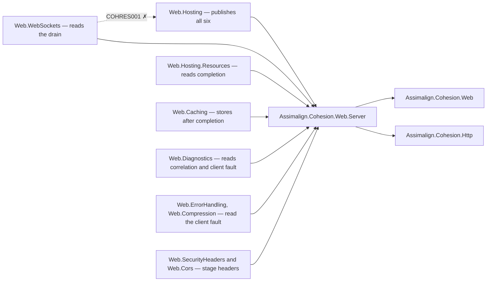

# Assimalign.Cohesion.Web.Server — Design

## Design intent

`Assimalign.Cohesion.Web.Server` holds the per-exchange contracts the Web server publishes:
`IWebRequestIdFeature`, `IWebRequestActivityFeature`, `IWebResponseCompletionFeature`,
`IWebServerDrainFeature`, `IWebClientFaultFeature` and `IWebResponseStartingFeature`. It is a contracts-only feature package.
The default server in `Web.Hosting` implements and installs all six; feature libraries and
applications read them.

The package exists because of two rules that point in opposite directions:

- **The area root holds no feature contracts** (owner decision 33 of 2026-10-09, extending decision
  20's rule for core Http to `Assimalign.Cohesion.Web`; #1379). The three contracts lived in the
  root until then.
- **No feature library may reference the runtime module** (COHRES001). The contracts cannot live in
  `Web.Hosting`, which publishes them, because their readers are feature libraries: `Web.WebSockets`
  reads the drain signal and `Web.Hosting.Resources` the completion callbacks.

A package between the two satisfies both. `Web.Hosting` references it, which decision 32's
relaxation of COHRES002 allows, and every reader references it like any other feature package.

## Family map

The packages that publish, declare and read the contracts, with every arrow meaning "references":

| Package | Role | Reference to `Web.Server` |
|---|---|---|
| `Assimalign.Cohesion.Web.Server` | declares the six contracts | — |
| `Assimalign.Cohesion.Web.Hosting` | runtime module: implements and installs all six (the client fault on a request that can have a body, on every version) | project reference (COHRES002, relaxed by decision 32) |
| `Assimalign.Cohesion.Web.WebSockets` | closes open sockets with `1001 Going Away` when `Draining` fires | project reference |
| `Assimalign.Cohesion.Web.Hosting.Resources` | defers a control-plane stop until its `202` is written | project reference |
| `Assimalign.Cohesion.Web.Caching` | stores the final response only after successful completion | project reference |
| `Assimalign.Cohesion.Web.Diagnostics` | reads the request id and server activity for correlation; logs a client fault at the configured level with the status sent | project reference |
| `Assimalign.Cohesion.Web.ErrorHandling` | skips `OnException` and the `500` problem for a client fault | project reference |
| `Assimalign.Cohesion.Web.SecurityHeaders` and `Assimalign.Cohesion.Web.Cors` | stage policy headers immediately before commit | project reference |
| `Assimalign.Cohesion.Web.Compression` | leaves the transport's framing failure under a decoder unrelabeled | project reference |

The dotted edge is the reference COHRES001 rejects: a feature library may never reference the
runtime module, which is why the contracts could not move into `Web.Hosting`. `Web.Diagnostics` correlates its logs with the server's request id
and the activity published on this exchange (#1297).

## Why the contracts share one package

They have one publisher, the server, and one lifetime, the exchange. A package per contract
would add four packages to every framework that carries `Web.Hosting`, for interfaces of one or two
members each. The owner chose two homes over one shared features package (decision 33): contracts a
feature publishes go with that feature (the endpoint and the path base went to `Web.Routing`), and
contracts the server publishes come here.

## The contracts

**`IWebRequestIdFeature`** is the request-id seam (#1064). Its `RequestId` is a BCL
`ActivityTraceId`: the request id *is* the W3C trace id, so one value finds the request in the
server's span, in logs and in anything returned to the caller. The default server installs it on
every exchange before the pipeline runs. With a server span the id is the span's trace id; without
one it is the trace id of a valid `traceparent`, or else a random id generated on first read, stable
for the exchange. It is a Web contract, not an `Assimalign.Cohesion.Http` one, because a request id
is a server concern and the protocol core models only the wire.

**`IWebRequestActivityFeature`** exposes this exchange's server `Activity`, or `null` when no
activity was created (#1297). The default server's existing telemetry object implements both
this interface and `IWebRequestIdFeature`; the feature collection resolves either interface
from that one object. A listener can decline to create a span, and no listener creates none.
Readers borrow the activity; the server owns its start and stop. The feature names the server
activity even while a handler's child activity is current, and remains `null` when an unrelated
ambient activity flows into an untraced exchange.

This is an optional new contract, leaving `IWebRequestIdFeature` unchanged. Putting it here
respects the server-published feature boundary; putting it in Web.Hosting would require a
forbidden reference from Web.Diagnostics, and the Web root holds no feature contracts. Merely
matching an ambient activity's source name and trace id cannot prove which exchange owns it.
The public BCL activity also lets diagnostics inspect or enrich the server span without
depending on the runtime module's implementation.

**Compatibility with 10.0.0-preview.1.** The activity contract is additive; existing interface
implementations need no new member. HTTP logging's behavior changes: its `span.id` now names
the exchange's server span, rather than the inbound parent span, and its `trace.id` reads the
server's request-id feature even without an inbound header (decision 15).

**`IWebResponseStartingFeature`** registers `OnStarting(Func<object?, Task>, object?)` callbacks
before final-head serialization (#1156). They run once in reverse registration order, whether the
response is buffered or streamed. The default server delegates timing to the transport's existing
head-commit hook, shared by HTTP/1.1, HTTP/2 and HTTP/3; it maintains no second started flag.
Registration after callbacks begin or the response starts throws. Callbacks stage status/headers;
they must not recursively start, write, complete or take over the response. A callback failure stops
the list and aborts the exchange before its head is written, even if middleware catches the failure.
Protocol takeover and transport-generated rejection responses retain the transport hook's exclusions.

If `InvalidResponseField` refuses the head, callbacks never rerun. Their added/changed header values
and removals are reapplied before the server sends an unstarted buffered replacement, including its
own 500 after discarding application headers. Replacement status, body, framing and representation
metadata remain the replacement's: connection-specific fields, Content-Length, Trailer, content
metadata, validators and digests are excluded even when explicitly preserved, so the transport
calculates the new length. This corrects the hook added after preview.1 without a preview.1 break;
invalid callback fields are refused again. The optional `preservedHeaders` registration argument
also retains final values or absence of policy headers that a callback accepts without changing.
Only syntactically valid unchanged application fields are retained; a refused application value
cannot reappear on the clean replacement. Callback-modified invalid fields are still refused.
Keys are copied at registration and values are captured after all callbacks succeed. SecurityHeaders
declares its policy fields (including no-clobber framing), and CORS declares its grant fields and
early cache-selection `Vary`. The server has no middleware-specific header list. An outer error
boundary no longer removes their fields. A custom server must honor this lifetime to use those
middleware; they throw explicitly when the feature is missing. There is no DI dependency.

**Compatibility with 10.0.0-preview.1.** The new contract adds no members to existing interfaces.
Header staging now happens at head commit and survives an outer boundary; custom servers using
SecurityHeaders or CORS must provide the hook. Web.Server is already public in App.Web, so their
new references require no framework-member change.

**`IWebResponseCompletionFeature`** is the response-transmission seam. The default server installs
it on every exchange and invokes callbacks in registration order after writing the response to the
transport. Callback failures are isolated: every callback runs even if a preceding one throws,
and the default server retains and reports each failure (#1410). This changes the preview.1
behavior, which skipped later callbacks after the first failure. Registration after completion throws `InvalidOperationException`. This lets a terminal
defer lifecycle signals until its acknowledgement has been sent: the resource control plane's stop
route answers `202` and stops the application only once the `202` is on the wire.
Output caching also uses this seam so starting-callback policy changes and transmission failure govern
storage. A custom server without completion notification can serve existing hits but stores no misses.

**`IWebServerDrainFeature`** is the drain seam (decision 16, Http ADR 1). Its `Draining` token is
cancelled when the server begins its lame-duck drain: the server stops accepting and lets the
exchanges in flight finish within the stop's budget. An ordinary exchange finishes on its own; a
long-lived one (a WebSocket, a stream of server-sent events) registers on the token and ends its
own work cleanly. The token is not the exchange's cancellation: the exchange keeps running and its
response is delivered; `RequestCancelled` fires only if it is still running when the budget runs
out. The default server installs one shared instance on every exchange. It is a feature rather
than a member of `IWebApplicationServer` because the consumer is code running inside an exchange,
which sees the exchange's features and not the server.

**`IWebClientFaultFeature`** is the client-fault seam (#1340, owner decision 28). Its `StatusCode` is
the `4xx` the transport answers an exchange with because the client's request was at fault while the
application read its body: `400` for a malformed body or one the client cut short by closing the
connection, `413` over the body-size cap, `408` below the minimum data rate, `431` for a trailer
section over its bounds. The read throws as any stream read
does; this feature is how the code that sees the exception learns it was not an application defect.
`Web.Diagnostics` then logs the exchange at its configured level with the status sent,
`Web.ErrorHandling` skips `OnException` and the `500` problem, and `Web.Compression` leaves the
transport's framing failure under a decoder unrelabeled. It is a Web contract because decision 20
keeps the core to generic seams: the transport reports the fault on
`IHttpExchangeControl.ClientFaultStatusCode`, which exists only in the exchange's response phase, and
the default server publishes it from an interceptor. To keep the transport's fast path, the server
installs the feature only on a request that can have a body, as the transport reports it
(`HttpExchangeInterceptorRequestContext.CanHaveBody`): on HTTP/1.1 one that declares a body, on HTTP/2
one whose head did not end the stream, on HTTP/3 one whose request stream had not ended with its head
(#1378), which over the QUIC driver is nearly every request, since the transport sees the stream's end
only on a read. It reads `null` until a fault is latched. On HTTP/2 and HTTP/3 a body that contradicts its
content-length, or a malformed trailer section, resets the stream rather than drawing a status, and the
feature reports `400` for it. The value is read through on each access, because the fault is latched while the pipeline
runs.

**A custom server chooses which contracts it supports.** A custom `IWebApplicationServer` may omit any of them, so each
reader handles an absent feature (SecurityHeaders and CORS require starting and throw without it): the control plane falls back to a direct stop, WebSockets has
no drain-time close, so a socket ends by its own close or by the exchange's cancellation, and a
reader of the client fault treats an absent feature as no fault reported. HTTP logging omits
trace correlation when the request-id feature is absent and omits the span id when there is no
activity feature or server activity.

## Namespace: `Assimalign.Cohesion.Web`

The package pins its `RootNamespace` to the family name, `Assimalign.Cohesion.Web`, and its
contracts declare it. That is the namespace they shipped in, so moving them out of the root changed
their assembly and nothing a call site names. `general-rules.md` sanctions a family pin ("a family
that shares one namespace pins the family name"); `Web.Api`, `Web.Forms` and `Web.ProblemDetails`
pin the same name, as `Http.Cookies` and `Http.Forwarded` pin `Assimalign.Cohesion.Http`.

Binary consumers do break: a library compiled against the root's copies must be rebuilt, because
the types now live in another assembly. Every in-repository reader was rebuilt with the move.

## Framework membership

`App.Web` carries the package publicly, so applications compile against the contracts. Every other
area framework carries `Web.Hosting` privately (the area's control plane runs on it), and so carries
`Web.Server`, with `Web.Routing` and its `Http.Forwarded` dependency, privately too. The App.Runtime
framework-closure tests prove each list covers the project graph.

## AOT posture

Interfaces only: no reflection and no runtime code generation (`IsAotCompatible=true`).
`IWebRequestIdFeature` and `IWebRequestActivityFeature` expose the BCL `ActivityTraceId` and
`Activity` from `System.Diagnostics.DiagnosticSource`, which the shared framework carries;
no package is added.

## Adding a contract

A new per-exchange contract belongs here only when the server publishes it and a feature library
must read it. A contract a feature publishes goes in that feature's package; a contract only the
runtime reads stays internal to `Web.Hosting`. Each addition lands in every framework that carries
`Web.Hosting`, so it stays an interface with no new dependency.

## Non-goals

- **Implementations.** The default implementations are internal to `Web.Hosting`; a custom server
  provides its own.
- **Feature-published contracts.** The endpoint and the path base are `Web.Routing`'s, and a feature
  package owns any contract it publishes.
- **Builder verbs.** The server installs these features itself; there is nothing to register.
