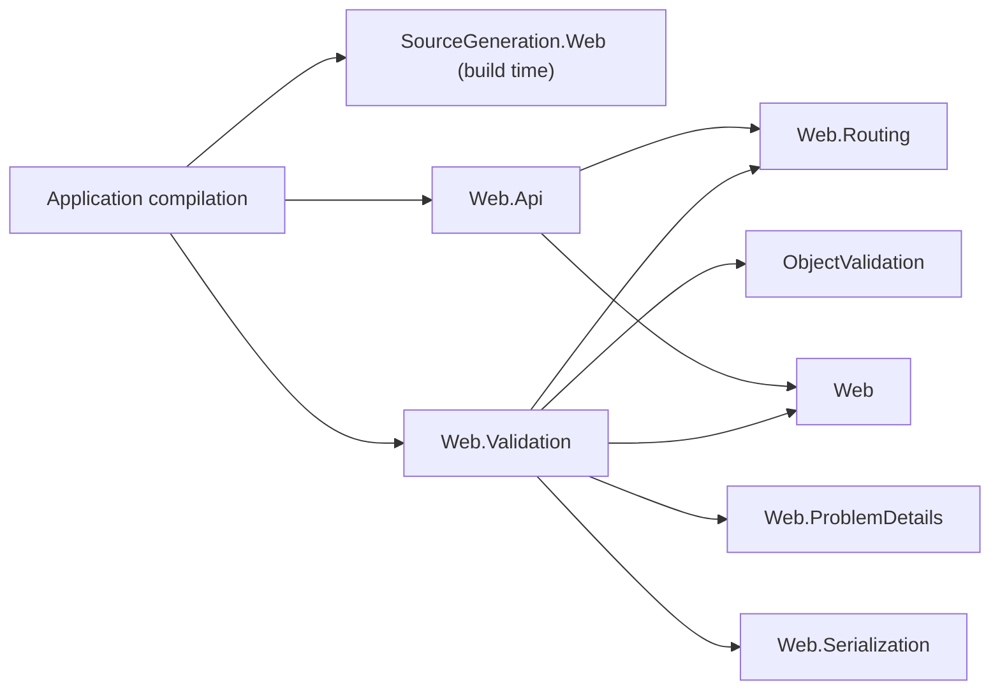
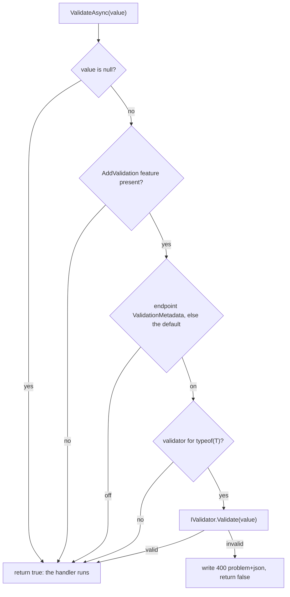

# Assimalign.Cohesion.Web.Validation — Design

## Design intent

A typed endpoint binds a request-body model and hands it to its handler. Binding failures (an
unparseable scalar, a malformed body) are already answered `400` before the handler runs; an invalid
value — a body that parses but breaks the application's rules — was not, so every handler repeated the
same checks and wrote its own error. This package validates the bound model with the application's
`Assimalign.Cohesion.ObjectValidation` validators and answers an invalid one the way binding failures
are answered, before the handler runs (#1060).

It owns three things: the registration (`AddValidation`), the per-request decision and the `400`
(`context.ValidateAsync`), and the endpoint metadata that turns validation off or on
(`ValidationMetadata`, `DisableValidation()`, `RequireValidation()`). The call into it is emitted by the
Web endpoint-binding generator.

## History and placement

Request validation was descoped from `Web.Api` by owner decision on 2026-07-20: an opt-in seam threading
an ObjectValidation validator through `IValidator`-carrying `Map*` overloads and an
`EndpointValidationMetadata` carrier was implemented on the #796 branch and removed before merge, so
`Web.Api` carries no ObjectValidation dependency. The owner then approved #1060 in the HTTP/Web Phase 2
lineup, which brings validation back.

**Placement — a separate package, not `Web.Api` (the integrator's recommendation, pending owner
review).** The descoping decision is kept literally: `Web.Api` still references neither
ObjectValidation nor this package. The integration lives here and reaches typed endpoints the way
antiforgery does: the generator, which references nothing at run time, emits the call when the
consuming compilation can name this package's entry point, and emits nothing otherwise. Consequences:

- An application without the package compiles and runs exactly as before; `Web.Api`'s own surface and
  dependency graph do not change.
- The validation engine is replaceable at the package boundary: the generated call names
  `HttpContextValidationExtensions.ValidateAsync<T>`, not an ObjectValidation type.
- Every `Sdk.Web` application has the package through `App.Web`, so typed endpoints validate as soon as
  a validator is registered; until `AddValidation` is called, the emitted call returns immediately.

The alternative — `Web.Api` referencing ObjectValidation and owning the call — would reverse the
2026-07-20 decision without the owner's say, and would put the engine in the dependency closure of every
endpoint-mapping consumer.



Arrows read "references". `Web.Api` and `Web.Validation` do not reference each other; the generated
thunk in the application calls both.

## Registration

`builder.Services.AddValidation(validation => ...)` configures `ValidationBuilder.Options` (an
`EndpointValidationOptions`), then `ValidationBuilder.Build` freezes them into an application feature
(`EndpointValidationFeature`, an `IHttpFeature` singleton the host seeds onto every exchange): the default
(`Enabled`, on unless set off) and a `FrozenDictionary<Type, IValidator>`. Registering again replaces the
feature. The verb is a component integration (owner decisions 34 and 35, 2026-10-09, #1380): the package
declares `[assembly: ComponentIntegration]` over the public `ValidationBuilder.Build` instance method
(`src/Properties/ComponentIntegrations.cs`), and the generator projects `AddValidation` onto
`IServiceProviderBuilder` in the application's compilation, so the package takes no dependency-injection
reference. Naming an instance method selects the builder template, whose callback is optional (owner
decision 39, 2026-10-10, #1395). A bare `AddValidation()` therefore compiles and registers a feature with
no validator, which validates nothing; the required callback it replaces rejected only `null`, so an
empty callback already did the same. The builder owns the options and exposes them, as
`AuthenticationBuilder` does. Until #1395 the verb was a static factory behind a hidden
`ValidationComponents` type taking a required `Action<EndpointValidationOptions>`, and until #1380 an
`extension(IWebApplicationBuilder)` member.
No configuration binding, middleware or request-time service location is involved, per the Web area's
dependency-free composition rule.

| Verb | Keys the validator by | Notes |
| --- | --- | --- |
| `AddProfile<T>(IValidationProfile<T>)` | `typeof(T)` | Builds a `Validator` over the one profile with `ContinueThroughValidationChain = true`, so every failing rule of every member is reported. The profile is configured once, here. |
| `AddValidator(IValidator)` | each `IValidationProfile.ValidationType` in `Profiles` | For a validator built elsewhere (`Validator.Create`, `IValidatorFactory.CreateValidator`). A validator with no profiles is rejected: it cannot name its type. |
| `AddValidator<T>(IValidator)` | `typeof(T)` | For a hand-written `IValidator` that declares no profiles. |

A second validator for a type is an `InvalidOperationException` at registration, not a silent
replacement. Lookup is exact on the type the value is bound as: no base-type or interface matching,
which would need runtime type inspection.

The `errors` map carries the failures the validator's ObjectValidation options report (that library's
DESIGN, "Which Failures Are Reported"). With the defaults, every failing member is reported, each with its
first failing rule's messages. `AddProfile` sets `ContinueThroughValidationChain`, which adds the messages of
each member's later failing rules, and a validator built with `ValidationMode.Stop` reports only the first
failing member in declaration order. Until ObjectValidation #1206, a default-options validator registered
with `AddValidator` stopped at the first failing member, so a body with several invalid members was answered
with one.

## The generated call

When the consuming compilation resolves `Assimalign.Cohesion.Web.Validation.HttpContextValidationExtensions`
— accessible, with a public static generic `ValidateAsync` — the generator emits, for an endpoint that
binds a request-body model, after every parameter is bound and before the handler is invoked:

```csharp
if (__arg0 is { } __validated0 && !await global::Assimalign.Cohesion.Web.Validation.HttpContextValidationExtensions.ValidateAsync<global::Customer>(context, __validated0, context.RequestCancelled))
{
    return;
}
```

- **After binding.** A binding failure on any parameter is answered first; validation runs only on a
  fully bound request.
- **The type argument** is the declared type without its top-level nullable annotation, or the underlying
  type of a `Nullable<T>`. The pattern test unwraps the value, so a `null` body is not validated.
- **Bodies only.** Only a model bound from the body is validated: route, query, header and form values
  are scalars, which have their own binding rules, and a body bound as a string or primitive is not a
  model. Form models do not exist — whole-object form binding is a `Web.Api` non-goal — and would be
  validated the same way if they arrive.
- **Static form, fully qualified.** The call is the static form of the extension member, so the generated
  file needs no `using` for the package.

## The per-request decision



The endpoint's `ValidationMetadata` is read last-wins from the endpoint `UseRouting` published
(`context.GetEndpointMetadata<ValidationMetadata>()`): a route's declaration overrides its group's,
either overrides the application's default, and with no declaration the default decides. Both states are
instances of the one sealed carrier, following the Web.Routing endpoint-metadata family rule, so a route
can require validation under a group that disables it. Unlike antiforgery, the metadata places no
requirement on the pipeline: there is no middleware, so nothing has to acknowledge the endpoint.

Validation runs synchronously (`IValidator.Validate`), not through `ValidateAsync`, which ObjectValidation
implements with `Task.Run`: a thread-pool hop per request for CPU-bound work.

## The failure payload

`ProblemDetails.FromStatus(400, "One or more validation errors occurred.")` with an `errors` extension
member (RFC 9457 §3.2): a map from key to a `string[]` of messages, the shape the generated thunk writes
for binding failures, so a client parses both the same way.

| Error source | Key | Why |
| --- | --- | --- |
| A rule's default source, its member selector `p => p.Address.City` | `address.city` with a camelCase contract | The registered JSON member names; the selector parameter is noise |
| An element's default source `p => p.Items[2].Quantity` | `items[2].quantity` with a camelCase contract | Zero-based indexes distinguish failing elements |
| A source the profile set (`error.Source = "name"`) | `name` | The author chose the key, for example the JSON property name |
| No source (an error about the value as a whole) | `""` | The empty key, the model-level convention clients already handle |

The map asks the application's serialization feature for each owning type's registered contract through
`TryGetJsonTypeInfo` (#152). It uses the matched `JsonPropertyInfo.Name`, follows `PropertyType` and
collection contracts' `ElementType`, and retains CLR names wherever no contract/member can be resolved.
Only default selector sources are translated; author-chosen sources and model-level errors stay as written.
ObjectValidation composes nested sources and inserts each zero-based `RuleForEach` index locally while
forwarding the element's errors, without changing a shared rule or adding a public index member.

**CLR identity requires generated metadata.** System.Text.Json exposes JSON names but keeps the CLR
member name internal. Reading `AttributeProvider` can trigger reflection, so validation never reads it.
The optional, feature-owned `IValidationJsonPropertyResolver` identifies the matching property in the
supplied final contract. The Web source generator adds an explicit implementation to source-declared
partial `JsonSerializerContext` classes when this package is referenced. It discovers CLR names and
`[JsonPropertyName]` at compile time, uses the registered naming policy for other names, and returns only
a property present in that contract. The generator ships with `Sdk.Web`; a package-only consumer opts
into `Assimalign.Cohesion.SourceGeneration.Web` alongside its JSON generator.

A custom resolver can implement the same optional interface to handle arbitrary contract modifications;
the map checks the options resolver first and then the contract's originating resolver, continuing when
either returns null before trying constructor-associated names and the naming-policy fallback. This lets
a custom resolver handle only the properties it changes without hiding generated mappings for other
nested or collection members. A context that already implements it is not augmented. A precompiled
context without that metadata still supports
policy-named properties and constructor-associated member names; a renamed mutable member with no
identity metadata falls back to its CLR name. Modifiers that rename or replace properties beyond the
policy/attribute names need an application implementation that identifies those final properties. This
limitation and the new optional public interface are escalated under #1209; no existing interface is widened.

Keys and messages keep the order the rules ran, which is declaration order. ObjectValidation runs members in
the order the profile declares them (a nested profile's members in place under their parent) and each
member's rules in the order they are chained. It lists its errors in that order, so the map takes them as
they come. Until ObjectValidation #1221, the map listed members in reverse declaration order.

A validator built with `ThrowExceptionOnFailure` throws `ValidationFailureException`. Its retained
`Errors` (#1208) go through the same mapper, so it returns the same `400` error paths as a returned
validation result. Previously the catch returned an empty map.

**Preview behavior change (#1209, HTTP/Web decision 15 terms).** Collection sources now include indexes
in ObjectValidation, where preview.1 omitted them. Web.Validation was not in 10.0.0-preview.1; its
pre-fix wire keys change from CLR paths to JSON paths, and throwing validators now return populated
maps. Clients keyed to the previous spelling must update. The `errors` extension remains an object of
string arrays; [RFC 9457 §3.2](https://www.rfc-editor.org/rfc/rfc9457.html#section-3.2) permits extension
members and does not prescribe this application's key syntax.

**OpenAPI consistency check.** Web.OpenApi's `WebOpenApiEndpointSource` describes input-binding `400`
responses with `OpenApiSchemaGenerator`'s generic ProblemDetails schema: five optional standard members,
with additional members allowed. JSON paths and indexes fit that schema. It needs a future validation
description policy that documents an optional `errors` object with string-array additional properties
and the JSON-path/index convention; it currently does not consume `ValidationMetadata`. Keep the generic
ProblemDetails extension space open rather than requiring every problem to carry validation errors.

Any other exception from a validator is a fault in the application, not a verdict on the request: a nested
profile's rule or a custom rule that throws (ObjectValidation's DESIGN, "A Rule That Throws"). It propagates
to the pipeline's exception boundary, and the handler does not run. Until ObjectValidation #1292 such a rule
was recorded as not invoked, so the body passed validation and reached the handler.

## AOT posture

`IsAotCompatible` holds with no reflection: validators are keyed by `typeof(T)` values the generated
code supplies, the frozen dictionary lookup is by `Type` identity, and the generic call is instantiated
over the bound type at compile time. ObjectValidation reads members through the expression trees' resolved
`PropertyInfo`/`FieldInfo` metadata without compiling them (its DESIGN, "NativeAOT Posture"). The problem
payload is written by `Web.ProblemDetails`' `Utf8JsonWriter` writer.

## Non-goals

- **Validating scalars and returned values.** Route, query, header and form values bind with their own
  rules; a returned value is the application's own.
- **Attribute-driven validation** (data annotations). Rules live in ObjectValidation profiles, registered
  per type; there is no attribute scan.
- **Asynchronous rules.** The engine's rules are synchronous.
- **Describing the `400`** in the endpoint description metadata. Like the binding `400`, it is an outcome
  the thunk produces on its own; a documentation adapter adds it by policy.
