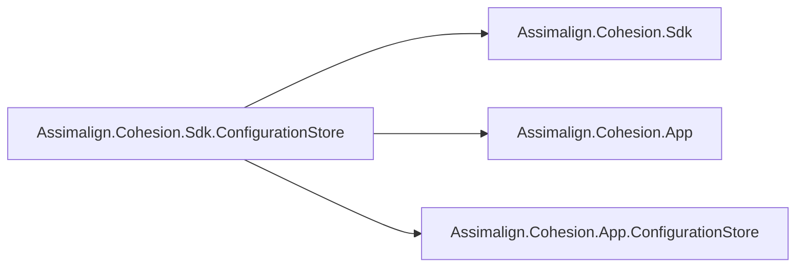

# ConfigurationStore SDK Design

## Scope

The SDK chains through the base Cohesion SDK and supplies the `Assimalign.Cohesion.App`
and `Assimalign.Cohesion.App.ConfigurationStore` framework references. The consumer owns an
ordinary executable whose `Program.cs` composes the store with
`ConfigurationStoreApplication.CreateBuilder(args)`.

## Defaults

The SDK sets the resource-executable marker, so the project defaults to an executable and,
through the base SDK, to self-contained output for the host runtime identifier. It declares
no endpoints, mounts, or other manifest items. A store application makes
itself a managed resource in `Program.cs` with `builder.Services.AddResource(...)` from
`Assimalign.Cohesion.ConfigurationStore.Hosting.ApplicationModel`, which the area framework
carries.

## Verification

The SDK has no task code and no test project of its own. The base SDK's package-boundary
tests cover the chain it uses, and the `cohesion-configurationstore` template build test
compiles a consumer against the packed SDK and frameworks.
