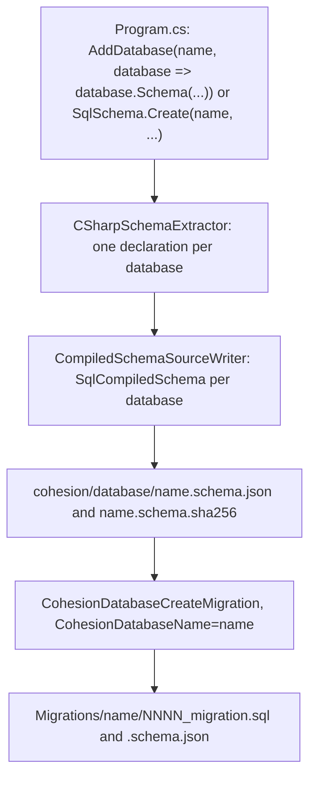

# Database SDK Design

## Boundaries

A database's C# schema declaration is the only schema source. The SDK compiler reads Roslyn
syntax and symbols from `@(Compile)` and `@(ReferencePath)`; it never invokes `Program.Main`,
starts an engine, loads a consumer plug-in, or scans `Schema/**/*.sql`. The compiler lowers each
declaration into the SQL family's `SqlCompiledSchema` contract and uses the schema's own canonical
document and hash, so build, migration and provisioning artifacts share one contract.

Two anchors declare a database's schema, one declaration per database (B1 of
`docs/programs/DATABASE_ENGINE_EXTENSIBILITY_DESIGN.md`, §5.7; owner decision 59 of 2026-10-09):

| Anchor | The database it declares |
| --- | --- |
| `SqlDatabaseBuilder.Schema(Action<SqlSchemaBuilder> declare)` | The constant first argument of the `SqlDatabaseEngineBuilder.AddDatabase(name, configure)` whose callback parameter receives the call. |
| `SqlSchema.Create(name, configure)` or `SqlSchema.Compile(name, configure)` | Its constant `name`. A `SqlSchema` value reaches an engine through `AddDatabase(SqlSchema)` or `database.Schema(SqlSchema)`, neither of which is a second anchor. |

The runtime's `database.Schema(declare)` is `SqlSchema.Create(<database name>, declare)`, so both
anchors compile to the document the engine's build provisions and records.

The extractor recognizes the declaration DSL by metadata name: the two anchors, then calls on the
sealed `SqlSchemaBuilder`, `SqlTableBuilder<TRow>` (``SqlTableBuilder`1``), `SqlTypeBuilder` and
`SqlPrincipalBuilder` (`CSharpSchemaExtractor.cs`). Those strings change in the same commit as the
types they name: a stale one compiles and then rejects every schema at build time. The task
project references `Database.Sql.Schema` and `Database.Sql.Language`, so `SqlDatabaseBuilder` and
`SqlDatabaseEngineBuilder` are names it matches in the consumer's compilation, never symbols it
links against. The test project compiles its consumer sources against the real `Database.Sql`
assembly, so renaming either builder fails the SDK tests in the same change.

The C# function, trigger and extension declarations, their extraction and the expression
canonicalizer that turned their lambdas into canonical C# text are gone (owner decision 57 of
2026-10-09): nothing ever executed them. Engine functions are registered on the SQL engine
builder, and SQL-defined functions arrive through DDL.

The SDK is a build-time layer. Its tasks may run under the JIT-based MSBuild host and reference
the AOT-compatible `Database.Sql.Schema` package, but the task and Roslyn assemblies never enter the
consumer's runtime closure. The task references `Database.Sql.Schema` and `Database.Sql.Language`
(per the `COHLIB001` same-area rule). Migration DEFAULT validation uses the public SQL parser and
expression renderer, avoiding a second literal grammar; it does not pull the SQL engine, its storage implementation, or
`Connections.Tcp` into MSBuild.

## Orchestration commands

When `CohesionApplicationModel=enabled`, the `Assimalign.Cohesion.Sdk.ApplicationModel`
manifest task writes this SDK's `CohesionCommand` defaults, `database.add-database` and
`database.add-principal`, as bare strings in `commands`; neither sets `RequiresInputResolver`,
the metadata that switches an entry to the object form. These advertise the Database
default control plane's bounded command set. Typed declarations ship in
Database.ApplicationModel, and the gateway delivers them through its generic
`ResourceControlPlaneCommandClient`; the SDK never executes them or places payloads in
the manifest. The schema compiler and migration path remain independent.

## Model selection

`CohesionDatabaseModel` is an exact selector. The shared targets file contains explicit,
allowlisted imports:

- `Sql` imports `Sdk.Database.Sql.targets`.
- `KeyValuePair` imports `Sdk.Database.KeyValuePair.targets`.

Each imported file sets `_CohesionDatabaseModelTargetsLoaded` and registers one private compile
target through `_CohesionDatabaseModelCompileTarget`. An absent selector fails with
`COHDBSDK001`; an incomplete model file fails with `COHDBSDK002`. Explicit imports are deliberate:
a project property can never expand into an arbitrary import path.

## Build contract

`CohesionDatabaseCompileSchema` runs after references resolve and before `CoreCompile` when
`CohesionDatabaseProject=true`. Model targets pass the same C# inputs to
`CompileDatabaseSchemaTask` with their fixed model identity. SQL supplies the compiled-schema
contract; KeyValuePair compilation fails with `COHDBSDK106` until that model owns a schema
package. The diagram shows the path from the C# to the artifacts and a migration.

The task accepts only statically analyzable schema declarations: names and numeric configuration
are compile-time constants, selectors are direct members, schema callbacks are inline lambdas,
and a `database.Schema(...)` call is made on the `AddDatabase` callback's own parameter (a helper
method that receives the `SqlDatabaseBuilder` works at run time but fails here; declare a reusable
schema as a `SqlSchema.Create(name, ...)` value instead). Artifacts are keyed by database name
alone, so a database name is unique across every engine of the project, although two engines may
each own a database of one name at run time. A schema principal fails the build
(`COHDBSDK108`): every SQL engine build refuses it before touching a file (`COHSQLP001`, owner
decision 58), so an artifact for it would only move the failure to the first start. Every
declaration is compiled before any artifact is written, so a failure replaces none.

Every table selector strips parentheses, casts, and `checked`/`unchecked` expression contexts in
any nesting order before resolving the direct row member. This applies uniformly to columns,
primary keys (`Key` and `PrimaryKey`), indexes, foreign keys, `Default`, and `DefaultSql`, matching
the runtime's `Convert`/`ConvertChecked` expression-tree handling. The selected member's declared
type remains the storage type: `Default<short>(row => checked((short)row.Number), (short)7)` on an
`int` member stores literal `7` on an Int32 column. Runtime/SDK canonical document and hash parity
cover these wrappers across every selector operation.

`table.Check(name, sql)` (E2, design §5.7) extracts as two compile-time string constants into
a CHECK constraint with the text as written and no columns, the record the runtime compiler
writes, so the artifact's document and hash equal the runtime's (`CompileDatabaseSchemaTaskTests`).
The schema extraction task does not parse CHECK SQL, and
**native functions are invisible to it**. A CHECK that calls a function the application registers
on its engine builder compiles into the artifact like any other; the engine's build binds it to its
function catalog before it touches a file (`COHSQLP001` when it does not bind). A CHECK's name
shares the table's constraint, primary-key and index name space (`COHDBSDK105`, as the runtime
compiler's `DuplicateDeclaration`).

`table.Column(selector, sqlType)` and `schema.Type<T>` (E3, design §5.7) extract with the same
parity. The SQL type is a compile-time string constant kept as written (`COHDBSDK104` when it is
not one), checked for the runtime's identifier/Int32 argument shape and shared modifier
ranges (`COHDBSDK106`), and a member declared with two names is `COHDBSDK105`. **Domains are
invisible to the task** as functions are: a column of a domain the application registers on its
engine builder compiles into the artifact, and the engine's build resolves the name before it
touches a file. `schema.Type<T>(t => t.Decimal(p, s))` is a domain named for `T`'s simple name, as
the runtime compiler names it; a generic or array `T`, which has no such name, is `COHDBSDK106`.
`table.Default<TValue>(selector, value)` accepts C# compile-time constants: strings, characters,
Boolean values, numeric values, `null`, and enum members (including constant expressions and
casts). Roslyn evaluates the expression and the extractor applies its contextual numeric
conversion, so `Default(row => row.Amount, 7)` on a decimal member produces exactly the literal
the runtime builder receives. Both paths compile the same stateless internal literal renderer
from `Database.Sql.Schema/shared` through `CohesionSharedSource`; no public helper or
shipped-to-shipped internal grant widens that boundary. The renderer quotes strings and doubles
apostrophes, preserves decimal scale using invariant culture, writes uppercase Boolean and NULL
literals, and validates the value against the member's mapped storage type. Characters use string
storage; enums use their underlying integer's storage, widening unsigned enum storage where
necessary. Explicit SQL type names still resolve and validate at engine build.

A value Roslyn cannot evaluate fails with `COHDBSDK109`, at its source location, naming
`DefaultSql` as the escape hatch. The extractor does not invoke constructors, read mutable fields,
or execute helper methods. Date/time, Guid, and binary CLR values are supported by the runtime
builder; their nonconstant C# constructions use `DefaultSql` in SDK-analyzed declarations.
`table.DefaultSql(selector, sqlLiteral)` retains the existing requirement for a non-empty
compile-time string constant (`COHDBSDK104`) and preserves its SQL text for engine validation as
exactly one supported literal before any file is touched. Typed mismatches are `COHDBSDK106`.

Either verb selects a column on its own, before or after `Column`, including an explicit SQL
type or inferred domain. Repeating the same rendered literal is idempotent; a different literal
for that column is `COHDBSDK105`. Only `DefaultLiteral` reaches the document: a typed default and
`DefaultSql` containing its exact rendered literal produce identical documents and hashes. The
shape retains the B2 members; #1438 advances the format to v5 for decimal normalization. The SDK/runtime parity tests cover every constant kind, all enum backing widths,
nullable values, implicit numeric conversions, constant concatenation, named arguments, domains,
and exact document/hash equality. Foreign-key compatibility compares the compiled storage and
SQL type metadata, so an enum and its integer storage, or char and string, match when their
domain/type declarations do too.

The diagnostics:

| Code | Meaning |
| --- | --- |
| `COHDBSDK100` | A source or reference could not be read, or the language version is unknown. |
| `COHDBSDK101` | No schema declaration was found, or a database name (compared ignoring case, across every engine of the project) has more than one. |
| `COHDBSDK102` | A name is not a non-empty constant (a CHECK's included); a `database.Schema(...)` call has no constant enclosing `AddDatabase` name; or a database name cannot name a file. |
| `COHDBSDK103` | A schema, table, type or principal callback is not an inline lambda. |
| `COHDBSDK104` | An operation the DSL does not support, or a CHECK's SQL text, column's SQL type, or DefaultSql literal that is not a non-empty constant. |
| `COHDBSDK105` | A duplicate table, type, principal, column, index or primary key, a conflicting column type or DEFAULT literal, or a CHECK named as another of its table's constraints, its primary key or one of its indexes. |
| `COHDBSDK106` | Invalid type modifiers naming the table/column or domain; or a semantic error: a dangling or mistyped reference, a column whose CLR type is not a SQL column type (the message lists the supported types), the KeyValuePair model, or a compiled-schema validation error (prefixed with the database name). |
| `COHDBSDK108` | `SqlSchemaBuilder.Principal`: a declaration every SQL engine build refuses (`COHSQLP001`) until principal and grant DDL exists. (`SqlSchemaBuilder.Type<T>` was refused here too until E3 made it a domain.) |
| `COHDBSDK109` | A typed Default value is not a C# compile-time constant; use DefaultSql with a constant SQL literal. |

The outputs are:

| Name | Default | Meaning |
| --- | --- | --- |
| `CohesionDatabaseSchemaOutputDirectory` | `$(IntermediateOutputPath)cohesion/database/` | Holds `<database>.schema.json`, the canonical `SqlCompiledSchema` JSON, and `<database>.schema.sha256`, the lowercase SHA-256 of its exact UTF-8 bytes, for every declared database. |
| `schemas.manifest` | In the output directory | The databases whose artifacts the task wrote, one name per line. |
| `CohesionDatabaseSchema` items | Set by `CohesionDatabaseCompileSchema` | One per database the manifest lists (its schema document, full path), with `DatabaseName` and `HashPath` metadata, for downstream targets. |
| `Schemas` task output | `CompileDatabaseSchemaTask` | One item per database, named for it, with `Hash`, `SchemaPath` and `HashPath` metadata. |

The document format is `cohesion/database-schema/v5`, shared with the runtime compiler and the
migration baseline writer. B2 introduced `defaultLiteral` in v4; #1438 advances the format again
because normalizing an omitted decimal scale changes a raw v4 NUMERIC(p) document's identity.
Earlier formats are refused before normalization, including v4. Rebuild artifacts and recreate
databases recording an earlier schema format; no old hash or identity is reconciled. Reading an
old artifact or migration baseline reports COHDBSDK206 with the schema.format refusal and remedy,
without writing a migration. Runtime deserialization uses SqlSchemaValidationException with
InvalidDocument. The document contains semantic data only, never source paths or timestamps. The task writes with
LF line endings and avoids replacing unchanged outputs. The manifest is the only record of which
files in the directory are the SDK's: the task deletes the `.schema.json` and `.schema.sha256`
files of a database its previous manifest listed and that is no longer declared, and leaves every
other file alone, so a consumer's own `*.schema.json` in an overridden directory is neither deleted
nor read as a database. The manifest is written on every successful compile and is the model
target's incremental output. Editing C# or a reference assembly, deleting the directory, or
pointing `CohesionDatabaseSchemaOutputDirectory` somewhere new invalidates it; and
`_CohesionDatabaseCheckSchemaArtifacts`, which runs before the model target, deletes the manifest
when an artifact it lists is gone, so a hand-deleted artifact is written again instead of the build
reading a partial set. The artifacts and the manifest are `FileWrites`, and `Clean` removes them.

## Migrations

`CohesionDatabaseCreateMigration` first compiles the desired schemas, then works on one database,
named by `CohesionDatabaseName` (compared ignoring case), which a project that declares exactly one
database may omit. Without it in a project that declares more, the target fails with
`COHDBSDK207`, and with a name the manifest does not list with `COHDBSDK203`; both list the
declared databases. Each database numbers its own migrations in `$(CohesionDatabaseMigrationsRoot)/<database>/`
(default `Migrations/<database>/`), so two databases never share an ordinal sequence or a file
name. The folder is found by its name ignoring case, as database names compare, so a declaration
renamed only in case (`Sales` to `sales`) keeps its history on a case-sensitive file system too
(#1392); a new folder takes the declared spelling, and two folders that match one database fail
the target with `COHDBSDK208`. A required, sanitized `CohesionDatabaseMigrationName` is combined with the next four-digit
ordinal. SQL compares the new document with the database's newest `NNNN_name.schema.json`
baseline through the shared `SqlSchemaMigrationPlanner`, renders operations in planner order, and
atomically emits matching `NNNN_name.sql` and `NNNN_name.schema.json` files. There are no
timestamps. Missing names, invalid schemas, unsupported/destructive operations, and path
collisions fail without partial outputs. `KeyValuePair` fails explicitly because a SQL script is
not a valid migration artifact for that model. SQL text uses the same guarded, `dbo`-qualified
dialect as the runtime renderer; the current dialect explicitly rejects constraints,
ALTER metadata, and required column additions that have no non-null literal default or backfill.
Every emitted column retains its DEFAULT. The migration writer validates it as exactly one SQL
literal through `Sql.Language`, then renders the parsed value, accepting a minus sign on a numeric literal and no other expressions, so signs, Boolean spelling and
escaped strings match the runtime's DDL. Required additions retain the shared planner's
conservative destructive-change opt-in; after that opt-in, a non-null default makes the DDL valid;
`DEFAULT NULL` has the same effect as absence and cannot supply that addition. Nonliteral text is
`COHDBSDK206` before either the SQL script or the new baseline is written. Engine-specific domain
resolution and default value conversion remain runtime validation, as the SDK does not build an
engine. SDK tests compare scripts for the same plans directly with `SqlMigrationScriptGenerator`.

## Verification

SDK-local tests evaluate the real target imports for SQL and KeyValuePair, the artifact directory
and manifest defaults, the manifest as the model target's output and the artifact check ahead of
it, the migration target's parameters, and the fallback diagnostic for unknown/case-mismatched
selectors. Task tests cover static/runtime canonical JSON and hash parity for both anchors, one
artifact per database and the manifest, removal of an undeclared database's artifacts while a
foreign `*.schema.json` stays, the hosted `AddSql` shape, the unanalyzable-name and file-name
refusals, duplicate and missing declarations, the principal refusal, domain and column-type parity and refusals
(`COHDBSDK108`), invalid C# schema diagnostics, per-database SQL migration numbering, the
one-database default and dialect output, and the KeyValuePair compilation and migration errors. The SampleHost end-to-end test in
`Database.Testing` checks the remaining link: the SDK's hash equals the hash the running host
recorded when its engine build provisioned the database. Packaging remains governed by the
repository's SDK pack contract; Microsoft.Build host assemblies are excluded from the shipped task
dependency closure.

## E4 script artifact decision

Iteration 1 keeps declared scripts outside the v5 typed schema. They require runtime statement
receipts and checksummed history that generated SQL alone cannot establish. The extractor emits
COHDBSDK110 for SqlDatabaseBuilder.Script, preventing incomplete artifacts: migration files that
carried a script without its receipt would leave a Verify-mode application unable to start, and a
later Apply run would execute the script a second time. Typed runtime/SDK document and hash parity
remain unchanged; this decision requires no schema-document format bump. The owner kept the refusal
(decision 82, 2026-10-15).

**Scripts with SDK migrations, today.** Declare the scripts in a separate small executable that does
not set `CohesionDatabaseProject`: it declares the same database with the same typed schema plus its
`Script(...)` calls, and runs once in Apply mode during deployment. The application keeps the SDK
pipeline and the typed schema only, and starts in Verify mode. Verify checks receipts only for the
scripts the application itself declares, and typed reconciliation tracks script-created objects, so
the migrator's tables, functions, domains and data serve the application without drift. The SQL
engine test `BuildAsync_VerifyWithoutScriptsAfterScriptedApply_ShouldAcceptTheScriptsObjects` pins
this. Making the pipeline itself script-aware (an artifact carrying each script's name, digest and
body, applied through a receipt-aware runner rather than plain SQL files) is
[#1504](https://github.com/assimalign/cohesion/issues/1504).

## Type modifier parity (#1438)

The extractor links the stateless internal Sql.Language/shared/SqlTypeModifiers through
CohesionSharedSource, alongside the schema package and engine. Column SQL text and Decimal(p,s)
use one mapping and rule (named Decimal arguments bind by parameter name in either order):
p 1..28, s 0..p, string/binary length 1..10485760, and FLOAT binary precision 1..53.
Temporal precision is recognized but unsupported; other types and domain references take no
modifiers. Omitted bounds stay unbounded. Invalid declarations emit COHDBSDK106
with their table/column or domain name and source location, and write no schema artifact. The
compiled-schema validator also covers raw metadata. No new diagnostic id or public API is added;
valid artifacts and hashes retain runtime parity. Declared scripts remain COHDBSDK110 because
only runtime provisioning owns their receipts.

Decimal scale normalization is shared too: precision with an omitted scale means zero. The
compiled-schema snapshots normalize raw records before validation and hashing, so SDK artifacts,
runtime declarations and raw compiled metadata cannot disagree about that default.

The same SQL text rule admits FLOAT(p) for 1..53 bits (1..24 selects Float32, 25..53 Float64 at
engine resolution). Temporal precision is recognized but unsupported and reports COHDBSDK106
with COHDBL001 in its detail, naming the column and modifier; malformed or invalid modifiers
retain SQL0005 in that detail. No artifact is written on either refusal. The existing diagnostic
ids and runtime/SDK canonical-document parity remain unchanged.

INTERVAL field qualifiers and ranges, with optional precision on SECOND, are recognized by the
same linked grammar. Extraction reports COHDBSDK106 with COHDBL001, naming the column and full
qualifier, even without precision; no artifact is written. DIALECT.md lists all accepted spellings
and the unimplemented field restriction/rounding semantics.
