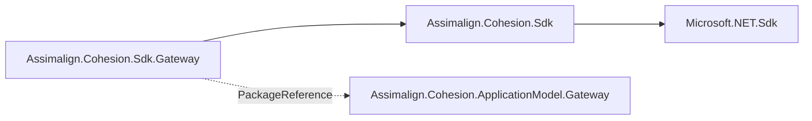

# Assimalign.Cohesion.Sdk.Gateway Design

## Design intent

`Sdk.Gateway` makes an ordinary executable project a Cohesion application gateway with
the least the build can do: it defaults the project to an executable and references the
gateway package. Everything that describes the application is code in the gateway's
`Program.cs`: the model (`ApplicationGateway.CreateBuilder(name)` and one
`AddResource(provider, name)` per resource), the platform it runs on, and the run itself.

The SDK generated that surface until 2026-10-31: it read referenced projects'
`resource.json` manifests through `CohesionResourceReference` items and wrote
`Gateway.CreateBuilder(args)`, `Manifests`, `Externals`, and provider selection into the
gateway. The application-model restart retired manifests, the generated surface, and the
`Assimalign.Cohesion.Sdk.ApplicationModel` package it imported, so the SDK kept only its
name, which the CLI's gateway discovery and consumers' `global.json` pins rely on.

## Package and import shape

The package has the normal Cohesion MSBuild SDK layout:

```text
Sdk/Sdk.props
Sdk/Sdk.targets
Targets/Sdk.Gateway.props
Targets/Sdk.Gateway.targets
Targets/Build.Version.props   (frozen at pack time)
```

The package carries no `Tasks/` folder: the SDK runs no task, so its project sets
`CohesionSdkPackTasks=false` and takes no MSBuild package reference.



The solid arrows are SDK imports; the dotted arrow is the one package reference the SDK
adds to the consumer.

- `Sdk/Sdk.props` defaults `OutputType` to `Exe` when it is empty, before it imports the
  base props (which import `Microsoft.NET.Sdk`'s, where `Library` would otherwise win),
  then imports `Targets/Sdk.Gateway.props`. A consumer's own `OutputType` still wins. It
  does not set the resource-SDK marker, so the base SDK adds no App framework.
- `Targets/Sdk.Gateway.props` adds
  `<PackageReference Include="Assimalign.Cohesion.ApplicationModel.Gateway" Version="$(CohesionVersion)" IsImplicitlyDefined="true" />`.
  `$(CohesionVersion)` comes from the base SDK's frozen `Build.Version.props`, which
  `Sdk.props` imports first; this SDK's own frozen copy ships but is not imported. A
  consumer pins both SDKs to one version in `global.json`, so the two agree. The reference is the
  package's whole closure: Definition, Protocol, and the identity package.
  `CohesionGatewayImplicitReference=false` removes it for a project that pins the package
  itself.
- `Sdk/Sdk.targets` defaults an executable gateway to `SelfContained=true` for the host
  runtime identifier (`RuntimeIdentifier=$(NETCoreSdkRuntimeIdentifier)`) with
  `ValidateExecutableReferencesMatchSelfContained=false`, the defaults a resource
  executable takes, then imports the base targets and `Targets/Sdk.Gateway.targets`, which
  is empty. A project that sets `SelfContained` or `RuntimeIdentifier` keeps its values.

## Decisions

- **No framework.** A gateway manages resources through their platform; it never loads a
  resource's runtime, so it takes no `App` or `App.<Area>` framework and no area package.
  The old in-process mode added App and the referenced areas' frameworks; the in-process
  platform now runs programs the gateway references itself.
- **Self-contained by default.** An in-process gateway references each resource's
  `Sdk.<Area>` project, and resource executables are self-contained and RID-specific. A
  framework-dependent gateway then fails NETSDK1151 at build; with that check off it cannot
  start, because the App and App.<Area> framework references flow in transitively and those
  frameworks ship only as runtime packs ("Framework: 'Assimalign.Cohesion.App' ... No
  frameworks were found"). Self-contained output carries the runtime packs, so the
  in-process gateway builds and runs. A gateway with no in-process resource pays only the
  larger output and may set `SelfContained=false`.
- **No platform by default.** A gateway runs on exactly the platform its `Program.cs`
  registers, so the platform is the consumer's own package reference: the in-process
  gateway half (`Assimalign.Cohesion.ApplicationModel.Gateway.InProcess`) or a
  `cohesion-platforms` gateway half such as `Assimalign.Cohesion.ApplicationModel.Gateway.Kubernetes`.
  Choosing one by property (the retired `CohesionGateways`) would hide the dependency the
  code already names.
- **No generation.** Identity and topology are values the program declares. Nothing in the
  build has to agree with them, so nothing can drift from them.
- **Keep the SDK at all.** A plain `Microsoft.NET.Sdk` project with the package reference
  works too. The SDK stays because it is the marker the CLI discovers (`cohesion run`), it
  keeps the package version in step with the rest of the Cohesion SDK pins, and it carries
  the base SDK's defaults and pin validation.

## Verification

`Tasks/tests` builds a package-only consumer (`TestProjects/GatewaySdkConsumer`) against the
packed SDKs and the gateway package closure in `_out/packages`, in an isolated workspace that
links the base SDK's `ConsumerWorkspace` (`COHESION_GATEWAY_SDK_TESTS`). The consumer's
`Program.cs` declares a model with no reference of its own; the test asserts the build
succeeds, the output carries the gateway assembly and an apphost, and no App framework,
manifest, or generated gateway source appears. A second consumer
(`TestProjects/GatewayInProcessConsumer`) references a `Sdk.Web` resource project
(`TestProjects/GatewayWebResource`) and calls into it; the test asserts the build passes
without NETSDK1151 and that the built gateway starts and loads the resource's App.Web types.
It needs the App and App.Web packs for the host RID in the feed.
`.github/workflows/sdk-smoke.yml` packs the closure and the frameworks and runs both on each
OS leg.

## Non-goals

The SDK does not generate sources, read other projects, select platforms, publish images,
or describe a model at build time.
