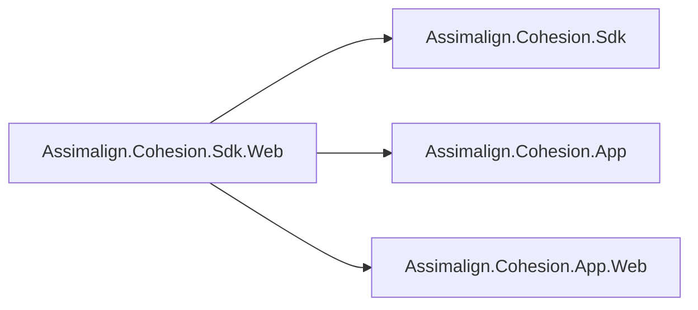

# Assimalign.Cohesion.Sdk.Web Design

## Design intent

Sdk.Web composes the base Cohesion SDK, the App hosting kernel, and the App.Web framework for an
HTTP application. Its Web defaults preserve the application's choices and enable the runtime support required to deliver Web EventSource diagnostics under
NativeAOT. Application startup and middleware composition remain in the application's `Program.cs`.

## Family map

The Web SDK imports the base SDK. Its implicit framework references depend on the shared App and App.Web packs.



| Package | Role |
| --- | --- |
| `Assimalign.Cohesion.Sdk.Web` | Executable marker, Web defaults, static-asset copying, and implicit framework references. |
| `Assimalign.Cohesion.Sdk` | .NET SDK chaining, common build defaults, and framework registrations. |
| `Assimalign.Cohesion.App` / `.Web` | Hosting kernel and HTTP/Web compile-time and runtime framework closure, including `Web.Hosting.ApplicationModel`, whose `builder.Services.AddResource(...)` makes the application a managed resource. |

## Import ordering and overrides

`Sdk/Sdk.props` marks the project as a resource executable before importing the base SDK, then adds
App and App.Web framework references unless `CohesionAutoIncludeAppFramework=false`. It imports
`Targets/Sdk.Web.props` before the consumer's project body. `Sdk/Sdk.targets` imports the base targets, then
`Targets/Sdk.Web.targets`.

The SDK declares no endpoints, probes, or other manifest items: application-model composition
is code. `wwwroot/**` files copy to both build and publish
output unless the consumer replaces the item metadata. The SDK also enables the generated Web API
interceptor namespace required for typed route handlers.

## NativeAOT event delivery

`Targets/Sdk.Web.props` defaults `EventSourceSupport` to `true` only when the property is empty:

```xml
<EventSourceSupport Condition="'$(EventSourceSupport)' == ''">true</EventSourceSupport>
```

NativeAOT otherwise removes EventSource delivery. After Web.Hosting moves its server diagnostics
to `WebServerEventSource`, the default keeps those events available to tools and to the entry-point
host's forwarder. Event delivery adds no logging provider. The application's configured sinks and
category filters still determine which forwarded entries they accept.

An explicit `false` before the import remains false; a value in the project body overrides the default;
a command-line global property wins over both. Disabling delivery does not change server behavior or
the source's exact internal counters. Other Cohesion SDKs do not inherit this Web-specific default.

**Compatibility with 10.0.0-preview.1 (#1399).** A NativeAOT Web application which left this property
unset now retains EventSource support and can deliver operator events to its configured log sinks.
This increases the native executable size. Explicitly set `EventSourceSupport=false` to retain the
previous delivery choice.

### Size measurement

The same Web AOT guard is published in Release twice, with only `EventSourceSupport` changed. The
measurement compares the native executable's byte length, excluding debug symbols and content files.
It measures the representative application's retained EventSource/runtime machinery, rather than
attributing every added byte to the Web server source alone.

| RID | Disabled bytes | Enabled bytes | Delta bytes | Evidence |
| --- | ---: | ---: | ---: | --- |
| `win-arm64` | 15,854,080 | 17,645,568 | 1,791,488 (+11.30%) | Local Windows ARM64 Release publish, 2026-10-12; enabled native smoke passed, including lifecycle payload names and no event 0. |
| `linux-x64` | 15,220,216 | 16,895,272 | 1,675,056 (+11.01%) | Local Ubuntu 24.04 Release cross-publish, 2026-10-12, source `75a699d12`; enabled x64 native smoke passed all 37 checks, including lifecycle payload names and no event 0. |

The linux-x64 measurement used a disposable `mcr.microsoft.com/dotnet/sdk:10.0.300-noble-aot`
container with .NET SDK 10.0.300, runtime 10.0.8, clang 18.1.3 and the GCC 13.3.0 x64 cross toolchain.
The container ran on ARM64 Linux under WSL; both output executables are x64 ELF binaries. The enabled
executable ran through QEMU user-mode 10.2.2 with x64 libc, OpenSSL, ICU and zlib installed in the
container. The smoke exit code was zero: 36 application checks plus the EventSource lifecycle check
passed. This is a binary-size measurement, not a comparison of execution speed under emulation.

The enabled publish emitted no trim/AOT warnings. The initial clean dependency compilation reported
the nine existing DependencyInjection warnings tracked by #1177 and the two Configuration warnings
tracked by #1220; neither native compilation emitted a trim/AOT warning. The CI Web NativeAOT job
continues recording both sizes and their delta on each run.

From the repository root on Linux, use separate output directories and change only
`EventSourceSupport` between the two publishes:

```bash
export DOTNET_PROCESSOR_COUNT=2
guard=resources/Web/Assimalign.Cohesion.Web.Hosting/samples/Assimalign.Cohesion.Web.AotGuard/Assimalign.Cohesion.Web.AotGuard.csproj
dotnet build build/Tasks -c Release -m:1 -p:UseSharedCompilation=false
dotnet restore "$guard" -r linux-x64 --disable-parallel
dotnet publish "$guard" --no-restore -c Release -r linux-x64 -m:1 -p:UseSharedCompilation=false -p:EventSourceSupport=false -o _out/aot-web-linux-no-events
dotnet publish "$guard" --no-restore -c Release -r linux-x64 -m:1 -p:UseSharedCompilation=false -p:EventSourceSupport=true -o _out/aot-web-linux-events
stat -c '%n %s bytes' _out/aot-web-linux-no-events/Assimalign.Cohesion.Web.AotGuard _out/aot-web-linux-events/Assimalign.Cohesion.Web.AotGuard
./_out/aot-web-linux-events/Assimalign.Cohesion.Web.AotGuard --smoke
```

The final command runs directly on x64 Linux. For the measured ARM64 Linux run, the container also
installed `gcc-x86-64-linux-gnu`, `binutils-x86-64-linux-gnu` and the x64 development/runtime libraries,
and prefixed that command with `qemu-x86_64-static`. No Windows-to-Linux NativeAOT cross-publish was
used.

On Windows ARM64, publish from a short worktree path and prepend the Visual Studio Installer
directory containing `vswhere.exe` to `PATH` before publishing; the native toolchain locator otherwise
fails during linking on this host:

```powershell
$guard = 'resources/Web/Assimalign.Cohesion.Web.Hosting/samples/Assimalign.Cohesion.Web.AotGuard/Assimalign.Cohesion.Web.AotGuard.csproj'
$env:PATH = "${env:ProgramFiles(x86)}\Microsoft Visual Studio\Installer;$env:PATH"
dotnet publish $guard -c Release -r win-arm64 -p:EventSourceSupport=false -o _out/aot-web-no-events
dotnet publish $guard -c Release -r win-arm64 -p:EventSourceSupport=true -o _out/aot-web-events
Get-Item _out/aot-web-no-events/Assimalign.Cohesion.Web.AotGuard.exe, _out/aot-web-events/Assimalign.Cohesion.Web.AotGuard.exe | Select-Object Name, Length
& ./_out/aot-web-events/Assimalign.Cohesion.Web.AotGuard.exe --smoke
```

### Verification boundaries

`WebEventSourceSupportTests` in the base SDK's test project evaluates the
shipped Web props with MSBuild and `PublishAot=true`. Cases cover the unset default and explicit
true/false values before the import, after it, and on the command line. These evaluations require no
package feed or application build.

The Web AOT guard uses `Microsoft.NET.Sdk`, so it explicitly sets `EventSourceSupport=true`; it
cannot prove the Sdk.Web default. Its in-process `GuardEventSourceListener` starts before the host is
built and checks, after stop, that one `ServerBound` and one `ServerStopped` arrive with their declared
payload names and the same `serverId`, with no event 0. The native smoke run returns failure if any
check fails. The guard treats trim/AOT analyzer warnings and ILC summary warnings as errors.
The disabled publish is used only for size measurement because its event-delivery check must fail.

## Operational reference

See the [event-source catalog](../../../../docs/EVENT_SOURCES.md) for source selection, forwarding,
and tooling, and [Web.Hosting's design](../../../../resources/Web/Assimalign.Cohesion.Web.Hosting/docs/DESIGN.md)
for the server's signal ownership, lifecycle, and payload policy.
