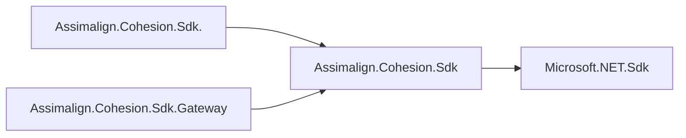

# Assimalign.Cohesion.Sdk Design

## Design intent

The base SDK is the Cohesion equivalent of `Microsoft.NET.Sdk`: a general build
foundation for plain libraries and executables. It owns defaults, framework
registrations, strongly typed settings, name-only project references, and pin
validation. It owns no application-model behavior: no SDK in the family generates a
manifest, a resource accessor, or a gateway surface. A resource makes itself a managed
instance in its `Program.cs`, and a gateway declares its model in its own.

The layered SDKs chain to the base:

The arrows show import dependencies. Each layered SDK imports the base props first and
the base targets last, then its own `Targets/` files.

## Project defaults and evaluation

`Targets/Assimalign.Cohesion.Sdk.Defaults.props` is imported before
`Microsoft.NET.Sdk` props. A direct base-SDK consumer therefore receives the
Microsoft default `OutputType=Library`. Each resource-area SDK sets the private
`_CohesionResourceSdk` marker before importing the base props, which lets that
same file set `OutputType=Exe` before Microsoft defaults it; a consumer assignment
in the project body still wins. Target-framework, language, nullable, implicit-
using, and AOT defaults remain general base-SDK policy.

The base target order is:

1. set `DisableTransitiveFrameworkReferenceDownloads` when empty;
2. import `Microsoft.NET.Sdk/Sdk.targets`;
3. import pin validation, strongly typed settings, and name-only reference
   targets.

Before step 2, a resource-area executable defaults to self-contained for the host
runtime identifier, because the App frameworks ship only as runtime packs.

## Strongly typed settings contract

`CohesionAppSettingsClass` is the sole opt-in and supplies the generated root
class name. `CohesionAppSettingsNamespace` overrides the default
`RootNamespace`. Without the class property, the target collects no inputs and
adds no generated source.

The generator merges `appsettings*.json` in ordinal-ignore-case path order.
Null values do not erase known types, integer/floating-point overlays widen to
`double`, and incompatible shapes fail the build. Generated binding uses
explicit `IConfiguration.GetEntry` calls; it does not use reflection, dynamic
activation, or `ConfigurationBinder`. Missing values preserve property
initializers. The target fingerprints the class, namespace, inputs, and task
assembly and places outputs under the target-framework intermediate directory.

## Name-only references

`CohesionProjectReference` lets repository builds name a project and carry its
resolved path separately. The base target turns resolvable items into ordinary
MSBuild project references without exposing resource-specific metadata.

## SDK pin agreement

The base validation task finds the nearest `global.json`. Every present,
recognized `Assimalign.Cohesion.Sdk*` entry is compared with ordinal string
equality; absence is allowed. The base pin is the anchor when present, otherwise
the first recognized identity in ordinal order is the anchor. This validates
agreement rather than imposing the repository's canonical version, so the local
identity is supported.

The retired `Assimalign.Cohesion.Sdk.ApplicationModel` is no longer a recognized
identity; a stale pin for it is ignored like any non-Cohesion SDK.

## Framework boundary

The base registers every `KnownFrameworkReference` but auto-includes none. It is
a library SDK like `Microsoft.NET.Sdk`; a direct executable names App explicitly.
Each resource-area SDK adds App plus App.<Area> under one
`CohesionAutoIncludeAppFramework` condition. Gateway adds no framework; it references
the gateway package only. App itself is the
transitive Assimalign project-reference closure of the hosting-kernel roots in
`libraries/App/Assimalign.Cohesion.App.props`, plus its umbrella assembly. Connections
is a kernel root because every area hosting module depends on it, and
ApplicationModel.Hosting because every area's `Hosting.ApplicationModel` integration
builds on it. Other libraries are consumed as ordinary packages.

## Diagnostics

| Code | Severity | Contract |
| --- | --- | --- |
| COHSDK002 | Error | All present recognized Cohesion SDK pins agree exactly and the pinned .NET SDK is valid and at least `10.0.300`. |

Package-boundary tests restore SDKs from `_out/packages`, exercise SDK resolution,
and compile consumer fixtures. Visual Studio compatibility tests load shipped
props and targets with .NET Framework MSBuild to reject APIs unavailable in that
host.

The shared consumer workspace derives Cohesion SDK pins from the repository's SDK families
at the package version under test. Root `global.json` supplies only the .NET SDK settings.
The Gateway SDK's tests link the same workspace (`COHESION_GATEWAY_SDK_TESTS`) and build
their own fixtures.

## Non-goals

The base SDK does not create resource manifests, generated resource or control-
plane source, image indexes, OCI archives, or application image gathers, and no
other SDK in the family does either (the `Sdk.ApplicationModel` package that did
was retired in 2026-10). Application-model composition is code.
