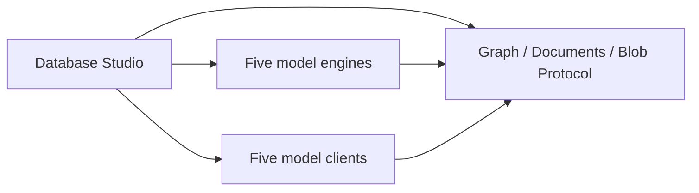

# Database Studio design

Studio deliberately composes the five embedded engines and the five remote clients. It references
Graph.Protocol, Documents.Protocol and Blob.Protocol directly for transferred values used by its
workspaces and formatter. Embedded and remote operations share those exact DTO identities; Studio
performs no conversion between duplicate shapes. SQL and KeyValuePair payload codecs arrive through
their engine and client references. The tool is outside COHDBCLIENT001's client-assembly scope.

The arrows show Studio's intentional composition:

Engine state and lifecycle stay in the embedded workspaces; remote clients own pooled transport
connections. Client errors derive from System.Exception and retain local structured diagnostics.
