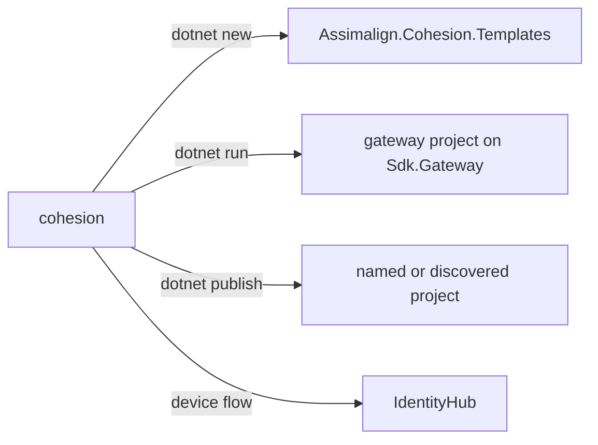

# CLI design

## Intent and authority

The CLI is a thin wrapper with no gateway semantics of its own. A gateway is an ordinary
executable whose `Program.cs` declares its model and the platform it runs on, so the CLI
delegates execution and errors to `dotnet` and to that program. Its own behavior is argument
mapping, gateway project discovery, and OIDC device login. The command reference and the single
documented template roster live in the [tooling README](../../../README.md).

The arrows are the processes and endpoints each verb reaches; the CLI references none of them
as an assembly.

## Execution and lifecycle

`CliApplication` routes commands; `IProcessRunner` is the single process-launch seam.
`ProcessRunner` uses `ProcessStartInfo.ArgumentList` without shell interpolation and inherits
stdin/stdout/stderr. Child exit codes are preserved. Ctrl+C reaches the child console;
cancellation gives it 35 seconds to stop before terminating a remaining process tree.

`Arguments` consumes known options before the first `--`. Unrecognized child arguments
and the passthrough tail retain their order and spelling. `Templates` owns the accepted
short-name list.

When either shell environment variable (`COHESION_ENVIRONMENT`, `DOTNET_ENVIRONMENT`) is
nonblank, `run` supplies `--no-launch-profile` to `dotnet run`: launch profile variables
otherwise override the inherited shell values. The injected environment reader keeps tests
independent of the developer's shell.

`GatewayDiscovery` reads project XML without MSBuild execution. SDK markers accept
attribute name/version and child Sdk forms. Explicit project paths avoid ambiguous recursive
selection. The CLI starts `run` in the gateway project's directory: an SDK 10.0.401 probe showed
that `dotnet run --project` alone retains the caller's directory.

## Gateway state

The CLI has no deploy, trust, parameter, or status verbs and keeps no local state for a gateway:
a gateway program has no command-line modes, and its record lives in the `IApplicationGatewayStore`
its `Program.cs` chooses. `publish` forwards to `dotnet publish` and adds no container-image
option.

## Login protocol and proposed credential store

`DeviceLogin` discovers the issuer's device endpoint, POSTs form data and polls the token
endpoint with the device grant. Approval is manual. `authorization_pending` continues,
`slow_down` adds five seconds to subsequent polls, and expiration/access denial stop the
flow. Cancellation covers requests and delays. HTTP redirects are disabled; credential
endpoints require HTTPS except for loopback Local endpoints. Token/error response
bodies are never included in diagnostics. `--print` reserves stdout for the access token;
approval instructions go to stderr.

The design specifies device login but no credential storage contract. Per this work item's
explicit proposal, credentials are persisted under
`~/.cohesion/credentials/<issuer-host>.json` with fields
`access_token`, `token_type`, `expires_at` and `issuer`, protected by `ProtectedFile`.
The host filename intentionally has one slot per host (ports, issuer paths and clients
collide; IPv6 colons are replaced by underscores). **Item 27 (#972) must pin or revise this
proposal.** Client secrets and device codes are not saved.

IdentityHub's landed flow is Local/loopback-only. It does not yet issue a token that a
gateway accepts; an IdentityHub-to-gateway token bridge remains later work.

## Error model and extension points

CLI usage errors use internal `CliException` and exit 2. I/O, malformed documents and
transport/startup failures exit 1 without echoing potentially secret values. Local
cancellation exits 130. Child processes return their own exit status. A new verb belongs here
only when it wraps a contract that exists; Item 39's follow-up owns unshipped templates.

## Packaging, tests and AOT

The project follows `tooling/Cli/<project>/{src,tests,docs}` for the release resolver and
shared build action. It sets `PackAsTool` and `ToolCommandName=cohesion`; assembly/package
identity stays `Assimalign.Cohesion.Cli`. Central version/branding imports remain authoritative.
The informational-version reader strips SDK commit metadata after `+`.

There is no public managed API, runtime type discovery or reflection JSON serializer.
Source-generated JSON metadata and fixed assembly informational-version metadata are
compatible with trimming/NativeAOT. The tool package itself is framework-dependent.

The test project has the explicitly sanctioned raw relative `ProjectReference`, documented
at its point of use: the Cohesion name resolver indexes only `libraries/` and `resources/`.
Production code has no project references. Tests use a fake process runner, fake HTTP,
deterministic polling time and in-repository filesystem fixtures. DPAPI tests execute on
Windows and POSIX mode checks execute on the other CI hosts.

The new tooling CLI workflow supplies the standard three-OS build/test matrix. Release
inventory and root solution edits are orchestrator-owned shared entries; the CLI requires
no framework or Dependabot change. All package verification installs use an in-repository
`_out/` tool path.
