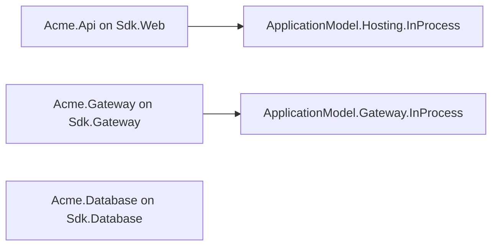

# Template package design

## Direction and scope

The package implements design item 39 and replaces the retired `extensions/dotnet` scaffold.
It owns nine short names: `cohesion-app`, `cohesion-gateway`, `cohesion-web`, `cohesion-spa`,
`cohesion-database`, `cohesion-secretstore`, `cohesion-configurationstore`, `cohesion-identityhub`
and `cohesion-rezolvr`. The application-model design every scaffold follows is
[docs/libraries/ApplicationModel/DESIGN.md](../../../../docs/libraries/ApplicationModel/DESIGN.md).

There is no runtime API or assembly reference surface for this package.
The package is L1 tooling; its output consumes the corresponding resource-area SDKs and frameworks.
The CLI wrapper belongs to item 40, and further resource-area templates are deferred until their
SDKs mature.

The diagram is `cohesion-app`'s package references: the API references the in-process
platform's instance half, the gateway its gateway half, and the database neither. No project
references another.

## No landing-zone template

The roster ships no landing-zone or composite template. A gateway is a plain program, a child
gateway joins its parent through a platform's channel (`UseParent`), and no platform with a
cross-process parent join ships from this repository, so a federated landing zone cannot be
expressed until one does. A landing-zone template belongs with the first out-of-process platform
pair, in `cohesion-platforms` or `cohesion-examples`.

## Content

`src/content/<shortName>/.template.config/template.json` is the template engine entry point.
Each identity is unique and each template supports `-n`. The only framework choice is `net10.0`.
The package project disables default item discovery, so embedded executable programs never compile
into the packaging assembly. NuGet's default exclusions are disabled to retain `.gitignore`.
The package contains exactly 11 content project files: three for `cohesion-app`, one per other
template. Each includes `Properties/launchSettings.json` with exactly one profile named after the
project and `commandName: Project`; a resource's profile sets `COHESION_ENVIRONMENT: Local`, a
gateway's sets nothing, so an explicit caller environment survives. Template name substitution
updates the profile name together with the csproj filename.

Local is the developer-machine environment. Development is an ordinary deployed environment
with strict security behavior, and the framework's unset default stays Production. Use
`dotnet run --no-launch-profile` when selecting an environment through inherited shell variables,
because launch profiles override inherited variables; the CLI does so when a shell environment
variable is supplied.

Project filenames and C# namespaces use the original `-n` casing. `cohesion-app` lowercases the
name for its gateway (`ApplicationGateway.CreateBuilder("acme")`) and resource (`acme-api`).
`cohesion-gateway` names its gateway from `--applicationName`, or the lowercased first name segment.
Resource-name symbols normalize punctuation to hyphens.

## SDK ownership and the application model

The base SDK owns `OutputType`, `TargetFramework`, `LangVersion`, `EnablePreviewFeatures`,
`ImplicitUsings`, `Nullable` and `IsAotCompatible`. None is emitted in projects or root props, and
root `Directory.Build.props` carries only `VersionPrefix`. The template package and test harness
inherit repository configuration and remain AOT-compatible.

No project sets an application-model property or item: the SDKs have none. A resource makes
itself managed in its `Program.cs`, and only where that reads as part of the scaffold's story:
`Acme.Api` calls `builder.Services.AddResource("acme-api", resource => resource.UseInProcess())`
and references `Assimalign.Cohesion.ApplicationModel.Hosting.InProcess`. The standalone resource
templates are plain applications; their READMEs show the one call that makes them managed. The
Database area has no integration yet, so the database programs say so and stay unmanaged.

## Gateway composition and platforms

A gateway project is `Sdk.Gateway` plus one platform package, pinned to `$(CohesionVersion)`. Its
`Program.cs` declares the model with `ApplicationGateway.CreateBuilder(name)` and
`AddResource(provider, name)`, registers the platform, and runs the gateway until Ctrl+C.

Both gateway scaffolds reference the in-process platform
(`Assimalign.Cohesion.ApplicationModel.Gateway.InProcess`), because it is the only platform that
ships from this repository and a scaffold must compile on its own. The in-process platform runs
each resource's program by delegate (`infrastructure.AddProgram(provider, name, MainAsync)`), which
needs the gateway to reference the resource's project and the resource to expose a public entry
point. A template cannot write that wiring across two generated projects without also changing the
resource's entry point, so the scaffolds register no program and say how in a comment and the
README; until a program is registered, deploying its resource fails. The READMEs describe the other
choice, the Kubernetes pair from `cohesion-platforms`, which replaces the in-process package and
registration and leaves the model unchanged.

## Standalone SPA routing (#1092)

`cohesion-spa` registers the routing feature through `builder.Services.AddRouting()` before
building the application. Its pipeline runs `UseStaticFiles()`, then `UseRouting()`, then maps
`MapFallbackToFile("index.html")`. Static assets retain their normal handling, and the lowest
precedence GET/HEAD fallback serves `wwwroot/index.html` for client-side routes. The nonfile
constraint examines the last path segment: `/settings` and `/releases/v1.0/settings` can fall
back, while `/assets/missing.js` remains 404. Routing and static-file support already ship in
`App.Web`; no extra package reference, reflection or runtime code generation is required.

This is a behavior break from 10.0.0-preview.1 on the HTTP/Web program's decision 15 terms:
newly generated standalone SPA applications answer client-route deep links with the page instead
of 404. Existing generated applications must add the same composition explicitly. Other templates
are unchanged.

The packed-SDK SPA run test starts the generated apphost and checks the page content for deep
links, HEAD semantics and 404 responses for missing file paths. Its process is stopped in a
`finally` block, including when an assertion fails.

## Packing and versioning

`PrepareCohesionTemplates` copies tracked content into the intermediate output before NuGet gathers
package files, then replaces `__COHESION_PACKAGE_VERSION__` in staged `global.json` files with
`$(CohesionVersion)`. `__COHESION_DOTNET_SDK_VERSION__` and `__COHESION_DOTNET_ROLL_FORWARD__`
come from the repository root `global.json`. The canonical package version and the 20 pin values
therefore agree at pack time; `.local` package pins are rejected. Source files are never rewritten.
The centralized branding import adds the standard NuGet icon.

Every template includes nuget.org mapped to Cohesion packages and `*`, plus a placeholder organization
feed mapped to the generated name prefix. It contains no machine feed or authentication material.
The generated guard uses split regular-expression spellings so it also passes the repository guard
that scans this template source.

## Acceptance lifecycle

An xUnit v2 fixture packs the package into its own workspace, installs it with `dotnet new install`,
and uninstalls it on disposal. Each process receives that workspace's `DOTNET_CLI_HOME` and
`NUGET_PACKAGES`; neither the user's template hive nor global package cache is used. Workspaces live
under `_out/verify-39/w` to stay within the repository and limit Windows path depth. An empty
`Directory.Build.targets` at the workspace boundary prevents repository targets leaking into consumer
builds; it sets no project defaults. Logs and generated projects remain available for inspection.

Feed-free assertions cover every installed template, complete inventory pins, authored programs,
source hygiene, root files and every source launch profile. They reject MSBuild elements and generated
members no SDK defines, and check that a gateway program builds its gateway under the expected name, that
a resource calling `AddResource` opts into a platform it references, and that every package is
pinned to `$(CohesionVersion)`. Name replacement and the explicit gateway name receive separate
coverage.

Feed-backed tests first repeat those assertions, then substitute only the SDK pin values and the
isolated feed config, build the generated tree, and check that no manifest or generated resource
or gateway source appears. Package requirements are derived per template from the content SDKs,
the App framework packs for the host RID, the gateway package closure for a `Sdk.Gateway` project,
and each `CohesionPackageReference` in the content together with its repository project's
`CohesionProjectReference` closure. The .NET SDK's `ProcessFrameworkReferences` also downloads
targeting packs for every registered Cohesion framework; discovery reads the base SDK's actual
registrations for this closure.

A discovery-time Fact subclass reports two permitted skips: absent exact-version packages and a base
SDK package lacking `Targets/Assimalign.Cohesion.Sdk.Defaults.props`. This keeps feed-free release
validation useful. A complete feed turns consumer build errors into failures, never skips.

## CI and inventory integration

`tooling-templates.yml` prepares the nine library packages the app and gateway scaffolds restore:
the in-process platform's two halves and their closure (Gateway, Definition, Protocol,
ApplicationModel.Hosting, the identity package, Hosting and Core). The workflow then uses the shared
build action to pack canonical SDK/framework packages for the runner's RID and build/test this
package. Package publication remains exclusively in the repository release workflow. The workflow
triggers on `libraries/ApplicationModel/**` because the gateway programs and `Acme.Api` call those
APIs directly.

The shared release module lists this package and exact-path exclusions for all 11 template content
projects.

## Database composition

Both programs import `Assimalign.Cohesion.Database` for the shared `Listen(Uri)` extension in
`Database.Tcp`, alongside their model and Hosting imports. The `App.Database` framework already
supplies that assembly, so no explicit package reference is needed. This import keeps the
standalone and app scaffolds compiling against the shared listener without changing
endpoints, schemas or application defaults.

The two Database programs (the standalone `cohesion-database` and the app's `Acme.Database`) use the three composition levels of the engine extensibility design (B1,
owner decisions 49 to 59 and 72 of 2026-10-09). `builder.AddSql("<engine>", sql => ...)` names the
engine once; inside it, `sql.Options` holds the engine's values, `sql.AddServer(server =>
server.Listen(...))` lets the model create the server (no cast to `SqlDatabaseEngine`), and
`sql.AddDatabase("<database>", database => database.Schema(...))` declares the one database the
engine owns and its schema. The engine's build, inside application `Build()`, creates the
database on first start and applies the schema before any server accepts, so the program has no
separate provisioning call. The programs declare no principals: the SQL engine refuses schema
principals at build (`COHSQLP001`) until principal and grant DDL exists (decision 58), which is why
the earlier templates failed on their first start. Every record member a table stores is
declared: `Key`, `Column`, `Index` and `References` each add the member they select as a column and
nothing else does, so a member left out of the declaration is no column, and the first write that
names it fails. Both programs read
`Database:DataPath` and `Database:Endpoint` from configuration, with a local data directory and
`cohesion-db://localhost:5740` as defaults.

This changes composition only. Template acceptance explicitly builds both emitted Database programs (the
Templates workflow runs when Database.Hosting, Database.Sql, Database.Sql.Schema, Database.Client,
Database.Sql.Client or libraries/Connections change, so an API change those programs compose
reaches template CI), and it starts the generated
`cohesion-database` once: a self-contained build for the host RID runs with a free loopback
endpoint, and the test waits for the server to accept a connection, which happens only after the
engine's build has provisioned `customers`. It then writes a full `Customer` row and reads it back
over the wire with the SQL client, and checks the database's files exist. The test project
references the SQL client from source for that; the generated programs stay package-only
consumers.
